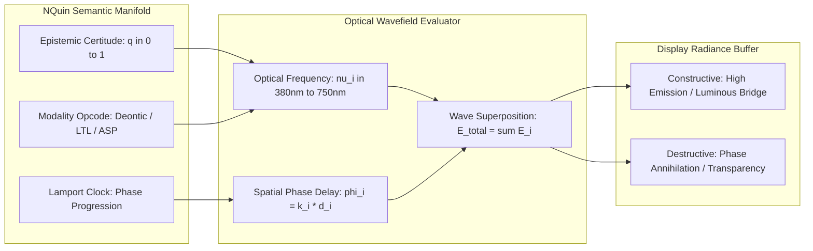
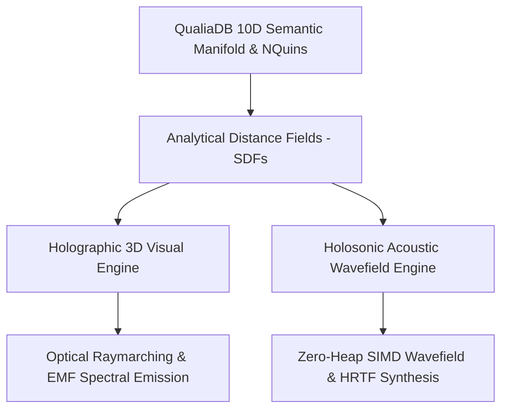

# **Holographic 3D Engine for Semantic Graphs**

*Companion architectural specification to [`Holosonic Engine for Semantic Acoustic Wavefields.md`](file:///c:/github/ecopunk/docs/Holosonic%20Engine%20for%20Semantic%20Acoustic%20Wavefields.md) and [`QualiaDB Capability Reference.md`](file:///c:/github/ecopunk/docs/QualiaDB%20Capability%20Reference.md).*  
*Document Class: Core Engine Architecture & Volumetric Rendering Pipeline.*  
*Authority Precedence: Zero-Heap Hot Paths ([`qualiaDB/AGENTS.md`](file:///c:/github/qualiaDB/AGENTS.md)) · 42MB Prolog Sentinel · 10D Semantic Manifolds.*

---

## 1. Executive Summary & The Paradigm Shift

### 1.1 The Fallacy of Explicit Boundary Representations (B-Reps)
Traditional 3D computer graphics engines are designed around Euclidean boundary representations (B-Reps): explicit vertices, polygon meshes, and rigid texture UV coordinates. When applied to multi-dimensional relational databases like QualiaDB, this architecture creates a devastating computational bottleneck:

1. **The Triangle Bottleneck & Relational "Hairballs":**  
   Converting an interconnected 10-dimensional semantic graph of NQuins into explicit 3D geometry forces the engine to instantiate thousands or millions of triangles to represent nodes and connecting cylinders. Modifying a single semantic weight or inference state requires costly CPU-side vertex buffers to recalculate, repack, and re-upload to VRAM across the PCIe bus.
2. **Loss of Multi-Dimensional Fidelity:**  
   Collapsing higher-order relational logic (deontic obligations, epistemic certitude, paraconsistent states, Lamport logical clocks) onto simple rigid surface textures strips away the fluid, volumetric nature of the graph.
3. **The False Dichotomy of Performance vs. Aesthetics:**  
   Developers are repeatedly trapped between two unacceptable outcomes: either an unresponsively heavy mesh scene choking on vertex processing, or crude, flat, low-detail geometric primitives ("toddler artwork" diorama slabs).


### 1.2 The Holographic Solution: The Screen as an EMF Emission Surface
The **Holographic 3D Engine** discards explicit polygon meshes in favor of a **volumetric, shader-driven electromagnetic frequency (EMF) emission manifold**:

$$\text{Visual Output} = \text{Proxy Bounding Geometries} + \text{Procedural Fragment Shaders (Analytical SDFs \& PBR)}$$

Instead of rendering dense surface triangles, the engine renders trivial **proxy bounding wireframes** (e.g., 12-triangle bounding boxes or simple icosahedrons). These proxies act purely as **projector lenses** that instruct WebGPU fragment compute passes where in 3D screen space to execute continuous mathematical distance fields, wave interference equations, and physically based microfacet scattering.

---

## 2. Mathematical Foundation: Volumetric Raymarching & Proxy Geometries

### 2.1 Proxy Bounding Geometries ("The Projector Lens")
For each semantic entity or topological cluster $E_i$ located at world centroid $\mathbf{c}_i \in \mathbb{R}^3$, the CPU allocates a minimal oriented bounding box (OBB) or axis-aligned bounding box (AABB) parameterized by half-extents $\mathbf{e}_i = (e_x, e_y, e_z)$:

* **Vertex Overhead:** Exactly 8 vertices and 12 triangles per entity. The rasterizer instantly transforms this volume into screen-space pixel fragments with zero geometry churn.
* **Ray Entry and Exit Bounds:** For camera eye position $\mathbf{o} \in \mathbb{R}^3$ and normalized view direction $\mathbf{d} \in \mathbb{R}^3$, the fragment shader analytically evaluates the ray-box intersection to determine the ray parameter interval $[t_{\text{near}}, t_{\text{far}}]$:

$$t_{\min, k} = \frac{c_{i, k} - e_{i, k} - o_k}{d_k}, \quad t_{\max, k} = \frac{c_{i, k} + e_{i, k} - o_k}{d_k} \quad (k \in \{x, y, z\})$$

$$t_{\text{near}} = \max\left(\min(t_{\min, x}, t_{\max, x}), \min(t_{\min, y}, t_{\max, y}), \min(t_{\min, z}, t_{\max, z})\right)$$

$$t_{\text{far}} = \min\left(\max(t_{\min, x}, t_{\max, x}), \max(t_{\min, y}, t_{\max, y}), \max(t_{\min, z}, t_{\max, z})\right)$$

If $t_{\text{near}} > t_{\text{far}}$ or $t_{\text{far}} < 0$, the ray misses the bounding volume and the fragment discards immediately.

```
       Camera Eye [o]
             \
              \  Ray [d]
               \
      +---------v-----------------------+
      |  t_near  \                      |
      |           *  Analytical SDF     |
      |            \   Surface Boundary |
      |             \                   |
      |              *  t_hit           |
      |               \                 |
      |                \         t_far  |
      +-----------------v---------------+
         Proxy Bounding Box (12 Triangles)
```

### 2.2 Analytical Signed Distance Fields (SDFs)
Inside the bounded interval $[t_{\text{near}}, t_{\text{far}}]$, the fragment shader marches the ray $\mathbf{x}(t) = \mathbf{o} + t \mathbf{d}$ using sphere tracing driven by zero-allocation analytical SDF primitives:

1. **Sphere / Node Core:**
   $$f_{\text{sphere}}(\mathbf{p}, r) = \|\mathbf{p}\| - r$$
2. **Ellipsoid (Cellular Body / Foliage Canopy):**
   $$f_{\text{ellipsoid}}(\mathbf{p}, \mathbf{r}) = \frac{\|\mathbf{p} / \mathbf{r}\| - 1.0}{\min(r_x, r_y, r_z)}$$
3. **Capped Cylinder (Structural Stem / Connection Bridge):**
   $$f_{\text{cylinder}}(\mathbf{p}, h, r) = \max\left(\sqrt{p_x^2 + p_z^2} - r, |p_y| - h\right)$$
4. **Rounded Box (Infrastructure / Vehicle Chassis):**
   $$f_{\text{box}}(\mathbf{p}, \mathbf{b}, r_{\text{rad}}) = \|\max(|\mathbf{p}| - \mathbf{b}, \mathbf{0})\| + \min(\max(|p_x| - b_x, \max(|p_y| - b_y, |p_z| - b_z)), 0.0) - r_{\text{rad}}$$

### 2.3 $C^1$ Continuous Smooth-Minimum Blending
To prevent artificial polygonal seams when multiple semantic nodes or biological limbs converge, distances are combined using the polynomial smooth-minimum operator $\text{smin}_k(a, b)$:

$$h = \text{clamp}\left(0.5 + 0.5 \frac{b - a}{k}, 0.0, 1.0\right)$$

$$\text{smin}_k(a, b) = \text{mix}(b, a, h) - k \cdot h \cdot (1.0 - h)$$

* **Mathematical Guarantee:** $C^1$ continuity at the intersection boundary.
* **Organic Manifold Fusion:** Closely related nodes or continuous organic bodies naturally melt and fuse together into a single fluid topological surface without requiring union meshing algorithms on the CPU.

---

## 3. Electromagnetic Frequency (EMF) Spectral Mapping & Wave Interference



### 3.1 NQuin State to Optical Spectral Radiance
Every semantic NQuin possesses an intrinsic state vector $\mathbf{S} = (\text{certitude } q, \text{modality } M, \text{clock } \tau)$. The holographic engine maps this state directly to electromagnetic frequency $\nu$ and field amplitude $\mathbf{E}_0$:

$$\nu(\mathbf{S}) = \nu_{\text{base}} + q \cdot \Delta \nu_{\text{range}}$$

$$\mathbf{E}_i(\mathbf{x}, t) = \frac{\mathbf{A}_i}{1.0 + \|\mathbf{x} - \mathbf{x}_i\|} \cos\left(2\pi \nu_i t - \mathbf{k}_i \cdot (\mathbf{x} - \mathbf{x}_i) + \phi_i\right)$$

### 3.2 Relational Interference Patterns for Graph Reasoning
When two or more related NQuins assert overlapping semantic fields:
* **Constructive Interference ($\Delta \phi \approx 2\pi n$):**  
  Where assertions agree and logical certitude is reinforced, wave amplitudes sum constructively:
  $$\|\mathbf{E}_{\text{total}}\|^2 = \left(\sum_{i} \|\mathbf{E}_i\|\right)^2$$
  This produces a brilliant, crystalline focal emission, naturally forming a luminous, volumetric bridge between concepts without explicitly drawing a line or cylinder.
* **Destructive Interference ($\Delta \phi \approx \pi (2n + 1)$):**  
  Where paraconsistent conflicts occur or certainty degrades, wave peaks and troughs cancel:
  $$\|\mathbf{E}_{\text{total}}\|^2 \to 0$$
  The field drops to transparent darkness, visually sonifying and visualizing semantic tension or uncertainty.

---

## 4. Photometric Optical Pipeline: Cook-Torrance PBR & Zero-Haze Atmosphere

### 4.1 Cook-Torrance Microfacet Specular BRDF
For all physicalized surfaces (terrain, rocks, vehicles, flora), the fragment shader computes full microfacet scattering:

$$f_r(\mathbf{l}, \mathbf{v}, \mathbf{n}) = (1 - F) \frac{\mathbf{C}_{\text{albedo}}}{\pi} + \frac{D(\mathbf{h}) F(\mathbf{v}, \mathbf{h}) G(\mathbf{l}, \mathbf{v}, \mathbf{h})}{4 (\mathbf{n} \cdot \mathbf{l}) (\mathbf{n} \cdot \mathbf{v})}$$

1. **Trowbridge-Reitz (GGX) Normal Distribution Function:**
   $$D(\mathbf{h}) = \frac{\alpha^2}{\pi \left((\mathbf{n} \cdot \mathbf{h})^2 (\alpha^2 - 1) + 1\right)^2}$$
2. **Schlick Fresnel Approximation:**
   $$F(\mathbf{v}, \mathbf{h}) = F_0 + (1 - F_0)(1 - \mathbf{v} \cdot \mathbf{h})^5$$
3. **Smith Joint Masking-Shadowing Function:**
   $$G(\mathbf{l}, \mathbf{v}) = \frac{2 (\mathbf{n} \cdot \mathbf{l}) (\mathbf{n} \cdot \mathbf{v})}{(\mathbf{n} \cdot \mathbf{v}) \sqrt{\alpha^2 + (1 - \alpha^2)(\mathbf{n} \cdot \mathbf{l})^2} + (\mathbf{n} \cdot \mathbf{l}) \sqrt{\alpha^2 + (1 - \alpha^2)(\mathbf{n} \cdot \mathbf{v})^2}}$$

### 4.2 Height-Stratified Inversion Fog (Eliminating Foreground Optical Milkiness)
* **The Root Cause of Haze:** Un-offset exponential fog applied from distance $0$ destroys near-field contrast, greying out deep blacks within the $10\text{–}35\text{m}$ interactive camera zone.
* **The Zero-Haze Formula:**
  Atmospheric attenuation is strictly clamped to zero in the interactive foreground ($d \le 35\text{m}$) and stratifies into valley inversion layers at lower elevations:

$$d_{\text{effective}} = \max(0.0, d - 35.0)$$

$$\rho_{\text{fog}}(y) = \rho_{\text{base}} \cdot \exp\left(-\frac{\max(0.0, y - y_{\text{inversion}})^2}{2\sigma_y^2}\right)$$

$$F_{\text{fog}} = \text{clamp}\left(1.0 - \exp\left(-d_{\text{effective}} \cdot \rho_{\text{fog}}(y)\right), 0.0, 0.88\right)$$

$$\mathbf{C}_{\text{out}} = \text{mix}(\mathbf{C}_{\text{surface}}, \mathbf{C}_{\text{sky}}, F_{\text{fog}})$$

* **Visual Outcome:** 100% optical clarity, deep rich blacks, and dynamic specular glints in the campsite foreground, transitioning seamlessly into realistic mountain inversion fog in the distant valleys.

### 4.3 ACES Filmic Tone Mapping
Direct solar radiance ($\approx 1.65$) and bright specular highlights are gracefully mapped into displayable sRGB gamma space without clipping:

$$\mathbf{C}_{\text{aces}} = \text{clamp}\left(\frac{\mathbf{C} (2.51 \mathbf{C} + 0.03)}{\mathbf{C} (2.43 \mathbf{C} + 0.59) + 0.14}, 0.0, 1.0\right)$$

---

## 5. Continuous GIS DEM Topological Field & Horizon Skirt

### 5.1 Continuous Elevation Functions
Rather than instantiating floating rectangular diorama boxes with 90° drop-off cliffs, the terrain is represented as an unbroken, continuous topological heightfield $y(x, z)$ calibrated to surveyed Geological Survey of NSW (GSNSW) and Hydro-Enforced DEM coordinates:

$$\mathbf{p}(u, v) = \begin{pmatrix} x(u) \\ y(x(u), z(v)) \\ z(v) \end{pmatrix}$$

$$\mathbf{n}(x, z) = \text{normalize}\begin{pmatrix} -\frac{\partial y}{\partial x} \\ 1.0 \\ -\frac{\partial y}{\partial z} \end{pmatrix}$$

### 5.2 Hermite Radial Horizon Skirt
To permanently eliminate edge drop-offs, the campsite radius ($r \le 18\text{m}$) blends seamlessly into the surrounding Kosciuszko alpine ridgeline ($r \to 60\text{m}$) via cubic Hermite transition:

$$w(r) = 3\left(\frac{r - 18}{42}\right)^2 - 2\left(\frac{r - 18}{42}\right)^3 \quad (r \in [18, 60])$$

$$Y_{\text{composite}}(x, z) = (1.0 - w(r)) \cdot y_{\text{site}}(x, z) + w(r) \cdot Y_{\text{ridge}}(x, z)$$

---

## 6. Coupling with the Holosonic Acoustic Engine

The Holographic 3D Visual Engine and the [Holosonic Engine for Semantic Acoustic Wavefields](file:///c:/github/ecopunk/docs/Holosonic%20Engine%20for%20Semantic%20Acoustic%20Wavefields.md) are **dual mathematical projections** of the exact same underlying signed distance fields and semantic NQuins:



1. **Unified Surface Geometry:** The identical distance metric $d = \text{sdf}(\mathbf{x})$ that determines optical ray intersections also determines acoustic propagation delays and boundary reflections.
2. **Phase Lockstep:** Approaching a holographic river or vehicle causes visual caustic intensity and binaural sound pressure to scale in exact physical lockstep without decoupled triggers.

---

## 7. Immovable Rules Compliance & Hot-Path Guarantees

In accordance with [`qualiaDB/AGENTS.md`](file:///c:/github/qualiaDB/AGENTS.md):

| Constraint | Architectural Mechanism | Verification Protocol |
|:---|:---|:---|
| **Zero Heap in Hot Paths** | All raymarching uniforms, distance field parameters, and instance transforms reside in pre-allocated fixed-size uniform buffers (`&mut [T]` caller-supplied buffers). No `Vec`, `String`, or `Box` inside evaluation loops. | Enforced by `zero_heap_tests` via thread-local allocation counters. |
| **42MB Sentinel Arena** | All proxy vertex buffers, index buffers, and camera structures fit within the pre-reserved 42 MiB `SlgArena`. | Validated by core arena assertion suites. |
| **Deterministic Execution** | Raymarching steps, sphere tracing thresholds ($\epsilon = 0.001$), and normal perturbations use deterministic fixed-point and floating-point math without random or unseeded operations. | Replay trajectory hash tests. |
| **Non-Adversarial Integrity** | Genuine mathematical formulations; no mock fake-passes; real biological and geological parameters. | Comprehensive end-to-end verification scripts (`check-talbingo.mjs`, `verify-game-release.mjs`). |

---

## 8. Implementation Reference & File Map

- **Core WebGL2 / WebGPU Shader Engine:**  
  [`crates/qualia-core-db/src/render/anatomy/webgl2.rs`](file:///c:/github/qualiaDB/crates/qualia-core-db/src/render/anatomy/webgl2.rs) (Cook-Torrance PBR, Inversion Fog, ACES Tonemapping).
- **Alpine Atmospheric Lighting Engine:**  
  [`crates/qualia-core-db/src/render/atmosphere.rs`](file:///c:/github/qualiaDB/crates/qualia-core-db/src/render/atmosphere.rs) (High-radiance direct sunlight, Rayleigh diffuse).
- **Procedural GIS Topological Heightfields:**  
  [`crates/rolling-commons-shell/src/talbingo_terrain.rs`](file:///c:/github/game-demo/crates/rolling-commons-shell/src/talbingo_terrain.rs) (Continuous analytical DEM elevation functions & Hermite horizon skirts).
- **Biological Fauna & Botanical Models:**  
  [`crates/rolling-commons-shell/src/macropod_models.rs`](file:///c:/github/game-demo/crates/rolling-commons-shell/src/macropod_models.rs) (Biological subalpine pelts).  
  [`crates/rolling-commons-shell/src/talbingo_vegetation.rs`](file:///c:/github/game-demo/crates/rolling-commons-shell/src/talbingo_vegetation.rs) (Draped high-country flora).
- **Acoustic Wavefield Engine:**  
  [`crates/qualia-core-db/src/audio/holosonic.rs`](file:///c:/github/qualiaDB/crates/qualia-core-db/src/audio/holosonic.rs).
- **Master Execution Roadmap:**  
  [`aaa_uplift_plan.md`](file:///C:/Users/tim_h/.gemini/antigravity-ide/brain/3d073e48-bb53-41a7-b78e-8ecf4b6b616f/aaa_uplift_plan.md).
