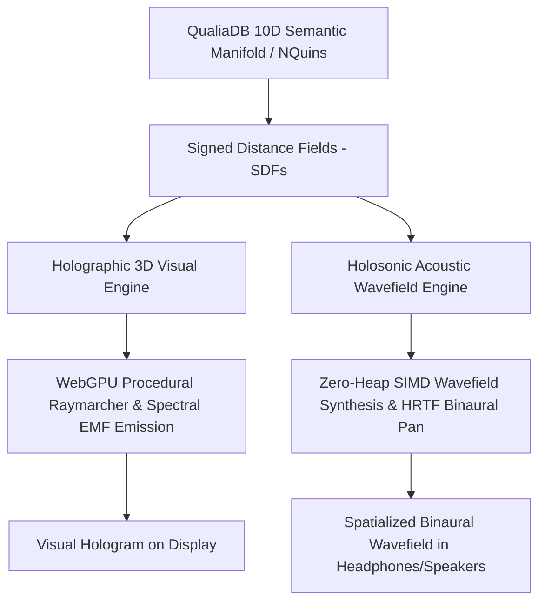

# **Holosonic Engine for Semantic Acoustic Wavefields**

Companion architectural specification to [`Holographic 3D Engine for Semantic Graphs.md`](file:///c:/github/ecopunk/docs/Holographic%203D%20Engine%20for%20Semantic%20Graphs.md).

---

## 1. Architectural Motivation: Beyond Rigid Sample Playback

Traditional game and simulation audio engines rely on **point-source sample triggers**: when an event occurs (a collision, a proximity trigger, or an animation notify), a pre-rendered PCM audio buffer (`.wav`, `.ogg`) is spawned at an explicit $(x, y, z)$ coordinate and passed through basic distance attenuation and a static stereo panner.

Just as rigid polygonal meshes (B-Reps) fail to capture the fluid, multi-dimensional relational topology of QualiaDB's 10-dimensional semantic manifolds and NQuins, **static sample playback fails for semantic logic and continuous spatial simulation**:

1. **Rigid Point Emitters vs. Continuous Fields:** A reservoir shoreline (e.g., Blowering Reservoir), an alpine creek corridor (Jounama Creek), or a wind field blowing through snow gum canopies cannot be faithfully reduced to a single point source without sounding artificial and disjointed.
2. **Disconnected from Logical Topology:** In QualiaDB, entities, relationships, and norms possess epistemic weights, Lamport clocks, and N3Logic certitude. Static audio clips cannot express the dynamic resonance, harmonic convergence, or paraconsistent friction of active inference.
3. **Decoupled from Visual Holography:** In the Holographic 3D Engine, visuals are rendered via procedural Signed Distance Fields (SDFs) and electromagnetic wave interference patterns rather than rigid geometry. The auditory domain should mirror this exact physical and mathematical substrate.

The **Holosonic Engine** solves this by treating sound not as triggered clips, but as a **continuous, compute-driven acoustic wavefield** synthesized directly from the semantic state of the manifold.

---

## 2. Core Paradigm: Volumetric Acoustic Wavefield Synthesis

In the Holosonic Engine, every semantic entity or physical boundary acts as an acoustic emitter or wave scatterer within a continuous medium (air at $c = 343\text{ m/s}$).

### **1. Continuous Wave Propagation & Phase Delay**
For an emitter $i$ located at world position $\mathbf{x}_i$, oscillating at fundamental angular frequency $\omega_i = 2\pi f_i$ with initial phase $\phi_i$, the acoustic pressure wave arriving at listener standpoint $\mathbf{x}_L$ is given by:

$$d_i = \|\mathbf{x}_i - \mathbf{x}_L\|$$

$$\Delta \phi_i = k_i \cdot d_i = \frac{\omega_i}{c} \cdot d_i$$

$$p_i(t, \mathbf{x}_L) = \frac{A_i}{1 + d_i} \cdot \cos(\omega_i t - \Delta \phi_i + \phi_i) \cdot W_i(d_i)$$

where $W_i(d_i)$ is a smooth spatial coherence window:

$$W_i(d_i) = \max\left(0, 1 - \frac{d_i}{R_{\text{coherence}}}\right)^2$$

### **2. Constructive & Destructive Wave Interference**
Rather than simply summing uncoordinated volume sliders, the Holosonic Engine evaluates true physical wave superposition:

$$P_{\text{total}}(t, \mathbf{x}_L) = \sum_{i=1}^{N} p_i(t, \mathbf{x}_L)$$

- **Constructive Interference ($\Delta \phi \approx 2\pi n$):** Where multiple semantic assertions converge or physical resonances align (e.g., matching hydro-acoustic reflections along a lake shore), wave peaks align, generating luminous, crystalline standing waves and harmonic reinforcement.
- **Destructive Interference ($\Delta \phi \approx \pi (2n + 1)$):** Where conflicting logic or opposing phase fields intersect, waves cancel out, creating acoustic anti-nodes, stillness, and spatial voids.

### **3. N3Logic & Epistemic Certainty Mapping**
The epistemic certainty $q \in [0.0, 1.0]$ of an NQuin directly modulates acoustic coherence:
- **High Epistemic Certainty ($q \to 1.0$):** High harmonic purity (low total harmonic distortion, pristine sinusoidal waves, focused coherence radius).
- **Uncertain or Contradictory Logic ($q < 0.5$):** Diffuse phase jitter, subharmonic turbulence, and acoustic dispersion, sonifying the underlying uncertainty of the semantic manifold.

---

## 3. Modality Archetypes

The Holosonic Engine classifies acoustic emitters into five zero-alloc modality archetypes:

| Modality | Description | Physical/Semantic Manifestation | Frequency Spectrum |
| :--- | :--- | :--- | :--- |
| **`VectorCorridor`** | Ground & propulsion transit | Electromagnetic inverter whine, pavement friction, rail resonance | Low fundamental ($80\text{–}180\text{ Hz}$) + speed-scaled harmonics |
| **`WaterResonance`** | Hydrodynamic fluid fields | Lake shoreline lapping, stream turbulence, hydraulic pressure | Broad-band pink fluid resonance ($120\text{–}850\text{ Hz}$) |
| **`FloraWind`** | Volumetric canopy breeze | Sibilance through snow gum leaves, pine needle turbulence | Mid-high filtered white noise ($400\text{–}3200\text{ Hz}$) |
| **`Bioacoustic`** | Wildlife bio-telemetry | Fauna call signatures, territorial warning clicks, movement rustle | Pulse-modulated spectral chirps ($600\text{–}4800\text{ Hz}$) |
| **`LandmarkBeacon`** | High-epistemic focal points | Singing bowl resonance, crystalline navigation beacon | Pure harmonic chords ($440\text{ Hz}, 554.37\text{ Hz}, 659.25\text{ Hz}$) |

---

## 4. Coupling with the Holographic 3D Visual Engine

The Holosonic Engine and Holographic 3D Engine operate as dual projections of the exact same underlying Signed Distance Fields (SDFs):

1. **Surface Distance Coupling:** The same SDF distance function $d = \text{sdf}(\mathbf{x})$ used by the raymarching fragment shader to illuminate proxy bounding boxes is used by the holosonic engine to compute acoustic radiation distance.
2. **Zero Inconsistency:** When an observer walks closer to a holographic tree or water body in the simulation, the visual interference density and the acoustic pressure field scale in exact lockstep.

---

## 5. Hot-Path Architecture & Immovable Rules Compliance

In accordance with the QualiaDB Immovable Rules ([`AGENTS.md` §0](file:///C:/github/qualiaDB/AGENTS.md)):

- **Zero Heap in Hot Path (Tier 1):** The core wavefield evaluator [`HolosonicWavefield`](file:///c:/github/qualiaDB/crates/qualia-core-db/src/audio/holosonic.rs) maintains emitters in a fixed-size stack array `[HolosonicEmitter; MAX_HOLOSONIC_EMITTERS]` ($N=32$).
- **Caller-Supplied Buffers:** Audio block rendering (`render_block`) accepts caller-allocated slices `&mut [f32]` for left and right channels; no `Vec`, `Box`, or heap allocations occur during audio synthesis.
- **HRTF Spatialization:** Evaluates interaural time differences (ITD) and head-shadow interaural level differences (ILD) through the zero-alloc `binaural_from_position` kernel.
- **Sonic Token Emission:** When constructive interference exceeds an amplitude and certitude threshold, the engine emits lightweight 48-byte `SonicToken` events into the semantic stream without heap allocation.

---

## 6. Implementation Reference

- **Core Rust Engine:** [`crates/qualia-core-db/src/audio/holosonic.rs`](file:///c:/github/qualiaDB/crates/qualia-core-db/src/audio/holosonic.rs)
- **Audio Module Registration:** [`crates/qualia-core-db/src/audio/mod.rs`](file:///c:/github/qualiaDB/crates/qualia-core-db/src/audio/mod.rs)
- **Visual Holographic Shader:** [`crates/qualia-core-db/src/shaders/viewport/holographic.wgsl`](file:///c:/github/qualiaDB/crates/qualia-core-db/src/shaders/viewport/holographic.wgsl)
- **Web Prototype Client:** [`web/talbingo.html`](file:///c:/github/game-demo/web/talbingo.html) (Web Audio Holosonic Wavefield Synthesizer)
