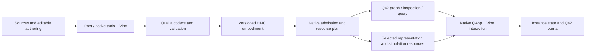

# Ecopunk architecture — native stack and embodied entities

**Status:** specification draft v0.4 · **Updated:** 2026-10-24.
The governing decisions below record Timothy's 24 October clarifications.
Detailed schemas and APIs remain proposed until qualified with their upstream owners.
This architecture document alone does not authorize sibling-repository edits.
For the asset-production blockers, Timothy confirmed on 2026-10-27 that
task-relevant Poet, QualiaDB and Etalon implementation is authorized, subject
to filesystem permissions and coordinated ownership.

VibeScript is the shared authored application/REPL language. The
[comprehensive proposed 0.2 contract](tech/vibescript-0.2-specification.md) and
[REPL/host contract](tech/vibescript-0.2-repl-and-host-contract.md) define source
evaluation without per-script Rust/Cargo/JS builds, persistent sessions, typed
capabilities and safe live native authoring. Bytecode is optional. The current
inspected dialect remains 0.1; preserve pinned behavior and qualify proposed
changes through ENG-13/G89 rather than silently claiming a released upgrade.

## 1. Purpose and governing decisions

**Primary domain clarification, 2026-10-26:** Ecopunk's foundation is the living
Earth: flora, fauna including insects, funga, microorganisms and their geological,
soil, water and atmospheric context. Made-world and civics applications build
upon it. The [biosphere, Earth and anatomy capability programme](tech/biosphere-earth-and-anatomy-capabilities.md)
extends the existing native requirements to shared multiscale authoring,
scientific presentation and reviewed biology/anatomy education. An equipment
fixture cannot qualify that breadth, and attractive rendering cannot establish
scientific or educational accuracy. Reuse existing native capabilities and
qualify each consumer/domain rather than introducing another implementation stack.

Ecopunk is both an application/content ecosystem and an applied research and
development driver for **QualiaDB and its custom dependency stack**. Success
requires the stack itself to acquire and exercise the necessary capabilities.
A similar-looking result delivered through a substitute stack does not meet
that purpose.

| ID | Binding requirement | Acceptance contract |
|---|---|---|
| REQ-NAT-001 | Native product authoring, packaging and runtime MUST use the Qualia-native stack; JavaScript, Node.js and V8 MUST NOT be required to author, build, inspect, query, simulate or present an Ecopunk embodiment through that native workflow. | The complete workflow runs in a declared native environment with no JS/V8 runtime. A browser screenshot or Node exporter cannot establish this. |
| REQ-NAT-002 | Vibe owns authored interaction, policy and orchestration; native bounded kernels, codecs, solvers and GPU work execute through public engine capabilities. | Each operation has an identified authoring entry point, state owner and engine/dependency API; unsupported capability produces a gap record. |
| REQ-NAT-003 | Missing general capability MUST be developed in the appropriate custom dependency, with its requirements and acceptance cases recorded here. | An upstream work packet identifies the owning library, public interface, compatibility, bounds, positive/negative cases and evidence needed. Implementation authority is allocated separately. |
| REQ-NAT-004 | A complete species embodiment MUST distribute as HMC, including its available graph corpus and associated resources at an identified revision. | Species completeness and selective resource use satisfy the [species contract](tech/assets/species-embodiment-spec.md). A mesh with labels does not meet this requirement. |
| REQ-NAT-005 | Natural entities, human-made entities, their representations and their package releases MUST have distinct identifiers and domain contracts. | A species, a particular organism, an artefact design, a manufactured vehicle, its depiction and its HMC release cannot be substituted for each other. |
| REQ-NAT-006 | Alternate visual representations MUST resolve to the same referent and applicable state, independently of style, scale, resolution or device profile. | A style switch changes depiction; it preserves graph facts, component identifiers and authoritative state. |
| REQ-NAT-007 | Every model/embodiment completion declaration MUST account for every deliverable and expanded case through versioned claims, evidence and required reviews, including film, open-world game and cartoon profiles. | The [completion contract](tech/assets/model-completion-claims.md) and [template](tech/assets/model-production-template/README.md) identify missing/partial/blocked/stale work; a complete claim cannot bypass an open row. |
| REQ-NAT-008 | Poet MUST be the unified authoring interface; Craft-related reusable crates/domain engines are consolidated under `C:/github/craft` and integrated through the shared native contracts. | [Poet/Craft consolidation](tech/poet-craft-consolidation.md) preserves/reconciles existing Poet functionality and ports domain controls into its tool chest, containers, inspectors and timelines; eleven standalone app shells are not the integration result. |
| REQ-NAT-009 | Aether, the Dioxus fork at `C:/github/rust-app-framework`, MUST be the controlled framework foundation for evolving the Webizen Desktop native launcher/host and harmonised application projections. | [Environment/framework contract](tech/webizen-environment-framework.md) qualifies actual fork resolution, native backend, launcher/service behaviour and shared Poet/application integration. |
| REQ-NAT-010 | Harmonised WASM versions MUST share application semantics and use authorized native environment capabilities where required, with explicit availability, ownership and recovery contracts. | Native, WASM-local and native-assisted WASM cases identify actual execution, dependencies, compatible versions and results; unsupported native operations remain visible rather than acquiring substitute logic. |
| REQ-NAT-011 | Chora, the Servo-derived engine at `C:/github/chora`, MUST retain a separate source/workspace/license boundary from the other code bases. | [Chora boundary](tech/chora-engine-boundary.md) requires generic integration interfaces, host-owned adapters, separate provenance and qualified dependency/distribution closure; Chora is excluded from Craft consolidation. |
| REQ-NAT-012 | Etalon, the developed wgpu fork at `C:/github/etalon`, MUST be assessed and used according to its actual local capabilities, selected features and qualified consumer path. | [Etalon handoff](tech/etalon-capability-handoff.md) reconciles implemented extensions and historical completion evidence; the [production backlog](tech/ecopunk-production-backlog.md) traces requirements through authored HMC content to actual reviewed output. Upstream wgpu descriptions do not establish Etalon's limits. |
| REQ-NAT-013 | Ecopunk MUST produce accepted high-grade masters and explicit reviewed delivery derivatives without allowing game/device budgets to lower master quality. | [High-grade production contract](tech/high-grade-production-and-civics-experience.md) qualifies editable sources, full HMC knowledge/resources, source-to-derivative lineage and preserved identifiers/form/function across required profiles. |
| REQ-NAT-014 | Content/tool development MUST serve understandable civics spatial experiences in game-demo related to dev.civics.au and advance integrated Webizen exploration/knowledge/authoring. | The same contract requires credible places/species/systems, a bounded civics case, actual consumer use and identifiers/state/provenance continuity through native/WASM and Poet workflows. |

These requirements govern the intended product, not just its frame loop.

The [identifier association rule](domain-model.md#dom-ax-7-multiple-identifiers-can-refer-to-one-subject)
applies across layers: several identifiers may refer to one topic/subject/entity/
agent/actor. Preserve their scheme, scope, provenance, validity and qualified
mappings without collapsing distinct referents, parts, roles or releases.
Native authoring, packaging and runtime retain their JS/Node/V8-independent
requirement. Existing JS-owned product logic remains implementation debt.
Timothy's subsequent framework clarification also requires supported WASM
versions, including authorized use of running native services. They share
authored Vibe/Rust rules and contracts with native applications; generated
browser/platform binding dependencies must be declared and qualified, not
misrepresented as native no-JS proof or expanded into a second state engine.

## 2. Responsibility map

| Layer | Responsibility |
|---|---|
| Ecopunk | Domain specifications; acquired/curated corpus; entity families; reference material; authored models/rules; product compositions; acceptance scenarios. |
| Aether application framework | Dioxus fork at `rust-app-framework`: shared component/reactivity/layout/input/accessibility and native/WASM rendering/host integration seams, with controlled version/feature evolution. |
| Chora engine, separate code base | Servo-derived web/spatial document engine at `chora`; generic embedding interfaces, independent source/license provenance and host-owned adapters outside the engine. Exact host/backend role needs qualification. |
| Webizen Desktop native environment | Launcher and app/window/session lifecycle, authorized native/platform/service mechanisms, provider readiness and WASM/native capability connection. Reconcile useful existing host/OS-shell source without prescribing the failed desktop UX. |
| Poet | Unified authoring interface with harmonised native and WASM projections for graph, geometry/CAD, materials, rigging, media, behaviour and package release construction. Retain/recover the existing Poet composition and interaction model. |
| Craft libraries/domain engines | Reusable extracted medium-specific editing, documents, codecs and capabilities under one `craft` directory; supply Poet controls/surfaces through shared contracts, not independent mandatory studio UIs. |
| Vibe / native QApp hosts | Authored selection, inspection, orchestration, governed actions and presentation intent over public APIs. |
| QualiaDB and custom libraries | Identifiers/graph queries, Q42/HMC/10D codecs, admission, state/journal, geometry, physics, rendering, audio and bounded resource services. Use the existing owning library rather than duplicating it in Ecopunk. |
| Etalon GPU/dependency layer | Developed wgpu fork at `etalon`: graphics/compute API, validation/HAL, Naga and extended resource/forge/graph/tensor/render/WASM surfaces. Reconcile actual feature/consumer ownership with QualiaDB; qualify and extend it when the applied use-case reveals gaps. |

This map is a requirement allocation, not a claim that every seam is implemented.
The [biosphere integration review](tech/biosphere-graph-spectra-and-streaming.md)
adds cross-crate reuse, physically typed EMF/environmental cues and native
Q42-selected HMC resource streaming. `qualia-sim` depends on Core; host/sim-side
adapters preserve that dependency direction. Q42 relationships, typed resources,
authoritative simulation state and visual/audio projections retain distinct
owners; a separate application graph or renderer-owned biological truth is not
an integration shortcut.
The [engine register](tech/engine-requirements.md) records existing evidence and
open work. [Development modes](tech/development-modes.md) retains the upstream
authorization boundary: investigate and specify; Timothy allocates engine edits.

The [native production toolchain specification](tech/assets/production-toolchain-spec.md)
maps the actual Poet/Craft repositories to production roles, current evidence,
missing 3D/animation/package handoffs and TOOL-01–12 enablement packets. Installed
studio names do not establish a complete production capability.

## 3. Entity, embodiment and occurrence

An **entity** is what is being described. An **embodiment** is its integrated,
inspectable body of knowledge, resources and operational definitions. An
**HMC release** is the immutable distribution snapshot carrying that embodiment.
A **representation** depicts the entity. An **instance** is a particular real
or synthetic subject with its own identifiers, time, context and state.

Species templates, organism instances and observations follow the natural-world
contract. Designs, manufactured instances, assemblies and installed systems
follow the [made-world contract](made-world.md). Both use the shared
[package contract](tech/assets/asset-package-spec.md) and per-asset requirements.
People and social institutions retain sociosphere identifiers and authority; they
are not manufactured components or owned contents of a scene.

## 4. Flow through the native stack

All graph data in a release can be packaged while only a bounded working set is
resident. Fetching or decoding a selected representation's dependency closure
does not redefine the contents or completeness of the distributed embodiment.

## 5. Specification order and open work

Settle identifiers/domain distinctions, completeness, package/root/variant semantics,
state ownership and native API contracts before commissioning further graphics
implementation. Then qualify one species family and one made-world assembly
through those contracts. Visual quality remains required, using actual native
output and the representation's declared target.

Open decisions: exact family metadata encoding and vocabulary bindings;
versioned public native APIs; completeness/import reconciliation mechanics;
cross-release representation-extension admission; capability evidence for each
native host. None permits JavaScript/V8 substitution or a reduced mesh-only
species package.

Framework/launcher/WASM decisions and current source evidence are consolidated
in [webizen-environment-framework.md](tech/webizen-environment-framework.md).

The [120-packet production backlog](tech/ecopunk-production-backlog.md) now
coordinates specification decisions, stack evidence, native pipeline, authoring,
content, review and harmonised delivery. A good reviewed reference scene precedes
broad production expansion; it need not wait for every independent R&D objective.
An existing crate called `desktop` is not by itself a native renderer; the
chosen backend and actual fork/dependency closure require qualification.
