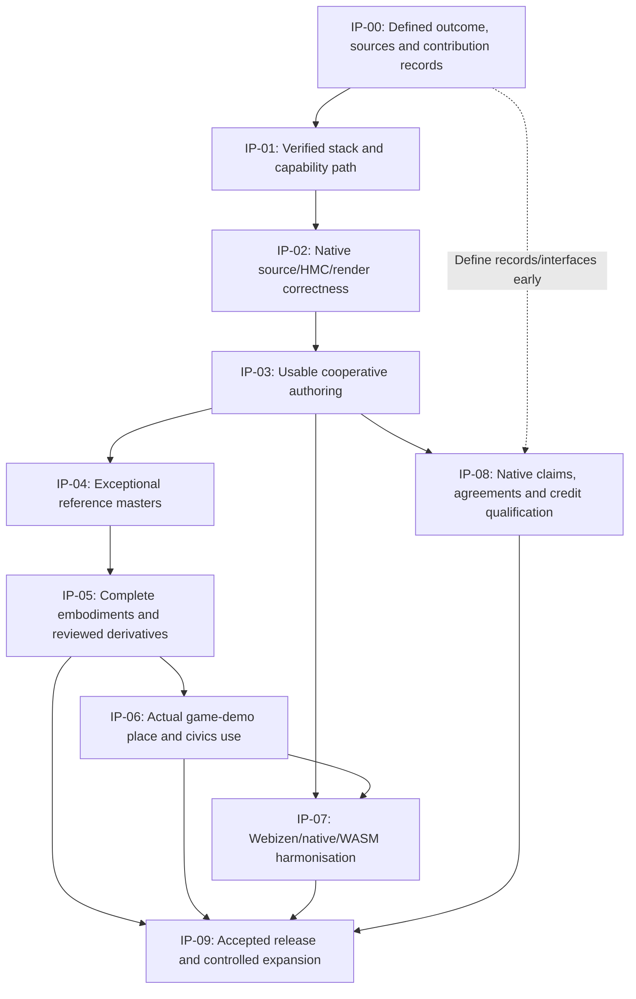

# Ecopunk implementation plan — cooperative tools, exceptional assets, game-demo

**WASM priority, 2026-10-29:** Timothy clarified that WASM is the most important export for the active species round. Native support was disabled during engine upgrades; repairing that host is outside this critical path. Use the existing authoring/model capabilities and current improved scene builders to deliver high-quality browser-reviewable assets. The owned native dependency rebuild was stopped. Native product requirements remain recorded for their later work; they are not a new prerequisite to these WASM candidates. Timothy's and authorized contractor review remains authoritative for acceptance.

**Species production resumed, 2026-10-29:** Timothy requested continued improvement toward publication, selected white gum and swamp wallaby, and required a separate species producer for each plus independent coordination review and his own review before acceptance. The [active round dispatch](species-production-round1.json) bounds the work and [independent review record](../qa/implementation-2026-10-29/species-review-round1/coordinator-review.md) records findings. This subsequent instruction activates bounded source authoring, necessary serial native builds/checks and candidate exports for these subjects; older research-only/HOLD wording does not prevent this round. Existing IP/ECO/model requirements remain. Neither agent review nor a render constitutes Timothy's acceptance, complete species delivery, native Poet usability qualification or permission to publish. Preserve prior sources, evidence and working-tree changes.

**Managed documentation delivery, 2026-10-28:** [the whole-biosphere implementation document set](whole-biosphere-implementation/README.md) supplies a coordinated critical path, corpus/inference and user-defined estimation contracts, living-system and Earth/space packets, Poet/Etalon delivery seams, and acceptance evidence. It retains this plan's phase order and existing job register; its proposed implementation packets are for consideration, not implicitly activated by research completion.

**Whole-biosphere scope reconciliation, 2026-10-28:** [the outstanding-work view](tech/whole-biosphere-uplift-outstanding-work.md) covers animals, plants, funga, microorganisms, habitats, terrain/geology/soil, water, atmosphere and space weather, plus the existing made-world/civics scope. Botanical work is a bounded starting case. This view expands existing BSA/ECO/IP obligations without replacing their phase order or treating uninspected code as absent. Later user instructions permitted a bounded asset attempt; its current M64-related export pause must not be confused with the older blanket HOLD wording retained below. No new build, test or export is activated by this documentation revision.

**Recovery correction, 2026-10-28:** the requested [Poet incident and remediation record](../qa/implementation-2026-10-27/human-authority-round1/poet-continuity-incident-and-remediation.md) documents the missed original-workspace continuity, modular repository intent and newly identified unreachable junction-adoption route. Follow its [asset-production recovery outline](../qa/implementation-2026-10-27/human-authority-round1/asset-production-recovery-outline.md), including the already registered TERN/RDF species-information pipeline. Preserve this governing phase order, current testing/rebuild deferral and existing work; an installed native source slice is not evidence of the requested product experience.

**Botanical critical-path execution, 2026-10-28:** the [managed swarm execution annex](botanical-production-swarm-execution.md) assigns disjoint geometry, source/control, surface-continuity, resource and persistence work against the latest installed junction snapshot. It defines a coding-complete milestone before Poet tests/rebuild, then serial qualification and the native first-production workflow. It preserves this phase order, IP-03 C1–C8, the existing job register, current production HOLD and the later complete-package obligations. Installed source is distinguished from tested or accepted behavior.

**Full-scope execution update, 2026-10-27:** Timothy requested a comprehensive implementation plan and immediate implementation using managed swarms. The [full authorship and presentation execution companion](full-authorship-presentation-implementation.md) allocates the existing IP-00–09 sequence, PA-01–12 and the complete production/claim scope; it does not replace this governing phase order. Concrete active assignments and results are recorded in the [current round evidence](../qa/implementation-2026-10-27/full-scope-round1/README.md). Preserve existing work, the production HOLD and the distinction between tested software, an actual native operator workflow and accepted content.

**Coordination update, 2026-10-27:** Timothy authorised testing and repairs; the [post-update qualification](../qa/implementation-2026-10-27/post-update-qualification/README.md) records the earlier repaired snapshot. The current bounded native controller-rights/contributor-reviewer round is integrating verified owners and usable review selection; see the [current production-blocker audit](../qa/implementation-2026-10-27/human-authority-round1/asset-production-blockers.md). Direct author/edit/save/render under existing project/controller admission does not require a new personhood or credential-provider service. Delegated-agent permissions and independent-review claims retain their applicable authority requirements. Human/domain review can occur during production; it is not a universal prerequisite to beginning authoring. Asset-production HOLD remains Timothy's project instruction pending the relevant operation-specific foundations; these changes do not release it or waive package acceptance.

**Human principal / agent authority, 2026-10-26:** Authentication must preserve an admitted human principal and the scoped, expiring, revocable rights of separately authenticated agents. Apply the [hierarchy contract](tech/human-principal-agent-authority.md). Concurrent-session diagnostics do not prove a human delegation chain or independent review. AUTH-H1–H6 refine the existing IP-03 cooperation gates and remain open pending implementation/qualification.

**Status:** implementation plan v0.8, bounded biosphere authoring implementation active · **Date:** 2026-10-26.
**Execution status:** implementation packets remain open; this document is not a
build, native qualification, model acceptance or completed-product claim.

**Current instruction, 2026-10-26:** Timothy requested updating the plans and starting the next implementation swarms. The [active round 1](biosphere-authoring-round1.md) dispatches simultaneous project sessions, native botanical organ/graph editing and animal rig/preview integration under IP-03. The [job register](biosphere-work-packets.json) records exact ownership and current states. All fifteen image cases are [implemented and engineering verified](../qa/implementation-2026-10-26/image-completion/README.md); older deferred statements are historical. Asset production remains HOLD, and whole FND/IP-03 and human/domain gates remain open. The rest of this document retains the original phase order, requirements and historical evidence.

**Reuse-first allocation:** before proposing a missing capability or replacement,
trace current owner/public API, host/consumer, tests and applicable prior receipts.
The bounded nine-location audit is a source input, not a complete engine audit.
Extend it only where the selected product operation needs more evidence; do not
make reading every library a new prerequisite for the first useful outcome.

The user has authorized implementation using cost-routed, suitably scoped
sub-agents. The [execution dispatch](implementation-dispatch.md),
[role contracts](implementation-agent-roles.json) and
[dependency-ordered queue](implementation-queue.json) allocate bounded jobs;
[execution evidence](../qa/implementation-2026-10-24/README.md) records actual
changes/checks separately from broad packet acceptance. No model/package or
whole-phase readiness follows from a diagnostic subjob finishing.

The [second implementation batch](../qa/implementation-2026-10-24/batch-2/README.md)
applies the canonical full-input parser, transitive effect checker, persistent
checked session and source-restoring revision journal. Actual target checks and
the native Poet/Aether authoring mount are tracked there. These prerequisites
advance IP-03; exceptional editable masters, cooperative workflow acceptance and
complete source/HMC/game-demo delivery remain the governing outcome.

**Priority clarification, 2026-10-25:** before further reference asset polish,
qualify the existing ecosystem format/SDK path under
[format and SDK foundation](tech/format-sdk-foundation.md): a canonical checked
M64 reader with truthful raw geospatial writing, and a `.10d` MID2 typed-sidecar
resolver that preserves normal, morph and scientific payloads together. This
is bounded foundation work within IP-01/IP-02 and their existing owners; it does
not reorder the governing phases, waive IP-03 C1–C8, or qualify later asset
production. Round 2 captures the actual source findings before revising later
round estimates. Keep payments later. Poet remains the unified authoring product
and its existing UX baseline is preserved; `poet-geometry` and
`poet-spatial-authoring` are internal libraries refactored into Poet. Historical
Craft workspace code is a migration/reference source, not the product target.

The [Round 3 progress record](../qa/implementation-2026-10-25/batch-6/rounds/round3/progress.md)
tracks the subsequent developmental M64 georaster profile, bounded frame decoding,
explicit opaque retention and native Poet typed resource inspection. Its saved
source, native tests and WASM compilation are separate from full gate acceptance.
Asset production remains on hold; the reference fixtures are read-only inputs.

The [Round 4 progress record](../qa/implementation-2026-10-25/batch-6/rounds/round4/progress.md)
adds native M64 v3 creation/editing, persistent source declarations, exact saved-HMC
contribution/review controls and explicit native steward package grants. Its 36
selected native cases include actual author/reviewer HMC save/reopen and
same-source successor invalidation. These scoped results do not pass FND-05 or
IP-03 C1–C8: required model operators, usable human cooperation, full graph/
derivation, compatibility/fidelity and runtime interoperability remain open.
Assets stay on hold; saved source, build and target checks are linked in that report.

The [Round 5 spatial authoring record](../qa/implementation-2026-10-25/batch-6/rounds/round5/progress.md)
adds source-preserving part add/replace/reparent/removal, selected material
assignment, checked `.10d` material/field inspection and conservative derivatives.
Its selected native cases exercise original Poet intents through authored
geometry/material changes, coherent `.10d`/Q42 HMC production, distinct review
and reopen. Changed compiled targets use new explicit asset keys to retain old
sections/graph facts; arbitrary same-key semantic merging is not qualified.
All foundation and C1–C8 gates remain open. Further profile/CAD/organic, texture,
joint/rig, graph/derivation, native usability and runtime target work precedes
asset production; this scoped implementation does not waive those requirements.

The [Round 6 profile/CAD and surface record](../qa/implementation-2026-10-25/batch-6/rounds/round6/progress.md)
tracks saved native metric profiles/revolution, part-local planar UVs, visual
MAT4/map controls and bounded HMC texture binding. Actual GPU readback exercises
all six map roles and UV changes. The textured workflow exposed a canonical HMC
duplicate-resource defect; its reviewed owner-level repair and actual rerun
status are retained in that record. All FND/IP-03 gates remain open; this does not
qualify general unwrap/atlas, complete CAD/organic/rig operations, graph/rights
derivation, native usability or runtime target interoperability. Assets stay on hold.

The [Round 7 UV/texture record](../qa/implementation-2026-10-25/batch-6/rounds/round7/progress.md)
adds explicit-seam harmonic disk charts, bounded atlas packing, native UV/layer/
stroke/detail controls and coherent texture input retention. Actual public engine,
native source/contributor/reviewer/reopen and GPU cases are recorded there,
including the canonical alpha correction and rejected-UV proposal recovery fix.
These bounded results do not pass a whole FND/IP-03 gate. Required advanced UV/
painting/baking, CAD/organic/rig work, full graph/rights continuity, workload and
runtime interoperability qualification and actual human usability remain open.
Source-entry opaque metadata refuses unqualified snapshot-only copying. Asset
production remains on hold; the reference master and fixtures remain unchanged.

The [Round 8 safety/continuity record](../qa/implementation-2026-10-26/round8/progress.md)
tracks saved parameter-loss prevention, private-draft preservation, exact HMC
source-origin retention, fresh-process native recovery and reviewed verification.
Its [dependency-ordered dispatch and estimate](../qa/implementation-2026-10-26/round8/readiness-and-dispatch.md)
prioritizes the interactive viewport, required source-linked operators and actual
cooperative usability next. All FND/IP-03 gates remain open; asset production
stays on hold. Archived staging code has moved out of the Round 1–7 docs cohort;
canonical production sources remain in their owning repositories.

The [substantive native authoring delivery](../qa/implementation-2026-10-26/round9/progress.md)
now implements retained interactive viewport controls, source-owned dimension
regeneration after material/TRS overrides, contributor/reviewer projections and
preview lighting. The unchanged 199-part reference completed native editing,
picking, HMC compilation and fresh-process recovery; its diagnostic package and
launch script are retained. This establishes an implemented authoring trial,
not whole-gate or model acceptance. Large-workload responsiveness, actual native
operator cooperation, complete knowledge/rights lineage and required remaining
production operators still precede accepted masters and game-demo derivatives.

**Biosphere breadth clarification, 2026-10-26:** the
[capability programme](tech/biosphere-earth-and-anatomy-capabilities.md) maps
BSA-01–12 and BSA-EDU-01–08 to existing phases/owners for flora, fauna/insects,
funga, microorganisms, geology/soil/water and multiscale anatomy. Existing
scientific kernels, DICOM ingestion and geospatial format evidence are inputs;
complete native domain workflows and biomedical education acceptance remain
unqualified. Qualify reusable mechanisms in parallel through reference cases;
do not impose completion of the entire programme as a new serial prerequisite
for the white-gum/wallaby scope. Per-scope foundation gates remain binding.

**Existing-stack and streaming review, 2026-10-26:** before further biosphere
implementation, apply the [graph/EMF/streaming integration contract](tech/biosphere-graph-spectra-and-streaming.md)
and [scoped dispatch](biosphere-implementation-dispatch.md). Reuse developed
geometry, `qualia-sim` growth/leaf/contact, modality/logic, spectral/audio and
Q42/HMC capabilities across their real owners. Preserve complete graph-bearing
embodiments while selecting a bounded query/inspection resource closure. Keep
physical cue domains, verified acquisition granularity and organism-response
evidence explicit. The [review index](../qa/implementation-2026-10-26/biosphere-integration-review/README.md)
distinguishes discovered files, inspected function bodies and actual prior
executions; it is not a complete QualiaDB audit or a new gate pass. Prepared
workers own separate staged patches; one coordinator owns shared source/manifest
integration and serial Cargo/native/GPU checks through captured exit.

**Biological reference clarification, 2026-10-26:** Timothy requested a local
white-gum development sequence and wallaby for Kosciuszko National Park / the
Snowy Mountains, NSW. The [biological reference work](../qa/implementation-2026-10-26/biological-reference/README.md)
sets mountain white gum and swamp wallaby as working subjects, pending exact
specimen/reference review. This extends the native operator qualification beyond
rigid equipment: reuse existing Qualia plant, organic and skeletal capabilities;
qualify their Poet admission, controls, source/persistence and viewport paths.
Branch diagnostics are engineering fixtures, not accepted tree assets. Complete
developmental forms, animal deformation/behaviour, all three production profiles,
HMC knowledge/rights and game-demo acceptance remain required. Foundation gates
and asset-production HOLD are preserved.

The [third implementation batch](../qa/implementation-2026-10-25/batch-3/README.md)
adds native policy gates, shared UI/MCP sessions, durable source/history HMC,
material controls and measured renderer repairs. A local diagnostic save/reopen
route is distinct from production cooperative admission. The batch's then-next
P0 authentication/admission, durable source/contribution/review and resource
work must be reconciled against later native implementations and receipts above;
do not redispatch already completed subcases from this historical paragraph.
Actual contributor/reviewer production qualification and required complete
resource preservation remain case-specific. Scoped tests cannot close IP-03 or
certify an exceptional asset. Payment rails remain later work.

This is the **single governing delivery order** for the work discussed. It
consolidates the [120 detailed ECO packets](tech/ecopunk-production-backlog.md),
their claim ledger and the specifications below. Older phase orders and engine
uplift plans are research/history inputs where they conflict with this plan.
Existing working code and valid evidence must be reused. Repository boundaries
and upstream implementation authority remain as recorded in [development modes](tech/development-modes.md).

## 1. The outcome and the readiness test

**Identifier model:** a topic, subject, entity, agent or actor can have several
identifiers. Preserve scheme/scope/provenance and qualified mappings in native
records and HMC/tool handoffs; local keys, labels and content digests have distinct
roles. [DOM-AX-7](domain-model.md#dom-ax-7-multiple-identifiers-can-refer-to-one-subject)
governs this rule. Exact legacy source names remain references, not the vocabulary
or cardinality contract for the proposed framework.

Ecopunk must produce **exceptional, editable high-grade masters** of species,
things and places, with complete HMC knowledge/resources and deliberate reviewed
film, open-world game and cartoon representations. Game-demo consumes appropriate
derivatives to illustrate social problems, solutions and opportunities related
to dev.civics.au. Its current device budgets or primitive fixtures cannot set
Ecopunk's master-quality ceiling.

The stack must also be usable for **collaborative/cooperative production of a
well-defined and demonstrated result**. A collection of libraries, an AI-facing
API, a successful compile or an attractive isolated image does not establish that
capability. Native Poet, the selected Craft engines and shared Qualia services
must support actual contributors creating, revising, reviewing and delivering
the assets. Improvements must advance the intended Webizen environment.

**First reference delivery:** one identified tree species, one animal species,
one vehicle, one person, one community structure/system and one coherent place
composition. Establish place/species fit and actual subjects in IP-00. Existing
Corymbia source studies are recovery inputs, not evidence that they fit every
proposed locality. Preserve the game-demo campaign and distinguish source-based
places, illustrative elements and fiction. Broader families remain allocated.

This reference set is a **production-capability and quality qualification batch**,
not a unilateral reduction of the first Ecopunk outcome to six assets. IP-00
must identify the complete asset/place/scenario census promised for that outcome.
IP-09 keeps every required item open until produced, reviewed and used in the
consumer; a successful reference batch cannot certify an unfinished wider delivery.

The reference delivery passes only when:

- The cooperative authoring workflow in IP-03 actually works on identified source
  assets with distinct authorized contributor/reviewer contexts.
- Master form, anatomy, surfaces, motion and composition pass visual/domain review
  in neutral and intended lighting, without labels hiding weak recognition.
- Source edits reopen and reproduce the identified HMC; full available species
  knowledge is retained, including information unused by the visible mesh.
- Required film/game/cartoon forms have explicit master/source lineage and their
  own quality, rig/motion, resource and semantic-preservation evidence.
- Actual game-demo output uses those exact derivatives in a recognisable place
  and an understandable bounded civics scenario.
- Every applicable model deliverable/case, source right and review is accounted
  for; contributor work and compensation status survive the handoffs.

**Payment rails must be supportable, but are not a first-output priority.**
Record source rights, useful contributions, agreed terms and funding/authority
from the start. Keep allocation, period, receipt and adapter interfaces extensible.
Live payment/token adapters and full financial-product qualification are a later
support track; they cannot become a reason to postpone usable tools and assets.

## 2. What is built, what is demonstrated, and what is missing

Evidence labels: **S** = inspected source; **H** = historical completion/test claim
needing scope/revision reconciliation; **D** = earlier executed data check;
**V** = earlier captured viewer output; **U** = not qualified for this outcome.
“Missing” below distinguishes a known deficiency from an unproved integration.
No fresh native build, GPU benchmark or multi-contributor run is claimed here.

| Subsystem | Already present | Missing/unfinished for this delivery | First allocation |
|---|---|---|---|
| Etalon | **S:** developed wgpu fork: API/core/HAL/Naga, agent/leases, forge, NQuin, tensor, render and WASM crates; Qualia consumers/bridges. **H:** tracker records 299 resolved TODOs and nine resolved earlier gaps. | **U:** exact current source/feature/consumer path, shared device ownership and required rendering/compute outcomes. Ecopunk Git, game-demo local and Aether registry/facade declarations differ. Do not recreate completed fork work. | IP-00/01; ENG-01 |
| Qualia graph/formats/runtime | **S/D:** Q42/HMC/.10d/M64 codecs, checked readers/resolvers and native source/checkpoint/resource integration; scoped Round 3–9 executions and later Q42/range-consumer study. | Complete biological graph/resource embodiment, arbitrary safe derivation, query-selected authenticated acquisition and bounded CPU/GPU lifetime remain qualified per operation, not by a whole-file preview. Reuse the saved readers, writers and recovery paths. | IP-02/03; ENG-02/07 |
| Aether | **S/D:** controlled Dioxus fork; native Poet uses the native framework path, with saved native builds and offscreen qualification; desktop webview is a distinct route. | Actual human workflow, launcher integration and declared native/WASM service parity remain open. Preserve per-consumer feature/source evidence; do not relabel the native editor as wholly absent or a desktop feature as no-JS proof. | IP-01/03/07; ENG-01/08 |
| Webizen Desktop / OS-shell | **S:** native services, project commands, host/UI contracts and stage routing. | **U:** intended launcher, real mounted native Poet, coherent service/session ownership and the cooperative production experience. Descriptive stages do not deliver the editor. | IP-03/07; ENG-08/09 |
| Chora | **S:** separate Servo-derived engine, generic embedding/C-API source and declared MPL boundary. | **U:** actual required role, selected profile/ABI/device integration. Keep it separate; it is not a Craft extraction candidate or automatic replacement for Aether native rendering. | Boundary from IP-00; selected integration IP-07 |
| Poet | **S/D:** original Tool-Chest/Manifolds references survive; native source/geometry/material/resource editing, viewport controls, authority/review projections and diagnostic HMC fresh-process recovery are saved and exercised. | Required biological organ/rig/clip controls, complete source/graph/resource preservation and actual authorized human contributor/reviewer C1–C8 work remain unqualified. Extend the native product; do not restart a separate studio or repeat completed operator work. | IP-03; ENG-08/09 |
| MIT capability migration | **S:** historical suite sources/inventory and reusable image/RAW/vector/audio/film/text/PDF/grid/deck/CAD and optional-assistance capabilities; current internal Poet geometry/spatial libraries already serve native operations. | Reconcile remaining capabilities and source homes, preserve notices and recover useful Poet UX. Historical inventory counts do not establish reusable-library qualification or require a separately branded product. | IP-03; ENG-03/04/08 |
| VibeScript | **S/D:** 0.1 source evaluator, canonical parser/effect/session fixes and persistent native source/history editing have saved scoped evidence. Optional VM and the proposed 0.2 specification remain separate. | Reconcile remaining async/job, live native reactive and full conformance cases against current code/receipts. Do not reschedule already fixed parser/session behaviour from the old inventory; no complete 0.2 release or universal host-effect coverage is claimed. | IP-00/01 contracts; IP-03 required authoring; ENG-13 |
| Organic/CAD authoring | **S/D:** native profile/revolve/assembly/UV/detail/source operators and turtle diagnostics; existing graph/radii/remesh/meshing, sim metamer/leaf, SKL1/player/weight/frame-upload owners and portal actor consumer are traced in source. | Missing native connections and preservation contracts are scoped in BS-10A–E/20A–E. Reuse canonical solvers/codecs; retain exact vertex/weight/normal/UV and organ correspondence, HMC resources and source edits. High-grade morphology and usable controls remain required. | IP-03/04; ENG-03–05 |
| Rendering/materials | **S/D:** typed textures/residency, native material/map/lighting operations and actual GPU readback evidence; developed Etalon and existing animated/scientific render APIs. Historical viewer faults remain recorded. | Qualify current active/deployed inputs and species-specific surfaces, foliage/groom and motion. Preserve executed fixes rather than treating all original faults as unfixed. No high-grade biological or broad spectral/scientific acceptance follows from the diagnostic material cases. | IP-02/04; ENG-02/04/06 |
| Existing models | **D/S:** 26 stored Corymbia representation/study entries, 124 component references, 120 distinct paths; native/browser generators. | No accepted complete high-grade family established by this audit. Known canopy/anatomy/material deficiencies; earlier manifest check found 8 unique hash and 15 byte-size mismatches. Stored/generated/deployed identifiers remains to reconcile. | IP-00/02/04 |
| Places and interaction | **S/V:** terrain/scene/lab/walkthrough prototypes and game-demo place work exist. | Known generic terrain under regional labels, transform disagreement, obscuring cameras/UI and excessive rebuilding; **U** recognisable high-grade place and complete scenario/authoring continuity. | IP-02/06; ENG-06/10 |
| Claims and review | **S:** 193-base-deliverable catalogue, starter ledgers, schemas and agent instructions. | Native exact-coverage/evidence/review enforcement is specified, not installed/qualified. A human visual judgment cannot be replaced by counts or self-certification. | Manual records IP-00; native gate IP-08/09; ENG-12 |
| Semantic agreements/instruments | **S:** existing licence/framework vocabulary, package/resolve/attestation and project/authority services; exact generic runner is explicitly demo execution in the source review. | Actual dependency closure, adopted agreement and operative execution/authority/contribution bindings remain separate. Signatures, labels, catalogue closure and generated receipts do not prove adoption or a completed production policy. Live rails stay later. | Records IP-00/03; full integration IP-08 |
| Compensation and credit | **S:** project/finance records, commons arithmetic and QDNF capped holds/settlement/reversal/aggregation/credit-consent boundaries. | Known valuation-unit issue in the project score; **U** agreement-bound valuation, provider allocations, period close and residual disposition. The inspected QDNF live rail entry points return `Unsupported`. | Core records IP-00/03; funds/rails later IP-08 |

Evidence details and original paths: [graphics audit](tech/ecopunk-graphics-audit-2026-10-24.md),
[Etalon handoff](tech/etalon-capability-handoff.md),
[toolchain audit](tech/assets/production-toolchain-spec.md),
[framework/host](tech/webizen-environment-framework.md),
[Chora boundary](tech/chora-engine-boundary.md),
[agreement sources](tech/semantic-agreements-and-compensation.md),
[credit sources](tech/credit-allocations-and-periodic-reconciliation.md).

## 3. Engine requirements that must make the tools productive

These are **qualification/integration packets with conditional extensions**, not
claims that every listed kernel is absent. For each: identify the existing public
API and active caller, exercise the operation on the reference asset, then reuse,
wire, repair or extend the owning library. Every change must end in a usable
authoring operation and an inspected output. No private substitute stack.

| Packet / owner | Existing basis and required capability | Required proof / priority |
|---|---|---|
| **ENG-01 — Etalon/Aether/Qualia owners** | Resolve coherent fork/source/features and actual native renderer/device/queue/surface ownership. Reconcile wgpu compatibility facade/version differences and expose enabled capabilities and errors. | Real native UI + source asset frame, correct resource lifetime/input/resize/device-loss behavior. **First gate**, IP-01/03; G81/G85. |
| **ENG-02 — Qualia format/resource owners** | Public native editable-source compile, complete HMC descriptor, dependency/root/part admission, inspection/query and incremental resource replacement. Preserve graph/identifiers/units/rights and exact input/output digests. | The same reviewed source/root is edited, compiled, reopened and drawn; missing/corrupt/incompatible input preserves the prior admitted object. **First gate**, IP-02; G71–G74/G86/G88. |
| **ENG-03 — geometry/CAD/Poet owners** | Editable organic and manufactured geometry: branching/curves, topology/remesh/retopology, UV/detail operations, required subdivision/groom/foliage, parametric solids/surfaces, constraints and assemblies. Reuse existing kernels; distinguish operator absence from absent authoring binding. | Artists/contributors create the reference tree, animal and assembly with diagnostic form and retained source history. No “done” by primitive counts. **Production blocker where unsupported**, IP-03/04; G75/G76. |
| **ENG-04 — material/texture/render owners** | Semantic per-surface materials, UV/normal/tangent and colour/spectral conventions, typed maps/mips/compression and upload/residency diagnostics; required skin/coat/leaf/glass/cloth/paint/ground response. | Distinct surfaces survive edit/export/load and render correctly at reference distances; wrong-role/fallback resources are visible as errors. Fix known host assignments. **Early**, IP-02/04; G75–G77. |
| **ENG-05 — rig/animation/physics/audio owners** | Shared rig/skin/morph/IK/contact and action/transition/behavior APIs, stable bounds/normals and time/state; required physical/audio interaction behind Vibe orchestration. Editable rigs/clips remain source assets. | Continuous reference motions with correct contact, deformation and synchronized sound, every required expanded case and profile accounted for. **Reference scope before delivery**, IP-03/04. |
| **ENG-06 — renderer/Etalon owners** | Qualify existing lighting/shadows/AO/environment and requested film/stylised passes; add proven missing scattering/groom/displacement/transparency/resolve/output operations only where the visual target needs them. | Matched neutral/intended lighting, high-detail closeups and sequences meet the visual board on actual native output. Explain exposure/colour losses with fixtures. **High-grade gate**, IP-02/04; G77/G86. |
| **ENG-07 — geometry/resource/runtime owners** | Bounded cold high-detail construction/parallelism, cancellation and incremental decode/upload; hot-path zero-allocation discipline, streaming and selective residency over full HMC content. Do not treat every cold authoring operation as the 42 MiB hot arena. | Large required masters fit an explicit caller budget, fail safely when exceeded and reproduce deterministically; edits avoid unnecessary full-game rebuilds. **As exposed**, IP-02–05. |
| **ENG-08 — Poet/Aether/Craft host owners** | Unified native Tool-Chest/Manifolds, real viewport/gizmos/selection/inspectors/timelines, typed domain commands, undo/reopen/jobs and accessible input. Extract selected Craft engines additively; preserve original Poet UX/functions. | A contributor can perform the defined work in actual native Poet and inspect errors/results. A CLI, standalone app launcher or placeholder form cannot close this capability. **Cooperative-production gate**, IP-03; G79/G80. |
| **ENG-09 — Qualia cooperative/host/app-contract owners** | One authoritative project/document state, scoped roles, contributor/task/review records, versioned specifications, revision-aware edits, conflict/branch resolution, deterministic jobs and durable shared history. | Two authorized contributor/reviewer contexts complete the IP-03 acceptance loop on the same project; restart, stale result and conflicting edit cases preserve work. **Cooperative-production gate**, IP-03. |
| **ENG-10 — scene/geometry/physics owners** | Stable scene/part identifiers, object transforms and instancing, physical/geospatial units, semantic picking, bounds, camera fitting and incremental state instead of monolithic procedural rebuilds. | Correct-size subjects stay grounded, selectable and correctly framed through walk/inspect/lab/edit operations; a highlight does not regenerate the world. **First scene gate**, IP-02/06. |
| **ENG-11 — native derivation/compiler owners** | Reproducible master → film/game/cartoon/device representations: geometry/texture/rig/foliage proxies, LOD/streaming and collision, with measured loss and preserved semantic/functional clues. Cartoon treatment may require authored sources, not decimation. | Paired master/derivative shots, motion, performance and picks pass at declared distances/budgets, with exact lineage. **Before consumer acceptance**, IP-05; G74/G77/G86. |
| **ENG-12 — Q42/provenance/review owners** | Actual deliverable/case coverage, evidence freshness, trusted review, source/terms and external final-HMC receipt; integrate with task/release declarations without circular hashes or fake financial/human approval. | Missing/stale/duplicate/fabricated/self-approved cases fail; selected complete packages have all 193 base and expanded obligations satisfied. **Before complete-package claim**, IP-08/09; G78/G87. |
| **ENG-13 — Vibe/Poet/language-service/host owners** | Source-evaluated application/REPL contract, persistent functions/modules, safe multiline parsing, typed effects/grants/handles, real jobs, reactive native UI and revision-aware live edits/recovery. Reconcile existing 0.1 before implementing the proposed 0.2 dialect; optional bytecode cannot become a required build per script. | VIBE-01–11 and REQ-VIBE-001–024/VBC-001–032 retain exact profile/source/evidence claims. Required cases demonstrate no-build native Poet editing and cooperative source → HMC production, IP-03 C1–C8; native/WASM parity follows allocated cases. **Required authoring gate**, G89. |

G1–G70 and older engine epics are screened in IP-00 against the selected outcome.
Record reuse/integration/repair/extension/defer dispositions with owners and
reasons. G71–G89 and all affected detailed requirements remain traceable. Broad
alternative-engine superiority, unrelated inference optimisations and every
backend/R&D feature are not prerequisites for the first reference delivery.

## 4. Dependency order and parallel work

Arrows are **acceptance dependencies**, not a demand to serialize every activity.
Reference research, source inventory and existing-code review start immediately.
Tool and content specialists work together once the bounded interfaces are fixed.
IP-07/08 are support tracks; their scoped components enter earlier gates where
actually required. Live rails are a later IP-08 adapter subtask and do not block
IP-03/04. A declared financial product cannot claim working refunds/payments
until its actual rail cases pass.

Each phase below is applied to explicit subject/target/milestone cases. Larger
family/suite/backend cases remain open even when the reference case passes.
The primary-phase map is an accountability home, not permission to ignore the
ECO dependency graph or prerequisites of the relevant case.

## 5. Ordered implementation phases

### IP-00 — Freeze a bounded production brief and preserve existing work

**Depends on:** none. **Owners:** product/art/domain lead, native/tool leads and QA.

1. Select and version the six reference subjects/place/system, relevant sources,
   diagnostic traits, shots/distances, native/WASM targets and one bounded civics
   question. Set observable master, derivative, movement and place criteria.
2. Record current repositories/dirty state/locks/artifacts and existing receipts;
   preserve all user work. Census real assets separately from graph catalogue IDs.
3. Define the required source/HMC/identifiers/state contracts and named public seams;
   ratify the selected codec/profile without creating a private format.
4. Open cooperative project/task/contribution/review records and model dossiers;
   record actual source rights and agreed terms/status. Draft licence files do
   not activate themselves. Do not assume unpaid work was gifted.

**Exit evidence:** versioned brief/visual board, subject/source inventory,
contract/owner matrix, initial claims and concrete gap dispositions. Resolve the
decisions needed for this slice; leave larger programme choices visible.

### IP-01 — Establish the real stack and required capability path

**Depends on:** IP-00. **Owners:** Etalon/Aether/Qualia integration and QA.

Resolve actual fork/registry/local/Git versions/features and device types. Map
each required operation to existing public code, active caller and applicable
historical receipt. Reconcile Etalon's completed work before prescribing changes.
Select the JS/V8-independent native rendering path; a `desktop` feature is not
proof. Qualify only required source/device/shader/resource boundaries first.

**Exit evidence:** reproducible source/feature/target identifiers, required capability
matrix and real native initialization/submission/resource lifecycle results.
Unsupported capability has an owned ENG packet and fixture, not a substitute SDK.

ENG-13 also maps the actual Vibe interpreter, language service, catalog and host
versions. Ratify source/effect/type/profile contracts against existing 0.1 and
the [0.2 proposal](tech/vibescript-0.2-specification.md). Source → checked AST →
evaluation is the mandatory interactive path; optional bytecode is not a reason
to require a Rust build for script edits. Specify exact blocking behavior rather
than assuming the language or whole native stack must be rebuilt.

### IP-02 — Repair the source-to-HMC-to-frame chain and visual correctness

**Depends on:** IP-00/01. **Owners:** Ecopunk pipeline, Qualia codecs/render and technical art.

Repair manifest hashes/lengths/rebuild instructions; use the reviewed HMC/root
and identifiable parts instead of an unrelated generator route. Reconcile physical
units/transforms. Establish a bounded native fixture with calibrated materials,
camera and lighting, reporting upload/residency/exposure errors.

The known `(idx as u8) % 4` upload defect is in the browser shell; the audit found
native colour uploads use a different path. Correct the shared typed contract
and validate both relevant consumers; do not infer identical native failure.
Wrong category-wide surfaces and weak authored geometry require separate fixes.

Use existing native helpers/public renderer APIs. The current
`compile_east_coast_substrate.rs` performs broad generation; do not make every
preview rerun the whole compiler or overwrite an accepted asset set.

**Exit evidence:** identified source/HMC/native artifact and matched diagnostic
captures; correct part/material binding and graceful invalid-input/reload cases.
This proves the pipeline fixture, not exceptional masters or cooperative readiness.

### IP-03 — Finish and demonstrate the cooperative authoring capability

**Depends on:** IP-00/01/02. **Owners:** Poet/internal domain libraries/Aether/native host and Qualia cooperative owners.

Recover Poet and integrate selected reusable MIT-licensed capabilities as
internal Poet functionality, preserving origin/history/notices and original UI
behavior. Historical Craft workspace/relocation references remain migration
inputs to reconcile against actual source homes; they do not require separate
Craft-branded apps or a blanket source move before useful Poet authoring.
The [comprehensive Poet authoring review](tech/poet-comprehensive-authoring-review.md)
reconciles this phase with current native IntentBus/session work, the existing
`qualia-app-contract`, original workspace behaviour and eleven source-tool
families beyond CAD. PA-01–12 expand PC/TOOL acceptance for image/RAW, vector,
audio, film, rich text/PDF, spreadsheets, presentations, optional assistance and
graph/spatial/package authoring for both people and agents. Reuse authoritative
domain sessions; descriptors and headless calls do not establish native editor
parity. Twelve prepared PA-R research jobs are in the existing
[job register](biosphere-work-packets.json), not a new phase order or activated
implementation batch. The additional EffectCraft compositor source and
[adaptation guide](tech/poet-capability-adaptation-guide.md) extend these same
PA-01/02/06/12 allocations. Start from existing POET-STU/ST requirements and real
current native owner/intent examples; source-app runtimes, authority and UI do
not supersede the ecosystem. No compositor native integration is yet qualified.
The biological workflow passes its declared requirements;
comprehensive Poet retains the wider inventoried functions and accessibility.

Bind the actual organic/CAD/material/rig operations needed by the brief
to native Poet. Finish the missing operators or host bindings exposed by ENG-03–09/13.
Do not wait for unrelated suite parity, but do not declare tool readiness while
the reference work still requires unsupported operations.

VIBE-04–07/09/10 qualify persistent functions/sessions, real jobs, safe live edits,
native reactive UI and cooperative recovery on the reference source. Invalid
scripts leave accepted work usable; effects cannot rerun during parse fallback
or reconnection. An admitted pinned 0.1 path can satisfy an actual case; the 0.2
version label, optional VM parity and unused domain extensions do not delay
exceptional masters. Actual blocking authoring defects must be finished here.

**Mandatory operational gate — all eight cases must pass:**

1. **C1 Definition:** the shared project exposes the same versioned brief,
   references, source/parts, target criteria, tasks and review decisions.
2. **C2 Cooperation:** distinct authorized contributor/reviewer sessions can obtain
   and contribute to the same project under declared roles and source authority.
3. **C3 Real authoring:** use native Poet to create/edit the required geometry,
   surfaces, rig/procedural state and composition; inspect real native previews.
   CLI output or generic field forms alone cannot satisfy this case.
4. **C4 Revisions:** submit/checkpoint/reopen, undo/revise, and review another
   contribution with preserved authorship, source lineage and actual effort/status.
5. **C5 Conflict safety:** stale or conflicting edits and cancelled/late jobs
   cannot silently replace someone else's work; resolve against explicit revisions.
6. **C6 Production:** reproduce the identified HMC/root and downstream preview
   from the admitted editable source; diagnose a deliberately invalid resource.
7. **C7 Recovery:** restart/disconnect/rejoin and recover sources, pending work,
   decisions and authority without false commits or lost contributions.
8. **C8 Usability/evidence:** contributors/reviewers can complete the declared
   workflow, including error recovery, using actual controls and records; retain
   native captures, inputs/results and required human acceptance.

**Exit evidence:** a demonstrated cooperative asset-production loop, not a tour of
APIs. If any required authoring/cooperation case fails, report **stack not ready
for this production scope**, name the missing operator/API/host behavior, and
finish that blocking ENG packet. A good isolated image cannot bypass this gate.

### IP-04 — Produce exceptional high-grade reference masters

**Depends on:** IP-02/03 and approved reference criteria. **Owners:** artists,
domain specialists, riggers and tool/render engineers supporting the actual work.

Produce native-editable tree/animal/vehicle/person/structure/place masters with
reviewed diagnostic form, hierarchy, topology, surfaces, high-detail closeups and
source lineage. Finish required anatomy, leaf-bearing structure/groom, solid and
assembly detail, deformation, meaningful movements/contact and audio/operation.
Use the agreed whole/part/scale views and compose the environment deliberately.

**Exit evidence:** unlabelled recognition, neutral/intended-light turntables,
closeups and continuous motion that pass the declared visual/domain criteria.
Prove a contributor revision travels through the usable IP-03 workflow. Primitive
counts, higher sampling and ontology labels are not visual acceptance. A visual
master milestone remains scoped; complete model packages still require IP-05/09.

### IP-05 — Complete embodiments and derive consumer-grade resources

**Depends on:** IP-02/04. **Owners:** asset/pipeline, native codec/derivation,
technical art, graph/domain and performance teams.

Reconcile complete available species knowledge and made-world design/instance/
assembly/operation data in identified HMC releases. Retain high-grade sources.
Derive/author required film, game, cartoon and device forms with native operations,
master/output hashes, conversion settings and preservation thresholds. Qualify
LODs, materials, rigs/clips, collision/ports, semantic picks, resource budgets and
offline inspection. Measure actual first-present and interactive/frame/memory costs.

**Exit evidence:** complete selected graph/resource inventories; matched master/
derivative stills and motion; actual target budgets and source round-trip. Every
required profile and movement/behavior case remains in the claim ledger. Reduced
exports state coverage/base references and cannot claim an omitted corpus is full.

### IP-06 — Deliver the actual game-demo place and civics experience

**Depends on:** IP-02/05; scenario/terrain/reference work can begin in IP-00.
**Owners:** Ecopunk/game-demo integration, environment/domain, UX and QA.

Load the exact reviewed derivatives into game-demo through shared engine APIs.
Finish coherent place-specific terrain/routes/structures/ecology and readable
walk/inspect/lab framing; replace placeholder surfaces/subjects and unnecessary
regeneration. Demonstrate one bounded problem, response and opportunity using
declared conditions/resources/model assumptions and visible consequences.

Use **civics** for people-led work and **civic** for government capacity. Preserve
contributor history, institutional-role distinctions and epistemic status. A
fictional fixture remains labelled; it does not certify real-place fidelity.

**Exit evidence:** actual game-demo captures and continuous interaction with the
same identified source/derivative resources, source/knowledge inspection and
comprehensible scenario results. An Ecopunk-only render cannot close this phase.

### IP-07 — Harmonise Webizen, native Poet and required WASM modes

**Depends on:** IP-03/06 for experience acceptance; framework work starts earlier.
**Owners:** Aether, Webizen/host, Poet and browser/native integration owners.

Deliver the intended launcher and real authoring application with shared command,
session, selection, state, jobs and accessibility conventions. Native/WASM-local/
native-assisted operations declare providers and capabilities explicitly. Qualify
identifiers, authority, version, disconnect/reconnect/revocation and data recovery.
Integrate Chora through generic interfaces only where its selected role requires
it; retain its separate source/workspace/license boundary.

**Exit evidence:** contributor/user continuity from place → knowledge/source →
native Poet edit/review → checkpointed HMC revision → scenario/consumer result,
with actual required WASM cases. Finish remaining Craft UI/function parity under
its mapped inventory; a launcher stage or eleven separate apps is not integration.

### IP-08 — Qualify native completion, agreements, credit and period mechanisms

**Depends on:** IP-00/02/03 for integrated qualification. Core contribution,
terms/authority and review records start in IP-00/03. **Owners:** existing
Q42/provenance/review, semantic-instrument, cooperative/finance/QDNF and Poet owners.

Implement/qualify exact deliverable/case/evidence/human-review completion gates.
Reconcile the licence/Humanitarian Equity Framework/token/instrument work and
unit-safe valuation. Bind actual operative terms and native instrument decisions;
do not activate draft licences or infer compensation from a score or token.

Support bounded commercial recovery until discharge and applicable human-rights
no-charge cases without erasing unpaid work. Qualify provider-funded allocation,
no-overdraft drawdown, accepted-obligation period statements and provider-directed
residual return/carry/purpose delegation. Preserve separate credit, consent,
contributor compensation, verified settlement and resource budgets.

**Early support deliverable:** versioned contracts, adapter interfaces, native
accounting/review and explicitly labelled in-process cases. **Later adapter
deliverable:** actual selected live rails/optional tokens with measured cost,
verified events, failure/reversal/recovery and honest status. Live payment
integration is not required to author/render the first exceptional assets; it
is required before advertising actual payment/refund functions as delivered.

**Exit evidence:** AGR-01–11/FUND-01–06 and native completion cases pass within
their declared release scope; unsupported rails stay explicitly open. No invented
assent, receipt, review, transfer, donation or completed-compensation claim.

### IP-09 — Accept the reference release, then expand controlled production

**Depends on:** IP-04–07 plus required IP-08 gate/terms cases. **Owners:** product,
artists/domain reviewers, native/consumer QA and release/production owners.

Review all selected subjects against the 193-base catalogue plus every required
expanded and added case, including three representation profiles and all scoped
movement/behavior/operation. Bind exact native/game-demo/WASM artifacts, sources,
package receipts and human decisions. Release only the scope that passes; list
all open programme, model, tool and rail items explicitly.

Then expand the flora/fauna/thing/place census, tool domains, backend/scale cases
and cooperative production throughput from accepted masters/recipes. Finish
remaining inventoried Craft/Poet functions and controlled update/rollback cases.
Continue independent stack R&D with named outcomes/comparisons rather than making
universal superiority a substitute for delivery.

## 6. What happens first — the first executable work batch

These are implementation allocations to prepare next; none was executed by this plan.

| Order | Concrete job / location | Deliverable / stop condition |
|---|---|---|
| 1 | IP-00: define the reference brief, cooperative project and claims using current Ecopunk sources and game-demo place/scenario requirements. | Named subjects/place, visual/functional targets and source/rights/contributor records. Resolve the slice's actual decisions, not every future ontology. |
| 2 | IP-01: inspect actual Cargo resolution/locks/features across Ecopunk, game-demo, QualiaDB, Etalon, Aether and host; preserve working trees. | Exact native target/source matrix and bounded allowed changes. Reuse valid evidence; no blind dependency upgrade or renderer replacement. |
| 3 | IP-02: repair `assets/models/corymbia-aparrerinja/model-set.json` consistency and select one source/HMC/root fixture through public codecs/render APIs. | Correct hashes/lengths and proof of which bytes reach the native frame. Do not overwrite the full asset set as a preview shortcut. |
| 4 | IP-02: shared material/role/error/look fixture around `scene_builder_10d.rs`, native render helpers and relevant `ecopunk-wasm` upload consumers. | Correct surfaces/colour/units and observable failures. Browser modulo-role bug is fixed for that consumer; native result is independently checked. |
| 5 | IP-03: recover native Poet/project context and selected Craft library/viewport/geometry/material commands; test required editing operations. | First explicit authoring-gap report with public API/owner/fixture. Implement the missing operator or binding; a placeholder UI cannot pass. |
| 6 | IP-03: execute C1–C8 on the shared reference asset with distinct contributor/reviewer contexts. | Demonstrated usable cooperative production. If it fails, finish the blocking software before claiming readiness for the promised output. |
| 7 | IP-04: jointly author and review the reference masters, completing silhouette/anatomy/material/motion/composition rather than adding more rough archetypes. | High-grade source and actual native output accepted against the brief. Keep every unfinished package case visible. |
| 8 | IP-05/06: compile full reference HMCs, derive target resources and load those exact derivatives in game-demo. | Measured/visually reviewed consumer output and coherent place/civics interaction; then complete the release gates. |

The first visible engineering fixture is diagnostic. The first **mission-relevant
production milestone** is usable cooperative authoring plus an accepted high-grade
master. The first **consumer delivery milestone** adds its verified derivative
and actual game-demo use. Never collapse these into one “done” flag.

## 7. Complete allocation of the existing task corpus

Every ECO ID has exactly one primary phase below. This preserves all 120 packets;
references into other phases are dependencies/cases, not duplicate completion.

| Primary phase | ECO packets |
|---|---|
| IP-00 | ECO-001–010 |
| IP-01 | ECO-011–018 |
| IP-02 | ECO-021–030; ECO-051–055 |
| IP-03 | ECO-031–034; ECO-041–050 |
| IP-04 | ECO-056–090 |
| IP-05 | ECO-101–106 |
| IP-06 | ECO-091–100 |
| IP-07 | ECO-035–040; ECO-107–108 |
| IP-08 | ECO-111–113 |
| IP-09 | ECO-019–020; ECO-109–110; ECO-114–120 |

Supporting work is retained: TOOL-01–12 and PC-01–08 map to IP-03/04/07;
ENV-01–07 to IP-01/03/07; CHORA-01–05 to the boundary/selected IP-07 integration;
AGR-01–11 and FUND-01–06 to IP-00/03 records and IP-08 qualification. The earlier
S/A/I/P/E/Q tasks retain their detailed acceptance under the ECO mapping. The
[engine register](tech/engine-requirements.md) retains G1–G89 and conditional gaps.

[VIBE-01–11](tech/vibescript-0.2-source-and-conformance.md) add language/REPL/host
work under ENG-13: baseline IP-00, contracts IP-01, package cases IP-02, required
operational authoring IP-03, target parity IP-07 and release qualification IP-09.
The language claim starter preserves all 24 requirement and 32 case dispositions;
no language/profile completion follows from specification publication.

The [starter ledger](tech/ecopunk-production-claims.template.json) is pinned to the
detailed backlog and this plan, with phase/engine/subpacket allocations. Its
starter claims remain open and contain no execution claims. The
[current execution ledger](tech/ecopunk-production-claims.json) retains all 120
open packets and records scoped implementation milestones/evidence separately
from complete packet acceptance. For each implemented packet/case record actual owner,
source/output versions, concrete result, evidence, required reviews and open IDs.
Models separately retain the [193-deliverable dossier](tech/assets/model-production-template/README.md).
Instruction-level controls do not imply the native completion gate is installed.

## 8. Decisions needed for allocation and review

IP-00 must settle the reference subjects/place/scenario, accepted master board,
output shots and numeric target budgets, selected native/consumer profiles,
actual canonical descriptor/codec bindings, contributor/source terms and owners.
Choose implementation batches against those decisions and demonstrated capacity;
no reliable calendar estimate exists before the source/authoring gaps are scoped.

This plan does not defer known required capability as “nice to have”. IP-03/04
fails if the stack cannot perform the agreed cooperative authoring or high-grade
operations. It also does not promote unproved gaps into mandatory rewrites:
finish the precise missing public capability, demonstrate the tool and asset
outcome, and carry that result through to game-demo.

**Round 1 engineering update, 2026-10-27:** 51 canonical source files are saved. Native Poet library verification passed 307 cases (0 failed, 13 ignored), including signed botanical source/native-intent/MCP/history and fresh-process HMC reopen, selected-window isolation with concurrent direct sessions, credential-proof cancellation and checked rig/player replay. Core authority focused verification passed 31; the broader 9,878-pass Core harness is retained as historical input evidence because Vibe changed outside this wave afterward. See the [coordinator report](../qa/implementation-2026-10-26/biosphere-authoring-round1/README.md). This is a selected software increment, not full BS/IP-03 readiness. AUTH-H2–H6, native rig resource/controls/viewport wiring, direct Vibe botanical host admission, selected production surface/workload/graph-streaming scope and actual C1–C8 human/domain acceptance remain open. Production stays HOLD.
