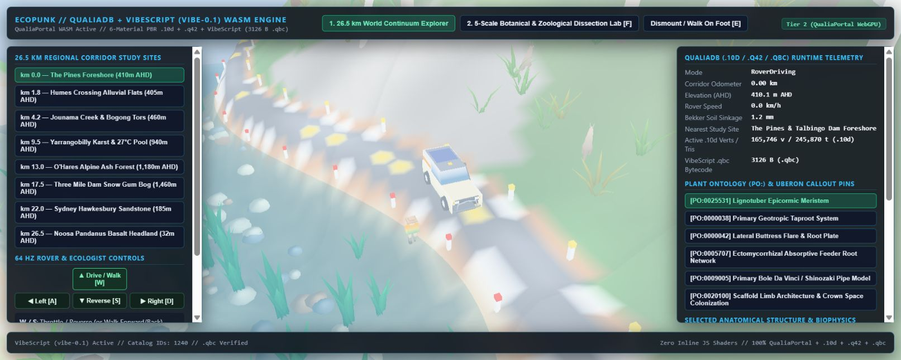
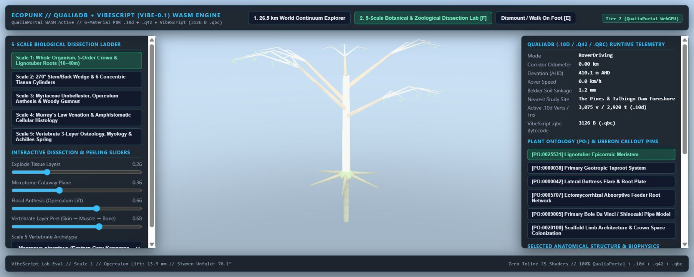
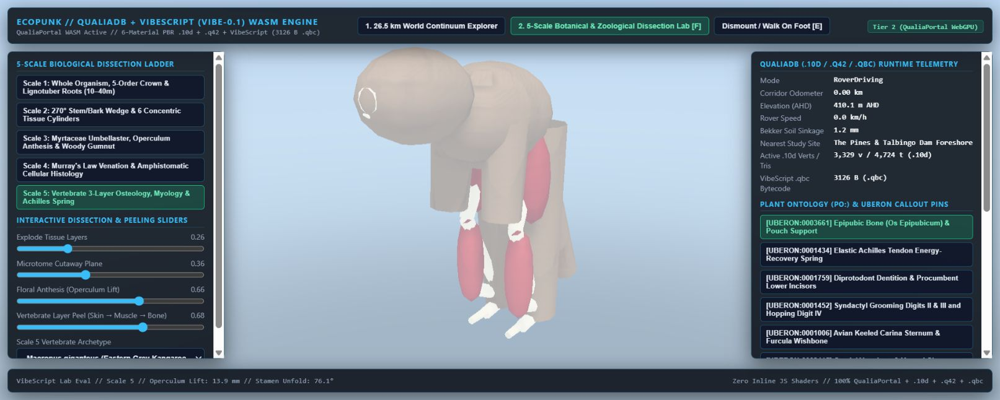

# Ecopunk graphics audit — 24 October 2026

**Specification correction, 2026-10-24:** the browser observations below remain
evidence about the existing demo, but its proposed browser-led delivery order
is superseded by Timothy's clarification. The intended software develops and
uses the native QualiaDB/custom stack without JS/V8; a species embodiment carries
its full available graph/resources in HMC; the made world requires its own
design/assembly/operation structure. See [architecture](../architecture.md),
[species contract](assets/species-embodiment-spec.md), [made world](../made-world.md)
and the revised [task list](ecopunk-graphics-tasks.md). Specification work comes
first. Historical browser screenshots do not qualify the native workflow.

**Assessment:** the demo does not yet meet the project's own illustrated-CG or scientific-illustration quality bar. The dominant problems are unfinished asset forms, weak material separation, generic environment construction, and poor presentation. There are also concrete browser integration defects. Better lighting alone will not turn the existing models into finished assets.

This audit concerns **ecopunk's published continuum and biological lab**, not the separate Maslows Challenge game-demo. The older [game-demo remediation](game-demo-remediation.md) remains separate. The actionable backlog is [ecopunk-graphics-tasks.md](ecopunk-graphics-tasks.md).

The [production backlog](ecopunk-production-backlog.md) coordinates remediation
with the later architecture/authoring clarifications. The [Etalon handoff](etalon-capability-handoff.md)
records developed fork capabilities and existing consumer source. Findings here
retain their audited artifact/source scope; this addendum is not a new deployment
capture, GPU benchmark or revision-certified audit of every kernel.

## Evidence and limits

- Local ecopunk HEAD: `f84f579cefb9865da3638c4bbc7d7929346d133f`; working tree was clean before this audit.
- Inspected the [published demo](https://mediaprophet.github.io/ecopunk/) in Chrome on 24 October 2026: initial Talbingo scene, Noosa selection and all five lab scales, using their default controls. The UI reported **Tier 2 / WebGPU**. This is not independent GPU-adapter identification.
- Main viewport measured 1614 × 646 CSS pixels; canvas backing size 1888 × 755. Also inspected the narrow in-app browser. No viewport overrides or renderer settings were applied.
- Retained eight browser screenshots, browser observations/logs, local artifact SHA-256 values, and component manifest checks in [the evidence folder](../../qa/graphics-audit-2026-10-24/README.md).
- Inspected the local WASM shell, scene/model generators, material setup, packaging workflow, asset manifest, existing planning requirements, and focused upstream QualiaPortal texture/material/vertex-update sources.
- The shell fetch used for published/local byte comparison failed. **Published WASM byte identifiers with local source remains unverified.** Live appearance and local source defects are therefore separate evidence, not a claim that a particular source change alone explains the deployed image.
- Upstream source was readable, but Git identifiers inspection was denied. Upstream observations refer to the current local files, not a certified engine revision.
- No build, container verification, timing benchmark, device comparison, or scientific/taxonomic validation was performed. Browser-control timeouts are not FPS measurements. The console's connection errors have not been attributed to the application rather than browser integration.

## What the viewer actually looks like

### World: pale surfaces, sparse detail, weak grounding

The default view is milky and low contrast. Road markings and posts read as soft bright patches; the rover, person, animal, grass and shoreline lack convincing contact and material differentiation. Widely separated oversized grass tufts leave large empty surfaces. The view is a small diorama dominated by UI, despite the regional exploration language.

The [Noosa selection](../../qa/graphics-audit-2026-10-24/08-published-noosa.png) repeats the same visual vocabulary, with a large foreground boulder obscuring the route. Returning from the vertebrate lab also leaves its anatomy callouts and lab status visible in the world view. These are composition and state/presentation issues in addition to the common washed-out rendering.

These observations support an exposure/lighting/material investigation. They do **not** establish whether bloom, tone mapping, texture fallback, ambient light, or several causes dominate. The browser's ambient intensity is `0.78`, versus `0.26` in the native capture path; direct intensity is `2.25` versus `1.52`, and browser exposure adds `+0.35 EV`. These are different setups, not a valid before/after comparison.

### Organism and anatomy: schematic forms presented with stronger claims

The whole-tree lab model reads as a sparse branching scaffold. The crown lacks enough leaf mass, fine branching and characteristic irregularity to read as a finished organism. White surfaces lose definition against the blue background. A scientifically named branching algorithm does not establish a believable tree silhouette.

The default kangaroo lab selection reads as disconnected tubes and rounded masses, with weak species recognition. Its partly peeled default makes evaluation harder: this capture is **not** an intact-skin assessment. A useful anatomy view still needs coherent limb proportions, landmark alignment, understandable dissection, and distinct tissue surfaces. The source constructs bone/muscle/skin from generalized tubes and ellipsoids; model counts and ontology labels do not establish anatomical fidelity.

The [stem](../../qa/graphics-audit-2026-10-24/03-published-stem-wedge.png) is clipped by the top of the viewport and reads as a largely featureless white cylinder. The [flower/gumnut](../../qa/graphics-audit-2026-10-24/04-published-flower-gumnut.png) has mechanical radial repetition, little surface definition, and an upper component obscured by the header. The [leaf](../../qa/graphics-audit-2026-10-24/05-published-leaf-histology.png) is legible as a leaf, but its tip is obscured and the tiny tissue section cannot serve as a useful histology view at that framing. Each scale needs its own composition and level of explanatory detail.

## Findings and ownership

Evidence classes: **V** = observed pixels/UI; **S** = inspected source; **D** = executed data check. Source line anchors below describe the audited checkout; future edits may move them.

| ID | Finding / practical consequence | Evidence | Primary owner |
|---|---|---|---|
| G01 | **Texture roles are wrong in the browser shell.** Four colour PNGs are uploaded with `(idx as u8) % 4`: foliage as colour, bark as normal, pebbles as linear data, soil as alpha-masked colour. All six scene materials request opaque base colour textures. | S: `crates/ecopunk-wasm/src/lib.rs:435`; `scene_builder_10d.rs:319,3294`; upstream `render/portal/texture_upload.rs:19`, `render/gpu/materials.rs:260,384`. The latter resolves by digest + colour space + mip semantic and falls back to neutral texture on a miss. The inspected code therefore mismatches three colour resources. Native upload uses sRGB/Color for all four (`scene_builder_10d.rs:3920`). | Ecopunk integration; engine diagnostics support |
| G02 | **Browser/native look settings diverge; live scene is washed out.** This prevents meaningful visual qualification from native images. Upload and exposure results are also ignored via `let _ =`. | V + S: screenshot 01; WASM `lib.rs:427–445,607–615,690–694`; native `scene_builder_10d.rs:4048` onwards. Isolate the lighting/postprocessing causes before prescribing a new renderer. | Ecopunk look development; engine only for proven defects |
| G03 | **Materials are grouped by asset category rather than physical surface.** Animals use bark; the person and vehicle share pebble texture, roughness `0.38`, metallic `0.12`. Tyres, glass, paint, fabric and skin cannot respond distinctly. Four 256² colour textures provide no authored normal/roughness/occlusion detail in this scene path. | S: `scene_builder_10d.rs:319–482,2652–2659,3285–3404`. The issue is semantic material choice and surface detail, not texture resolution alone. | Materials / technical art |
| G04 | **World trees retain opaque canopy cores and oversized leaf blades.** The core is an 8-slice/4-stack hull; blade length is 42–66% of the canopy-cluster x radius. This creates solid lobes with leaves stuck on, rather than airy branch/leaf structure. | S: `scene_builder_10d.rs:600–704`; supporting older native render `assets/renders/03_flora_specimen_loupe_snow_gum.png`. That render is historical, not today's browser capture. | Botanical modeling |
| G05 | **Species diversity is largely procedural archetype/palette variation in the world path.** Canopy selection cycles by `i % 5`, fern/grass-tree by `i % 7/6`; comments conflate several taxa per treatment. This cannot deliver each named plant's diagnostic habit. | S: `scene_builder_10d.rs:2935–3008`. No inference that every catalog species has a corresponding reviewed render asset. | Botanical modeling / ecology |
| G06 | **Fauna and lab anatomy need authored form reconstruction.** General SDF/capsule/ellipsoid construction is useful for blocking volume, but current output lacks convincing head, feet, joints, coat and tissue transitions. | V: screenshot 06 and historical fauna render; S: `scene_builder_10d.rs:1493` onwards, `zoological_anatomy.rs:535` onwards. Do not use minimum vertex-count tests as appearance acceptance. | Creature modeling / anatomy / animation |
| G07 | **Landscape uses a shared synthetic river-valley recipe.** Elevation is an analytic meander/channel/ridge function; a fixed 108-cell grid and seeded scatter produce the foreground. Study sites 0/1 and 3/4 share sector builders. The displayed regional labels are not evidence of place-specific landform reconstruction. | S: `scene_builder_10d.rs:2520–2694,2855–3068`; WASM `lib.rs:351–360`. The inspected visible build path does not sample the packaged terrain raster. | Environment art / geospatial integration |
| G08 | **Displayed movement and modeled size use different conversions.** Models use `SECTOR_METRIC_SCALE=0.045`; movement uses `0.012` and clamps local actor coordinates. Per-site auto normalization adds another transform. This needs a world/camera audit before a physically scaled walkthrough can be accepted. | S: `scene_builder_10d.rs:104`; WASM `lib.rs:566–588,839–900`. Constant metadata assertions do not validate this end-to-end transform chain. | Ecopunk world integration |
| G09 | **Framing and UI obscure the work.** Lab scale changes reuse one JS orbit; the Rust per-load camera is overwritten each frame. Side columns are fixed at 350 and 390 px, with no responsive treatment in the inline stylesheet. The narrow viewport is almost entirely UI. Pins are text buttons, without a demonstrated visible model anchor/highlight. | V: screenshots 02–07; S: `viewer/index.html:34,315–321,401–441,474–500`; WASM `lib.rs:923–926`. | Viewer / interaction design |
| G10 | **Asset provenance/rebuild state is inconsistent.** Manifest: 26 model entries, 124 component references, 120 unique files, seven LOD groups. Eight unique files have wrong SHA-256 values; fifteen have stale byte counts; nineteen references have at least one mismatch. README still describes six studies/18 components and invokes absent `build.mjs`. | D: `evidence.json`, reproducible `collect-evidence.mjs`; S: `assets/models/corymbia-aparrerinja/README.md`, `model-set.json`. Existing LOD groups are real manifest declarations, but have not been visually qualified here. | Asset pipeline |
| G11 | **Three content routes can drift.** Stored model-set components, native sector renders, and browser-generated lab/sector meshes are separate. The browser calls `build_sector_10d` / `build_dissection_scale_10d`; it does not load the reviewed model-set manifest or prebuilt HMC on this path. Fixing files in the asset folder therefore need not improve the demo. | S: WASM `lib.rs:556–564,676–688`; `viewer/index.html:285–307`; native compiler and model manifest. Native “closeup specimen” helper rebuilds the whole Talbingo sector and changes the camera (`scene_builder_10d.rs:3514`). | Asset pipeline / integration |
| G12 | **Interaction does unnecessary construction work.** Every slider input rebuilds/compiles/reloads the lab mesh; selecting a pin invokes that same rebuild. Site loads generate complete scene meshes. Rover/person vertices allocate and upload every frame, even at rest. | S: viewer `refreshLabDissection`, pin click handler; WASM `lib.rs:560,676,854–909`. Upstream position writes update whole draw bounds and AABB. Cost is unmeasured; profile before assigning performance blame. | Integration; engine for missing reusable APIs |

## Engine assessment

There is no evidence here justifying replacement of the engine. The inspected engine already has material texture residency, typed mip roles, shadowing, SSAO, environment lighting, vegetation machinery and position-update normal reconstruction. Several capabilities are called by ecopunk, but calling an API is not proof that the final image is correct.

Most immediate work belongs in **content and integration**: fix the texture contract, use appropriate materials, align lighting configuration, fit cameras and deliver a shared asset path. Upstream work should be scoped to a reproducible fixture that fails:

1. Texture residency/fallback diagnostics and typed role contracts visible to the host.
2. Matched browser/native material and colour-management fixtures.
3. Foliage tests for two-sided shading, alpha coverage, shadows, wind and LOD, using a real branch asset.
4. Depth/contact/shadow tests at the actual world scale and camera ranges.
5. Actor transforms, dirty updates, culling/instancing and LOD exposed efficiently to the host where existing paths are insufficient.
6. Water tests for depth, shore contact, transparent ordering and reflection response.

Do not duplicate the renderer in JavaScript. Preserve the project's Vibe/Qualia ownership boundaries. Do not claim the engine lacks normal updates: the inspected `render/gpu/mesh_upload.rs:443` reconstructs and uploads dirty normals. Tangent/deformation correctness and scale-dependent behaviour still need fixture coverage.

## Recommended production direction

Use the existing [style tiers](assets/style-and-scale.md) and [digital-twin requirements](assets/digital-twin-asset-requirements.md): **T3 illustrated-CG** is the provisional world target; **T1 scientific illustration** is the provisional lab target. Those are existing project directions, not a newly approved visual target. Establish an actual Ecopunk reference board and approved in-engine sample for each.

The first finished scene should contain one terrain/shoreline segment, one habitat-appropriate hero tree plus derived variation, understorey/litter/rock dressing, one recognisable kangaroo, the rover and ecologist for scale, and restrained daylight. Pair it with a useful specimen view of that same tree and animal. Keep Corymbia studies as their own explicitly identified specimen family rather than assuming that a species label establishes local occurrence.

Finish silhouette and proportion first, then topology/UVs, materials, rigging and motion, then derived LODs and variants. Use neutral-light turntables and the real habitat view together. Retain procedural generation for controllable structure and variation, with explicit authored constraints and review. More triangles, shader modes, scientific terminology, generated catalog entries or successful checksums cannot close a visual-quality task.

Release acceptance should include human review of actual browser frames at default and close inspection distances, clear model identifiers without labels, readable surfaces and tissue boundaries, stable contact and animation, working specimen framing, and a repeatable device/performance receipt. Record separate outcomes for visual quality, scientific accuracy, runtime correctness and provenance. None is a substitute for the others.
