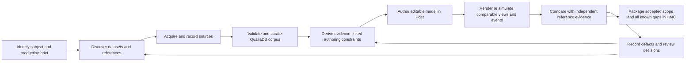

# Evidence-led asset production: corpus, characterization and model evaluation

**Status:** proposed operating process, 28 October 2026. Extends the existing [acquisition/package pipeline](pipeline.md), [species embodiment contract](assets/species-embodiment-spec.md), [asset requirements](assets/digital-twin-asset-requirements.md) and [model-completion claims](assets/model-completion-claims.md). It does not establish that the complete process has been implemented or run.

Timothy's direction is to discover datasets about the object/species, accumulate as much relevant known information as possible, add broader botanical knowledge, and gather image/video/audio characterization that can be used to judge the produced models. This process makes that evidence part of the asset's native knowledge and production loop. It applies to other living domains and made-world objects with the relevant domain vocabularies.

Current M64-related asset exports remain paused while the upstream fixes settle. Research, corpus design and documentation can proceed. This document does not start a new export, compile, paid provider call, publication or scheduled monitoring job.

**Whole-system scope correction, 28 October 2026:** botanical examples are an initial production case, not a restriction on Ecopunk or QualiaDB updates. This process covers flora, vertebrates, invertebrates, funga, microorganisms, habitats, geology/terrain/soils, fresh and marine water, atmosphere/weather and space-weather forcing, with made-world and civics embodiments in their existing scope. Shared domain knowledge includes anatomy, ecology and Earth/space sciences as applicable; it is not limited to botany. See the [whole-biosphere outstanding-work list](whole-biosphere-uplift-outstanding-work.md). Each domain uses its own evidence, units, applicable logic and physical models. No plant grammar, source register or first asset defines the whole product.

## 1. The production loop

The loop produces two linked things: an increasingly rich knowledge corpus and an increasingly faithful editable embodiment. A mesh is one representation of the subject; it is not the corpus or a substitute for it. Evidence collection continues while authoring improves. Do not make exhaustive worldwide research a prerequisite to creating a first bounded model.

## 2. Four connected bodies of evidence

| Body | Content | Relationship to the asset |
|---|---|---|
| **Subject corpus** | Taxon/name concepts, occurrences/specimens, morphology/anatomy, measurements, development, phenology, physiology, ecology, conservation, behavior, variation and source-specific disagreements. For manufactured objects: specification, assembly, material and operation records. | Describes the actual subject and the scope of each assertion. Supports part/state/parameter choices and exposes missing evidence. |
| **Shared domain knowledge** | General botany: organ definitions, leaf/stem/root anatomy, branching, developmental processes, vascular/biomechanical principles, ecological relationships, measurement methods and the limitations of general models. | Reusable versioned QualiaDB knowledge. The asset links to the applicable interpretation closure; a general rule is not promoted to a measured fact about every species or individual. |
| **Characterization corpus** | Images, recordings, video, scans, surveys, diagrams and observation sequences, with available capture context and technical metadata. | Supplies inspectable appearance, scale, movement, material, sound and environmental evidence. Raw and derived items retain their relationships. |
| **Evaluation references and judgments** | Identified independent views/observations where available, comparison protocols, measurable criteria, exact generated outputs, discrepancies and attributed technical/visual/domain decisions. | Determines whether a particular model revision meets a stated purpose. Design references alone do not prove independent validation. |

Use existing native graph/source/provenance owners. These are logical corpus roles, not four new databases or project formats. Retain original source terms, IRIs and identifiers; express mappings explicitly rather than replacing the source's meaning.

## 3. Step-by-step operating procedure

### P1 — Identify the subject and the initial useful output

Record whether the work represents a taxon, a particular individual/specimen, a population, a manufactured design, or an explicitly illustrative study. Record intended locality/time/state where known and distinguish it from an artistic setting. A species identifier, occurrence record, specimen identifier and model revision are different referents.

Start the existing dossier and complete claim-ledger projection. Define the first useful editable output and applicable later profiles without deleting the complete package obligations. Record the relevant questions before searching: which organs, scales, developmental states, motions, material properties and views need evidence? A natural variation range is not a requirement for one representative to have every extreme simultaneously.

**Output:** subject/identifier record, production brief, initial component/state inventory and explicit unresolved questions.

### P2 — Search for datasets, descriptions and media systematically

Begin with the [Australian source register](../data-sources/australia.md), the [ecological acquisition notes](../../plans/east-coast-australia-ecological-dataset-acquisition-plan.md) and the [existing reference-resolution record](../../qa/implementation-2026-10-27/human-authority-round1/reference-resolution.md). Search accepted names and relevant synonyms using source-qualified taxon concepts, not names alone. Record search scope, date, coverage and source versions, including sources with no relevant results or unavailable access.

| Question | Existing source families to examine |
|---|---|
| What taxon/name concept is intended? | NSL/APC/APNI/AFD; qualified ALA/GBIF mappings and authoritative treatments. |
| Where, when and by whom was it observed or collected? | ALA/GBIF, state systems, AVH/OZCAM and voucher/collection records. |
| What anatomical and morphological descriptions exist? | Floras, EUCLID, PlantNET, treatments, specimen descriptions and appropriate primary studies. |
| What measured traits and methods exist? | AusTraits, source studies, measurements and TERN observations where applicable. |
| What context and co-occurrence evidence exists? | TERN EcoPlots/AusPlots, SuperSites, appropriate landscape/sensor products and their source records. |
| What can be seen or heard? | Collection/provider media, TERN EcoImages/EcoAcoustics and other permitted image/audio/video or scan sources. |
| What general domain knowledge helps explain it? | Existing botany/anatomy/trait ontologies, methods, primary research and applicable reviewed models. |

This is a starting source map, not a claim that every provider supplies every taxon or modality. Verify actual formats and endpoints. RDF vocabularies describe structure; they are not a substitute for specimen, observation or media evidence. Do not repeat unverified numbers or taxonomic mappings from older project tables as established facts.

**Output:** ranked source inventory and retrieval plan covering broad species knowledge as well as the current visible model needs.

### P3 — Acquire records with provenance and usable rights

Preserve the exact permitted source/version or a verifiable reference, source identifiers, publisher/creator, retrieval time, content digest, original format and actual acquisition result. Deduplicate copies while retaining provider and derivation relationships. A hundred syndicated copies of one photograph are one observation source, not a hundred independent witnesses.

Capture permissions, attribution, storage/display/adaptation/distribution/commercial conditions, sensitivity and any cultural restrictions at the applicable dataset/item/representation level. A media metadata licence need not be the media licence. Record known authorization once and reuse it within scope; unresolved terms remain explicit and only block the uses that depend on them. Do not send requests to creators or services without the applicable authorization.

Use the existing acquisition inbox and review path. Do not rewrite raw records in place, obtain restricted coordinates by bypassing controls, upload data to another provider, or create private replacement stores. Where access is unavailable, retain the discovery record and the precise gap.

**Output:** dated source snapshots/references, rights/sensitivity records, deduplication lineage and an acquisition receipt that distinguishes success, missing, failed and deferred items.

### P4 — Construct the broad subject corpus and shared botany corpus

Normalize through existing native parsers and source-specific adapters; retain the original representation and mapping revision. Apply the [source namespace and native inference contract](#7-source-namespaces-and-native-symbolic-inference) below. The growing Q42 corpus must be usable by QualiaDB's existing symbolic logic systems, not merely stored as labelled data. Preserve RDF term kinds, lexical values, language/datatype, named source context, units, uncertainty, sampling methods, dates and identifier distinctions. Apply pinned source shapes and native integrity checks. A generic SPARQL variable-to-hash adapter does not, by itself, establish preservation of these semantics.

For each substantive assertion retain its subject, property, result/value, source/evidence, method, valid/observation time, biological/environmental scope and status. Distinguish source assertion, reviewed observation, inference, model assumption, artistic choice, contested claim and unknown. Multiple compatible or conflicting records coexist; do not flatten them into a single unsupported default.

Build general botanical knowledge once, with versioned links to its source and applicability conditions. Asset dossiers reference the relevant shared knowledge and retain the interpretation closure needed for use and offline packaging. A general pipe model, for example, remains a model with assumptions; it does not identify measured branch radii for a specific tree.

Keep broad subject information even when it is not used by the first mesh: ecology, development, relationships and contextual observations remain useful to queries, simulation and future representations. Organizing the data for a selected working set must not shrink the complete declared species corpus.

**Output:** queryable subject and applicable domain knowledge in QualiaDB, a mapping/validation report, conflicts/unknowns and a versioned coverage manifest. A generic labelled mesh does not meet this output.

### P5 — Characterize the subject across media

| Modality | Record when available | Potential model judgments | Important limitation |
|---|---|---|---|
| Photographs | Identified subject/organ/state, date, viewpoint/orientation, scale/calibration, capture/processing and illumination information, resolution and the exact image region used. | Silhouette, proportions, attachment, leaf arrangement, bark, diagnostic organs, color/material appearance under declared conditions. | Perspective, lighting and processing can change apparent dimensions and color; missing calibration remains missing. |
| Video | Identified subject and event, time base/frame rate, duration, camera motion/view, environment/forcing and selected time intervals. | Deformation, wind response, articulation, growth/event transitions, timing, contact and temporal consistency. | Camera movement is not organism movement; footage from one session is not independent merely because it has many frames. |
| Audio | Subject/event attribution and confidence, time/location precision, microphone/setup and sample rate where known, environment, background sources, channel information and selected intervals. | Appropriate sound events, temporal/spectral character and synchronization with movement or interaction. | Ambient wind, nearby species or handling noise do not automatically characterize the target organism; uncalibrated recordings do not establish absolute loudness. |
| Scans and surveys | Acquisition method, scale, coordinate system, uncertainty, coverage, alignment and processing lineage. | Surface/volume dimensions, spatial arrangement, canopy/terrain context and geometric comparison. | Occluded or inferred regions are not direct observations. |
| Diagrams and treatments | Author/source, scope, legend, scale, orientation and whether schematic or measured. | Anatomical relationships, parts and state-specific diagnostic constraints. | A schematic is not a metrically accurate reconstruction. |

Do not require unavailable metadata before retaining an otherwise useful permitted item. Record which judgments it can actually support. Characterization can be descriptive, quantitative or both.

The current TDWG standard is **Audiovisual Core** (earlier project notes use “Audubon Core”). It provides biodiversity-media metadata, access-point and region-of-interest structures; the underlying IRIs and version need preservation, not an uncontrolled rename. Its rights description concerns the media resource rather than automatically the metadata. [TDWG Audiovisual Core term list](https://ac.tdwg.org/termlist/).

TERN's model separates observations, features/samples, results, methods and time/context; Darwin Core supplies relevant biodiversity record distinctions. Use actual source relationships rather than identifying every record with the species name. [TERN conceptual model](https://linkeddata.tern.org.au/information-models/tern-ontology/conceptual-information-model), [Darwin Core terms](https://dwc.tdwg.org/terms/).

**Output:** a navigable reference board and time/region-addressable characterization corpus linked to subject, part, state, source and permitted uses.

### P6 — Translate evidence into editable production constraints

Create a traceable relationship for every meaningful parameter or production rule:

**source record/media region → observation or scoped assertion → applicable part/state → parameter/rule → authoring source revision → generated output → comparison result.**

Examples include leaf width/length distributions and arrangement, stem taper, branch attachment, bark form, developmental organ presence, material appearance and response to a declared forcing. Preserve measurement method and uncertainty rather than selecting an unexplained average. Mark artistic settings and unsupported numerical choices as such. Confidence in a taxon-level trait does not establish the exact dimensions of an unspecified individual.

Use existing QualiaDB domain/geometry/simulation owners and the established Poet tool-chest/manifold workspace. Keep direct native and Vibe operations on the same source/authority path. Deformation, UVs, normals, materials and part identifiers must survive edits and derived representations.

**Output:** an editable production specification whose constraints link to evidence and whose assumptions are inspectable. Missing evidence produces an explicit open question or an illustrative choice, not a fabricated scientific parameter.

### P7 — Judge generated models against reference evidence

Before shaping the asset, designate independent evaluation items where the corpus supports it. Split by specimen, acquisition session or site as appropriate, not by near-duplicate frames. Where no independent material exists, disclose that limitation instead of calling reuse of the design references independent validation.

Produce views/events comparable to the selected evidence: controlled camera and scale, diagnostic closeups, appropriate lighting, state and forcing, and time-aligned motion/audio where relevant. Record the generated model, source/corpus revision, renderer/simulator/tool versions and comparison settings.

| Evaluation area | Record and compare |
|---|---|
| Identity and anatomy | Applicable diagnostic organs, absence/presence, relationships and developmental compatibility. |
| Geometry | Scale and proportions where supported, silhouette, branching/attachment, surface shape and coverage/occlusion limits. |
| Materials | Bark/leaf appearance, surface structure, shading/UV/normal continuity, color only within known capture conditions. |
| Motion and behavior | Deformation, contact, event/transition timing and response to declared conditions; distinguish plausible animation from validated prediction. |
| Audio | Attributed event content, temporal/spectral behavior and synchronization, with capture limitations retained. |
| Product quality | Editability, preserved identifiers/attributes, preview, undo, HMC save/fresh reopen and actual consumer use. |

Set criteria and tolerances from evidence and declared purpose before judging the output; do not invent a universal numeric threshold or one opaque “quality score.” Report per-feature error, unexplained discrepancies and unavailable judgments. Technical integrity, artistic quality and biological/domain acceptance are separate attributed decisions. If the independent material is repeatedly used for tuning, revise the evaluation designation and disclose the resulting dependence.

**Output:** an evidence-linked defect list and actual review/measurement results for exact output versions. Correct the model or a faulty inference/mapping, then repeat affected comparisons. A render, automated similarity metric or model-generated caption cannot award scientific/human acceptance.

### P8 — Package and evolve the corpus with the asset

Package semantic graphs, editable sources, required domain/ontology interpretation, media/resources and their rights/provenance with the native embodiment under the existing HMC contract. Store semantic data in `.q42`; use `.m64` and `.10d` according to their actual admitted payload profiles/codecs and source roles. Preserve dense values, units, coordinate frames and original media rather than expanding every sample into graph facts or treating extensions as interchangeable wrappers. Reconcile the pending M64 fixes before the next export.

Keep a comprehensive, reconciled corpus revision while selecting a bounded resident/query resource closure for a viewer. Rights/access restrictions must remain effective; a public derivative cannot expose restricted material simply because it belongs to the complete subject record. Record omitted/unavailable content and the governing scope rather than claim an incomplete public projection is the whole corpus.

New evidence creates a new corpus revision and an impact list: which anatomical statements, parameters, geometries, materials, simulation claims or reviews are affected? Regenerate/review those outputs and preserve prior versions. Do not keep an old pass when its supporting evidence or source has changed.

**Output:** a native knowledge-bearing editable asset/package and an external receipt binding final bytes, corpus/source versions, actual checks, review decisions and remaining claim IDs. Film, game and cartoon remain separate required complete-package targets; a first bounded asset is not the complete species.

## 4. What “as much known data as possible” means operationally

Pursue broad coverage rather than stopping at the first convenient images. Maintain a source/category coverage table with: searches performed; available sources and revisions; acquired and validated records; independent observations; duplicate counts; applicable organs/states/modalities; excluded/restricted/missing material; conflicts; unresolved questions; and review state.

Completeness is a claim about a declared subject, sources searched, corpus revision and cutoff, with explicit gaps. It is not a claim to know every fact that exists worldwide. Large corpus work is partitioned and deduplicated through native resource contracts; acquisition and processing budgets control jobs without arbitrarily lowering master quality. Expand coverage iteratively and keep authoring useful while research continues.

No fabricated biology fills a missing category. No evidence disappears because the current renderer cannot display it. Do not infer source independence or reliability from raw record count.

## 5. First application to the current work

The current spray is an authored illustrative study. Its chosen dimensions and artistic shapes are not retrospectively species measurements. Preserve that status while producing its pending package/previews when the M64 update is ready.

For an evidence-based botanical asset, reuse the existing white-gum/tree case and reference work: resolve the taxon-level/individual scope, accumulate taxonomy, trait, organ/state and media evidence, build the applicable shared botany corpus, and define diagnostic comparisons before claiming species fidelity. Maintain source conflicts and unknowns. Regional occurrence and generic eucalypt appearance do not identify a specimen.

The same process extends to the wallaby and other living/made objects through the appropriate domain evidence and existing owners. Payments, unrelated spreadsheet development and completion of every authoring family are not new prerequisites to an initial bounded asset.

## 6. Immediate implementation work after this process definition

1. Reconcile current native ingestion/identifier/shape/unit/media APIs and the M64 fixes; do not redispatch already implemented owners as missing.
2. Implement or complete source-specific acquisition/mapping jobs using existing native services and resource budgets. Keep acquisition/evaluation receipts and known limits truthful.
3. Expose corpus search, subject/organ/state evidence inspection, media regions/intervals and parameter provenance through the intended Poet workspace.
4. Connect comparable render/simulation capture and evidence-linked defect/review recording. Reuse the existing dossier, project/history and review mechanisms.
5. Verify a real corpus-to-parameter-to-output-to-HMC-reopen case under the user's coding/testing instructions. Documentation and adapter presence alone do not close the pipeline.

This document is an operating process and implementation contract. It does not claim data has already been acquired, a corpus validated, an export resumed or a model accepted.

## 7. Source namespaces and native symbolic inference

**User requirements, 28 October 2026:** the growing Q42 ontology/corpus preserves the source namespace. Non-RDF sources acquire a source-qualified semantic vocabulary and record identifiers so their information can participate in broader RDF/semantic resolution. This dataset must support inference through the logic systems already built into QualiaDB. QualiaDB remains the owner of graph storage, identifiers, logic and execution; this contract does not authorize a replacement database, interpreter or reasoning framework.

### 7.1 Preserve sources and qualify non-RDF mappings

For RDF, retain upstream term IRIs and namespace bindings, term kinds, lexical values, datatypes/languages and graph context. A prefix abbreviation is not an identifier. Q42 compilation must retain the reversible source-term/lexicon relationships needed to inspect assertions and resolve terms; hashes alone do not establish semantic preservation.

For CSV, JSON, XML and other structured sources, register the provider, domain/source URL, dataset identifier, original format, schema/version, snapshot/digest, field vocabulary, record identifier scheme and mapping revision. Derive the source-specific vocabulary from the actual schema/data dictionary and hierarchical structure, preserving the original field/key paths. A domain alone does not identify a dataset or establish the meaning of a field.

Prefer provider-issued stable identifiers and published semantic mappings. Otherwise mint explicitly Ecopunk/Qualia-managed, source-qualified identifiers; do not imply that the provider issued a fabricated HTTP IRI. Preserve original domains, paths, keys and their provenance. Distinguish enduring record identifiers from snapshots and schema revisions. Use stable source keys where available; records lacking them remain explicitly snapshot-local. Row positions, mutable names and content digests are not automatically persistent identifiers for the represented organism or observation.

Preserve JSON nesting and significant list order, CSV column definitions, units, language/datatype, and absent/null/empty distinctions. Keep identifier lexical forms such as leading zeroes. Distinguish a source's classification hierarchy from a biological taxon concept, scientific name, specimen and occurrence. A taxonomy import must not collapse those referents.

Maintain source assertions, schema mappings and derived assertions in distinguishable native contexts. Align source terms to applicable TERN/SOSA, Darwin Core, units/provenance and authoritative taxonomic terms through explicit qualified mappings. Every mapping records its source, scope, version, validity and method/review status, including uncertainty or disagreement. Matching labels produce candidates, not automatic identity or equivalence. Resolution need not require every source to provide RDF originally.

### 7.2 Inference is part of the production loop

The required path is **source records → source-qualified NQuins/Q42 → explicit vocabulary mappings and applicable rules → existing QualiaDB logic/solver operations → inspectable conclusions → evidence-linked Poet authoring and review**. Reuse native public operations and the existing Vibe/Poet host routes. Do not introduce a second implementation because a limited LocalHost route cannot execute an operation.

Select the logic appropriate to the question: rule entailment, description/class relationships, temporal conditions, epistemic/source-qualified knowledge, defeasible or paraconsistent treatment of exceptions/conflicts, answer-set alternatives, or other existing supported modalities. Record the actual selected engine/API and semantics. Do not treat every modality as interchangeable or claim that an ontology import activates all reasoning automatically. SHACL/integrity validation is distinct from logical entailment; statistical/model suggestions remain distinguishable from symbolic consequences.

Each inference job records:

- Input corpus/snapshot and permitted graph closure, source namespace/mapping revisions, rule/ontology versions and exact query or goal.
- Engine/host/API version, selected semantics and assumptions, including open/closed-world scope and any use of negation or defaults.
- Native operation budgets and completion state: exhausted, truncated, unsupported, inconsistent, no answer and completed are distinct outcomes. A partial result cannot claim exhaustive entailment or enumeration.
- Derived conclusion identifiers/context and available derivation evidence linking premises and rules. If the current operation only returns matches or counts, label that limited result; do not invent a proof or materialized consequence.
- Applicable time, taxon/individual/developmental context, uncertainty and conflicts. A general botanical rule does not become a measured property of a particular tree.

Retain source assertions when rules or mappings change. Invalidate or recompute affected conclusions and downstream model constraints/reviews, preserving prior lineage. An illustrative leaf arrangement can be chosen by an author; it cannot be silently converted into an inferred species fact.

### 7.3 Human authority and inspectability

People must be able to inspect the source, mapping, rule, conclusion and its effect on the editable model, challenge a mapping or inference, and retain alternatives. Use existing project/authority/history/review mechanisms for adoption and consequential edits. An inference result does not grant an agent permissions, sign an agreement, waive rights, prove payment or award human acceptance. Keep actual author, delegated executor and reviewer roles separately attributed. Applicable restrictions remain effective during reasoning, derived display and packaging.

### 7.4 Bounded source reconciliation and required qualification

Read-only inspection on 28 October found existing owners and consumers, rather than a reason to replace them:

| Inspected source under `C:/github/qualiaDB/` | Observed scope and limit |
|---|---|
| `crates/qualia-core-db/src/modalities/logic/mod.rs` | Existing public logic modules/re-exports include N3, core VM, deontic and SHACL owners. This module inventory alone is not semantic qualification. |
| `crates/qualia-core-db/src/modalities/logic/rules.rs` and `tests/logic_rules_pipeline.rs` | RuleEngine parses/registers/fires rules through SlgArena and evaluates premise-pattern matches. Source tests cover bounded rule matching and MCP/WAL paths; WAL logging is best-effort and the inspected test tolerates an absent WAL. Neither comments nor source tests establish executed durable auditing or arbitrary botanical entailment. |
| `crates/qualia-core-db/src/poet_host/invoke/mod.rs` and `graph/n3.rs` | Native `N3Logic.evaluate` dispatch accepts parse/evaluate/infer modes. The inspected adapter caps static triples at 256 and reports matches with optional fact/rule evidence; it does not itself expose a materialized general multi-step closure. This is a scoped observation, not a finding that other inference paths are absent. |
| `crates/qualia-core-db/src/modalities/asp.rs` and `poet_host/invoke/logic/asp.rs` | The source-program host route calls `compute_answer_sets`; a separate legacy live-graph path calls the context-bifurcation enumerator. Preserve that distinction. Current core bounds include 12 atoms and six body literals; callers must validate bounds and disclose output capacity rather than imply unbounded reasoning. |
| `crates/vibe/src/catalog/logic.rs` | Existing modal LocalHost operations are present. N3/ASP explicitly require an engine host on this route. A LocalHost diagnostic is not evidence that QualiaDB lacks those engines. |
| `crates/poet/src/browser/logic_workbench/request_reasoning.rs` | Existing browser workbench constructs N3 infer/explain and ASP requests. It is a consumer example, not evidence of the required native human workflow or of source-corpus integration. |

This was a bounded read-only trace of these bodies, not a semantic audit of every modality, solver, domain, specialized library, graphics/audio/vision or semantic-instrument owner. No missing-engine claim is made about uninspected code. Relevant existing owners and saved execution evidence must be reconciled before allocating implementation changes. File pins below bind the inspected working-tree snapshot, which may include uncommitted changes; they are not test results.

Required qualification, when testing resumes: import real source-qualified datasets for the declared production cases, starting with the selected botanical case and extending to animals, funga/microorganisms, places and Earth/space time series; resolve preserved lexical identifiers; apply an explicitly scoped existing rule/logic operation; inspect its actual conclusion/evidence; reject an invalid cross-source identity mapping; retain contradictory/unknown evidence; exercise a budget boundary without silently accepting a complete result; change a premise and recompute/invalidate its consequences; carry corpus, mappings, rules and conclusions through native package save/fresh reopen. People must inspect and decide on the resulting authoring change through Poet. These are acceptance obligations, not claims that this document has implemented or executed them.

### Inspected-source pins

QualiaDB HEAD at inspection: `3c0f3938d6d18dc7fc23447136716af65281b55a`. SHA-256 of working-tree file bytes:

| Relative source path | SHA-256 |
|---|---|
| `crates/qualia-core-db/src/modalities/logic/mod.rs` | `33804beb328c42ba0bc3f8bd143ec54f5004c816bca22cd201f7469ee6ead43a` |
| `crates/qualia-core-db/src/modalities/logic/rules.rs` | `6f701ae85e67364d2b94227cdb6ffe9965b51c69ef8d85dd1b6bb01723df0ecc` |
| `crates/qualia-core-db/tests/logic_rules_pipeline.rs` | `f5ca7b0f3a6bc157ffecefa42ce99c5f25ae96a897e361e69f664b4de752ac3a` |
| `crates/qualia-core-db/src/poet_host/invoke/mod.rs` | `977b81ef5c52fc616561fe3dd980a7d2f4003ee621e6147f9c6ee2887c8ed56b` |
| `crates/qualia-core-db/src/poet_host/invoke/graph/n3.rs` | `accd01480fb80b12a44cfda9b8918e4e50be28b182a96ad9bacc464aa314f721` |
| `crates/qualia-core-db/src/modalities/asp.rs` | `8e47275bb8f55994e36a57007d34a203d516ef5df87794df7841f790e0f94cf7` |
| `crates/qualia-core-db/src/poet_host/invoke/logic/asp.rs` | `f4bdaa4af78f7e239f4e8fddd9b8c097324d8c74180d5367bc2bb4e9bef4fb6e` |
| `crates/vibe/src/catalog/logic.rs` | `acd38d4454036f80efb3df0e01fb94a5f974fe107c2d13f025c7c8eafbc51f5f` |
| `crates/poet/src/browser/logic_workbench/request_reasoning.rs` | `c2edfa4cbc71f1ed5bad5a893f5b3f761f67c436ec2242b1676f83a84384968d` |
