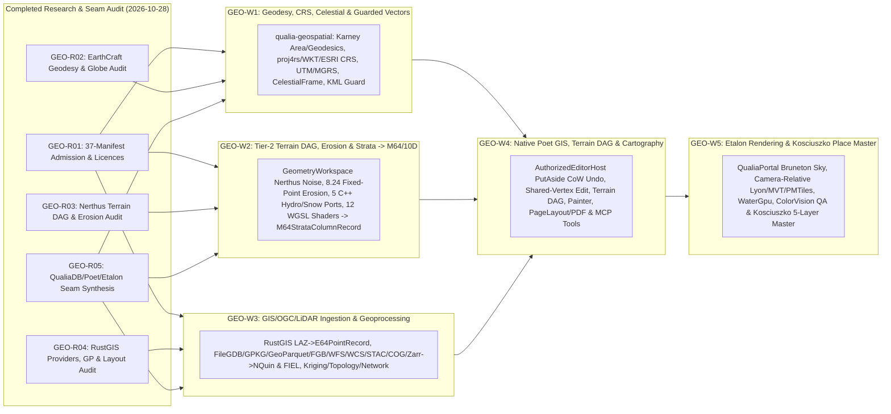

# Geography Libraries (`EarthCraft`, `Nerthus` and `RustGIS`) — Poet & QualiaDB Adaptation Guide

**Revision:** 2026-10-28 (v1.1 — updated to include `RustGIS-main`) · **Status:** source-backed adaptation specification and agent handoff. No source extraction, native integration, build, test, export, paid provider call or acceptance is performed by this document. The three repositories under `C:/github/geography-libraries` are:
1. **`EarthCraft-main` (`v0.2.0`, MIT)**: Planetary 3D globe explorer, WGS84/Karney ellipsoidal geodesy, `DD`/`DMS`/`DDM`/`UTM`/`UPS`/`MGRS` coordinates, IAU 2006/2000A celestial/solar ephemeris (`sofars`), guarded KML/KMZ, and hybrid `wide::f64x4` SIMD / GPU ray-casting.
2. **`nerthus-main` (`v2.3.1`, MIT)**: Clean-room Gaea 2.3.1.0 node-based procedural terrain generator, 182 node builders, 19 modifiers, 8.24 fixed-point hydraulic erosion (`ParallelErosion_Erode`), 5 native C++ erosion/hydrology/snow simulation ports (`ce`, `cs`, `cw`, `hydro`, `ts`), 12 WGSL compute shaders, Bruneton precomputed atmosphere (`sky.wgsl`), and 323 Copernicus Sentinel-2 colour LUTs.
3. **`RustGIS-main` (`v0.4.0`, Apache-2.0)**: Pure-Rust desktop/web/CLI GIS suite (`unsafe_code = "forbid"`), 16 vector/point-cloud formats (`GeoPackage`, `GeoParquet`, `FlatGeobuf`, `Shapefile`, pure-Rust `Esri FileGDB`, `LAS`/`LAZ`/`COPC` LiDAR, `OSM PBF`, `DXF`), full OGC web clients (`WFS`, `OGC API Features`, `WMS`, `WMTS`, `WCS`, `CSW`, `SOS`, `SensorThings`, `STAC`, `ArcGIS REST`), `COG` & `Zarr v2/v3`/`NetCDF`/`GRIB2` data cubes, `proj4rs` + WKT/ESRI reprojection, 21 built-in geoprocessing tools (`buffer`, `clip`, `intersect`, `dissolve`, `spatialJoin`, `zonalStats`, Ordinary `kriging`, `viewshed`, Dijkstra `RoadGraph`, 6 `topology` rules/auto-fixes, `a5` DGGS) + 1,000+ GeoLibre/Whitebox tools, `MVT`/`PMTiles` vector tiles, camera-relative `lyon` GPU tessellation, shared-vertex topological editing, `PutAside` CoW delta undo/redo, and cartographic `PageLayout`/`MapSeries` PDF/SVG/glTF export.

Following the [requirements-first adaptation guide](poet-capability-adaptation-guide.md), we begin with the required human/agent operation and an existing QualiaDB/Poet implementation owner, then select reusable source code from `EarthCraft`, `Nerthus`, and `RustGIS` while refusing standalone app shells (`eframe`/`egui`, `bevy`/`bevy_egui`), upstream `wgpu` device silos, driver/registry mutation shims, unauthenticated localhost MCP sockets, and unbounded heap allocations.

This guide extends the [comprehensive authoring review](poet-comprehensive-authoring-review.md), [spatial substrate](spatial-substrate.md), [map layers](map-layers.md), [biosphere, Earth and anatomy capability programme](biosphere-earth-and-anatomy-capabilities.md), and the single [implementation plan](../implementation-plan.md). Detailed audit reports and SHA-256 coverage pins live in [the QA review directory](../../qa/implementation-2026-10-28/geography-libraries-review/README.md).

---

## 1. Existing Requirements Come First

| Existing reference | Requirement to preserve | Evidence limit |
|---|---|---|
| [spatial-substrate.md](spatial-substrate.md), [map-layers.md](map-layers.md), ECO-031–040 | `.q42` is the semantic spine (`geo:Feature`, `sosa:Observation`); `.m64` (`M64StrataColumnRecord` Mode `0x02`, `E64PointRecord` Mode `0x00`, `GRM3` v3 georaster) and `.10d` (`FIEL` continuous fields, `VOX0` sparse voxel octrees, `MESH`) hold dense payloads bound to `GDA2020` (`EPSG:7844`), `AHD` (`EPSG:5711`), AusPix DGGS (`to_dggs_cell_hash`), and `BankedConstituentLut`. | Specification and bounded `GRM3`/native checkpoint receipts exist; full 5-layer Kosciuszko / Snowy Mountains compilation (LiDAR + WFS geology + Geofabric hydro + OSM corridors + ecology/fire) remains open. |
| [biosphere-earth-and-anatomy-capabilities.md](biosphere-earth-and-anatomy-capabilities.md), BSA-01/02/05/08/09/10/11 | Sourced dimensional geology, lithology, stratigraphy, erosion/deposition, surface/subsurface flows, catchments, snow/glaciers, LiDAR point clouds, and soil-root interfaces; cooperative Poet authoring with preserved provenance and refusal of silent flat-terrain substitution. | Source kernels and georaster checkpoint views exist; `Nerthus` erosion/strata, `RustGIS` WFS/WCS/LAZ/COG/Zarr/topology, and `EarthCraft` geodetic/celestial bindings are not yet integrated or runtime-qualified. |
| [ecopunk-production-backlog.md](ecopunk-production-backlog.md), ECO-058, ECO-091–100 | Unify physical units and geospatial frames (`ECO-091`), author high-grade place masters (`ECO-092`), foreground/middle/backdrop ecological composition (`ECO-093`), shoreline/water response (`ECO-058`), people-led **civics** scenario comprehension (`ECO-094`), and seamless overview-to-walk-to-lab transitions (`ECO-096–100`). | Current place scenes use synthetic analytic terrain or elevation-only `GRM3` fixtures; high-grade Kosciuszko place master remains open. |
| `qualiaDB/AGENTS.md` §0 & §0-A | **Two-Tier Zero-Heap Contract:** Tier-1 hot paths (`.q42` evaluators, `SlgArena`, per-frame queries) require zero heap (`AllocationClass::HotZeroHeap`, 42 MiB Sentinel). Tier-2 cold construction (terrain DAG build, erosion, GIS geoprocessing, `lyon` tessellation, mesh/BVH build) must run through `GeometryWorkspace` with explicit caller-owned byte budgets (`256 MiB` default cold budget) and fail closed on exhaustion. | `RustGIS` already enforces explicit fail-closed constants (`MAX_BYTES = 256 MiB`, `MAX_LAYER_VERTICES = 2M`); both `Nerthus` and `RustGIS` cold passes must route through `GeometryWorkspace` admission. |

---

## 2. Concrete Implementation Examples to Follow (QualiaDB & Poet Owners)

Every adaptation from `EarthCraft`, `Nerthus`, or `RustGIS` must bind to these existing canonical owners rather than introducing parallel infrastructure:

| Existing implementation (with SHA-256 pin) | What an agent must follow | What must be adapted or refused |
|---|---|---|
| [`qualia-geospatial/src/frame.rs:1–173`](file:///c:/github/qualiaDB/crates/qualia-geospatial/src/frame.rs#L1-L173) (`0063167be2a114a35e2fa968199a03c105e8ffcc97b9b7f2f025188ff57a9664`) | `GeodeticFrame` (`SRID_GDA2020 = 7844`, `VERTICAL_DATUM_AHD = 5711`, Talbingo / Snowy Mountains default origin `-35.78, 148.29, 350_000 mm`), `project_to_local_mm`, `unproject_from_local_mm`, `to_dggs_cell_hash` (60-bit AusPix token). | Reuse `earthcraft_core::earth_model` + `rustgis_geom` (Karney WGS84 geodesics & polygon area via `geographiclib-rs`, Bowring inversion), `earthcraft_core::coordinates` (`DD`/`DMS`/`DDM`/`UTM`/`UPS`/`MGRS`), and `rustgis_data::raster::crs` (`proj4rs` + WKT1/WKT2/ESRI CRS parser) inside `qualia-geospatial`. Keep AusPix DGGS canonical; offer `RustGIS`'s `a5` pentagonal DGGS (`dggs.rs`) as an optional equal-area analysis grid. |
| [`qualia-core-db/src/q42/m64_matter/strata_record.rs:1–136`](file:///c:/github/qualiaDB/crates/qualia-core-db/src/q42/m64_matter/strata_record.rs#L1-L136) (`67a57b509d9ef7baa7c338d54b4f9c54d7437d7da13ead22b15963590df131b8`), [`point_record.rs:1–103`](file:///c:/github/qualiaDB/crates/qualia-core-db/src/q42/m64_matter/point_record.rs#L1-L103) (`cfc47155f8002b19b9d110621ca5a1b66cae08084baf95498ba966a0b7c49840`), & [`banked_lut.rs:1–250`](file:///c:/github/qualiaDB/crates/qualia-core-db/src/q42/m64_matter/banked_lut.rs#L1-L250) (`0276f88b308eb53b0093adc7bcc0b158ac7d50c1b3ba627682fee174093f2356`) | 64-byte POD `M64StrataColumnRecord` (Mode `0x02`), 64-byte POD `E64PointRecord` (Mode `0x00`, ASPRS classification + return number + 8-band spectral signature), and `BankedConstituentLut` (Bank 0 global `0..128`, Bank 1 regional `128..224`, Bank 2 blend `224..256`). | Stream `RustGIS`'s `lidar.rs` (`laz` LAS 1.0–1.4 / LAZ / COPC reader) directly into `.m64` Mode `0x00` `E64PointRecord` chunks (refusing per-point `BTreeMap<String, Value>` heap allocation). Compile `Nerthus` heightfields, wear/deposit/flow masks (`ParallelErosion_Erode`, `ce`, `cw`, `cs`, `hydro`, `Stratify`) + `RustGIS` WFS geology polygons (`ogc.rs`) into `M64StrataColumnRecord` and `BankedConstituentLut` Bank 1. |
| [`qualia-geospatial/src/wfs.rs:1–111`](file:///c:/github/qualiaDB/crates/qualia-geospatial/src/wfs.rs#L1-L111) (`19d8a154ae5eff1069c7d35f9bef4052093120788363e3c2ec1fb04ec5f2ab7c`), [`raster_m64/writer.rs:1–103`](file:///c:/github/qualiaDB/crates/qualia-geospatial/src/raster_m64/writer.rs#L1-L103) (`440d8e6db0cd3cf674a5113acff61b842c1cc295fdb31e793e64e7bdba93b3f0`), & [`corridor.rs:1–120`](file:///c:/github/qualiaDB/crates/qualia-geospatial/src/corridor.rs#L1-L120) (`753499bce025b34ea68255bab295d317613d1d6ff609e371c3ff9c2cedc32238`) | `GeologicVectorLayer` (`Jmb=128`, `Gda=129`, `Skt=130`, `Qa=131`), checked `GRM3` v3 georaster writer (`RasterM64Limits`), and `HermiteCorridorSegment::conform_strata_column` (roadbed crown/compaction and creek parabolic channel excavation). | Upgrade `qualia-geospatial` with `RustGIS`'s vector/OGC readers (`GeoPackage`, `GeoParquet`, `FlatGeobuf`, `FileGDB`, `Shapefile`, `WFS 2.0`, `OGC API Features`, `WCS`, `STAC`, `SOS`/`SensorThings`, HTTP-Range `COG`, `Zarr v2/v3` $\rightarrow$ `.10d` `FIEL`), emitting `.q42` `NQuin` `geo:Feature` and `sosa:Observation` records and driving `HermiteCorridorSegment` from real Geofabric streams and OSM/NSW road vectors. |
| [`qualia-core-db/src/specialized_libs/computational_geometry/geometry_workspace.rs:1–450`](file:///c:/github/qualiaDB/crates/qualia-core-db/src/specialized_libs/computational_geometry/geometry_workspace.rs#L1-L450) (`acb3be000a0c298a482c67f543c28db38b623a3cdf7f86719a9edc41ca4361f9`) | `GeometryWorkspace` (`DEFAULT_WORKSPACE_BUDGET = 42 MiB`, `DEFAULT_COLD_GEOMETRY_BUDGET = 256 MiB`), `admit_pass`, `deterministic_partition`, `deterministic_reduce`. | Wrap both `Nerthus` cold graph evaluation and `RustGIS` geoprocessing (`tools.rs`, `kriging.rs`, `rasterops.rs`, `network.rs`, `topology.rs`) in `GeometryWorkspace` byte budgets, preserving `RustGIS`'s `Capped<B>` vertex/byte guards and failing closed on exhaustion. |
| [`poet/native/src/graphical/cooperation/editor.rs:1–250`](file:///c:/github/poet/native/src/graphical/cooperation/editor.rs#L1-L250) (`53b4839723a3e77d84410eb23af2a153a91ebf11aef65d420a71f25edba1e2c5`) & [`authoring/source_layers/snapshot.rs:1–130`](file:///c:/github/poet/native/src/graphical/authoring/source_layers/snapshot.rs#L1-L130) | `AuthorizedEditorHost` gates session mutations with `NativeAuthority::authorize_session_operation`, expected revision checks, structural byte budgets, and `SourceDeclaration`. | Adopt `RustGIS`'s `PutAside` copy-on-write delta undo/redo pattern (`MapMeta`, `LayersMeta`, `OneLayer` in `rustgis-engine`) and `vertexedit.rs` shared-vertex topological editing (`edit.moveSharedVertex` + `DragOwner`) inside Poet's authorized geospatial session. **Refuse** `nerthus-app`'s `127.0.0.1:47110` and `rustgis`'s `127.0.0.1:7879` unauthenticated localhost MCP sockets. |
| [`qualia-core-db/src/render/portal/mod.rs:1–250`](file:///c:/github/qualiaDB/crates/qualia-core-db/src/render/portal/mod.rs#L1-L250) (`0f5a9d5552d5284f66821aaf12a94ee7a69e8b9144979da20a815796e3fad6f6`), [`gpu/water.rs`](file:///c:/github/qualiaDB/crates/qualia-core-db/src/render/gpu/water.rs#L1-L250), [`terrain_seam_tests.rs`](file:///c:/github/qualiaDB/crates/qualia-core-db/src/render/terrain_seam_tests.rs#L1-L177) | Etalon-backed `QualiaPortal`, `WaterGpu`, `AtmosphereUniform`, `ToroidalGroundCoverClipmap`, and pixel-exact tile seam tests. | Port `RustGIS`'s camera-relative `f64`$\rightarrow$`f32` `lyon` vector/extrusion tessellator (`gpu_scene.rs`, `F32_REACH_PX = 8_388_608.0`), `MVT`/`PMTiles` decoder, and `ColorVision` deficiency filters alongside `Nerthus`'s 12 WGSL compute kernels + Bruneton `sky.wgsl` and `EarthCraft`'s `CelestialFrame` into `QualiaPortal` on **Etalon**. |

---

## 3. Capabilities Selected for Reuse and Adaptation Across All Three Repositories

### 3.1 From `EarthCraft-main` (`v0.2.0`, MIT) — Planetary Globe, Geodesy & Ephemeris
1. **Ellipsoidal Geodesy & Multi-Format Coordinates (`earthcraft-core`)**:
   - `EarthModel::{Wgs84, PerfectSphere}` (`earth_model.rs:10–279`): Karney's ellipsoidal geodesic inverse/direct solver (`distance_km`, `initial_bearing`, `sample_path`), Bowring's closed-form geodetic inversion (`geodetic_degrees`), and ray-ellipsoid intersection (`intersect_ray`).
   - Multi-standard coordinate parser & formatter (`coordinates.rs`, `input.rs`, `display.rs`): `DD`, `DMS`, `DDM`, `UTM`/`UPS` (with Norway 32V and Svalbard 31X–37X rules), and `MGRS` (`1 m` precision).
   - Geodesic multi-path `Ruler` (`ruler.rs:18–246`) with 128-step undo/redo.
2. **Astronomical / Celestial Ephemeris & Orbit Propagation (`earthcraft-core`)**:
   - `CelestialFrame::from_unix_seconds` (`celestial.rs:20–72`): IAU 2006/2000A precession-nutation (`sofars::c2t06a`) + ICRS-to-Galactic rotation matrix $R_{\text{gal}}$ for accurate Milky Way orientation.
   - `sun_dir(unix_secs)` (`math.rs:27–61`) and `OrbitElements::propagate` (`orbit.rs:42–135`).
3. **Ray-Anchored Globe Camera, `FlyAnim` & Guarded KML/KMZ (`earthcraft-core`, `earthcraft-data`, `earthcraft-render`)**:
   - Cursor-locked ray-ellipsoid pan/zoom (`camera.rs:76–157`) and smoothstep geodesic `FlyAnim` (`flight.rs:6–68`).
   - Hardened KML/KMZ security guard (`kml/guard.rs:1–121`: `64 MiB` max archive, `100:1` ratio, `<!DOCTYPE`/`<!ENTITY` rejection) and hybrid f32 GPU + `wide::f64x4` CPU horizon/seam repair (`gpu/repair.rs:1–68`).

### 3.2 From `nerthus-main` (`v2.3.1`, MIT) — Procedural Landforms, Erosion, Hydrology & Strata
1. **Bit-Exact Cross-Platform Noise & PRNGs (`nerthus-noise`)**:
   - `fast_noise.rs`, `perlin.rs`, `simplex.rs`, `cellular.rs`, `gabor.rs`, exact `.NET Random`/`Mt19937`/`XorShift64Star`, and x86 SSE/AVX2 `RCPPS`/`RSQRTPS` lookup tables (`x86.rs`, `x86_tables.rs`).
2. **8.24 Fixed-Point Parallel Hydraulic Erosion & 5 C++ Simulation Ports (`nerthus-nodes`, `nerthus-erosion`)**:
   - `parallel_erosion.rs` + `parallel-erosion.wgsl`: Laplacian pyramid hydraulic droplet erosion using **8.24 fixed-point integer accumulators** (`FIXED_SCALE = 16777216.0`, `atomic<i32>` in WGSL) for race-free multi-threaded/GPU determinism across 3 sediment classes (suspended, bed load, coarse) and `Wear`/`Deposits`/`Flow` masks.
   - `hydro` (`drainage.rs` priority-flood pit fill + `rivers.rs` primary/secondary/tertiary valley carving), `cw` (`engine.rs` 4-phase shallow water + `fill.rs` `SpanFill` lakes/seas), `cs` (`engine.rs` orographic snowfall, wind transport & angle-of-repose slip), `ce` (classic droplet/thermal), and `ts` (pyramid talus shaper).
3. **182 Node Builders, 19 Modifiers, 12 WGSL Shaders, Bruneton Sky & 323 Sentinel-2 LUTs**:
   - Declarative `nodes.toml`/`modifiers.toml` (`catalogue.rs`), stratigraphy/surface nodes (`Stratify`, `Strata`, `Sandstone`, `Shatter`, `Outcrops`, `Fault`, `Canyon`, `Terraces`, `Soil`), 12 WGSL compute shaders, Eric Bruneton's BSD-3-Clause `sky.wgsl`, QEM mesh decimation, and `mcp/terrain_report.rs` geomorphology metrics.

### 3.3 From `RustGIS-main` (`v0.4.0`, Apache-2.0) — GIS Formats, OGC/STAC, LiDAR, Geoprocessing & Cartography
1. **5-Layer Australian Spatial Ingestion Providers (`rustgis-data` $\rightarrow$ `map-layers.md` Layers 0–4)**:
   - **Layer 0 (LiDAR & DEM)**: `lidar.rs` (`laz` LAS 1.0–1.4, LAZ, COPC) + `raster/cog.rs` (HTTP-Range Cloud-Optimized GeoTIFF) + `raster/crs.rs` (`GeoKeyDirectoryTag` + `proj4rs`/WKT1/WKT2/ESRI reprojection) + `ogc.rs` (`WCS 1.0/2.0.1` `GetCoverage`).
   - **Layer 1–3 (Geology, Hydrography & Corridors)**: `io.rs` (`GeoPackage`, `GeoParquet`, `FlatGeobuf`, `Shapefile`, pure-Rust `Esri FileGDB` `filegdb.rs`, `OSM PBF`, `DXF`, `GPX`) + `ogc.rs` (`WFS 1.1/2.0`, `OGC API Features`, `SOS 2.0`, `SensorThings v1.1`, `Overpass QL`).
   - **Layer 4 (Climate, Remote Sensing & Ecological Cubes)**: `raster/zarr.rs` (`Zarr v2/v3`, `NetCDF-3`, `GRIB2 WMO FM 92` multidimensional `DataCube`) + `raster/safe.rs` (Sentinel-1/2 SAFE) + `ogc.rs` (`STAC API` search).
2. **Vector, Raster, Geostatistical & Network Geoprocessing (`rustgis-analysis`, `rustgis-geom`)**:
   - 21 core geoprocessing tools (`tools.rs`: `buffer`, `clip`, `erase`, `intersect`, `identity`, `union`, `dissolve`, `spatialJoin`, `zonalStats`, `simplify`, `calculateGeometry` with Karney ellipsoidal area `geodesic_polygon_area_m2`).
   - Ordinary `kriging` (`kriging.rs` with Spherical/Exponential/Gaussian variogram fitting $\rightarrow$ prediction + variance rasters) and `idwInterpolation`.
   - `rasterops.rs` (`viewshed`, `line_of_sight`, marching-squares `contours`, `ndvi`, `pca`, `glcm_texture`, `suitability_overlay`).
   - Planar `RoadGraph` (`network.rs`: Dijkstra shortest path with turn/barrier costs, `service_area` isochrones, `od_cost_matrix`) and `topology.rs` (6 topology rules: `MustNotOverlap`, `MustNotHaveGaps`, `MustNotSelfIntersect`, `MustNotHaveDangles`, `MustBeCoveredBy`, `MustBeInside` + automated fixes `SubtractOverlap`, `MergeGap`, `TrimDangle`, `SnapVertices`).
3. **Interactive Topological Editing, `PutAside` CoW Session, Vector Tiles & Cartographic Publishing (`rustgis-engine`, `rustgis-render`, `rustgis-tiles`, `rustgis-map`)**:
   - **Topological Shared-Vertex Editing (`vertexedit.rs:1–565`)**: `edit.moveSharedVertex` moves shared boundary vertices across adjacent polygons simultaneously without creating gaps/slivers, protected by `DragOwner` (`Weak<Vec<Feature>>`).
   - **`PutAside` CoW Delta Undo/Redo (`crates/engine/src/lib.rs`)**: Snapshots only `MapMeta`, `LayersMeta`, or `OneLayer` (`Arc<Dataset>` / `Arc<Raster>` pointer swap) instead of cloning unchanged layers.
   - **Camera-Relative `f64`$\rightarrow$`f32` GPU Tessellation (`gpu_scene.rs`, `mesh.rs`) & Vector Tiles (`mvt.rs`, `pmtiles.rs`, `style.rs`)**: Subtracts a camera-relative `f64` origin before `lyon` `f32` tessellation (`F32_REACH_PX = 8_388_608.0`, `Capped<B>` vertex budget) to prevent single-precision jitter at street/parcel scale, plus zero-protoc Mapbox Vector Tile v2.1 and PMTiles v3 decoding.
   - **Cartographic `PageLayout`, `MapSeries`, `cosmic-text` Curved Labels & QGIS Interop (`layout.rs`, `qgis/mod.rs`, `pdf.rs`, `svg.rs`)**: Publication-grade print layouts (`Legend`, `ScaleBar`, `NorthArrow`, `GridGraticule`, `MapSeries` multi-page atlas), complex-script/RTL (`i18n/rtl.rs`) curved line labels, colour-vision deficiency simulation (`Protanopia`/`Deuteranopia`/`Tritanopia`/`Achromatopsia`), and QGIS `.qgs`/`.qgz`/`.qml` import/export.

---

## 4. Phased Implementation Process & Work Packet Allocation (`GEO-R01`–`GEO-R05` / `GEO-W1`–`GEO-W5`)

In accordance with `AGENTS.md` (2026-10-26/27), **research/documentation packets (`GEO-R01`–`GEO-R05`) are completed by this review pass**, while **implementation waves (`GEO-W1`–`GEO-W5`) are prepared, bounded, and held for explicit coordinator dispatch**:

### Assignable Work Packet Summary

| Packet ID | State | Target Owner / Crate | Bounded Deliverable & Acceptance Gate |
|---|---|---|---|
| **GEO-W1** | `prepared_inactive` | `qualia-geospatial` + `qualia-core-db` | Integrate `earthcraft-core` + `rustgis-geom` Karney WGS84 geodesic distance/bearing/polygon-area (`geographiclib-rs`), Bowring inversion, `DD`/`DMS`/`DDM`/`UTM`/`UPS`/`MGRS` converters, `rustgis-data::raster::crs` (`proj4rs` + WKT1/WKT2/ESRI CRS reprojection), `CelestialFrame` (IAU 2006/2000A with SOFA notice), and guarded KML/KMZ parser (`guard.rs`) into `qualia-geospatial`, bound to `GeodeticFrame` (`GDA2020` + `AHD`). Supports `ECO-031`, `ECO-091`, `BSA-01`, `BSA-10`. |
| **GEO-W2** | `prepared_inactive` | `qualia-geospatial` + `qualia-core-db` | Adapt `nerthus-noise` (with x86 LUTs), `nerthus-erosion` (`ce`, `cs`, `cw`, `hydro`, `ts`), and `nerthus-nodes` (`parallel_erosion.rs` 8.24 fixed-point hydraulic erosion + stratigraphy nodes + 12 WGSL compute shaders) under `GeometryWorkspace` (`256 MiB` cold budget, fail-closed) to compile into `M64StrataColumnRecord` (6-layer stack, fluid depth/velocity/sediment, `recompute_geophysical_summaries`), `BankedConstituentLut` Bank 1, `HermiteCorridorSegment`, and `.10d` `FIEL`. Exclude `nvidia_profile.rs`. Supports `ECO-032–036`, `ECO-058`, `BSA-08/09`. |
| **GEO-W3** | `prepared_inactive` | `qualia-geospatial` + `qualia-core-db` | Adapt `RustGIS` `lidar.rs` (`laz` LAS/LAZ/COPC) to stream directly into `.m64` Mode `0x00` `E64PointRecord`; adapt `io.rs`/`filegdb.rs`/`gpkg.rs`/`parquet.rs`/`fgb.rs`/`ogc.rs` (`WFS 2.0`, `OGC API Features`, `WCS`, `SOS`/`SensorThings`, `STAC`) to emit `.q42` `NQuin` `geo:Feature`/`sosa:Observation` records; adapt `cog.rs` & `zarr.rs` (`Zarr v2/v3`, `NetCDF-3`, `GRIB2`) into `GRM3`/`.10d` `FIEL`; and wrap `RustGIS` geoprocessing (`buffer`, `clip`, `intersect`, `dissolve`, `zonalStats`, `kriging`, `viewshed`, `topology.rs` 6 rules/auto-fixes, `network.rs` `RoadGraph`, `a5` DGGS) inside `GeometryWorkspace`. Supports `ECO-022–030`, `ECO-031–040`, `ECO-092/094`, `BSA-01/02/09`. |
| **GEO-W4** | `prepared_inactive` | `poet/native` + `qualia-app-contract` | Integrate `RustGIS` `PutAside` CoW delta undo/redo (`OneLayer`/`LayersMeta`), `vertexedit.rs` topological shared-vertex editing (`edit.moveSharedVertex` + `DragOwner`), Attribute Table $\leftrightarrow$ Poet Grid container binding (`PA-08`), `PageLayout`/`MapSeries` PDF/SVG export (`PA-07`), QGIS `.qgs`/`.qml` interop, `Nerthus` terrain DAG/painter/Sentinel-2 CLUT controls, and `EarthCraft` geodesic ruler/coordinate bar into `AuthorizedEditorHost`, `NativeIntentBus`, and `CheckpointService` (`SourceDeclaration` provenance). Supports `ECO-044–050`, `ECO-098–099`, `IP-03 C1–C8`, `BSA-10/11`. |
| **GEO-W5** | `prepared_inactive` | `qualia-core-db/src/render` + `webizen-render` + `ecopunk` | Integrate `Nerthus` Bruneton `sky.wgsl` (BSD-3-Clause notice preserved) + `Data`/`Clay`/`Realistic` terrain modes, `EarthCraft` `CelestialFrame` Milky Way + `FlyAnim` macro-to-micro camera transitions, and `RustGIS` camera-relative `f64`$\rightarrow$`f32` `lyon` vector/2.5D-extrusion tessellator (`gpu_scene.rs`, `Capped<B>`) + `MVT`/`PMTiles` decoder + `cosmic-text` curved labels + `ColorVision` deficiency filters into Etalon-backed `QualiaPortal`; verify `terrain_seam_tests.rs` and compile the 5-layer Kosciuszko / Snowy Mountains place master (`ECO-051–060`, `ECO-091–100`). |

Machine-readable packet definitions with exact `source_preimages`, `must_read`, `required_handoff_fields`, and `activation_requirements` are recorded in [`geography-work-packets.json`](../../qa/implementation-2026-10-28/geography-libraries-review/geography-work-packets.json).
