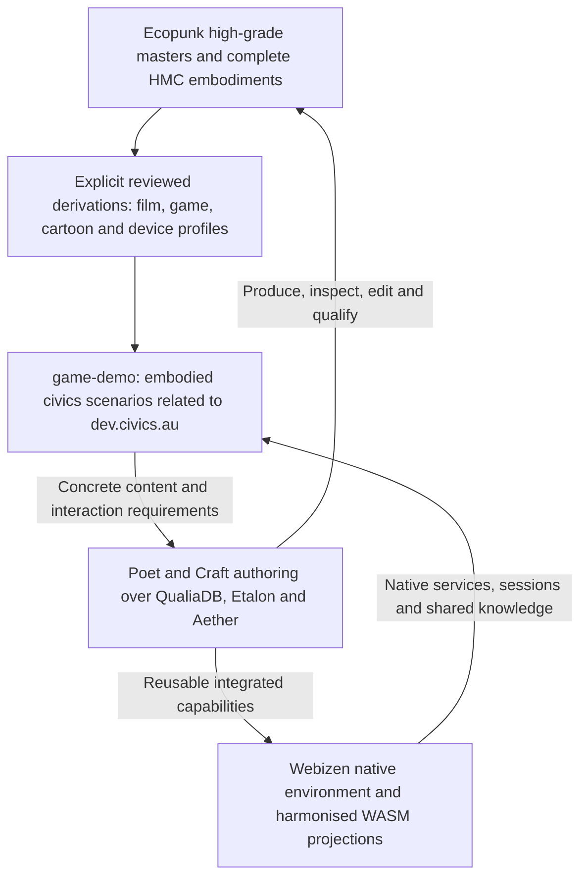

# High-grade masters, civics scenarios and the Webizen experience

**Status:** specification draft v0.2 · **Clarified:** 2026-10-24.
Timothy's purpose clarification governs the production backlog: **Ecopunk
produces high-grade reusable assets and places, from which appropriate reduced
delivery versions can be derived.** `C:/github/game-demo` consumes those outputs
in work related to dev.civics.au, making social problems, solutions and
opportunities understandable through gamified spatial experiences. Developing
the tools to do this also advances Webizen Desktop into the intended native,
knowledge-linked creative and exploratory environment.

Poor place, flora, fauna and artefact representations therefore obstruct the
project's communication and exploration purpose. Treat their failures as product
failures with an identified remedy, not as an unexplained inevitable property of
a prototype or a reduced device profile. Record verified causes separately
from causes still requiring investigation.

Companions: [architecture](../architecture.md),
[production backlog](ecopunk-production-backlog.md),
[style/scale](assets/style-and-scale.md), [HMC contract](assets/asset-package-spec.md),
[model completion](assets/model-completion-claims.md),
[framework/host](webizen-environment-framework.md).

## 0. Civics, civic activity and cooperative obligations

Timothy's vocabulary is binding in this project's specifications:

| Term / axis | Required meaning and record |
|---|---|
| **Civics** | People-led participation, knowledge, standards development, cooperation and commons work. It includes historically unpaid, underpaid and self-funded contributions; a people-led project can also receive compensation without becoming government activity. |
| **Civic** | Government activity or actors acting in a government capacity. Preserve that role rather than using this word as shorthand for the people's civics work. |
| Funding / compensation | Record paid, unpaid, underpaid, self-funded, freely gifted, outstanding, disputed or unknown status with its scope and evidence. Funding status is separate from actor role, authorship, authority and rights. |
| Commercial / human-rights purpose | Classify the particular use under the applicable cooperative-project/commons policy. Organization type, paid employment and asserted purpose are separate facts; government status alone does not classify a use as commercial or exempt. |

Timothy's motivating example is his account of unpaid international W3C
credentials work followed by funded government involvement and control. The
required system behaviour is to retain the originating people, artifacts,
contribution history, actual delegation/control changes and compensation status.
Institutional adoption or later funding must not overwrite those records or
stand in for payment to the originating contributors.

Use the existing [cooperative project/commons layer](cooperative-layer.md),
[contribution chains](contribution-chains.md) and [compensation model](compensation.md).
Qualifying commercial use contributes toward the applicable bounded obligation
cost until it is compensated/discharged. Applicable human-rights purposes may
be without charge before that point. A no-charge use is distinct from a payment,
an authorized contribution waiver and discharge of the project's obligation.
Once the relevant pool is discharged, its cost-recovery charge ends under the
commons policy; preserve attribution/provenance and legitimate separate costs.

The [semantic agreement/instrument handoff](semantic-agreements-and-compensation.md)
maps existing work in `license`, `humanitarian-equity-framework`, the earlier
`semantic-tokens-xec` and QualiaDB. Use its source/evidence distinctions and
AGR-01–11 packets: ontology-defined rights and agreements, executable instruments,
contribution valuation, technical tokens and verified settlement are distinct
linked responsibilities. SDGs work must retain useful contributions and fair
compensation without treating humanitarian purpose as coerced unpaid labour.

| ID | Requirement / acceptance |
|---|---|
| REQ-CIVICS-001 | Preserve people-led civics versus government civic capacity, contributor identifiers/history and actual funding/authority as distinct records. Scenario and UI wording must retain this distinction. |
| REQ-CIVICS-002 | Masters, derivatives, tools and project contributions must retain linked origin/author/derivation and outstanding/settled compensation records through institutional adoption and package updates. Paid downstream employment does not establish settlement of someone else's contribution. |
| REQ-CIVICS-003 | Apply qualifying commercial cost recovery through the existing cooperative/commons machinery, using identified policy/pool/contributions and verified credit/discharge events. Prevent duplicate credits, over-collection and resetting a discharged ancestor pool merely because a derivative or new institutional owner exists. Legitimate new work is separately attributable. |
| REQ-CIVICS-004 | A permitted human-rights no-charge case must record its policy/purpose/scope without falsely crediting a payment, treating silence as a gift or erasing outstanding contributor obligations. Actual payment, authorized waiver and discharge remain separate acts. |
| REQ-CIVICS-005 | Qualify commercial-before-discharge, permitted human-rights use-before-discharge, partial/final settlement, post-discharge use and derivative/ownership-change cases. Use real receipts and source rights; do not invent a royalty on third-party work or replace the existing native cooperative ledger with a private game billing engine. |

## 1. Production direction and ownership

The [credit and periodic-reconciliation contract](credit-allocations-and-periodic-reconciliation.md)
adds a positive pre-funded allocation model, explicit drawdown limits and
provider-directed residual return/carry/purpose delegation. Separately accepted
obligations can be reconciled over agreed periods. Keep provider credit,
contributor compensation and verified settlement distinct; neither unused funds
nor eligible human-rights no-charge use becomes automatic personal debt.

Ecopunk's master quality is set by its high-grade production purpose and agreed
references. A current game device budget, simplified fixture or browser route
does not define that ceiling. Game-demo remains a downstream product and applied
stack evaluation case. Scenario rules and game interaction belong to its authored
Vibe/shared-engine contracts; Ecopunk supplies reusable knowledge, content,
places, embodiments and their production requirements.

The inspected `game-demo/README.md` describes embodied civics/SDG exploration,
bounded scenarios and a current fictional campaign alongside place prototypes.
Its `docs/planning/03-place-data-and-content.md` already requires recognisable
real-place foundations and verified HMC distribution. Preserve those distinctions
when agreeing a shared case; this document does not replace its campaign or
claim the current build achieves the stated experience. The dev.civics.au
relationship here records Timothy's purpose, not an audit of that website.

## 2. Requirements and completion evidence

| ID | Requirement | Acceptance evidence |
|---|---|---|
| REQ-QUAL-001 | Ecopunk MUST produce reviewed high-grade master assets, assemblies and places as the primary production output. | Editable sources, references, diagnostic form, surface detail/materials, appropriate rig/behaviour and high-detail output meet the subject's declared highest-quality criteria. A low-detail demo fixture cannot establish master acceptance. |
| REQ-QUAL-002 | Native tooling MUST retain source structure, parameters/operator history and complete identifiers/knowledge/resource linkage sufficient to revise and regenerate the masters. | Reopen, inspect and edit an organism, a manufactured assembly and a place composition through qualified Poet/Craft/native capabilities; changes propagate with reproducible provenance. A baked screenshot or lossy mesh alone is insufficient. |
| REQ-QUAL-003 | Reduced delivery versions MUST be explicit, reproducible derivatives of identified accepted masters or approved shared sources; they cannot overwrite the master. | Record source/content revision and digest, derivation operations/settings/tool versions, output identifiers, target budget, measured loss and required human acceptance. Temporary derivative previews remain unaccepted until their source and output cases pass. |
| REQ-QUAL-004 | Reduction MUST preserve required identifiers, diagnostic form, proportions/scale, semantic parts, relevant functions, state and scenario comprehension. | Compare master and derivative at intended shots/distances and during movement/interaction. Screen error, topology, materials, rig/clip/contact, picking and functional cases pass declared thresholds. If a budget cannot retain these, record the unmet target and concrete remedy. |
| REQ-QUAL-005 | Style and delivery budget MUST remain separate axes. Film, open-world game and cartoon all require high-grade workmanship. | Cartoon is designed, readable and well animated; it is not approved because detail was removed. Film output resolution does not cap master asset fidelity. Each required profile has its own reviews and preserved semantic invariants. |
| REQ-QUAL-006 | Places MUST have high-grade source/composition, context and recognizable distinguishing features where a real-place depiction is claimed. | Validate relevant terrain/water, routes, structures, ecological distribution, flora/fauna and human scale against identified sources. Mark fictional/illustrative elements and coverage. An attractive generic scene with a place label cannot close the real-place case. |
| REQ-QUAL-007 | Species representations MUST support both visual recognition and the knowledge/scale/behaviour claims made about them. | Unlabelled form, anatomy/parts, surfaces, movement and cross-scale inspection pass visual/domain review; complete available graph/resources remain in the full species HMC. A topology count or ontology label does not establish fidelity. |
| REQ-QUAL-008 | The downstream civics demonstration MUST make a declared problem, possible responses and opportunities understandable through interaction with the place and its systems. | A bounded case links an evidenced or explicitly fictional baseline, actors/needs, constraints/resources, possible interventions, tradeoffs and observable consequences. Show source/model assumptions, uncertainty and state changes; attractive graphics alone cannot establish scenario understanding. |
| REQ-QUAL-009 | Production blockers MUST be explained with evidence, an owning layer and a concrete resolution path. | A failure record identifies expected output, observed defect, artifact/revision/target, source or execution evidence, known/unknown cause, blocked capability and proposed owner/API/content task. Distinguish a missing kernel, missing binding, unused asset and unfinished authored content. No unexplained quality downgrade or unsupported root-cause certainty. |
| REQ-QUAL-010 | Tool and dependency development MUST be evaluated through improved authoring and delivered outcomes, alongside its scoped technical checks. | Show an artist/agent creating and editing the selected masters, deriving them and using the outputs in the actual consumer. Link each gap closure to its visible/functional result; source presence alone cannot close product delivery. |
| REQ-QUAL-011 | Webizen MUST support continuity between spatial experience, knowledge inspection, authoring and bounded exploration of alternatives. | From a place, inspect an entity and source, move between relevant scales/representations, open its authoritative editing context in Poet, checkpoint a permitted revision and compare a scenario alternative. Preserve identifiers/state/provenance and declared service ownership through native/WASM handoffs. Layout and exact interaction design remain to be reviewed. |
| REQ-QUAL-012 | Completion claims MUST cover master quality, derivation quality, actual downstream use and the declared experience outcomes separately. | Link all applicable model/scene/scenario cases and reviews to actual source, HMC and runtime artifacts. A passed reduced profile cannot certify its master; an accepted master cannot certify game-demo or Webizen integration. |

## 3. Master and derivative contract

Keep the full embodiment's graph and master resources distinct from a selected
runtime working set. Device LOD/residency does not remove knowledge from the full
release. An exported reduced HMC must state its coverage and explicit base/master
references; it must not claim an omitted graph/resource corpus is complete.
Use existing HMC/Q42 descriptors and qualified native compilers; the exact
metadata binding remains an owning-format decision, not a new private format.

Derivation may include retopology/decimation, texture baking/compression/mips,
groom/foliage proxies, rig/clip simplification, collision/occlusion resources and
other justified operations. Stylised depictions may need deliberate authoring
against shared sources rather than automatic decimation. All retain lineage,
editable inputs, compatibility and subject-specific loss criteria.

The place dossier adds composition/source layers, coordinate/time conventions,
site-specific features and species/assembly/representation references to the
per-model records. A scenario dossier separately identifies the learning or
exploration intent, baseline, possible actions, governing models/constraints,
assumptions, visible results and acceptance cases. Natural, made-world, person,
place and scenario identifiers remain distinct. A species HMC need not absorb an
entire place or game campaign to be complete.

## 4. Reference experience and work allocation

Select one real-place or explicitly fictional civics case with a tree, animal,
vehicle, person and community structure/system. The supplied community-grounds
image can inform composition and possible system examples. It does not establish
which factual locality or civics intervention is approved.

The required demonstration proceeds from reviewed masters to selected consumer
derivatives, then into a bounded interactive scenario. For example, repair access,
water availability or shared energy could be a proposed case; scope and causal
models must be specified before claiming the outcome is simulated. Follow the
same identified subjects through knowledge inspection, native Poet editing,
package update and Webizen/game-demo presentation. Qualify offline/local and
native-assisted behaviour where declared; do not invent a second browser state
engine for the demonstration.

| Outcome | Existing work packets that must deliver it |
|---|---|
| High-grade master criteria and complete scope | ECO-001/004/005/007/008, 061–080; TOOL-03–09 |
| Native editable source and preserved derivation | ECO-024–030, 044–050, 052–060, 079/104; G74–G78 and G86 |
| Recognisable places and understandable civics case | ECO-071–078, 091–100; place/scenario dossiers and consumer interface contract |
| Actual high-grade → derived → game-demo handoff | ECO-027/030/104/114–117; master/output/runtime IDs and matched evidence |
| Webizen spatial/knowledge/creative continuity | ECO-031–040/098–100/116; ENV-03–07, REQ-QUAL-011 |
| Honest blocker reporting and completion | ECO-009/010/111–120; every applicable 193-catalogue case plus added place/scenario/derivation obligations |

M1 diagnostic fixtures and early blockouts remain useful engineering inputs;
they are not accepted master assets or release-quality derivatives. Finish one
reviewed master family and bounded place/scenario path before scaling production.
General tool/engine improvements can proceed alongside that work against concrete
acceptance cases. Neither indefinite architecture work nor a convenient low-grade
consumer profile closes the content-quality requirement.

## 5. Open decisions

Accepted reference place/civics case and master visual boards; supported consumer
budgets and preservation thresholds; exact native derivation/operator APIs;
HMC lineage/coverage bindings; selected scenario models/assumptions; experience
layout and interaction review; actual owner/reviewer allocation. The high-grade
production direction, downstream civics purpose and tool-to-Webizen feedback loop
are established requirements. No implementation or visual acceptance is claimed
by this specification update.
