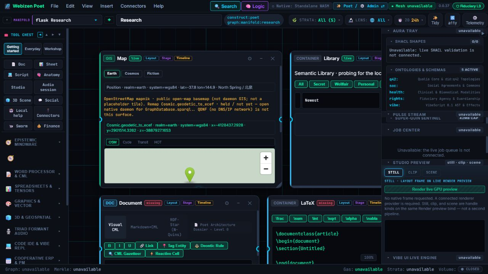

# Reusable MIT capabilities and one Poet interface

**Status:** specification / migration design v0.2 · **Updated:** 2026-10-26.
Timothy's clarifications: refactor the MIT-licensed source capabilities and
useful editing/UI behaviour into **Poet**, preserving its existing functionality.
They become internal Poet functionality, not a separate suite product. Preserve
required notices and existing source compatibility while allocating any renaming.
The earlier `C:/github/craft` layout is a migration/extraction proposal to
reconcile per library with current source homes; a blanket folder move is not
the product outcome or a prerequisite for every usable authoring slice.

The [comprehensive authoring review](poet-comprehensive-authoring-review.md)
covers original workspace continuity, all eleven source families, current native
human/agent paths and existing QualiaDB owners/contracts. It supersedes stale
CLI-only/no-native-IntentBus observations below without asserting full parity.

Additional source, 26 October: `C:/github/storytold/effectcraft-main` is reviewed
in the [EffectCraft evidence index](../../qa/implementation-2026-10-26/effectcraft-review/README.md).
Apply the [existing-code adaptation guide](poet-capability-adaptation-guide.md)
to all source families: map the required operation to prior Poet/QualiaDB
implementations, then admit matching engine/UI behaviour. Renaming/copying a
whole app or embedding its shell does not establish that adaptation.

This continues the specification-first work. It defines the extraction and UI
integration. This document itself performs no source relocation, build, test or
publication. Later saved code/evidence must be considered separately; do not
interpret the original snapshot as a statement that no migration has happened.

Companions: [architecture](../architecture.md),
[production toolchain](assets/production-toolchain-spec.md),
[interfaces](interfaces.md), [model completion](assets/model-completion-claims.md).

The subsequent [framework/environment clarification](webizen-environment-framework.md)
establishes Aether, the controlled Dioxus fork at `C:/github/rust-app-framework`, Webizen
Desktop's native launcher/host role, and harmonised native and WASM versions of
Poet. Reconcile existing host/OS-shell services and shared UI contracts through
that foundation. WASM native dependencies are explicit per capability; the
native graphical path must independently satisfy the no-JS/V8 requirement.

**Excluded from extraction:** Chora, the Servo-derived engine at
`C:/github/chora`, keeps its own source/workspace/license boundary under the
[Chora contract](chora-engine-boundary.md). It is not a Craft crate collection
or Aether implementation component. Host-side adapters integrate generic engine
interfaces without moving/copying engine implementation into this workspace.

## 1. What can be recovered now

Read-only inspection on 24 October found:

| Location | Evidence / limitation |
|---|---|
| [Published Poet reference](https://mediaprophet.github.io/qualiaDB/poet-app/index.html) | Live title: “Webizen Poet WASM — Tool-Chest & Manifolds”. Visible menus, tool chest, canvas/manifolds, content containers, stage/timeline controls and inspection tray remain. Native status reports standalone WASM and several services unavailable. This is a UX reference, not proof of a working native authoring chain. |
| `C:/github/poet/wasm/src/lib.rs` | Exports tool-chest/core, constructs/manifolds, ContextRef, IntentBus/receipts, registry and Vibe facade. |
| `C:/github/poet/wasm/src/browser/` | Existing UI includes container/layout/context, menus/toolbars, command palette, tool chains, views, jobs, graph/ontology and authoring modules. It is DOM/web-sys based; preserve its product behaviour while supplying the native projection. |
| `C:/github/poet/native` | Current native graphical source/spatial/material/resource/workflow slice is implemented and has scoped execution evidence. Original workspace/media/document recovery and actual human acceptance remain partial; see the current review. The CLI is a separate entry. |
| `C:/github/webizen-desktop/src/commands/{poet,vibe_host,poet_daemon,poet_render}.rs` and shell/settings integration | Host services and Poet entry points still exist. Preserve/extract useful host functionality and native capability wiring rather than assuming all previous Poet work is absent. |
| `C:/github/qualiaDB/crates/webizen-studio/src/components/poet/` | Older Poet presentation modules remain; reconcile behaviour and source lineage instead of growing another independent frontend. |
| `C:/github/poet/old/` | Historical design/reference/source trees remain. They are recovery inputs, not permission to overwrite the current application. |

The user's loss of the intended integrated experience is not contradicted by
the presence of files. The precise regression/removal history has **not** been
established: source history, prior working artifacts and actual native runs
must be reconciled before assigning a cause or declaring recovery complete.
Published/local artifact byte identifiers were not established in this inspection.



## 2. Target repository layout

The directory tree below records the **historical proposed extraction layout**,
not a mandatory current move map or a claim of existing crates/parity. The current
`C:/github/craft/README.md` records a bounded geometry extraction; native Poet also
consumes internal library owners under its workspace. Review and preserve those
actual consumers before changing a source home. Additional media engines are
admitted/refactored individually under their resolved internal/native owners.

```text
C:/github/
  craft/
    Cargo.toml                 consolidated library workspace
    crates/
      cadcraft-geom/ ...       retained namespaced domain/kernel/codec crates
      cadcraft-engine/
      photocraft-*/ ...
      filmcraft-*/ ...
      soundcraft-*/ ...
      vectorcraft-*/ ...
      wordcraft-*/ ...
      gridcraft-*/ ...
      deckcraft-*/ ...
      lightcraft-*/ ...
      pdfcraft-*/ ...
      <selected-artcraft-libs>/
    adapters/                  native Poet command/session/source bridges
    fixtures/                  bounded, licensed verification inputs
    migration/                 origins, file/crate map, notices, compatibility
    tools/                     one namespaced build/verification tool surface
  poet/
    <shared model>/            reused/extracted Poet composition and context
    <unified UI>/              tool chest, panels, editing surfaces and menus
    native/                    graphical native host + explicit CLI target
    wasm/                      supported shared projection; preserve existing UX
  rust-app-framework/          Aether: controlled native/WASM framework
  chora/                       separate Servo-derived engine; not consolidated
  webizen-desktop/             native launcher/host environment and services
  webizen-os-shell/            reconcile useful host/UI source; final home open
  qualiaDB/                    graph/Vibe/codecs/shared capabilities
  etalon/                      owning custom hardware/compiler dependencies
```

The original `poet-*craft` working copies remain intact while the destination
is staged and qualified. Inventory all crates and decide their disposition;
do not copy eleven full applications and call that integration. No original
history, assets, notices or user changes should disappear as a side effect.
The `craft` directory was absent in the 24 October inventory; it exists in the
26 October source review. Neither fact certifies whole-suite extraction.

### Dependency direction

```text
Poet UI / Vibe commands
  -> native domain adapters and internal headless document engines
    -> qualified shared QualiaDB capability/format/graph libraries
      -> their owning custom dependencies
```

Poet owns authoring navigation/composition. Internal domain libraries own
medium-specific document/editing/codec capabilities. Shared primitives with an
established QualiaDB owner are consumed there, not duplicated for a renamed tool.
QualiaDB must not depend back on the Poet application or a foreign UI, creating a
cycle. Mere physical colocation does not change API/ownership boundaries.

## 3. Every source unit gets a disposition

| Source category | Intended destination / treatment |
|---|---|
| UI-independent geometry, colour, text, imaging, DSP, time, codec and document libraries | Reuse under resolved internal library ownership, preserving exact source/API compatibility until an explicit migration. Prefer existing shared QualiaDB operations when contracts match; do not merge superficially similar algorithms by name or preserve a separate product brand as architecture. |
| Editing command/session/history logic | Reusable native domain engines, with one authoritative state/session and Poet command adapters. |
| Reusable UI semantics | Extract selection, gesture, editor state, menu/command descriptions, validation and accessibility behaviour into shared/pure models as appropriate. |
| Domain editing surfaces and controls | Port/integrate into Poet's content containers, inspectors, tool chest, menus and timelines using the canonical native UI/rendering path. Preserve each useful function, not the foreign app's entire desktop shell. |
| egui/React/Tauri application chrome and launchers | Retained migration/reference material while behaviour is ported; not mandatory runtime dependencies or eleven windows embedded inside Poet. Framework-specific controls cannot simply be imported as Poet widgets. |
| Native OS mechanisms | Toolkit-independent authorized host services. File/device/GPU lifetime and access stay with the owning native host, not duplicated in each tool. |
| Provider/network clients | Optional, capability-scoped libraries with retained rights/provenance and explicit authorized invocation; do not import accounts/secrets/runtime caches into the consolidated source. |
| Test/fixture/build crates | Preserve and remap evidence paths; consolidate duplicate build tools, keep hostile-input/property/regression coverage and source notices. |
| Examples/plugins/vendor/source snapshots | Explicitly classify and bound; not automatically workspace members or production capabilities. |

The lossless UI/function inventory must map **every existing command, panel,
editor gesture, shortcut, context-menu entry, dialog, view and accessibility
behaviour** to retained/ported/combined/replaced/pending, with source and target
IDs and evidence. “Removed because we stripped the app” is not acceptance.
Retire a genuine duplicate only with its replacement/compatibility recorded.

## 4. What gets added to Poet

Poet remains the product surface shown in the reference: an authoring canvas
with coherent Construct/context, tool chest, containers and views. Integrate:

- Drawing/CAD/3D tools and geometry manipulation into the selected spatial
  content and its part/assembly inspector.
- Photo/RAW/vector tools into the relevant image/material/vector editor
  surface, with consistent selection and source/colour management.
- Audio tools into tracks, source/event/emitter editing and mixing views;
  film editing into shared stage/timeline/sequence and render/output views.
- Word/PDF/grid/deck functions into their content bodies and focused toolsets,
  retaining underlying editing/file semantics rather than replacing them with
  generic forms.
- Native graph, component/variant, behaviour, HMC and per-deliverable claim
  inspection in the same workspace for the current entity/document context.

Menus, command palette, contextual controls, tool chains, keyboard and agents
dispatch the same versioned commands against the same selected document/part
and expected revision. One document has one authoritative engine/session; no
parallel browser copy of facts or hidden Craft-app state. Gesture begin/preview/
commit/cancel, jobs, undo/recovery and accessible controls need coherent contracts.

Existing DOM-based Poet is a reference for product continuity, not permission
to make JavaScript/V8 a required layer. Extract shared model/interaction logic,
then express the native UI through Vibe and qualified native component/render
bindings. Audit the actual host dependencies: removing Tauri or selecting a
framework does not by itself prove a JS/webview-free native workflow.

## 5. Why relocation is a migration, not a folder rename

[source-inventory.json](craft-consolidation/source-inventory.json) lists the
static visible manifest inputs, source hashes and unassessed destination rows.
Inspection found **324 manifests across eleven repositories**, including **271
under crate trees**. These are discovery candidates, not 271 proven reusable
production libraries. The enumeration respects ignore rules and does not
resolve the complete Cargo dependency graph. Git/dirty state is not yet audited.

The manifests include a duplicate `xtask` package in ten workspaces. Other
issues to resolve before unified workspace admission include:

- `[workspace.dependencies]`, package metadata/lints/profiles, feature flags,
  resolver/rust-version differences and root-relative dependency paths.
- `include_*`/build-script/generated inputs, bundled assets/shaders/fonts,
  fixture/corpus paths, license/notice files and tool discovery.
- Native versus WASM targets, optional codecs/providers/platform libraries,
  duplicate versions/types and transitive UI dependencies.
- Persisted document formats, existing command IDs and recovery compatibility;
  source movement does not justify changing their semantics or dropping data.

Preserve existing namespaced package names on first extraction. Unify build
tool names and reconcile root configuration explicitly. A single directory
could temporarily retain separate workspaces, but that would be a staging
layout, not completion of the proposed consolidated library workspace.

## 6. Dependency-ordered migration packets

All packets are **open**. This plan is not execution evidence.

| Packet | Work | Required completion evidence |
|---|---|---|
| PC-01 | Establish current/historical Poet UX, native host and source baselines; inspect repository state and recover last working functionality. | Source/artifact identifiers, user-change preservation, feature/UI matrix, real working/unavailable results. No assertion that a new shell replaces restored Poet. |
| PC-02 | Extend the static manifest inventory into full file/dependency/license/build-input/feature graph and extraction map. | Every source unit has origin, role, disposition, target and loss/compatibility record, including UI/tests/assets; unresolved dependencies remain open. |
| PC-03 | Reconcile historical extraction paths with current internal Poet/shared library owners; admit/refactor reusable libraries additively in bounded groups. | Exact source/consumer/migration map, compatibility and notices; correct workspace paths/features/metadata, no sibling source loss, actual checks when implementation is resumed. Folder colocation alone is not completion. |
| PC-04 | Reconcile shared primitive ownership and native app/session/command contracts with the existing ST/Vibe/Qualia interfaces. | Versioned schema/dispatch, state/selection/undo/job/capability semantics; no circular or duplicate authoritative state. |
| PC-05 | Recover/refactor Poet's shared composition and native graphical host using the existing UI as the continuity baseline. | Native Poet presents its real tool chest/canvas/content/inspection workflow and reaches actual engine services without required JS/V8. The CLI remains separately identified. |
| PC-06 | Port each medium's complete editing/UI behaviour into Poet, one vertical slice at a time. | UI/function inventory rows resolve to real native commands and domain surfaces; users can open, edit, undo, checkpoint/reopen and export through Poet for each medium. No placeholder panel or external app launch counts as integrated functionality. |
| PC-07 | Integrate the full 3D/CAD/rig/animation/behaviour/material/film/game/cartoon HMC production path. | Actual native source-to-HMC workflow and per-model deliverable evidence under G75–G78, with stable graph/part/variant identifiers. |
| PC-08 | Cut over workspace consumers/build/deployment references and retire redundant runtime dependencies only after parity. | Reviewed dependency graph, native regression/UX evidence, compatible persistent data, reproducible builds and retained rollback/reference sources. Update published projection only as separately authorized. |

Source extraction completion requires its exact map/workspace gates.
Comprehensive Poet additionally requires native product continuity,
all inventoried domain functions and qualified end-to-end authoring. Moving
source directories, adding a menu item or showing a screenshot alone proves
neither. Each packet reports its exact resolved/open IDs and evidence.

## 7. Precedence and open decisions

This clarification supersedes the **product goal** of eleven independent Craft
applications in prior ST assumptions. It does not erase their source history or
authorize destructive cleanup, relicensing, publication, or copying account data.
The older source/contract research remains useful; reconcile it rather than
blindly following the old repository layout. File migration and implementation
remain future work in this specification-first conversation.

Open: final consolidated repository/source-control strategy and origin-history
retention; exact crate move map and root configuration; existing shared UI/host
contract integration and native renderer qualification; Poet recovery/parity criteria; dual
target build/deployment path and verified source identifiers of the public page.
The one-Poet-interface requirement, controlled framework fork, native launcher
and supported native-assisted WASM direction remain established. Historical
directory proposals do not override the current product boundary or actual
qualified library homes; all medium-specific editing functions remain allocated.
