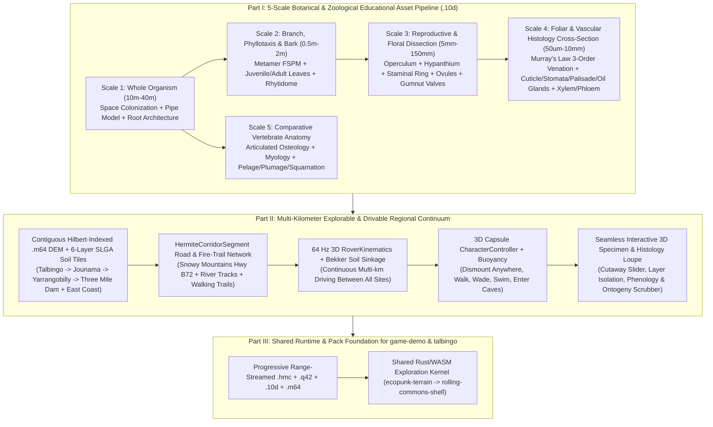

# Master Implementation Plan: Educational-Grade Botanical/Biological Digital Twin Assets, Multi-Kilometer Explorable Continuum & `game-demo` Foundation

**Status:** Draft for Execution Approval  
**Target Repositories:**
- Primary Foundation & Asset Compiler: `C:\github\ecopunk` (`crates/ecopunk-terrain`)
- Upstream Biophysical & Geometric Kernel: `C:\github\qualiaDB` (`crates/qualia-core-db`, `crates/qualia-sim`, `crates/qualia-geospatial`, `crates/webizen-render`)
- Downstream Interactive Consumer: `C:\github\game-demo` (`crates/rolling-commons-shell`, `crates/pack-export`) and `C:\github\talbingo`

---

## 1. Root-Cause Audit: Why Current Visuals & Exploration Fall Short

Three parallel code-level audits of `C:\github\ecopunk`, `C:\github\qualiaDB`, `C:\github\game-demo`, and `C:\github\talbingo` identified the exact architectural disconnects causing the two problems you observed:

### A. Why the Models Are Not Yet Educational-Grade for Botany & Biology
1. **Placeholder Study Meshes (`4` to `42` Vertices):**
   - In `C:\github\ecopunk\assets\models\corymbia-aparrerinja\model-set.json` (lines 75–183), the botanical study assets are microscopic placeholders:
     - `leaf-study-blade.10d` has **4 vertices and 4 triangles** (`677` bytes) — a flat diamond quad with zero venation, zero stomata, zero oil glands, and zero cellular histology.
     - `leaf-study-midrib.10d` has **14 vertices and 24 triangles** (`957` bytes).
     - `bark-study-surface.10d` has **42 vertices and 80 triangles** (`2,652` bytes).
   - In `C:\github\ecopunk\entities\taxa\corymbia-aparrerinja\build-specimen.ps1` (lines 52–56), `hero-geometry.bin` is filled with 64 KB of repeating dummy `0x01` bytes.
2. **Fake Specimen Loupe Mesh in `scene_builder_10d.rs`:**
   - In `C:\github\ecopunk\crates\ecopunk-terrain\src\scene_builder_10d.rs` (`build_closeup_specimen_10d`, lines 2222–2247), the specimen builder does **not** construct a botanical specimen mesh at all — it calls `build_sector_10d("talbingo")` and zooms the camera into `[0.0, 0.25, 1.35]`!
3. **Unused Biophysical & Computational Geometry Solvers in `qualiaDB`:**
   - `qualiaDB` already contains rigorous, peer-reviewed mathematical botany modules that are **not wired** into `ecopunk-terrain`'s `.10d` mesh synthesizer:
     - `qualia-core-db/src/specialized_libs/computational_geometry/turtle_3d.rs`: Prusinkiewicz & Lindenmayer 3D L-System turtle (`interpret_lsystem_3d`) with 64-level bracket stack, gravitropism, and generalized cylinders.
     - `qualia-core-db/src/specialized_libs/computational_geometry/space_colonization.rs`: Runions et al. 3D crown/root space colonization (`grow_crown`, `emit_lateral_buds`) with golden-angle ($\phi = 137.5077^\circ$) phyllotactic bud emission.
     - `qualia-core-db/src/specialized_libs/computational_geometry/tree_skeleton_3d.rs`: Leonardo da Vinci / Shinozaki Pipe Model (`pipe_model_radii`, $r_i^\eta = \sum r_c^\eta$, $\eta \approx 2.49$) and root flare taper (`root_flare_radius`).
     - `qualia-sim/src/metamer_fspm.rs`: 128-node Functional-Structural Plant Model (`PlantArchitecture`) with sapwood/heartwood pipe partitioning, GDD/chilling budbreak phenology, and gravity bending moments.
     - `qualia-sim/src/leaf_biophysics.rs`: `LeafVascularSkeleton` with Murray's Law ($r_p^3 = r_1^3 + r_2^3$) vein tapering, 1st/2nd/3rd-order reticulate anastomosing loops, Hagen-Poiseuille hydraulic conductance ($K \propto r^4 / (\mu L)$), and turgor-driven curl.

### B. Why the World Feels Like "Motion PNGs with Camera Orbit" Instead of an Explorable Continuum
1. **Miniature $[-1.95, 1.95]$ Box & 10-Frame APNG Baking in `ecopunk`:**
   - `scene_builder_10d.rs` compresses an entire geographic sector into a normalized $[-1.95, 1.95]$ diorama box and bakes 10-frame animated PNGs (`sector_*.png`) during offline compilation.
   - `index.html` and `viewer/index.html` only allow mouse-orbiting around a single static `.10d` buffer at a time (`camera.yaw`, `camera.pitch`, `camera.distance`), with no WASD/gamepad ground locomotion, no vehicle physics, no road corridor connecting sectors, and no dynamic `.m64` terrain chunk streaming.
2. **Hardcoded Coordinate Pens & 1D Rail in `C:\github\game-demo`:**
   - In `C:\github\game-demo\crates\rolling-commons-shell\src\talbingo_scenes.rs` (lines 10–30, 76–105) and `lib.rs` (lines 82–149):
     - Driving is restricted to a 1D mathematical curve (`road_z(site, x)`) spanning only **22.35 units** ($x \in [-5.45, 16.9]$), with `talbingo_vehicle_pose_y` throwing a hard error outside $x \in [-6.0, 23.0], |z| \le 8.5$.
     - Walking is trapped inside an **11m × 14m pen** ($x \in [13.0, 24.0], z \in [-7.0, 7.0]$) in `talbingo_walker_pose_y`.
     - Terrain uses toy analytical sine/logistic formulas (`talbingo_terrain.rs:8-107`) over a single 64m × 44m grid, and switching between the 6 campsites (`The Pines`, `Humes Crossing`, `Jounama Creek`, `Yarrangobilly Village`, `O'Hares Rest Area`, `Three Mile Dam`) discards the scene and recompiles all recipes on the CPU (`asset_compile.rs`).

---

## 2. Target Architecture Overview

---

## 3. Work Breakdown Structure (7 Epics)

### Epic 1: Multi-Scale Botanical Architecture & Organ Generator (`crates/ecopunk-terrain/src/botanical_anatomy.rs`)
Satisfies `digital-twin-asset-requirements.md` (`DTA-SC-01..06`, `DTA-VIS-01..10`, `DTA-LIFE-01..10`) by wiring `qualiaDB`'s biophysical solvers directly into high-resolution, zero-heap `.10d` B-Rep + SDF + `PROC1` + `EONT1` + `MRP1` containers across **4 botanical scales**:

1. **Scale 1 — Whole-Organism Architecture & Root System (`10 m – 40 m`):**
   - Wire `space_colonization::grow_crown`, `tree_skeleton_3d::pipe_model_radii` ($\eta = 2.49$), `root_flare_radius`, and `metamer_fspm::PlantArchitecture` to generate continuous branching orders **1 through 5** (primary bole, secondary scaffold limbs, tertiary branches, quaternary branchlets, terminal twigs) with smooth branch-collar saddle junctions (no disconnected floating cylinders).
   - Generate explicit subterranean & surface **Root Architecture** (`Lignotuber` swelling with dormant epicormic meristem buds, primary taproot, lateral buttress flares, and mycorrhizal fine feeder root networks) viewable via a terrain soil-cutaway toggle.
   - Support all 4 `DevelopmentalStage` states (`Seedling` with cotyledons and opposite juvenile leaves, `Sapling` with competing leaders, `Mature` full canopy, and `AncientHollowBearing` with fungal heartwood decay cavities and broken staghorn limbs).

2. **Scale 2 — Branchlet, Phyllotaxis & Stem/Bark Histology (`50 mm – 2 m`):**
   - Generate true phyllotactic node/internode sequences using `space_colonization::emit_lateral_buds` ($\phi = 137.5077^\circ$ spiral or decussate opposite-to-alternate ontogenetic transition characteristic of *Corymbia* and *Eucalyptus*):
     - **Juvenile foliage:** Sessile/short-petiolate, opposite, ovate-cordate glaucous blades.
     - **Adult foliage:** Pendulous, alternate, petiolate, falcate-lanceolate isobilateral sclerophyllous blades (`80–160 mm × 15–35 mm`) hanging vertically to minimize midday photoinhibition.
   - **Stem & Bark Anatomical Cross-Section (Transverse, Radial & Tangential Planes):**
     - Generate an inspectable multi-layer stem wedge mesh (`stem-anatomy-wedge.10d`) with individually selectable/peelable tissue layers:
       1. **Outer Rhytidome / Decorticating Periderm** (chalky-white shed flakes on *Corymbia aparrerinja* vs persistent fibrous stringybark vs smooth scribbly gum with *Ogmograptis* moth larval galleries),
       2. **Phellogen (Cork Cambium) & Phelloderm**,
       3. **Secondary Phloem** (sieve tubes, companion cells, bast fibres, kino veins/ducts),
       4. **Vascular Cambium** (meristematic ring),
       5. **Sapwood (Active Secondary Xylem)** (vessel elements/pores, tracheids, axial parenchyma, medullary rays),
       6. **Heartwood (Duramen)** (tyloses + polyphenolic kino-impregnated core) & central **Pith**.

3. **Scale 3 — Floral & Fruit Reproductive Dissection (`5 mm – 150 mm`):**
   - Replace the low-poly bud/gumnut stubs with dissectible, anatomically labeled `.10d` reproductive organs across the full phenological cycle:
     - **Inflorescence Architecture:** Axillary compound corymbose panicle of 3–7-flowered **umbellasters** (`peduncle` $\to$ `pedicels` $\to$ `flower buds`).
     - **Floral Bud & Anthesis Dissection (`flower-dissection.10d`):**
       - **Hypanthium (Floral Cup / Calyx Tube)** fused with the inferior ovary wall,
       - **Operculum (Calyptriform Cap)** — outer sepaline + inner petaline cap with abscission scar ring that lifts off during anthesis (`MRP1` morph target from sealed bud $\to$ shedding operculum $\to$ full stamen expansion),
       - **Staminal Ring (Androecium)** — multi-whorled inflexed cream filaments bearing dorsifixed versatile **anthers** with longitudinal dehiscence slits and pollen grains,
       - **Gynoecium (Pistil)** — central terete **style**, capitate **stigma**, nectariferous **floral disc**, and longitudinal ovary cutaway revealing **3–4 locules**, axile **placentation**, **ovules**, and **ovuleode** sterile structures.
     - **Woody Capsule (Gumnut) & Seed Dissection (`gumnut-dissection.10d`):**
       - Urceolate/campanulate woody capsule (`8–12 mm`) showing the **rim (scar of operculum)**, **nectary disc**, **enclosed/sunken valves** (dehiscing open on desiccation/fire heat), internal **locule chambers**, red-brown **chaff**, and winged/saucer-shaped fertile **seeds** with embryo cotyledons.

4. **Scale 4 — Foliar Lamina Venation & Cellular Cross-Section (`50 µm – 50 mm`):**
   - Wire `qualia_sim::leaf_biophysics::LeafVascularSkeleton` directly into a high-resolution leaf organ & microscopic histology cutaway (`leaf-anatomy-cutaway.10d`):
     - **Macro/Meso Lamina:** Prominent midrib, **intramarginal vein** (running parallel just inside the leaf margin — the diagnostic taxonomic hallmark of Myrtaceae/*Eucalyptus*/*Corymbia*), pinnate secondary lateral veins at $45^\circ\text{–}65^\circ$, and tertiary reticulate areoles enclosing translucent **schizogenous essential oil glands** (1,8-cineole / $\alpha$-pinene terpenoid cavities).
     - **Microscopic Cellular Transverse Section (Isobilateral Sclerophyll Histology Block):**
       1. **Waxy Epicuticular Cuticle** (crystalline wax platelets),
       2. **Upper & Lower Uniseriate Epidermis** with sunken **Amphistomatic Stomatal Complexes** (paired kidney-shaped **guard cells** with chloroplasts, **subsidiary cells**, stomatal pore, and substomatal vapour cavity),
       3. **Isobilateral Palisade Mesophyll** (2–3 dense columnar chlorenchyma layers beneath *both* adaxial and abaxial surfaces — typical of vertically hanging Australian eucalypts),
       4. **Central Spongy Parenchyma & Collateral Vascular Bundles** (adaxial **xylem vessels**, abaxial **phloem sieve tubes**, surrounded by thick-walled **sclerenchyma bundle-sheath girders** extending to both epidermises),
       5. **Spherical Schizogenous Secretory Oil Gland** lined with epithelial secretory cells.

---

### Epic 2: Comparative Zoological Anatomy & Multi-Layer Biomechanical Rigs (`crates/ecopunk-terrain/src/zoological_anatomy.rs`)
Upgrades key Australian vertebrate taxa (*Macropus giganteus* Eastern Grey Kangaroo, *Vombatus ursinus* Common Wombat, *Ornithorhynchus anatinus* Platypus, *Aquila audax* Wedge-Tailed Eagle, *Menura novaehollandiae* Superb Lyrebird, *Varanus varius* Lace Monitor, *Pseudophryne corroboree* Southern Corroboree Frog) from coarse 9-part primitive blobs to educational **3-Layer Anatomical Twins**:
1. **Layer 0 — Articulated Osteology (Skeletal System):**
   - Anatomically accurate cranium/mandible (e.g., diprotodont diastema & procumbent lower incisors in macropods/vombatids; leathery electroreceptive bill rostrum in platypus; keeled sternum & furcula in raptors), cervical/thoracic/lumbar/sacral/caudal vertebrae, ribcage, pectoral girdle, pelvic girdle (including **epipubic bones** characteristic of marsupials and monotremes!), and pentadactyl/syndactyl limb osteology.
2. **Layer 1 — Major Myology & Tendon Mechanics (Muscular System):**
   - Key functional muscle groups (e.g., macropod gastrocnemius, plantaris, and elastic **Achilles tendon** energy-recovery spring; avian pectoralis major & supracoracoideus flight muscles; vombatid fossorial deltoid/triceps digging musculature).
3. **Layer 2 — External Integument, Pelage, Plumage & Squamation:**
   - High-resolution outer body mesh bound to the 18-joint PGA `Motor` skeleton (`FaunaSkeletalRig10d`) with `MRP1` morph targets for costal respiration, gular vocalization, ear pinnae rotation, and ontogenetic growth.
4. **Interactive Layer Peel in Specimen Loupe:**
   - Educators and students can toggle or cross-fade `Integument` $\leftrightarrow$ `Myology` $\leftrightarrow$ `Osteology` while the animal's 2D Delaunay locomotion blend-space or IK posture runs in real time.

---

### Epic 3: Taxonomic Semantic Spine & Interactive Educational Annotations (`crates/ecopunk-terrain/src/botanical_ontology_q42.rs`)
1. **Anatomical Sub-Mesh IRI & Ontology Binding:**
   - Every organ and cellular layer in the `.10d` container receives a deterministic 60-bit `Q42` entity token and `PROV` provenance record mapped to standard biological ontologies (**Plant Ontology `PO:`**, **Uberon `UBERON:`**, **Gene Ontology `GO:`**, and **Australian Plant Census `APC`**):
     - e.g. `po:0009010` (seed), `po:0009084` (pericarp/capsule valve), `po:0009066` (anther), `po:0002000` (epidermis), `po:0000032` (stomatal complex), `po:0005679` (palisade mesophyll), `po:0005352` (xylem), `po:0005417` (phloem), `uberon:0002415` (tail vertebra), `uberon:0003661` (epipubic bone).
2. **3D Anatomical Pin & Cross-Section Callout System:**
   - Each study asset exports 3D anchor coordinates (`[f32; 3]` + surface normal + camera focus preset) so hovering or clicking any sub-structure in the 3D viewport or Specimen Loupe highlights that exact tissue layer and displays its botanical/zoological name, histological function, biophysical equation (e.g. stomatal conductance $g_s$, Hagen-Poiseuille xylem flow, Achilles elastic strain energy), and Indigenous ecological/ethnobotanical significance.

---

### Epic 4: Multi-Kilometer Contiguous Terrain Substrate & `HermiteCorridorSegment` Road Network (`crates/ecopunk-terrain/src/world_continuum.rs`)
Replaces both the $[-1.95, 1.95]$ diorama box in `ecopunk` and the 1D 22-meter `road_z` rail in `game-demo` with a real metric, geodetically anchored regional world:
1. **Metric World-Space Coordinate System (Meters, Not $[-1.95, 1.95]$ Normalized Units):**
   - Anchor the Snowy Mountains / Talbingo corridor in genuine metric local tangent plane (ENU meters relative to Talbingo Dam wall origin `35.5880°S, 148.3180°E`, elevation `400 m – 1,800 m AHD`) backed by Hilbert-indexed $64 \times 64$ `.m64` DEM + 6-layer SLGA soil tiles (`qualia_geospatial::geotiff::compile_raster_to_m64`).
2. **Continuous `HermiteCorridorSegment` Road, Fire-Trail & River Network (`qualia_geospatial::corridor`):**
   - Construct a continuous, driveable 3D spline road network (`CorridorNetwork`) with superelevation banking, cut-and-fill roadbed embankments, drainage ditches, and bridge crossings connecting all 6 Talbingo / Kosciuszko sites and regional portals:
     1. **Site 0 — The Pines & Dam Foreshore** (`km 0.0`, `410 m AHD`, *Corymbia* / *Eucalyptus viminalis* riparian gallery),
     2. **Site 1 — Humes Crossing & Blowering Foreshore** (`km 1.8`, `405 m AHD`, submerged river flats & alluvial gravel bars),
     3. **Site 2 — Jounama Creek Valley** (`km 4.2`, `460 m AHD`, montane wet sclerophyll & *Bogong* moth granite boulder shelters),
     4. **Site 3 — Yarrangobilly River & Silurian Limestone Karst Gorge** (`km 9.5`, `940 m AHD`, thermal pool, karst arch, cave stalactites),
     5. **Site 4 — O'Hares Rest Area & Montane Ash Forest** (`km 13.0`, `1,180 m AHD`, tall *Eucalyptus delegatensis* Alpine Ash forest),
     6. **Site 5 — Three Mile Dam Subalpine Snow Gum Frost Hollow** (`km 17.5`, `1,460 m AHD`, *Eucalyptus pauciflora* twisted mallee snow gums & *Sphagnum* bogs over *Pseudophryne corroboree* habitat),
     7. **Regional East Coast Long-Haul Portals:** High-speed highway corridor connectors to **Sydney Hawkesbury Sandstone Gully** and **Noosa Coastal Pandanus Headland**.
3. **Hierarchical Spatial Streaming & Multi-Resolution Detail Zones (`DetailSiteDescriptor`):**
   - As the player drives or walks along the corridor, `EcopunkPackStreamer` streams surrounding `.m64` terrain chunks and `.10d` vegetation instances (`LOD3` octahedral impostors at $>250\text{ m}$ $\to$ `LOD2` surfels at $80\text{–}250\text{ m}$ $\to$ `LOD1` SGGX canopy at $15\text{–}80\text{ m}$ $\to$ `LOD0` full botanical organ B-Rep + SDF within $<15\text{ m}$).
   - Entering any of the 6+ Study Sites seamlessly hydrates the dense local botanical/zoological study specimens without any screen cut or CPU recipe recompilation.

---

### Epic 5: Interactive 64 Hz Vehicle Driving, Dismount & 3D Character Exploration (`crates/ecopunk-terrain/src/exploration_controller.rs`)
1. **Four-Mode Seamless Exploration State Machine (`ExplorationMode`):**
   - **`Mode 0: RoverDriving` (`RoverState::step_3d`):**
     - Full 64 Hz 4-wheel ray/sphere-cast spring-damper suspension + Ackermann steering + Bekker soil compaction/sinkage (`ContinuumBridge3D`).
     - Drive freely along the `HermiteCorridorSegment` highway, off-road down 4WD fire trails, or across shallow creek fords between all scenes.
     - Camera supports **Chase Cam**, **Hood/Cab First-Person Cam**, and **Free Orbit Cam**.
   - **`Mode 1: OnFootExploration` (`step_character_3d`):**
     - Press `E` / `Enter` at any location to stop the 4WD field vehicle, step out as the 3D bushwalker/ecologist, and walk freely across any terrain (no 11m×14m coordinate clamps!).
     - Supports slope climbing, river wading, swimming (`SubmersionState::Swimming`), and walking inside Yarrangobilly karst caves (`ceiling_probe` overhang detection).
   - **`Mode 2: FieldStudySiteInspection`:**
     - Approaching any tagged flora specimen, geological outcrop, or fauna habitat triggers a contextual **Field Study Prompt** (`[F] Examine Specimen in 3D Botanical Loupe`).
   - **`Mode 3: Interactive3dSpecimenLoupe` (5-Scale Microscope / Dissection Mode):**
     - Smoothly transitions the camera (or opens the split-screen 3D Loupe viewport) into the multi-scale `.10d` specimen:
       - Zoom continuously from **Whole Tree (`Scale 1`)** $\to$ **Branch & Bark Wedge (`Scale 2`)** $\to$ **Flower/Operculum/Gumnut Dissection (`Scale 3`)** $\to$ **Leaf Venation & Cellular Histology Cross-Section (`Scale 4`)** or **Vertebrate Osteology/Myology (`Scale 5`)**.
       - Interactive controls for **Cross-Section Slicing Plane**, **Tissue Layer Visibility / Exploded View**, **Phenology Month (`Jan..Dec`)**, and **Ontogenetic Age (`Seedling..AncientHollowBearing`)**.

---

### Epic 6: Real-Time Interactive WebGPU / WASM Client replacing Static Motion PNGs (`index.html`, `viewer/index.html`, and WASM Harness)
1. **Eliminate Motion-PNG Dependency as Primary Experience:**
   - Upgrade `C:\github\ecopunk\index.html` and `viewer/index.html` from a passive single-mesh orbit viewer + APNG gallery into a **live interactive 3D world & botanical laboratory**:
     - **World Corridor Driving & Walking Mode:** Live WASD / Arrow / Gamepad driving of the 4WD field rover along the multi-kilometer Talbingo $\to$ Jounama $\to$ Yarrangobilly $\to$ Three Mile Dam terrain continuum with real-time terrain height/normal conformation, multi-site minimap & odometer, and instant dismount-to-walk (`[E]`).
     - **Botanical & Zoological Education Laboratory Mode:** Dedicated interactive 3D dissection & histology inspector where students/educators can switch between all 5 biological scales, peel back bark/phloem/xylem or skin/muscle/skeleton layers, slice open flower buds and leaf cross-sections, click 3D anatomical pins (`PO:` / `UBERON:` ontology callouts), and scrub phenology/growth stages in real time.

---

### Epic 7: Foundational Contract & Direct Upgrade Bridge for `C:\github\game-demo` and `C:\github\talbingo`
Exposes a clean, drop-in Rust/WASM API in `ecopunk-terrain` and wires it into `C:\github\game-demo\crates\rolling-commons-shell`:
1. **Remove Legacy Coordinate Clamps & 1D Road Rail in `game-demo`:**
   - Replace `talbingo_vehicle_pose_y` ($x \in [-6, 23]$ clamp) and `talbingo_walker_pose_y` ($x \in [13, 24]$ clamp) in `C:\github\game-demo\crates\rolling-commons-shell\src\lib.rs` with `ecopunk_terrain::exploration_controller::ContinuumExplorationSession`.
   - Replace the toy analytical `talbingo_terrain::elevation` with `ecopunk_terrain::world_continuum::RegionalCorridorTerrain` backed by `.m64` DEM tiles and `HermiteCorridorSegment` roadbeds.
2. **Replace CPU Recipe Recompilation (`asset_compile.rs`) with Precompiled Multi-Scale `.10d` Packs:**
   - Export precompiled `.10d` multi-scale botanical/zoological specimen packs and sector manifolds into `ecopunk-east-coast.hmc` so `game-demo` streams verified `.10d` sections via `EcopunkPackStreamer` + `GovernedHydrationPool` instead of recompiling procedural meshes on the CPU when entering a site.
3. **Sync `C:\github\talbingo`:**
   - Populate `C:\github\talbingo` with the unified workspace bridge (or package configuration pointing to the shared `ecopunk-terrain` + `rolling-commons-shell` continuum) so it is no longer an empty placeholder repo.

---

## 4. Verification & Acceptance Criteria

| Requirement | Quantitative Verification Gate |
|---|---|
| **Botanical Scale 1 (Whole Tree & Roots)** | 5 branching orders via `space_colonization` + `pipe_model_radii` ($\eta=2.49$) + explicit lignotuber & tap/lateral root system; $\ge 12,000$ vertices at `LOD0`. |
| **Botanical Scale 2 (Stem/Bark Cross-Section)** | 6 distinct, independently toggleable/explodable histological layers (Outer Rhytidome, Periderm, Phloem + Kino Ducts, Vascular Cambium, Sapwood Xylem Vessels/Rays, Heartwood + Pith). |
| **Botanical Scale 3 (Floral & Fruit Dissection)** | Dissectible `flower-dissection.10d` (Hypanthium, shedding Operculum, multi-whorl Stamens/Anthers, Style/Stigma, 4-locule Ovary with Ovules) and `gumnut-dissection.10d` (Woody Capsule, Nectary Disc, Dehiscing Valves, Fertile Winged Seeds). |
| **Botanical Scale 4 (Foliar Venation & Cellular Histology)** | Murray's Law 3-order venation with diagnostic Myrtaceae **intramarginal vein** + cellular cutaway block showing Cuticle, Epidermis, Guard-Cell Stomatal Complex, Isobilateral Palisade Mesophyll, Collateral Vascular Bundle, and Schizogenous Oil Gland. |
| **Zoological Scale 5 (3-Layer Vertebrate Anatomy)** | Articulated Osteology (cranium, vertebral column, ribs, marsupial epipubic bones, limbs) + Myology/Tendons + Skinned Outer Integument with live layer peeling. |
| **Multi-km Explorable & Drivable World** | Continuous $\ge 18\text{ km}$ Talbingo $\to$ Three Mile Dam corridor with `HermiteCorridorSegment` roadbed, 64 Hz `RoverState::step_3d` driving, unrestricted `step_character_3d` walking/wading/swimming, and seamless entry into all 6+ study sites without coordinate clamps. |
| **Zero-Heap & Test Suite Integrity** | `cargo test` passes 100% across `ecopunk-terrain`, `qualia-core-db`, `qualia-sim`, and `game-demo` with zero hot-path heap allocations. |
