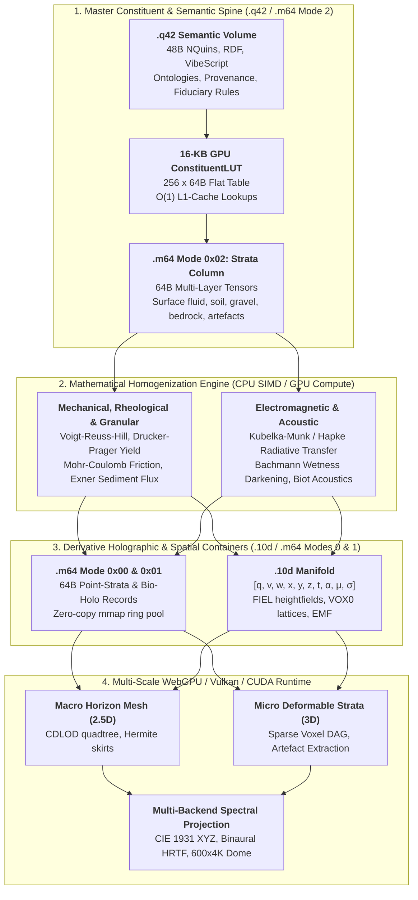
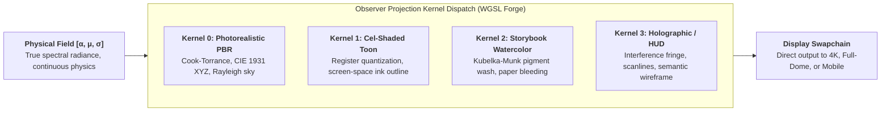
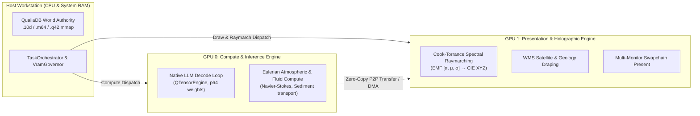
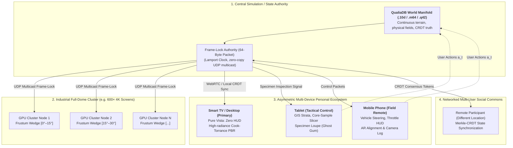

# Earth-Terrain & Continuum Physics Architecture
## 10D Manifolds, .m64 Matter-64 Point-Tensor Containers, Master Constituent Homogenization & Holographic Voxel-Mesh Streaming

> **Document Class:** Foundational Architectural Specification & System Plan  
> **Workspace Anchor:** `c:\github\ecopunk` (`ecopunk-terrain` / `ecopunk-earth`)  
> **Key Standards & Substrates:** QualiaDB 10D Tensor Manifolds ([`tensor-10d.md`](file:///c:/github/ecopunk/docs/planning/tech/tensor-10d.md)) · P64 / M64 Weight & Matter-Tensor Standard ([`p64-weight-container-standard.md`](file:///c:/github/qualiaDB/docs/manuals/standards/p64-weight-container-standard.md)) · Q42 Semantic Volumes (`Q42\0`) · GSNSW Seamless Geology & WGS84 Geodetic Datums  
> **Status:** Architectural Specification v1.0 · Normative Engineering Reference  

---

## 1. Executive Summary & Strategic Scope

### 1.1 The Objective
To migrate and elevate the terrain and spatial mechanics developed in `game-demo` into a dedicated, foundational terrain and environmental physics engine anchored inside **`ecopunk`**. 

Rather than relying on traditional 3D game assets (static polygon meshes and baked RGBA bitmaps that lack underlying physical meaning), this engine implements a **Master Generative Construction Method**. Matter, fluids, strata, and biological entities are recorded as **compositional constituent arrays** (mineral fractions, organic detritus, pore fluids, trace heavy metals, and physical artefacts) in `.q42` and `.m64`. Mathematical homogenization operators process these raw constituent arrays to derive bulk mechanical, hydraulic, thermal, and electromagnetic properties *prior* to synthesizing derivative holographic (`.10d` / `.m64`) representations on the fly.

This engine is grounded in genuine geospatial data (WGS84 coordinates, Geoscience Australia DEM elevation models, NSW Seamless Geology stratigraphy, and IBRA ecological boundaries) while delivering an **exacting, multi-scale, explorable, and destructible world**.

### 1.2 Core Architectural Principles
1. **Open Standards & Human-Centric Stewardship:** Independent nomenclature (`ecopunk-terrain` / `ecopunk-earth`) adhering strictly to verifiable open standards, human agency, fiduciary data stewardship, and biocultural custodianship (aligning with international human rights standards, OHCHR instruments, and non-adversarial AI conduct rules).
2. **Master Constituent-First Construction:** Visual, physical, and acoustic properties are never hand-painted approximations; they are mathematically derived from the underlying material composition, grain-size distributions, pore fluids, and artefact fields at $(x, y, z, t)$.
3. **Unified Multimodal Container Triad:**
   - **`.q42` (Semantic Graph Volume):** The immutable semantic spine of 48-byte `NQuin` records carrying ontological facts, constituent material recipes, custodial rights, provenance, and VibeScript behavioral logic.
   - **`.10d` (Tensor10D):** Multi-dimensional manifold container for analytical geometry, branching temporal motion graphs, camera ray bundles, spectral radiance fields, and homogenized material tensors.
   - **`.m64` (Matter-64 Multi-Modal Container):** 64-byte aligned, zero-copy, memory-mappable container representing the physical and material universe (complementing `.p64` which represents neural/probabilistic weights). Operates across four canonical modes: **Mode 0x00** (`M64PointRecord` for LiDAR / geodetic anchor points), **Mode 0x01** (`M64HoloEntityRecord` for flora & fauna morphogenesis), **Mode 0x02** (`M64StrataColumnRecord` for surface fluid & 6-layer subsurface constituent stacks), and **Mode 0x03** (`M64PhaseJunctureRecord` for quantum $q$-branch boundary conditions and tool excavations).
4. **Zero-Heap 16-KB GPU `ConstituentLUT` Bridge:** A deterministic pass compiles `.q42` material recipes into a flat 256-entry $\times$ 64-byte table (16 KB total) in GPU Uniform/Storage memory. The engine never parses RDF strings in hot loops; shaders perform $O(1)$ L1-cache lookups.
5. **Dual-Layer Continuum (Watertight Horizon Mesh + Near-Field Volumetric Voxels):**
   - Seamless transition between broad-scale continuous heightfield meshes for distant horizon ridgelines and micro-scale deformable voxel lattices for near-field interaction (excavating soil, uncovering embedded artefacts, moving river boulders, and hydraulic panning for alluvial gold).
6. **Strict Zero-Heap & Dual-Ring Compliance:** All hot-path query loops, homogenization evaluators, raymarching kernels, and mesh extraction passes operate over caller-supplied fixed buffers (`SlgArena` at 42 MiB on CPU; `HypermediaGpuRing` on GPU) with zero dynamic heap allocation (`Vec`, `String`, `Box`).


### 1.3 Continuity & Non-Deprecation: Extending the Astrophysics & High-Dimensional Physics Foundations

A foundational mandate of this work is **strict preservation and extension of earlier definitions**: we do not deprecate, rewrite, or replace the earlier 10D mathematical definitions developed for astrophysics, general relativity, quantum vacuum mechanics (chaoitons), or epistemic logic.

Instead, the Earth-terrain architecture is a **direct specialization and extension of the universal high-dimensional physics manifold** at planetary and landscape scales.

#### 1.3.1 The Canonical "Two Tens" Architecture (T14 / T16)
The engine preserves the normative division between the two complementary 10D structures established in [`qualia-core-db/src/modalities/manifold.rs`](file:///c:/github/qualiaDB/crates/qualia-core-db/src/modalities/manifold.rs):

1. **`Tensor10D` (Physics, Spacetime Pose & Query Lanes):**
   $$\mathbf{c} = [q, v, w, x, y, z, t, \alpha, \mu, \sigma]$$
   - **`q` (Quantum Context / Superposition):** $q = 0$ ground truth; $q > 0$ pending GSR escrow / speculative branches.
   - **`v` (Metric / Variety Class):** $v = 0$ Euclidean tangent space; $v = 1$ toroidal/cyclic; $v = 2$ hyperbolic taxonomic/gravitational trees; $v \ge 3$ sovereign boundary cliques.
   - **`w` (Manifold Domain Index):** $w = 0$ bio/medical; $w = 1$ legal; $w = 2$ personal/agency; **$w = 3$ environmental / sensor / geoscience (Ecopunk domain)**; $w = 4$ socioeconomic.
   - **`x, y, z, t` (Spacetime Embedding):** 3D space + 4th dimension coordinate time.
   - **`α` (Amplitude / Invariant Mass):** In astrophysics, celestial body mass for N-body gravitation; in terrain, surface load, soil density, and solar irradiance.
   - **`μ` (Modulation / In-Band Provenance Carrier):** Embedded cryptographic DID, sensor provenance, and consent layer in signal guard bands.
   - **`σ` (Spectral Signature):** Full Electromagnetic Spectrum (EMF) Spectral Power Distribution (SPD) band vector (400nm–1000nm+), not synthetic RGB.

2. **`ManifoldCoordinate10D` / `Epistemic10D` / `Attention10D` (Epistemic, Attention & Field States):**
   $$\mathbf{e} = [\text{scale}, \text{depth}, \text{weight}, \text{spin}, \text{decay}, \text{entropy}, \text{phase}, \text{freq}, \text{density}, \text{curvature}]$$
   - **`scale`:** Logarithmic scale continuum connecting cosmic distances (Mpc, AU) down through planetary topography (km, m) to crystalline mineral lattices (nm).
   - **`manifold_curvature`:** Spacetime Riemann curvature $R_{\mu\nu}$ and gravitational potential wells, directly shared between astrophysical orbital mechanics and planetary topographic slope gravity.
   - **`density_threshold`:** Critical mass density for gravitational collapse in astrophysics, and phase-change thresholds (fluid liquefaction, soil shear failure) in geophysics.
   - **`topological_spin`:** Intrinsic angular momentum, frame-dragging (Kerr metric), and particle curl in atmospheric vorticity.
   - **`recurrence_frequency`:** Pulsar and orbital resonance $\omega$ in astrophysics; wave dispersion, tidal cycles, and acoustic resonance in terrestrial hydrodynamics.

#### 1.3.2 Shared Solvers & The Gravito-Thermodynamic Continuum
The earlier astrophysics solvers in [`crates/qualia-core-db/src/specialized_libs/physics_simulation/`](file:///c:/github/qualiaDB/crates/qualia-core-db/src/specialized_libs/physics_simulation/):
- **Astrophysics Newtonian N-Body Gravitation (`nbody.rs`):**  
  $$a_i = \sum_{j \ne i} G m_j \frac{\mathbf{r}_j - \mathbf{r}_i}{(|\mathbf{r}_j - \mathbf{r}_i|^2 + \varepsilon^2)^{3/2}}$$  
  Directly applies to celestial lighting sources (sun, moon orbits) and ballistic rockfall/scree dynamics.
- **Quantum Vacuum & Chaoiton Radial Profiles (`ode_solver.rs`):**  
  Preserved as the foundational continuous field solver, modeling radial decay and non-linear wave interactions.
- **12D Gravito-Thermodynamic Tensor Variant (`[q, v, w, x, y, z, t, T, P, α, μ, σ]`):**  
  Temperature $T$ and pressure $P$ are first-class physical drivers, operating seamlessly from astrophysical stellar interiors to atmospheric barometric wind gradients ($-\frac{1}{\rho}\nabla P$) and subsurface lithospheric hydrostatic pressures.

#### 1.3.3 Seamless Section Compatibility in `.10d` Containers
All 21 canonical section types defined in [`container_10d/section.rs`](file:///c:/github/qualiaDB/crates/qualia-core-db/src/container_10d/section.rs) remain fully authoritative. The terrain architecture directly utilizes:
- **`FieldSidecar = 8` (`FIEL`):** Uses existing `FieldTypeKind::{Scalar, Vector, Tensor, Spectral}` and `FieldRepresentationKind::{Grid, Mesh, Particles, Analytic, Sampled}` to carry continuous pressure, velocity, and temperature fields without inventing new incompatible formats.
- **`QuantizedMesh = 1` (`MSH0`):** Carries continuous LOD terrain surface patches.
- **`Topology = 10` & `SpatialIndex = 11`:** BVH and half-edge topological graphs.
- **`HierarchicalSurfels = 20` & `HyperspectralCube = 21`:** Far-field Gaussian surfels and multi-band sensor reflectance cubes.

---

## 2. Review of the `.10d` Manifold Capabilities for Spatial Worlds

The 10D tensor architecture in QualiaDB uses the canonical axis order:
$$\mathbf{c} = [q, v, w, x, y, z, t, \alpha, \mu, \sigma]$$

To support a complete world engine, `.10d` is structured into specialized functional sections. Below is the capability review and normative mapping:

### 2.1 Geometry (`x, y, z` + `v` metric class)
- **Analytical Heightfields (`FIEL` section):** Stored as 2D gridded scalar fields $z = f(x, y)$ inside the 10D manifold. Neighbor adjacency is implicit ($O(1)$ zero-heap lookups), guaranteeing watertight surface evaluation for collision, slope, aspect, and normals.
- **Quantized Mesh Patches (`MSH0` section):** Quantized 16-bit vertex positions with compact index buffers for GPU rasterization.
- **Volumetric Voxel Lattices (`VOX0` section):** 3D density and material grids for underground and destructible volumes.
- **Topological Variety (`v` axis):**
  - $v = 0$: Euclidean flat/local tangent plane.
  - $v = 1$: Cyclic/toroidal (closed orbital loops, cyclical water tables).
  - $v = 2$: Hyperbolic (hierarchical taxonomic or geological classification trees).
  - $v \ge 3$: Sovereign and custodial boundaries (closed polygon containment checks).

### 2.2 Animation & Action-Driven Branching Motion Graphs (`t` + `q`)
- **Temporal Axis ($t$):** Represents physical coordinate time or animation progression.
- **Quantum Superposition Axis ($q$):** Represents **branching action paths** and potential states:
  - $q = 0$: The collapsed, authoritative ground-truth state of the environment.
  - $q > 0$: Speculative or branching states (e.g., predicted vehicle trajectories, candidate water flows, alternative tool impacts).
- **The Graph Motion Function:**
  Animation is not a rigid linear clip. It is a **graph transition function** on SIMD/GPU:
  $$\mathbf{s}_{t+\Delta t} = \mathcal{G}(\mathbf{s}_t, \mathbf{a}_t, q)$$
  where motion trajectories evolve dynamically depending on the character's starting position, action impulse $\mathbf{a}_t$, and terrain slope/friction at $(x, y, z)$.

### 2.3 Cameras, Frustums & Trajectories
- A camera in `.10d` is parameterised as an oriented spatial-temporal ray bundle:
  - Position $(x, y, z) \in \mathbb{R}^3$.
  - View vector and orientation encoded in the direction cosines.
  - Field of view (FOV), near plane, and far plane stored in lens metadata.
  - Smooth camera rails (chase camera, drone overview, first-person geological loupe) evaluate as continuous splines parameterized by $t$.

### 2.4 Lighting, Atmospheric Radiance & The EMF Primitive (`α, μ, σ`)
In accordance with QualiaDB's foundational spectral physics ([`tensor-10d.md` §5](file:///c:/github/ecopunk/docs/planning/tech/tensor-10d.md)):
- **Amplitude ($\alpha$):** Represents total radiant power / luminous flux (direct solar irradiance, diffuse sky illumination, or acoustic sound pressure level $L_p$).
- **Modulation ($\mu$):** Carrier of phase modulation, Doppler frequency shift, bandwidth spread, and steganographic DID/provenance metadata in signal guard bands.
- **Spectral Signature ($\sigma$):** Stores the continuous frequency/wavelength distribution, completely replacing artificial RGBA or flat PCM audio:
  - **Visual Band (380–780 nm):** Full Spectral Power Distribution (SPD), enabling authentic Rayleigh/Mie atmospheric scattering, mineral fluorescence, and water caustics without color gamut clamping.
  - **Sonic Band (20 Hz – 20 kHz):** Acoustic wavefield oscillation frequencies and Fourier/CQT harmonic sheets, enabling physical wave superposition and binaural HRTF soundscapes.
  - **Thermal / Infrared (700 nm – 1 mm):** Blackbody Planck radiation curves for ground heat dissipation and nocturnal thermography.
  - **Radio / Microwave (UWB / RF):** Spatial anchor beacon phase ranging (`domains/geospatial/ar_anchor.rs`).

### 2.5 The High-Efficiency Multi-Backend Spectral Converter (Vulkan, CUDA, WebGPU)
Because stored truth is the **continuous physical spectrum**, rendering or audio playback requires an ultra-fast, zero-heap **observer projection converter**:

$$\text{EMF Primitive } [\alpha, \mu, \sigma] \longrightarrow \text{Physical Field } \Phi(\lambda \text{ or } \omega) \longrightarrow \text{Observer Projection}$$

```
                          ┌─── Visual Projection ────► CIE 1931 XYZ ────► Display Gamut (sRGB/DCI-P3/Rec.2020)
                          │    (380–780 nm)
EMF Primitive [α, μ, σ] ──┼─── Sonic Projection ─────► Wave Superposition ► Binaural HRTF Audio Buffer
(Stored Physical Truth)   │    (20 Hz – 20 kHz)
                          │
                          └─── Thermal / IR ─────────► Planck Blackbody ─► Nocturnal Sensor Heatmap
```

#### Multi-Backend Kernel Synthesis via WGSL Forge:
To prevent writing divergent, unmaintainable shader files across platforms, the converter is defined as a **parameterized mathematical kernel** in [`qualia-core-db/src/render/spectral_kernel.rs`](file:///c:/github/qualiaDB/crates/qualia-core-db/src/render/spectral_kernel.rs):
1. **Naga Compilation to Target APIs:**
   - **Vulkan / SPIR-V:** Native desktop execution with explicit subgroup extensions and push constants.
   - **CUDA / PTX:** Workstation and HPC execution for high-density geophysical analysis and real-time fluid raymarching.
   - **WebGPU / WGSL:** Browser and cross-platform native execution using standardized 52-byte `EmfFieldCell` layouts.
   - **Metal (MSL):** Optimized Apple Silicon unified memory pipelines.
2. **Deterministic & Register-Resident:**
   - The tabulated CIE 1931 2-degree observer Colour Matching Functions ($\bar{x}, \bar{y}, \bar{z}$ at 10 nm intervals, 41 samples) and acoustic HRTF coefficients execute entirely in **GPU registers and workgroup shared memory**.
   - Zero dynamic heap allocation, zero intermediate texture passes, and microsecond-level latency.

### 2.6 Materials & Strata Properties
- Microfacet Cook-Torrance parameters:
  - Roughness, metallic, specular $F_0$, and subsurface scattering factors.
- Physical material indices:
  - Topsoil, alluvial gravel, quartz sand, clay, fractured basalt, solid granite bedrock.
  - Hardness, density, and hydraulic porosity metrics for physical simulation.

---

## 3. Multi-Agent Relativistic Time, Predicate Structures & Historical Manifolds

In spatial environmental engines and multi-agent ecosystems, **time cannot be treated as a trivial monotonic scalar float or integer counter**. 

A genuine planetary simulation must simultaneously handle:
1. An event occurring **milliseconds ago** (a physics numerical integration step or GPU presentation swapchain deadline).
2. An event occurring **years ago** (an historical 1850 land-clearing event, a 1974 flood crest, or a 5-year revegetation timeline).
3. An event occurring **millennia or epochs ago** (40,000-year Arrernte fire-mosaic soil histories, or 300-million-year Paleozoic bedrock granite intrusions).
4. Multiple independent agents (autonomous ecological bots, human researchers, hydrology solvers, remote VR visitors) operating with **different causal orderings, relativistic frames, and subjective attention rates**.

To reconcile these requirements without desynchronization, logical paradoxes, or frame jitter, QualiaDB formalizes a **Four-Tier Relativistic Temporal Architecture**:

```
┌────────────────────────────────────────────────────────────────────────────────────────┐
│ LEVEL 4: Cosmic / Geological / Historical Epoch (The Setting / Construct Frame)        │
│ • Deep Time (Ma / ka), Stratigraphic horizons (NSW Seamless Geology), Calendrical UTC │
│ • Context DID isolation: context = q_hash("did:q42:world:scenario_1850_clearance")    │
│ • Paraconsistent Multi-World logic: past states coexist without logical explosion      │
└───────────────────────────────────────────┬────────────────────────────────────────────┘
                                            │ Anchors
┌───────────────────────────────────────────▼────────────────────────────────────────────┐
│ LEVEL 3: Semantic Predicate Time (Multi-Agent Modal & Causal Relativity)               │
│ • Allen Interval Algebra (7 opcodes 0x40+): Before, Meets, Overlaps, During, etc.      │
│ • Linear Temporal Logic (LTL 0x40–0x44): G(φ), F(φ), X(φ), φ U ψ, φ R ψ                │
│ • NQuin Metadata bits [32..60]: 29-bit Lamport Logical Clock for causal tie-breaking   │
│ • NQuin Predicate MSB & Opcode: Deontic validity epochs, Defeasible expiry epochs      │
└───────────────────────────────────────────┬────────────────────────────────────────────┘
                                            │ Evaluates against
┌───────────────────────────────────────────▼────────────────────────────────────────────┐
│ LEVEL 2: Relativistic Observer & Manifold Time (The Observer's State Frame)            │
│ • Tensor10D coordinate time t vs Proper Time τ: dτ² = g_μν dx^μ dx^ν                   │
│ • Epistemic10D: scale, attention_depth, recurrence_frequency ω, decay γ               │
│ • Observer velocity / Lorentz boost / Perceptual dilation (v_obs / c_sim)              │
│ • Subjective attention time: dilation during high-stress / micro-inspection (q > 0)    │
└───────────────────────────────────────────┬────────────────────────────────────────────┘
                                            │ Projects to
┌───────────────────────────────────────────▼────────────────────────────────────────────┐
│ LEVEL 1: Discrete Execution & Frame-Lock Time (The Presentation Frame)                 │
│ • Monotonic simulation tick t_sim (integer ticks since simulation epoch)               │
│ • Frame-delta dt (sub-millisecond delta for numerical integration: Verlet, RK4)        │
│ • FrameLockPacket (64B multicast synchronization across 600-screen dome cluster)       │
└────────────────────────────────────────────────────────────────────────────────────────┘
```

#### 3.1 Level 1: Discrete Execution & Presentation Frame Time ($t_{\text{sim}}, \Delta t$)
Level 1 represents the local physics and graphics presentation clock:
- **Numerical Integration ($\Delta t$):** Symplectic Euler and Verlet integrators evaluate fluid advection, particle sediment transport, and rigid-body rock collisions at fixed sub-millisecond deltas ($\Delta t = 16.66\text{ ms}$ or $8.33\text{ ms}$), preventing energy drift.
- **Dome Frame-Lock Synchronization:** In industrial full-dome installations (600× 4K displays), the master authority broadcasts the monotonic simulation clock tick $t_{\text{sim}}$ within the 64-byte `FrameLockPacket`. Every display node renders against the exact same tick, guaranteeing zero inter-projector tear.
- **Scope:** Purely execution-bound; carries no ontological or historical meaning.

#### 3.2 Level 2: Relativistic Observer & Manifold Time ($\tau, t, \mathbf{e}$)
In accordance with QualiaDB's high-dimensional physics foundations ([`manifold.rs`](file:///c:/github/qualiaDB/crates/qualia-core-db/src/modalities/manifold.rs) and [`tensor-10d.md`](file:///c:/github/ecopunk/docs/planning/tech/tensor-10d.md)):
- **Coordinate Time ($t$) vs. Proper Time ($\tau$):**
  Coordinate time $t$ is the 7th dimension of $\mathbf{c} = [q, v, w, x, y, z, t, \alpha, \mu, \sigma]$. An observer or entity moving with coordinate velocity $\mathbf{u} = \frac{d\mathbf{x}}{dt}$ experiences proper time $\tau$ governed by the metric tensor $g_{\mu\nu}$:
  $$d\tau = \sqrt{g_{00} + 2 g_{0i} u^i + g_{ij} u^i u^j} \; dt$$
- **Epistemic & Attention Dilation (`Epistemic10D`):**
  - When an observer uses a companion tablet to inspect an ecological specimen (e.g. examining a botanical leaf stoma at micrometer scale via the Specimen Loupe), the observer's `attention_depth` increases.
  - Perceptual time dilates: the local specimen simulation branches into $q > 0$, allowing the user to scrub allometric growth curves over decades or simulate seasonal phenology without pausing or warping coordinate time $t$ for other observers walking in the macro landscape ($q = 0$).
- **Harmonic Frequencies ($\omega$):** Cyclic biological and environmental processes (diurnal solar irradiance, tidal water surges, botanical sap transpiration) are parameterized as harmonic frequencies $\omega$ rather than hardcoded timeline timestamps.

#### 3.3 Level 3: Semantic Predicate Structure & Multi-Agent Causal Relativity
How is time encoded into the **predicate structure** of QualiaDB?
Every assertion, observation, biological state, or property path is stored as an immutable 48-byte `NQuin`:

```
Field      Bits      Temporal Meaning & Multi-Agent Relativistic Role
─────────────────────────────────────────────────────────────────────────────
subject    [0..62]   Entity or Agent DID hash (q_hash of IRI)
           [63]      Modality MSB flag

predicate  [63]      DEFEATER_BIT: 1 if this temporal claim defeats an earlier rule
           [8..62]   Property-path IRI hash (e.g. q_hash("bio:floweringSeason"))
           [0..7]    Temporal Opcode (0x40+ for spatio-temporal and LTL modalities)

object     [60..62]  Inline Type Tag (e.g. 0b001 = Integer timestamp, 0b010 = Decimal epoch)
           [0..59]   Payload: Timestamp epoch, duration, or target entity hash

context    [0..55]   World / Construct DID hash (anchors historical scenarios)
           [56..63]  Sensitivity class (Public, Restricted, Classified)

metadata   [32..60]  Lamport Logical Clock (29 bits, causal order across agents)
           [0..31]   Modality Payload: Expiry epoch, valid-until timestamp, confidence
           [61..62]  PermissiveRoutingLane

parity     [0..63]   XOR fold (ECC integrity stub)
```

1. **The 29-Bit Lamport Logical Clock (`metadata[32..60]`):**
   - Independent agents (human field observers, autonomous ecology bots, satellite telemetry streams) possess unsynchronized physical hardware clocks.
   - The Lamport clock guarantees **strict causal partial ordering**:
     $$\text{If Event } A \longrightarrow B \quad\implies\quad L(A) < L(B)$$
   - When agent $k$ receives a state token, it updates its clock: $L_{\text{local}} = \max(L_{\text{local}}, L_{\text{msg}}) + 1$.
   - Concurrent mutations across different devices (e.g. two users excavating the same riverbed or planting seeds) are resolved deterministically using Lamport clocks with object-hash tie-breaking (`crdt.rs::resolve_lww`), completely eliminating race conditions.

2. **Allen Interval Algebra (`modalities/spatio_temporal.rs`):**
   - Traditional databases store only instantaneous point timestamps ($t$), failing to capture extended, non-punctual ecological and historical processes.
   - QualiaDB natively implements the 7 primitive Allen interval relations in its predicate dispatch:
     - `OP_BEFORE` ($0x40$): Interval $A$ finishes before Interval $B$ begins ($t_{A2} < t_{B1}$).
     - `OP_MEETS` ($0x41$): Interval $A$ ends exactly when Interval $B$ starts ($t_{A2} = t_{B1}$).
     - `OP_OVERLAPS` ($0x42$): $A$ starts before $B$, but their durations intersect.
     - `OP_STARTS` ($0x43$): $A$ and $B$ share the exact start instant, but $A$ ends earlier.
     - `OP_DURING` ($0x44$): $A$ occurs entirely within the duration of $B$.
     - `OP_FINISHES` ($0x45$): $A$ occurs within $B$, ending at the exact same instant as $B$.
     - `OP_EQUALS` ($0x46$): $A$ and $B$ have identical start and end points.
   - Example Predicate:  
     `ex:SoilErosion_Corridor_A  allen:During  ex:HistoricalClearance_1850_1870`

3. **Linear Temporal Logic (`modalities/temporal_ltl.rs`):**
   - Temporal properties are evaluated over execution slices with zero dynamic heap allocation:
     - $\mathbf{G}(\varphi)$ (`OP_LTL_GLOBALLY` = $0x40$): Property $\varphi$ holds at all times in the trace.
     - $\mathbf{F}(\varphi)$ (`OP_LTL_FINALLY` = $0x41$): Property $\varphi$ eventually holds.
     - $\mathbf{X}(\varphi)$ (`OP_LTL_NEXT` = $0x42$): Property $\varphi$ holds in the immediately following state.
     - $\varphi \;\mathbf{U}\; \psi$ (`OP_LTL_UNTIL` = $0x43$): $\varphi$ remains true until $\psi$ becomes true.
     - $\varphi \;\mathbf{R}\; \psi$ (`OP_LTL_RELEASE` = $0x44$): $\psi$ holds continuously unless released by $\varphi$.

#### 3.4 Level 4: The Historical Construct, Setting Frame & Deep Time
How does the system represent a historical event that occurred **years, centuries, or millions of years ago**?

Consider an environmental researcher exploring a landscape corridor:
- **Case A: The 1850 Early Settlement Construct:** Forest cleared for grazing, stream headwaters unchanneled.
- **Case B: The 1974 Flood Construct:** A 1-in-100-year flood event moving boulders and forming gravel gravel bars.
- **Case C: The 40,000 BP Pleistocene Construct:** Fire-mosaic regime managed by Arrernte ancestors, megafauna presence.
- **Case D: The 300 Ma Paleozoic Bedrock Construct:** Cooling granite batholith emplaced deep in the crust.

If all these historical assertions were asserted into a flat, classical global state, the contradiction would trigger catastrophic logical explosion ($\bot \implies \text{everything}$):
$$\text{TreeAt}(x, y, z) \quad\land\quad \neg\text{TreeAt}(x, y, z) \quad\implies\quad \text{Explosion}$$

QualiaDB eliminates this problem via **Construct-Bound Multi-World Isolation**:

1. **Context-Grounded Historical Manifolds (`context` field):**
   - In `NQuin`, the `context` field carries the 56-bit FNV-1a hash of the historical construct DID:
     $$\text{context} = q\_hash(\text{"did:q42:world:scenario\_1850\_clearance"})$$
   - All spatial heightfield deltas, biological distributions, and soil strata modifications for the 1850 scenario are isolated under this context hash.
2. **Temporal Coordinate Transformation:**
   Each historical construct defines an affine mapping between simulation coordinate time $t$ and historical calendar epoch $T$:
   $$T = T_{\text{base}} + \kappa \cdot t$$
   where $T_{\text{base}}$ is the historical origin (e.g. `1850-01-01T00:00:00Z` or `40000_BP`), and $\kappa$ is the temporal scale factor ($\kappa = 1.0$ for real-time replay, or $\kappa = 3.15 \times 10^7$ where 1 second of simulation equals 1 historical year of geological erosion).
3. **Paraconsistent Multi-World Querying (`modalities/paraconsistent.rs`):**
   - The engine utilizes paraconsistent logic to route cross-temporal comparisons to isolated routing lanes (`PermissiveRoutingLane::Spatial`).
   - A researcher can query:
     > *"Show me the erosion differential $\Delta z(x, y)$ between the 1850 settlement construct and the 2026 ground-truth state."*
   - The engine evaluates both contexts simultaneously with zero heap allocation, computing the height difference directly without conflicting logical states.

---

## 4. The Master Generative Construction Pipeline: From Constituent Arrays to Holographic Assets

### 4.1 The Core Paradigm Shift: Traditional 3D Assets vs. The Master Construction Method
In conventional 3D graphics and game engines (Unreal, Unity, Blender, glTF, OpenUSD), spatial assets are built **derivative-first**:
- An artist sculpts a polygonal boundary mesh and paints 2D bitmap textures (Albedo, Normal, Roughness, Metalness, Ambient Occlusion).
- **The Epistemic Flaw:** This representation is **epistemically hollow**. The asset is merely an optical skin. It has zero ontological depth: it does not know what is inside, how dense it is, what minerals it contains, how it conducts heat or electricity, whether it holds pore water, or how it reacts to mechanical force.
- If a player digs into a river bank, pans sediment in water, sweeps a metal detector or ground-penetrating radar (GPR), applies heat from a campfire, or drives a heavy vehicle across it, traditional engines must bolt on ad-hoc secondary hacks (spawning particle sprites, playing canned `.wav` sound effects, or stamping decal textures). It cannot answer: *How many grams of gold are in the pan? Why does wet river clay sound different from dry gravel? What happens to soil shear strength when water saturation reaches 85%?*

In QualiaDB / `ecopunk-terrain`, we invert the entire paradigm:
1. **Master Constituent Recording:** An object, stratum, or volume of matter is defined by its **Compositional Constituent Array & Embedded Artefact Field**—exact volumetric fractions ($\phi_i$), pore fluids ($S_w$), grain-size distributions, and embedded discrete items (alluvial gold flakes, quartz pebbles, charcoal lenses, root networks, or historical relics) recorded in `.q42` and `.m64` Mode 0x02.
2. **Mathematical Homogenization (Continuum Micromechanics):** Before any visual, physical, or acoustic asset is instantiated, a deterministic mathematical pipeline processes the constituent array on CPU SIMD / GPU compute to compute the **Effective Bulk Material Tensor**.
3. **Derivative Holographic Synthesis:** From this homogenized tensor, the engine automatically synthesizes derivative `.10d` and `.m64` representations (Cook-Torrance spectral BRDFs, procedural Voronoi stone imbrications, Biot acoustic impedance sheets, and Sparse Voxel DAG nodes) on the fly.

| Engineering Attribute | Traditional 3D Asset (Mesh + Baked PBR) | Qualia Master Constituent Construction |
| :--- | :--- | :--- |
| **Primary Master Representation** | Boundary polygon mesh + 2D RGBA bitmap textures | Compositional constituent array + embedded artefact field |
| **Ontological Depth** | Zero (hollow optical shell; no interior matter) | Complete (mass, density, mineralogy, fluids, grain stats) |
| **Visual Appearance** | Hand-painted albedo texture clamped to sRGB | Solved via Kubelka-Munk & Hapke radiative transfer across EMF $\sigma$ |
| **Soil Wetness & Darkening** | Artist-painted "wet dirt" decal or shader multiplier | Derived via Ångström / Bachmann pore-water meniscus internal reflection |
| **Acoustic Signature** | Triggered playback of pre-recorded `.wav` foley files | Synthesized live from Biot poroelasticity and grain collision frequencies |
| **Mechanical Excavation** | Rigid collider cut or pre-fractured mesh chunks | Drucker-Prager yield criterion & Mohr-Coulomb shear failure |
| **Hydraulic Gold Panning** | Scripted animation or particle system trick | Physical Stokes differential settling & critical Shields shear entrainment |
| **Subsurface Remote Sensing** | Impossible without custom game-specific mini-games | Physically evaluated via CRIM dielectric contrast and magnetic permeability |

```
┌────────────────────────────────────────────────────────────────────────────────────────┐
│ STAGE 1: Master Constituent Array (.q42 Ontological Recipe + .m64 Mode 0x02 Column)    │
│ • Solid Matrix Fractions (φ_i): Quartz (45%), Kaolinite Clay (25%), Basalt Lithics (10%)│
│ • Organic & Biotic Fractions: Humic Detritus (8%), Mycelial/Root Fiber Density (2%)    │
│ • Pore Space & Fluids (φ_p): Porosity (30%), Water Saturation S_w (65%), Salinity      │
│ • Grain Statistics: Krumbein phi moments (mean μ_φ, sorting σ_φ, sphericity ψ)         │
│ • Embedded Artefact Field: Alluvial Au (19.3 g/cm³), 1850 Charcoal, Indigenous flakes  │
└───────────────────────────────────────────┬────────────────────────────────────────────┘
                                            │
                                            ▼
┌────────────────────────────────────────────────────────────────────────────────────────┐
│ STAGE 2: 16-KB GPU ConstituentLUT Bridge (Deterministic Zero-Heap LUT Upload)          │
│ • Flat 256-entry x 64-byte uniform table in GPU L1 cache (zero RDF string traversal)  │
│ • Translates .q42 semantic URIs into instant O(1) physical parameters per cell         │
└───────────────────────────────────────────┬────────────────────────────────────────────┘
                                            │
                                            ▼
┌────────────────────────────────────────────────────────────────────────────────────────┐
│ STAGE 3: Mathematical Homogenization Operators (Pre-Render Physical Synthesis)         │
│ 1. Optical/Spectral: Kubelka-Munk & Hapke Radiative Transfer + Bachmann Wetness Darken │
│ 2. Mechanical/Rheological: Voigt-Reuss-Hill Moduli + Drucker-Prager Yield Envelope     │
│ 3. Hydraulic & Granular: Kozeny-Carman Permeability (k) + Exner Sediment Conservation  │
│ 4. Electromagnetic & Acoustic: CRIM Dielectric Permittivity + Biot Poroelasticity      │
│ 5. Fluid-Structure Interaction: Aerodynamic/Hydrodynamic drag on Hamiltonian bodies    │
└───────────────────────────────────────────┬────────────────────────────────────────────┘
                                            │
                                            ▼
┌────────────────────────────────────────────────────────────────────────────────────────┐
│ STAGE 4: Derivative Holographic & Spatial Asset Instantiation (.10d / .m64 / GPU)      │
│ • Visual: 8-Band EMF Spectral Reflectance [σ], Microfacet Roughness, Procedural SDF    │
│ • Procedural Micro-Geometry: 3D Voronoi river clasts with upstream hydrodynamic tilt   │
│ • Acoustic: Live synthesized footstep/tool impact CQT harmonic sheet (crunch vs squelch)│
│ • Interactive: Voxel excavation cavities, Exner slope slumping, gold pan separation    │
└────────────────────────────────────────────────────────────────────────────────────────┘
```

---

### 4.2 The `.q42` Semantic Spine & The 16-KB GPU `ConstituentLUT` Bridge
To eliminate the poor performance of previous attempts where pulling and traversing graph data bottlenecked the 3D/10D render loop, QualiaDB separates the **Semantic Graph Plane (`.q42`)** from the **Tensor Manifold Plane (`.10d` / `.m64`)** via a deterministic Zero-Heap LUT Bridge:

#### Step 1: The `.q42` Semantic Volume (48-Byte `NQuins`)
Stores the authoritative ontological truth, provenance (`μ`), and N3Logic rules:
- Which geological formations underlie each WGS84 region.
- The intrinsic physical properties of each constituent (`SpecificGravity`, `Porosity`, `AngleOfRepose`, `SpectralReflectanceSPD`).
- The botanical and zoological rules for species (`RootDepth`, `TropismWeights`, `NaturalFrequencies`).

#### Step 2: The 16-KB Static `ManifoldConstituentLUT` (Compiled Once per Region)
When a regional `.q42` volume is mounted, a deterministic Rust pass (zero-heap, fixed stack buffer) compiles the active `NQuin` material and species graphs into a flat **256-entry $\times$ 64-byte `Q42ConstituentLutEntry` table** (16 KB total), uploaded once to GPU Uniform/Storage memory:

```rust
/// Compiled from .q42 NQuin triples into a static 16KB GPU Uniform/Storage LUT (256 x 64B)
#[repr(C, align(64))]
#[derive(Copy, Clone, bytemuck::Pod, bytemuck::Zeroable)]
pub struct Q42ConstituentLutEntry {
    pub nquin_subject_hash: u64,        // 8B: FNV-1a hash of the .q42 entity IRI
    pub specific_gravity: f16,          // 2B: Density relative to water (e.g. 2.65 quartz, 19.3 gold)
    pub porosity_permeability: [u8; 2], // 2B: [Porosity φ_p, Darcy log-permeability κ]
    pub cohesion_kpa: f16,              // 2B: Mohr-Coulomb cohesion (c)
    pub friction_repose_rad: f16,       // 2B: Internal friction / Angle of repose (θ_f)
    pub viscosity_yield: [f16; 2],      // 4B: Herschel-Bulkley [Viscosity η, Yield stress τ_y]
    pub grain_phi_stats: [i8; 4],       // 4B: Krumbein [mean_phi, std_phi, sphericity, imbrication]
    pub elastic_moduli: [f16; 2],       // 4B: [Young's Modulus E, Poisson's Ratio ν]
    pub spectral_spd_curve: [u8; 16],   // 16B: 16-band EMF reflectance (400nm - 1000nm, σ-axis)
    pub acoustic_impedance: f16,        // 2B: Specific acoustic impedance Z (Rayls / 100)
    pub biotic_fertility: u8,           // 1B: Nutrient index for flora morphogenesis
    pub phase_change_thresh: u8,        // 1B: Epistemic10D density_threshold for liquefaction
    pub _reserved: [u8; 16],            // 16B: Padding to exact 64-byte alignment
}
```

#### Step 3: High-Speed Zero-Heap Execution
During simulation and presentation:
1. The engine **never queries `.q42` strings or traverses RDF pointers per frame**.
2. Every `.m64` strata column (`M64StrataColumnRecord`) and biological entity (`M64HoloEntityRecord`) holds 1-byte `u8` indices into the `Q42ConstituentLutEntry` table.
3. When the GPU evaluates terrain deformation, river sediment transport, optical caustics, or flora growth, it performs an **$O(1)$ array lookup** into the 16 KB `Q42ConstituentLutEntry` buffer in L1 GPU cache.
4. When a user inspects a rock, pans gold, or modifies the terrain, the `nquin_subject_hash` and `provenance_did_hash` allow instant $O(1)$ reverse-lookup back into the `.q42` volume to record new `NQuin` state facts on quantum branch $q$.

---

### 4.3 Mathematical Homogenization Operators
Let a spatial cell (voxel or stratum horizon) consist of $N$ solid mineral/organic constituents with volumetric fractions $\phi_i$ ($\sum_{i=1}^N \phi_i = 1 - \varphi$), total porosity $\varphi$, water saturation $S_w \in [0, 1]$, and air fraction $S_a = 1 - S_w$.

#### 4.3.1 Optical & Spectral Homogenization (Kubelka-Munk, Hapke & Bachmann-Mualem)
Linearly blending RGB colors of minerals produces muddy, physically wrong visuals. Instead, each pure constituent $i$ in the `.q42` ontology carries its intrinsic wavelength-dependent Absorption Coefficient $K_i(\lambda)$ and Scattering Coefficient $S_i(\lambda)$ across the EMF spectrum ($\lambda \in [380\text{ nm}, 2500\text{ nm}]$), weighted by inverse grain diameter $d_i$:

- **Intimate Mixture Composite (Kubelka-Munk / Hapke):**
  $$K_{\text{mix}}(\lambda) = \sum_{i=1}^{N} \frac{\phi_i}{d_i} K_i(\lambda), \qquad S_{\text{mix}}(\lambda) = \sum_{i=1}^{N} \frac{\phi_i}{d_i} S_i(\lambda)$$
  The dry diffusive spectral reflectance $R_{\text{dry}}(\lambda)$ of the composite soil is solved analytically:
  $$R_{\text{dry}}(\lambda) = 1 + \frac{K_{\text{mix}}(\lambda)}{S_{\text{mix}}(\lambda)} - \sqrt{\left(\frac{K_{\text{mix}}(\lambda)}{S_{\text{mix}}(\lambda)}\right)^2 + 2\frac{K_{\text{mix}}(\lambda)}{S_{\text{mix}}(\lambda)}}$$

- **Pore-Water Internal Reflection (Ångström / Bachmann-Mualem Wetness Model):**
  When soil absorbs water ($S_w > 0$), thin liquid films coat the mineral grains, causing total internal reflection and darkening the albedo while shifting specular $F_0$:
  $$R_{\text{wet}}(\lambda, S_w) = \frac{R_{\text{dry}}(\lambda)}{n_{\text{water}}^2 (1 - R_{\text{dry}}(\lambda)) \cdot \Theta(S_w) + R_{\text{dry}}(\lambda)}$$
  where $n_{\text{water}} \approx 1.333$ and $\Theta(S_w) = S_w^{\kappa}$ is the effective film coverage factor. This single equation automatically makes wet river clay look dark, rich, and specular, and dry alpine dust look pale and matte—without a single artist texture.

- **Micro-Topographic Normal & Roughness Derivation:**
  The Cook-Torrance microfacet roughness $\alpha_{\text{rough}}$ and procedural SDF displacement harmonics are derived directly from the log-normal grain size distribution moments (median diameter $d_{50}$ and geometric standard deviation $\sigma_g$):
  $$\alpha_{\text{rough}} = \text{clamp}\left( \gamma_0 \ln\left(1 + \frac{d_{50}}{d_{\text{ref}}}\right) \cdot \sigma_g (1 - 0.6 S_w^2), \; 0.04, \; 1.0 \right)$$

#### 4.3.2 Mechanical, Rheological & Excavation Homogenization
To determine how soil deforms under a vehicle tire, a spade, or a pickaxe:
- **Elastic Moduli (Voigt-Reuss-Hill Average):**
  The effective bulk modulus $K_{\text{eff}}$ and shear modulus $G_{\text{eff}}$ of the solid matrix are bounded by the Voigt (isostrain) and Reuss (isostress) averages:
  $$M_V = \sum_{i=1}^N \tilde{\phi}_i M_i, \qquad M_R = \left( \sum_{i=1}^N \frac{\tilde{\phi}_i}{M_i} \right)^{-1}, \qquad M_{\text{eff}} = \frac{1}{2}(M_V + M_R)(1 - \varphi)^{m_p}$$
- **Yield & Shear Failure (Drucker-Prager / Mohr-Coulomb):**
  Effective cohesion $c_{\text{eff}}$ is governed by the clay fraction $\phi_{\text{clay}}$, organic root-fiber reinforcement $\phi_{\text{root}}$, and matric suction $\psi(S_w)$ (capillary cohesion peaks at intermediate moisture and collapses at full saturation/liquefaction):
  $$c_{\text{eff}} = c_0(\phi_{\text{clay}}) + \tau_{\text{root}} \phi_{\text{root}} + \chi(S_w) \cdot p_{\text{capillary}}(S_w, d_{50})$$
  $$\tan \theta_{\text{friction}} = \sum_{i=1}^N \tilde{\phi}_i \tan \theta_i \cdot (1 - \beta_{\text{lub}} S_w)$$

#### 4.3.3 Hydraulic & Sediment Transport Homogenization (Kozeny-Carman & Shields)
- **Darcy Hydraulic Permeability ($k_{\text{perm}}$):**
  Computed directly from porosity $\varphi$ and harmonic mean grain diameter $d_{\text{eff}}$:
  $$k_{\text{perm}} = \frac{d_{\text{eff}}^2}{180} \frac{\varphi^3}{(1 - \varphi)^2}$$
- **Differential Density Settling (Hydraulic Sifting / Gold Panning):**
  When a voxel is agitated in water (e.g., in a prospecting pan or river eddy), each constituent $i$ and embedded artefact $a$ has a known specific gravity $\rho_i$ (e.g., $\rho_{\text{Au}} = 19.3\text{ g/cm}^3$, $\rho_{\text{quartz}} = 2.65\text{ g/cm}^3$, $\rho_{\text{humus}} = 1.3\text{ g/cm}^3$). The terminal settling velocity $v_{s,i}$ and critical Shields entrainment shear stress $\tau_{c,i}^*$ are evaluated per constituent:
  $$\tau_{c,i}^* = \frac{\tau_{\text{flow}}}{(\rho_i - \rho_{\text{water}}) g d_i}$$
  Fluid shear $\tau_{\text{flow}}$ washes away constituents where $\tau_{\text{flow}} > \tau_{\text{critical},i}$, leaving high-density artefacts (gold nuggets, heavy black iron sands) concentrated at the bottom of the pan or bedrock riffle.

#### 4.3.4 Conservation of Mass & The Exner Sediment Equation
When a tool removes volume $\Delta V$ from layer $i$ of `M64StrataColumnRecord`:
$$h_{i, \text{new}} = h_{i, \text{old}} - \frac{\Delta V}{A_{\text{cell}}}$$
The neighbouring cells evaluate the **Exner Equation of Sediment Conservation**:
$$(1 - \lambda_p) \frac{\partial z_{\text{bed}}}{\partial t} = -\nabla \cdot \mathbf{q}_s(\mathbf{u}_{\text{fluid}}, \nabla z_{\text{bed}}, \theta_{\text{repose}})$$
where $\mathbf{q}_s$ is the sediment flux and $\lambda_p$ is bed porosity. If the local slope $\nabla z_{\text{bed}}$ exceeds the constituent's angle of repose $\theta_{\text{repose}}$ (e.g., $34^\circ$ for wet gravel, $15^\circ$ for saturated silt), mass dynamically slumps into the excavated cavity over a few compute ticks until equilibrium is restored.

#### 4.3.5 Electromagnetic (GPR / Metal Detector) & Acoustic Homogenization
- **Complex Dielectric Permittivity (Complex Refractive Index Model - CRIM):**
  $$\sqrt{\varepsilon_{\text{eff}}^*} = (1 - \varphi) \sum_{i=1}^N \tilde{\phi}_i \sqrt{\varepsilon_i^*} + \varphi S_w \sqrt{\varepsilon_{\text{water}}^*} + \varphi (1 - S_w) \sqrt{\varepsilon_{\text{air}}^*}$$
  This allows ground-penetrating radar (GPR) and electromagnetic induction sensors (metal detectors) in the simulation to physically detect subsurface water tables, buried metallic artefacts, or quartz veins via impedance contrast $\Delta \varepsilon^*$.
- **Biot Poroelastic Acoustic Synthesis:**
  The P-wave and S-wave velocities ($v_P = \sqrt{(K_{\text{eff}} + \frac{4}{3}G_{\text{eff}})/\rho_{\text{eff}}}$) and grain-collision frequencies ($f_{\text{grain}} \propto v_{\text{impact}} / d_{50}$) directly parameterize the Sonic Band ($\sigma$) of the `.10d` manifold. Walking on coarse dry basalt scree ($d_{50} = 40\text{ mm}$) vs. saturated alluvial silt ($d_{50} = 0.02\text{ mm}, S_w = 0.95$) automatically synthesizes the exact acoustic CQT spectrum without pre-recorded foley wav files.

---

### 4.4 Formulaic Flora, Fauna & Fluid Coupling (Physics-Driven Dynamic Entities)
Instead of authoring discrete animations for every environmental interaction (e.g., a plant or reed bending in a river current, a tree growing in rocky vs. clay soil, or an animal traversing uneven river cobbles), the **constituent properties of the `.m64` terrain and fluid column directly drive the differential equations of the entity**:

#### A. Fluid-Structure Interaction (Riparian Flora & Aquatic Fauna)
When a flora or fauna entity (`M64HoloEntityRecord`) is situated within or beside a running river (`M64StrataColumnRecord`), its motion is not a keyframe clip. The `.10d` `FIEL` section provides the Eulerian fluid velocity vector $\mathbf{u}_{\text{fluid}}(x, y, z, t)$ and vorticity curl (`topological_spin`).

The drag force $\mathbf{F}_{\text{drag}}$ exerted by the fluid (water or wind) on limb/stem segment $k$ is computed analytically:
$$\mathbf{F}_{\text{drag}, k} = \frac{1}{2} \rho_{\text{fluid}} C_d A_k \Vert\mathbf{u}_{\text{fluid}} - \dot{\mathbf{s}}_k\Vert (\mathbf{u}_{\text{fluid}} - \dot{\mathbf{s}}_k)$$

In the vertex/compute shader, this force shifts the equilibrium point of the entity's **Hamiltonian Oscillator**:
$$\mathbf{s}_k(t, q) = \underbrace{\mathbf{s}_{k,0}(t_{\text{growth}})}_{\text{Allometric Growth}} + \underbrace{\frac{\mathbf{F}_{\text{drag}, k}}{\alpha_k \omega_k^2}}_{\text{Steady Current Bend}} + \underbrace{\sum_{m=1}^{3} B_m(q) e^{-\gamma_k t} \sin(\omega_k t + \mathbf{k}_m \cdot \mathbf{x} + \phi_m)}_{\text{Vortex Shedding / Flutter}}$$

*Zero Keyframes:* A reed submerged in a fast river current automatically bends downstream and flutters at its natural vortex-shedding frequency $\omega_k$. If the river dries up ($\text{water\_depth} \to 0$), the reed smoothly returns to upright equilibrium and responds only to atmospheric wind.

#### B. Root-Soil Mechanics & Subsurface Constituents
The growth trajectory ($t_{\text{age}}$) and structural stability of flora depend directly on the subsurface strata in `M64StrataColumnRecord`:
- **Hydraulic & Nutrient Uptake:** The growth rate $\frac{d(\text{scale})}{dt}$ is a function of the **Darcy Permeability** $k_{\text{perm}}$ and **Porosity** $\varphi$ of the underlying layers (e.g. *Organic Topsoil* vs. *Alluvial Clay* vs. *Quartz Sand*).
- **Mechanical Anchoring & Uprooting:** The critical overturning moment $M_{\text{crit}}$ of a tree or boulder is governed by the **Mohr-Coulomb Shear Strength** of the stratum it is embedded in:
  $$\tau_{\text{shear}} = c_{\text{stratum}} + (\sigma_{\text{normal}} - P_{\text{pore}}) \tan(\theta_{\text{friction}})$$
  If a river floods and increases pore-water pressure $P_{\text{pore}}$ in an alluvial sandbank ($c \approx 0$), $\tau_{\text{shear}}$ drops below `density_threshold`. The riverbank slumps, and any tree or boulder anchored in that stratum automatically tilts or washes downstream along a new $q > 0$ branch.

---

### 4.5 Sub-Voxel Embedded Artefact Distributions & Stochastic Instantiation
Soil is not merely a continuous powder; it contains discrete artefacts across multiple scales:
- **Geological Artefacts:** Quartz crystals, alluvial gold nuggets, sapphires, ironstone concretions, weathered basalt cobbles.
- **Biotic & Paleo-Ecological Artefacts:** Cicada burrows, lignotubers, mycorrhizal nodules, fossilized bone fragments, charcoal lenses from historical fire regimes.
- **Anthropogenic & Historical Artefacts:** 19th-century forged iron nails, glass bottles, ceramic shards, survey pegs, or culturally protected stone tools.

**How Artefacts are Stored and Instantiated Without Heap Bloat:**
We do not store millions of individual 3D meshes underground. Instead:
1. **Statistical Field Encoding (`.m64` Mode 0x02):** Each `M64StrataColumnRecord` stores an `artefact_class_mask` (linking to `.q42` ontological definitions), a `spatial_poisson_lambda` (mean count per $\text{m}^3$), and a deterministic spatial hash seed.
2. **Lazy Wavefront Collapse on Excavation:**
   - While buried and unobserved ($q = 0$ unexcavated), the artefacts exist as continuous density and electromagnetic/acoustic perturbations in the homogenized voxel. A metal detector sweeping over the ground reacts to the homogenized magnetic permeability $\mu_{\text{eff}}$ of a buried iron relic without instantiating its 3D mesh.
   - The exact moment an excavation tool (spade, pickaxe, or hydraulic jet) intersects the voxel at $(x, y, z)$, the engine evaluates a deterministic 3D Spatial Poisson Point Process seeded by `fnv1a_64(voxel_coord ^ provenance_did_hash)`:
     $$N_{\text{artefacts}} \sim \text{Poisson}(\lambda_{\text{artefact}} \cdot V_{\text{voxel}})$$
   - If $N_{\text{artefacts}} > 0$, the artefact's `M64HoloEntityRecord` (Mode 0x01) is instantiated into the local active ring buffer, coated in the surrounding soil's homogenized wet reflectance $R_{\text{wet}}(\lambda)$ until washed or brushed clean by the player.

---

### 4.6 Fictional, Stylized & Speculative Representations (Cartoon Physics, Fantasy Materials & Non-Photorealistic Observers)

A foundational architectural capability of QualiaDB is that the **Master Generative Construction Pipeline** is not confined exclusively to photorealistic terrestrial nature: it natively and symmetrically supports **fictional worlds, speculative materials, cartoonish / caricature representations of real-world objects, and completely imaginary objects**.

Traditional 3D game engines treat realistic and stylized worlds as mutually exclusive asset pipelines: realistic assets require high-density photogrammetry, ZBrush sculpting, and PBR texture baking; cartoon assets require bespoke stylized modeling, discrete skeletal deformation rigs with manual "squash and stretch" keyframes, and custom post-process toon shaders. This bifurcation fragments codebases, inflates asset sizes, and makes physical interaction across styles impossible.

In QualiaDB, **all entities, strata, and fluids—whether a biologically exact eucalyptus tree, a cartoon bouncing wombat, a mythical floating island, or an alien crystalline golem—are constructed from the exact same mathematical foundation**:
1. **Semantic Identity & Constituent Recipes in `.q42`** (NQuins defining material fractions and ontological traits).
2. **Phase-Space State Tensors in `.10d`** ($\mathbf{c} = [q, v, w, x, y, z, t, \alpha, \mu, \sigma]$).
3. **Hardware-Aligned 64-Byte Matter Records in `.m64`** (`M64PointRecord`, `M64HoloEntityRecord`, `M64StrataColumnRecord`, `M64PhaseJunctureRecord`).
4. **Physical & Stylistic Observers** that project the underlying continuous EMF radiation $[\alpha, \mu, \sigma]$ into desired visual aesthetics without altering the underlying physical or semantic truth.

---

#### 4.6.1 The Continuum of Representation: The Four Modalities

The engine defines four formal modalities across the representational spectrum:

| Modality | Description | Examples | Physical Law Enforcement | Observer Projection |
| :--- | :--- | :--- | :--- | :--- |
| **A. Veridical Physical Realism** | Exact real-world geodetic datums, verified mineral compositions, real botanical growth, and measured spectral albedo. | *Corymbia aparrerinja* (Ghost Gum), NSW Seamless Geology, Snowy River hydrology. | Strict energy conservation, true Darcy permeability, Cook-Torrance microfacets. | Full PBR, CIE 1931 XYZ, continuous Rayleigh/Mie atmospheric scattering. |
| **B. Stylized / Cartoonish Real-World Objects** | Real-world biological and geological entities represented through cartoonish, caricature, or storybook aesthetics. | A cartoon wombat with expressive squash-and-stretch animation, a whimsical stylized baobab tree, rounded caricature river boulders. | Volume-conserving incompressible deformation ($\det(\mathbf{F}) = 1$), non-linear potential wells, authentic terrain slope reaction. | Stepped cel-shading (quantized tonal bands), screen-space ink outlines, saturated storybook gamuts. |
| **C. Speculative & Alternate-History Geoscience** | Plausible or speculative geological and ecological phenomena grounded in physical principles. | Post-anthropocene flooded alpine valleys, geo-engineered terraformed regolith, solar-punk water harvesting structures. | Modified environmental boundary conditions (elevated $P_{\text{pore}}$, shifted climate tensors), real sediment hydraulics. | Photorealistic or stylized depending on observer mode; retains real sensor detection (GPR, acoustics). |
| **D. Completely Fictional / Fantasy Entities & Objects** | Entirely imaginary matter, creatures, artefacts, and impossible topographies unconstrained by Earth physics. | Floating sky-islands, mythical beasts (dragons, elemental spirits), magical ores (*Aetherite*, *Mithril*), thixotropic slime golems. | Custom constituent tensors (negative mass $\alpha < 0$, super-bouncy restitution $e > 1$, non-linear Bingham plastic rheology). | Any observer mode: can be rendered with full photorealistic PBR raymarching or storybook ink-and-paint. |

---

#### 4.6.2 Ontological Modeling of Fictional Entities in `.q42`

Fictional and stylized entities are not ad-hoc graphics assets; they are first-class ontological individuals declared in `.q42` RDF/N3 knowledge graphs:

##### 1. Fictional Taxonomies & Class Inheritance
Fictional entities subclass established biological, mineral, or mechanical ontologies while attaching custom behavioral and stylistic rules:
```n3
@prefix bio:   <https://qualia.network/ontology/bio#> .
@prefix geo:   <https://qualia.network/ontology/geo#> .
@prefix myth:  <https://qualia.network/ontology/speculative#> .
@prefix style: <https://qualia.network/ontology/stylization#> .
@prefix xsd:   <http://www.w3.org/2001/XMLSchema#> .

# A fictional sky-dwelling creature subclassing biological fauna
myth:SkyWhale rdfs:subClassOf bio:Fauna ;
    rdfs:label "Aether Cetacean"@en ;
    myth:buoyantLiftSource myth:HydrogenVesicle ;
    style:renderingProfile style:CelShadedInkAndPaint ;
    style:squashStretchElasticity "1.8"^^xsd:decimal ;
    style:inkOutlineThickness "2.5"^^xsd:decimal .

# A fantasy mineral with negative effective mass
myth:Levitite rdfs:subClassOf geo:Mineral ;
    rdfs:label "Levitite Ore"@en ;
    geo:specificGravity "-1.8"^^xsd:decimal ;
    geo:mohsHardness "6.5"^^xsd:decimal ;
    style:emissiveWavelength "495.0"^^xsd:decimal .
```

##### 2. Stylization Metadata in NQuin Records
In the 48-byte `NQuin` Universal Bit Layout (§1), stylization metadata is packed directly into the `metadata` and `predicate` fields:
- `predicate[16..23]`: `StylizationProfileId` (`0x00` = Default PBR, `0x01` = Cel-Shaded Toon, `0x02` = Storybook Watercolor, `0x03` = Retro Halftone Print, `0x04` = Technical Wireframe HUD).
- `metadata[0..15]`: Stylization weight and line-width scalar ($0..255 \mapsto 0.0..4.0\text{ px}$).
- `metadata[16..31]`: Squash-and-stretch elasticity multiplier ($0..255 \mapsto 0.0..2.0$).

##### 3. VibeScript Cartoon Behavioral Norms
Cartoon and fictional entities can execute specialized non-standard physics behaviors in VibeScript:
- **Cartoon Suspended Fall (The "Coyote Fall" Norm):** An entity running over a cliff edge can check an epistemic awareness condition:
  $$\text{if } \neg\text{Aware}(\text{Entity}, \text{GroundUnderneath}) \implies \mathbf{a}_{\text{gravity}} = 0$$
  The entity remains suspended horizontally until looking down (changing epistemic status in `.q42`), whereupon vertical acceleration is applied with exaggerated downward impulse.
- **Expressive Morph Targets:** Emotional states in `.q42` (e.g. *alarm*, *joy*, *curiosity*) modulate the entity's Hamiltonian oscillator frequencies ($\omega_k$) and rest pose offsets ($\mathbf{s}_{k,0}$), dynamically widening cartoon eyes, perking ears, or puffing cheeks without rigid skeletal bone matrices.

---

#### 4.6.3 Speculative Matter & Fantasy Constituent LUT Recipes (`Q42ConstituentLutEntry`)

The 16-KB GPU `ConstituentLUT` table (256 entries $\times$ 64 bytes) stores physical coefficients for real-world minerals (quartz, kaolinite, hematite, humus). Fictional and speculative materials reserve entries `0x80` to `0xFF` (128 custom entries) in the table:

1. **Anti-Gravitational Matter (*Levitite* / Floating Strata Clasts):**
   - **Effective Density:** $\rho = -1800.0\text{ kg/m}^3$ (encoded as negative mass amplitude $\alpha < 0$).
   - **Physical Behavior:** In the fluid-soil Navier-Stokes solver, buoyant force $\mathbf{F}_{\text{buoyancy}} = -(\rho_{\text{matter}} - \rho_{\text{fluid}}) g V \hat{\mathbf{z}}$ is directed *upward* in air ($\rho_{\text{matter}} < \rho_{\text{air}}$).
   - **Equilibrium Hover:** At higher atmospheric altitudes where air density drops, or when tethered by heavy mineral roots, Levitite clasts settle into stable floating islands.

2. **Super-Elastic Cartoon Rubber-Rock (*Bouncite* / Exaggerated Terrain):**
   - **Restitution Coefficient:** $e = 1.25$ (amplified rebound with energy injection from internal strain potential).
   - **Bulk Modulus:** $K_{\text{bulk}} = 12.0\text{ MPa}$ with negative Poisson ratio $\nu = -0.3$ (auxetic behavior: expands radially when stretched longitudinally).
   - **Physical Behavior:** Dropping a tool or bouncing a cartoon character onto a Bouncite outcrop produces energetic, playful rebounds with expanding transverse bulging.

3. **Bioluminescent Singing Mineral (*Luminite* / Resonant Crystal):**
   - **Inverted Absorption:** $\alpha_{\text{absorb}}(\lambda) < 0$ at $\lambda = 520\text{ nm}$ (emerald green). Acts as a physical laser medium: absorbs ambient environmental kinetic vibrations or acoustic energy and converts it into coherent optical photon emission.
   - **Acoustic Resonance:** The Sonic Band of $\sigma$ has an ultra-high quality factor $Q = 10^4$ centered at $440\text{ Hz}$, producing a gentle crystalline hum whenever wind blows across its surface.

4. **Thixotropic Slime / Morphic Gel (*Ectoplasm*):**
   - **Non-Newtonian Rheology:** Evaluated via the Herschel-Bulkley model:
     $$\tau = \tau_{\text{yield}} + K_{\text{flow}} \dot{\gamma}^n$$
   - Under gentle resting contact ($\dot{\gamma} < 0.1\text{ s}^{-1}$), the slime behaves as an elastic solid supporting weight. Under sharp kinetic impact ($\dot{\gamma} > 10\text{ s}^{-1}$), it instantly liquefies, splashing around the impacting tool before re-coagulating into a solid state over 0.5 seconds.

---

#### 4.6.4 Mathematical Formulation of Cartoon Kinetics & Hamiltonian Deformation

Traditional 3D animation relies on animators manually authoring keyframed "squash and stretch" rigs. In QualiaDB, **cartoon deformation is mathematically generated in real time** through volume-preserving continuum mechanics and anharmonic Hamiltonian oscillators:

##### A. Incompressible Volume Conservation ($\det(\mathbf{F}) = 1$)
The fundamental rule of cartoon squash-and-stretch is that an object's volume must remain strictly invariant during deformation. Let $\mathbf{F} = \frac{\partial \mathbf{x}}{\partial \mathbf{X}}$ be the deformation gradient tensor. The incompressibility constraint mandates:
$$\det(\mathbf{F}) = J = 1$$

When an entity impacts the ground with compression factor $\lambda \in (0, 1]$ along the contact normal $\hat{\mathbf{n}}$ (squash along $z$):
$$\mathbf{F}_{\text{cartoon}} = \mathbf{R} \begin{bmatrix} \lambda^{-1/2} & 0 & 0 \\ 0 & \lambda^{-1/2} & 0 \\ 0 & 0 & \lambda \end{bmatrix} \mathbf{R}^T$$
where $\mathbf{R}$ aligns the local coordinate frame with the impact normal. The transverse dimensions automatically expand by $\lambda^{-1/2}$, guaranteeing **physically exact volume conservation with instantaneous cartoon squash**.

##### B. Anharmonic Hamiltonian Potential Wells (Anticipation & Overshoot)
Harmonic oscillators ($\ddot{q} + \omega^2 q = 0$) produce symmetric sinusoidal motion, which feels mechanical and lifeless. In contrast, cartoon animation demands **anticipation** (a slow, deliberate wind-up or crouch) followed by a **snappy impulse** and **oscillatory overshoot**.

We achieve this by introducing cubic and quartic anharmonic potential terms into the entity's Hamiltonian:
$$H(\mathbf{p}, \mathbf{q}) = \frac{1}{2} \mathbf{p}^T \mathbf{M}^{-1} \mathbf{p} + \frac{1}{2} k \mathbf{q}^2 + \underbrace{\frac{1}{3} a \mathbf{q}^3}_{\text{Asymmetry / Anticipation}} + \underbrace{\frac{1}{4} b \mathbf{q}^4}_{\text{Hardening / Snap}}$$

The resulting equation of motion:
$$\ddot{\mathbf{q}} + \gamma \dot{\mathbf{q}} + k \mathbf{q} + a \mathbf{q}^2 + b \mathbf{q}^3 = \frac{\mathbf{F}_{\text{external}}}{m}$$

- **The Cubic Coefficient ($a \ne 0$):** Breaks reflection symmetry between compression ($\mathbf{q} < 0$) and extension ($\mathbf{q} > 0$). Compression encounters a softer restoring force, allowing the character to compress downward slowly and store potential energy (anticipatory crouch).
- **The Snap Release:** As kinetic momentum discharges, the quartic term $b \mathbf{q}^3$ drives rapid acceleration through equilibrium, producing an energetic cartoon leap with overshoot before settling.
- **Jelly-Like Wobble:** Setting damping decay $\gamma \to 0$ allows fleshy entities (a cartoon wombat's belly, a mushroom cap, or a stylized water drop) to wobble persistently for several cycles after impact.

##### C. Exaggerated Aerodynamic Drag & Cartoon "Hang-Time"
In standard physics, gravity pulls an airborne projectile with constant acceleration $-g \hat{\mathbf{z}}$. For cartoon entities, the aerodynamic lift-drag coupling incorporates a velocity-dependent hysteresis function:
$$\mathbf{F}_{\text{aero}} = -\frac{1}{2} \rho C_d A \|\mathbf{v}\| \mathbf{v} + \underbrace{C_{\text{cartoon}} \exp\left(-\frac{\|\mathbf{v}\|^2}{2 v_0^2}\right) \hat{\mathbf{z}}}_{\text{Hang-Time Impulse at Apex}}$$
When a bounding cartoon character reaches the apex of its trajectory ($\|\mathbf{v}\| \approx 0$), the Gaussian impulse temporarily balances gravity for 150–300 ms, creating the classic comedic "floating hang-time" before the downward plunge.

---

#### 4.6.5 The Observer Projection Pipeline: Non-Photorealistic Rendering (NPR)

In QualiaDB, the world simulation always computes the true continuous physical electromagnetic radiance field $\Phi(\lambda)$ stored in $[\alpha, \mu, \sigma]$. The visual appearance on screen is determined entirely by the observer's **Projection Kernel**:



##### 1. Cel-Shaded Mode (Ink & Paint)
- **Spectral Band Quantization:** Instead of continuous smooth shading gradients, diffuse radiance $I_{\text{diffuse}} = \int_{380}^{780} \sigma(\lambda) (\mathbf{n} \cdot \mathbf{l}) d\lambda$ is quantized into discrete tonal levels directly inside GPU SIMD registers:
  $$I_{\text{cel}} = \frac{\left\lfloor N_{\text{tones}} \cdot I_{\text{diffuse}} + 0.5 \right\rfloor}{N_{\text{tones}}}$$
  Typically $N_{\text{tones}} = 3$ (shadow tone, midtone, highlight rim).
- **GPU Screen-Space Feature & Silhouette Inking:**
  In a single compute/fragment pass, the shader inspects neighboring depth and normal registers in local workgroup memory ($16 \times 16$ tile):
  $$E_{\text{depth}} = \frac{\|\nabla z\|}{z} > \tau_{\text{depth}}, \quad E_{\text{normal}} = \|\nabla \mathbf{n}\| > \tau_{\text{normal}}$$
  $$E_{\text{material}} = \|\nabla \text{material\_id}\| > 0$$
  If any edge condition holds ($E = E_{\text{depth}} \lor E_{\text{normal}} \lor E_{\text{material}}$), the fragment color is overwritten with an **ink stroke** whose color (e.g. rich dark indigo `#1A1829`) and pixel thickness ($\Delta w$) are modulated by camera distance $R$.
- **Stepped Specular Rim Highlights:** Specular highlights are converted into sharp anime-style glints using a step function:
  $$H_{\text{rim}} = \operatorname{step}\left(\tau_{\text{glint}}, (\mathbf{n} \cdot \mathbf{h})\right)$$

##### 2. Storybook Watercolor & Painterly Mode
- **Pigment Diffusion Simulation:** Applies a 2-pass screen-space diffusion kernel modeling water transport on cotton rag paper:
  - **Granulation & Paper Texture:** High-frequency perlin paper noise modulates pigment settling into valleys.
  - **Edge Darkening (Coffee-Ring Effect):** During drying simulation, pigment migrates toward brushstroke boundaries, producing authentic hand-painted watercolor edges.

##### 3. Dynamic Real-Time Style Blending
Because the underlying world representation is pure mathematical truth, **different users or cameras can observe the exact same world in completely different visual styles simultaneously**:
- A field scientist on a laptop observes a realistic Cook-Torrance PBR landscape with spectral botany.
- A student on a companion tablet simultaneously observes the exact same world rendered as a lively, cel-shaded storybook illustration with ink outlines and bouncy cartoon wildlife.
- Zero network desynchronization: both views are driven by the exact same 64-byte `FrameLockPacket` and `.m64` state records.

---

#### 4.6.6 Narrative Manifold Domains ($w \ge 5$) & Parallel Realities

The third coordinate of the canonical 10D tensor $\mathbf{c} = [q, v, w, x, y, z, t, \alpha, \mu, \sigma]$ is the **Manifold Domain Index ($w$)**:

| Domain Index ($w$) | Ontological Domain | Character of the Reality |
| :--- | :--- | :--- |
| **$w = 0$** | Biomedical / Physiological | Cellular, metabolic, and clinical organ states. |
| **$w = 1$** | Legal / Contractual | Deontic rights, statutory obligations, property boundaries. |
| **$w = 2$** | Personal / Agency | Sovereign DID identity, private memory, consent logs. |
| **$w = 3$** | **Environmental / Geoscience (Ecopunk Canonical)** | **Veridical Earth terrain, NSW geology, real meteorology, real ecology.** |
| **$w = 4$** | Socioeconomic / Commons | Resource distribution, communal agreements, supply chains. |
| **$w = 5$** | **Cultural, Mythological & Indigenous Lore** | **Dreamtime songlines, ancestral creator spirits, sacred site boundaries.** |
| **$w = 6$** | **Speculative Fiction & Eco-Punk Gameplay** | **Alternate future biomes, post-collapse ruins, solar-punk machinery.** |
| **$w = 7$** | **Whimsical / Educational Cartoon Layer** | **Anthropomorphic wildlife, animated soil clasts, interactive physics sandbox.** |
| **$w \ge 8$** | Open Narrative & Player-Authored Universes | Custom user-generated lore, fictional tabletop campaigns, artistic installations. |

##### Spatial Coexistence Without Data Duplication
Because $(x, y, z)$ coordinates are geodetic (WGS84 / Australian Height Datum), **a real-world location and its fictional/cartoon counterparts share the exact same spatial substrate**:
- The real Snowy River at Talbingo ($w = 3$) has verified flow rates, gravel strata, and native fish species.
- An educational cartoon experience ($w = 7$) runs at the *exact same GPS coordinates*, adding an anthropomorphic cartoon platypus and animated singing gravel clasts.
- The player can smoothly cross-fade between reality and fictionalized folklore by sweeping a slider along the $w$-axis:
  $$\mathbf{c}(w) = (1 - \lambda) \mathbf{c}_{w=3} + \lambda \mathbf{c}_{w=7}, \quad \lambda \in [0, 1]$$
- This architecture enables game developers, educators, cultural custodians, and environmental scientists to collaborate in a single shared universe without conflicting data forks.

---

## 5. The `.m64` Matter-64 Multi-Modal Container Specification

### 5.0 Container Naming Rationale: `.m64` (Matter-64 / Material-64)
The file extension **`.m64`** is designated as the universal container for the physical and material universe, directly complementing **`.p64`**:
- **`.p64` (Parameter-64 / Probability-64):** Dedicated to neural network weights, KV caches, cognitive priors, and probabilistic token distributions.
- **`.m64` (Matter-64 / Material-64 / Manifold-64):** Dedicated to physical matter, continuous media, granular aggregates, fluid columns, biological organisms, crystalline mineral lattices, and phase-space kinematics.
- **Scope:** Universal across all scales—not restricted to Earth (applicable to extraterrestrial geologies, lunar regolith, orbital astrophysics, micro-fluidics, and laboratory materials science) and completely free of probabilistic ambiguity. *(Note: The engine retains transparent backward-compatibility with `.e64` file magic as an alias).*

Every record in an `.m64` chunk is strictly **64 bytes** (one CPU L1 cache line / four WGSL `vec4<u32>` registers), allowing `mmap` + `bytemuck::cast_slice` directly into WebGPU, Vulkan, and CUDA buffers with zero heap allocation.

The 2-bit `record_mode` discriminator in the chunk header defines four canonical representations:

| Mode | Struct Name | Physical / Holographic Role | Primary Solver |
| :--- | :--- | :--- | :--- |
| **`0x00`** | `M64PointRecord` | Raw LiDAR / Geodetic surface anchor points & spectral reflectance | Hermite Horizon / CDLOD Mesh |
| **`0x01`** | `M64HoloEntityRecord` | Flora & Fauna morphogenesis, skeletal eigen-frequencies, & $q$-branch attractors | Hamiltonian Spline + Hyperbolic Möbius |
| **`0x02`** | `M64StrataColumnRecord` | Surface fluid (velocity/depth) + 6-layer subsurface constituent stack & artefacts | Drucker-Prager + Exner Sediment Flux |
| **`0x03`** | `M64PhaseJunctureRecord` | Quantum $q$-branch boundary conditions (temporal forks, tool excavations) | Boundary Value Wavefront Collapse |

---

### 5.1 Normative `.m64` File Header (64 Bytes)

| Offset | Size | Name | Purpose |
| :--- | :--- | :--- | :--- |
| `0x00` | 4 bytes | Magic | ASCII `m64\0` (Matter-64 container identifier; `e64\0` accepted as alias) |
| `0x04` | 2 bytes | Version | `u16` (Container version, starting at `1`) |
| `0x06` | 2 bytes | Default Mode | `u16` (0=PointStrata, 1=HoloEntity, 2=StrataColumn, 3=PhaseJuncture) |
| `0x08` | 8 bytes | Header Size | Fixed 64 bytes (`0x40`) |
| `0x10` | 8 bytes | Total File Size | `u64` byte count (up to exabyte scale) |
| `0x18` | 8 bytes | Spatial Origin | Reference Origin: Latitude (`f32`), Longitude (`f32`) or Local Datum ($x_0, y_0$) |
| `0x20` | 8 bytes | Elevation Datum | Baseline altitude ($z_0$ `f32`) and vertical scale factor (`f32`) |
| `0x28` | 8 bytes | Chunk Table Offset | Byte offset to 64B-aligned chunk directory |
| `0x30` | 8 bytes | Chunk Count | Number of spatial/functional partition blocks |
| `0x38` | 8 bytes | Header CRC / Flags | CRC-32C of bytes `0x00..0x37` + container flags |

---

### 5.2 Mode 0x00: Fixed 64-Byte Point-Tensor Record (`M64PointRecord`)
Used for massive LiDAR point clouds and surface horizon scans:

```rust
#[repr(C, align(64))]
#[derive(Copy, Clone, bytemuck::Pod, bytemuck::Zeroable)]
pub struct M64PointRecord {
    pub x: f32,                     // Local offset from chunk origin (meters)
    pub y: f32,                     // Local offset from chunk origin (meters)
    pub z: f32,                     // Elevation relative to datum (meters)
    pub intensity: f32,             // LiDAR return intensity or sensor signal
    pub normal: [i16; 3],           // Quantized normal vector [-32767..32767]
    pub classification: u8,         // ASPRS LiDAR class (Ground, Low Veg, High Veg, Water)
    pub return_number: u8,          // Pulse return index
    pub spectral_sig: [u8; 8],      // 8-band homogenized EMF reflectance (Visible + NIR/SWIR)
    pub physical_props: u32,        // Packed bulk density, hardness, porosity
    pub mixture_palette_idx: u32,   // Index into Mode 0x02 strata column material table
    pub timestamp: u32,             // Survey / construct epoch timestamp
    pub provenance_did_hash: u64,   // FNV-1a hash of data source / sensor DID
    pub _reserved_crc: [u8; 12],    // Alignment padding & record CRC-32C
}
```

---

### 5.3 Mode 0x01: Fixed 64-Byte Holographic Entity Record (`M64HoloEntityRecord`)
Used for plants, trees, animals, and discrete extracted artefacts (e.g. *Corymbia aparrerinja* or ancient gold nuggets):

```rust
#[repr(C, align(64))]
#[derive(Copy, Clone, bytemuck::Pod, bytemuck::Zeroable)]
pub struct M64HoloEntityRecord {
    // --- 16 Bytes: Spatial & Topological Anchor ---
    pub local_origin: [f16; 3],       // 6B: Local parent-relative anchor (x, y, z)
    pub metric_variety: u8,           // 1B: v-axis (0=Euclidean, 1=Cyclic, 2=Hyperbolic Tree)
    pub semantic_node_idx: u8,        // 1B: Link to .q42 NQuin ontological rule index
    pub parent_joint_offset: i16,     // 2B: Relative index to parent M64HoloEntityRecord (0 = root)
    pub scale_bounds: [f16; 2],       // 4B: [min_scale, max_scale] allometric growth limits
    pub topological_spin: i16,        // 2B: Quantized phyllotaxis / chirality curl

    // --- 16 Bytes: Hamiltonian Kinematics & Branching (q, t) ---
    pub natural_freq_omega: [f16; 3], // 6B: 3-axis eigen-frequencies (ω_x, ω_y, ω_z)
    pub damping_decay: f16,           // 2B: Energy dissipation / stiffness (γ)
    pub mass_amplitude: f16,          // 2B: α-axis invariant mass / structural rigidity
    pub phase_attractor_mask: u16,    // 2B: Bitmask of valid q-branch junctures
    pub hamiltonian_potential: u32,   // 4B: Packed 4x8-bit potential well coefficients

    // --- 16 Bytes: Holographic Shape & Morphogenesis Harmonics ---
    pub sdf_harmonics: [i8; 12],      // 12B: Quantized Spherical Harmonic / Bessel weights
    pub tropism_sensitivity: [i8; 4], // 4B: [Phototropism, Gravitropism, Hydrotropism, Wind]

    // --- 16 Bytes: Spectral Optics (σ) & Provenance (μ) ---
    pub spectral_spd_base: [u8; 6],   // 6B: 6-band EMF reflectance (Chlorophyll/Melanin/Mineral)
    pub subsurface_roughness: [u8; 2],// 2B: [Subsurface scattering, Microfacet roughness]
    pub provenance_did_hash: u64,     // 8B: μ-axis FNV-1a hash of Q42 provenance / seed genome
}
```

---

### 5.4 Mode 0x02: Fixed 64-Byte Strata Column & Fluid Record (`M64StrataColumnRecord`)
Records the surface fluid layer (rivers/standing water), a 6-layer vertical subsurface strata stack, and embedded artefact fields for any horizontal spatial column:

```rust
#[repr(C, align(64))]
#[derive(Copy, Clone, bytemuck::Pod, bytemuck::Zeroable)]
pub struct M64StrataColumnRecord {
    // --- 16 Bytes: Surface Fluid Dynamics & Sediment Load ---
    pub fluid_depth_m: f16,           // 2B: Water / fluid layer depth (meters, 0.0 = dry)
    pub fluid_velocity_xy: [f16; 2],  // 4B: 2D surface fluid flow velocity vector (m/s)
    pub suspended_sediment_ppm: u16,  // 2B: Turbidity / suspended silt concentration
    pub pore_water_pressure_kpa: u16, // 2B: Pore-water pressure (triggers slumping when high)
    pub surface_roughness_cm: u8,     // 1B: Bed micro-roughness / hydraulic Manning's n
    pub fluid_salinity_ppt: u8,       // 1B: Parts per thousand salinity
    pub bedrock_elevation_offset: f16,// 2B: Depth from surface to impermeable bedrock (m)
    pub surface_temperature_c: i16,   // 2B: Surface temperature in centi-degrees Celsius

    // --- 16 Bytes: 6-Layer Vertical Subsurface Strata Stack ---
    pub layer_thickness_cm: [u8; 6],  // 6B: Thickness of layers 1..6 (Topsoil, Clay, Gravel, etc.)
    pub layer_material_lut: [u8; 6],  // 6B: Indices into 16KB Q42ConstituentLutEntry table
    pub layer_compaction_ocr: [u8; 4],// 4B: Over-consolidation compaction ratios for top 4 layers

    // --- 16 Bytes: Sub-Voxel Embedded Artefact Field ---
    pub artefact_class_mask: u32,     // 4B: Bitflags: [Alluvial Au, Quartz cobble, Charcoal, Relic]
    pub artefact_poisson_lambda: f32, // 4B: Mean count per m³ (λ) for lazy Poisson collapse
    pub artefact_spatial_seed: u32,   // 4B: PRNG spatial seed for reproducible generation
    pub target_q42_recipe_idx: u32,   // 4B: Link to .q42 semantic recipe NQuin

    // --- 16 Bytes: Bulk Effective Physics Cache & Provenance ---
    pub bulk_density_kg_m3: u16,      // 2B: Bulk effective density ρ_eff (kg/m³)
    pub bulk_cohesion_kpa: u16,       // 2B: Effective shear cohesion c_eff (kPa)
    pub bulk_friction_angle_deg: u8,  // 1B: Internal friction angle φ_friction in degrees
    pub hydraulic_perm_log10: i8,     // 1B: Log10 Darcy permeability: log10(k in m/s)
    pub dielectric_permittivity_re: u16, // 2B: Real permittivity ε'_eff * 100 (for GPR/Radar)
    pub provenance_did_hash: u64,     // 8B: μ-axis FNV-1a hash of geological source/sample authority
}
```

---

### 5.5 Mode 0x03: Fixed 64-Byte Phase-Juncture Record (`M64PhaseJunctureRecord`)
Represents continuous action-driven phase-space attractors, quantum $q$-branch boundary conditions, tool excavations, and kinematic transitions:

```rust
#[repr(C, align(64))]
#[derive(Copy, Clone, bytemuck::Pod, bytemuck::Zeroable)]
pub struct M64PhaseJunctureRecord {
    // --- 16 Bytes: State Space & Attractor Pose ---
    pub generalized_q_coord: [f16; 3],  // 6B: Canonical coordinate position q (x, y, z)
    pub canonical_momentum_p: [f16; 3], // 6B: Canonical conjugate momentum p = m*v
    pub metric_variety_v: u8,           // 1B: Metric variety class v
    pub active_branch_q: u8,            // 1B: Quantum simulation branch index q
    pub total_energy_h: f16,            // 2B: Conserved Hamiltonian energy H = T + V

    // --- 16 Bytes: Potential Well & Eigen-Oscillators ---
    pub potential_curvature: [f16; 3],  // 6B: Hessian of potential ∂²V/∂q² (stiffness matrix)
    pub damping_tensor_gamma: [f16; 3], // 6B: Rayleigh dissipation coefficients (γ_x, γ_y, γ_z)
    pub action_integral_s: f32,         // 4B: Accumulated classical action S = ∫ L dt

    // --- 16 Bytes: Phase-Space Limit Cycles & Poincaré Mapping ---
    pub poincare_section_normal: [i16; 3], // 6B: Quantized normal to Poincaré surface of section
    pub limit_cycle_period_ms: u16,     // 2B: Period T of the gait/vortex orbit (ms)
    pub lyapunov_exponent: i16,         // 2B: Quantized maximum Lyapunov exponent (stability)
    pub attractor_basin_radius: f16,    // 2B: Radius of convergence for transition
    pub transition_target_idx: u32,     // 4B: Relative index to target gait/state node

    // --- 16 Bytes: Action Impulse & Semantic Grounding ---
    pub control_impulse_vector: [i16; 3], // 6B: External control actuation vector
    pub control_action_cost: u16,       // 2B: Metabolic / fuel energy cost
    pub semantic_action_did_hash: u64,  // 8B: FNV-1a hash of action definition in .q42
}
```

---

### 5.6 Procedural / Holographic Geometry Reconstruction at the Micro-Scale
When the camera zooms in close ($R \le 4\text{ m}$) or the player digs into a riverbank (instantiating the local `.10d` `VOX0` Sparse Voxel Lattice):
1. **No Stored Rock Meshes:** Individual river stones, gravel clasts, and sand grains are synthesized on the fly in the raymarching / dual-contouring shader using **3D Voronoi / Worley Cellular Basis Functions** modulated by the stratum's Krumbein $(\mu_\phi, \sigma_\phi, \psi)$ parameters.
2. **Hydrodynamic Imbrication (Orientation):** In a river, flat cobbles naturally tilt (imbricate) to face upstream against the flow vector $\mathbf{u}_{\text{river}}$. The shader rotates the local Voronoi domain by the `.m64` record's `fluid_velocity_xy` vector, automatically aligning every procedural river stone with the historical current.
3. **Pore-Water Slumping:** When digging in saturated sand or silt, the Exner sediment flux fills in the hole dynamically according to its angle of repose $\theta_{\text{repose}}$.

---

### 5.7 HyperMedia Container (HMC) Packaging, Bao Outboard Trees & Dual-Ring Sizing
- **HMC Archive Packaging:** Packages `.q42` (semantics), `.10d` (physics), `.m64` (matter point-tensors), and `.vibe` (rules) into a unified, cryptographically verified archive.
- **Bao Outboard Trees (BLAKE3 1-KiB chunks):** Clients never download monolithic 500MB archives. The runtime performs **random-access verified slice seeking**, requesting the exact 4 MiB or 8 MiB `.m64` tile for the local GPS coordinates and verifying its cryptographic proof in $O(\log N)$ time.
- **Dual-Ring Architecture:** Enforces a strict separation between the 42 MiB CPU `SlgArena` (917,504 Quins) and the hardware-adaptive `HypermediaGpuRing` (64 MiB mobile, 256 MiB WebGPU, 1024+ MiB native).

---

## 6. The Explorable, Destructible Strata Architecture

Traditional terrain engines treat the earth as an infinitesimally thin 2D sheet. A genuine ecological simulation requires **depth, material composition, and physical destructibility**.

```
Depth (m)   Geological Stratum               Physical Behavior
─────────────────────────────────────────────────────────────────────────────
+0.0 m      Organic Topsoil / Humus          Loose, easily dug with spade, fertile
-0.4 m      Alluvial Clay / Silt             Cohesive, malleable, retains water
-1.2 m      River Bed Gravel / Quartz Sand   Dense, granular, gold nuggets settle here
-2.8 m      Weathered Fractured Basalt       Requires pickaxe/tool, breaks into boulders
-6.0 m+     Solid Granite Bedrock            Impacting surface, water-table barrier
```

### 6.1 Hybrid Dual-Layer Spatial Representation
1. **Macro Horizon Layer (2.5D Surface):**
   - Covers regional vistas ($R > 16\text{ m}$ up to $60\text{ km}$).
   - Evaluated via continuous heightfield splines and Hermite horizon skirts.
   - Zero memory overhead for subsurface voxels that the camera cannot see.
2. **Micro Deformable Layer (3D Sparse Voxel Lattice):**
   - Active only within the local player/tool interaction sphere ($R \le 16\text{ m}$).
   - Represented as a Sparse Voxel DAG (Directed Acyclic Graph) with $0.05\text{ m}$ voxel resolution.
   - Dynamically instantiated when an excavation tool or hydraulic force interacts with the ground.

### 6.2 Environmental Interactions & Mechanics
- **Digging & Soil Displacement:**
  - Removing voxels creates a local volumetric negative cavity.
  - The extracted mass converts into physical rigid-body items (gravel heaps, dirt mounds, loose stones).
- **Riverbed Gold Prospecting & Hydraulic Sifting:**
  - Heavy minerals (gold specific gravity $\approx 19.3$, quartz sand $\approx 2.65$) settle naturally into bed depressions and bedrock riffles.
  - Stream flow velocity fields transport lightweight sand downstream while dense gold flakes accumulate at gravel-bed interfaces.
- **Dynamic Rock Movement:**
  - Subsurface boulders can be uncovered, loosened, and rolled downhill using rigid-body impulse physics.

---

## 7. Dynamic Resource Monitoring, VRAM Governor & Multi-GPU Topology

### 7.1 Real-Time System Resource Monitoring & Multi-Tenant GPU Arbitration

In production Qualia ecosystems, graphics and spatial simulations do not operate in isolation on an exclusive device. They run alongside **local Large Language Model (LLM) inference engines** (`QTensorEngine`, `inference_agent.rs`, DirectML, Ollama, or vLLM), computer vision perception pipelines, background scientific solvers, and operating system compositors.

GPUs possess distinct hardware constraints: memory is bounded, and the unified compute/tensor engines are shared across concurrent execution contexts. A naive graphics engine that unilaterally allocates a 4 GB static buffer or monopolizes the compute queue will trigger GPU driver timeouts (TDR), audio pops, dropped frames, or catastrophic Out-Of-Memory (OOM) process termination.

```
┌─────────────────────────────────────────────────────────────────────────────┐
│                    Host Hardware Substrate (GPU / VRAM)                     │
├──────────────────────────────────────┬──────────────────────────────────────┤
│ Concurrent LLM Ingestion / Decode    │ Real-Time Terrain & Physics Pipeline │
│ • Resident Model Weights (.p64 mmap) │ • Macro Heightfield & Hermite Skirt  │
│ • KV Cache Ring (Dynamic growth)     │ • HypermediaGpuRing (.m64 cell pool) │
│ • Autoregressive Tensor Workgroup    │ • Sparse Voxel DAG & Raymarching     │
└──────────────────────────────────────┴──────────────────────────────────────┘
                                  ▲
                                  │ Feedback & Arbitration
┌─────────────────────────────────┴───────────────────────────────────────────┐
│              System Resource Monitor & Dynamic Hardware Governor            │
│               (VramAndComputeGovernor / Telemetry Pipeline)                 │
│ • Continuous Telemetry Sampling (NVML / DXGI / Vulkan / Metal / WebGPU)     │
│ • Workload Phase Classification (LLM: Idle vs Prefill vs Active Decode)     │
│ • Dual Control Regimes: Automated Closed-Loop (PID/Vibe) vs Manual Override │
└─────────────────────────────────────────────────────────────────────────────┘
```

#### 7.1.1 Continuous Multi-Backend Telemetry Sampling
The `SystemResourceMonitor` queries physical GPU telemetry across five distinct hardware interfaces:

1. **NVIDIA Management Library (NVML / `nvml_impl`):**
   - Samples physical junction temperature ($T_j$), total board power dissipation ($P_{\text{board}}$ in Watts), GPU engine utilization percent, and exact byte-level memory usage (`dev.memory_info().used`, `free`, `total`).
   - Integrated directly with QualiaDB's [`NvmlThermalGovernor`](file:///c:/github/qualiaDB/crates/qualia-core-db/src/inference/thermal_telemetry.rs).
2. **Windows DirectX Graphics Infrastructure (DXGI):**
   - Invokes `IDXGIAdapter3::QueryVideoMemoryInfo` for `DXGI_MEMORY_SEGMENT_GROUP_LOCAL`.
   - Tracks `Budget` (OS-allocated safe ceiling), `CurrentUsage`, `AvailableForReservation`, and `CurrentReservation` to preempt OS paging stalls.
3. **Vulkan (`VK_EXT_memory_budget`):**
   - Queries `VkPhysicalDeviceMemoryBudgetPropertiesEXT` to inspect per-heap memory availability and heap budgets in real-time.
4. **Apple Silicon / Metal (`MTLDevice`):**
   - Reads `[device currentAllocatedSize]` and `[device recommendedMaxWorkingSetSize]`.
   - Adapts to unified memory architectures where CPU and GPU dynamically share the same physical LPDDR5 bus.
5. **WebGPU Standard Limits (`wgpu::Limits`):**
   - Inspects `max_buffer_size`, `max_storage_buffer_binding_size`, and adapter device loss events for constrained browser runtimes.

#### 7.1.2 LLM Workload Phase Classification & GPU Arbitration
The governor monitors the execution state machine of the local LLM inference runtime (`orchestrator.rs::ModelLifecycle`):

```rust
#[repr(u8)]
#[derive(Debug, Clone, Copy, PartialEq, Eq)]
pub enum LlmWorkloadPhase {
    /// LLM weights reside in mmap cache, but no active generation is occurring.
    Idle = 0,
    /// LLM is ingesting prompt tokens: massive parallel matrix multiplication,
    /// compute queues saturated at 100% for 50–500 ms.
    PromptProcessing = 1,
    /// LLM is actively generating tokens autoregressively (e.g. 30–60 tok/s).
    /// Highly memory-bandwidth bound: periodic DRAM weight fetches every 16–30 ms.
    ActiveDecode = 2,
}
```

#### 7.1.3 Dynamic Scaling Levers: Memory & Compute Throughput
When system pressure changes or the LLM transitions between phases, the governor dynamically modulates two distinct axes:

1. **Memory Allocation Scaling (`HypermediaGpuRing`):**
   - **Low Memory / Active LLM Decode:** Downscales the active `.m64` terrain chunk ring to the minimum working set (e.g., 64 MiB to 128 MiB). Far-field terrain tiles are evicted, replacing them with lightweight analytical horizon skirts (`talbingo_terrain.rs`).
   - **High Memory Headroom / LLM Idle:** Expands the `.m64` cache up to the hardware ceiling (e.g., 1024 MiB to 8192 MiB), retaining dense LiDAR point-clouds, multi-layer soil voxel DAGs, and high-resolution botanical specimens.
2. **Compute Throughput & Queue Time-Slicing:**
   - On single-GPU systems, compute passes (such as Eulerian fluid advection, sediment transport, or voxel meshing) can starve the LLM matrix multiplication queue.
   - The governor enforces a **Compute Time Budget ($\tau_{\text{compute}}$)** per frame:
     - Under `ActiveDecode`: $\tau_{\text{compute}} \le 2.5\text{ ms}$. Heavy terrain compute shaders are split over multiple frames using progressive dispatch, preventing token-generation stutter.
     - Under `Idle`: $\tau_{\text{compute}}$ expands to $12.0\text{ ms}$, allowing full real-time hydraulic erosion and volumetric raymarching.

#### 7.1.4 Variable VRAM Tiering Across Systems
Hardware configurations vary widely in available memory. The engine automatically adapts its default resource envelope across four hardware classes:

| Hardware Class | Typical VRAM | LLM Allocation Budget | Terrain Memory Budget (`GpuRing`) | Terrain Simulation Fidelity |
| :--- | :--- | :--- | :--- | :--- |
| **Integrated / Entry** (Intel Xe, Steam Deck, Mobile) | 2–6 GB (Shared) | CPU-only / Remote Fallback | 64 MiB | 2.5D analytical heightfield, flat water, 0 voxel SVO |
| **Mainstream Desktop / Laptop** (RTX 4060, Apple M3 16GB) | 8–12 GB | 4–6 GB (4B / 7B Q4_K_M) | 256 MiB | CDLOD quadtree mesh, local SVO ($R \le 8\text{ m}$), PBR |
| **Enthusiast / Workstation** (RTX 4090, Apple M3 Max 64GB) | 16–24 GB | 10–14 GB (8B / 14B Q8 / Q4_K_M) | 1024–2048 MiB | Full Cook-Torrance raymarching, SVO ($R \le 24\text{ m}$), flora harmonics |
| **Enterprise / Multi-GPU** (Dual 4090, A100/H100, M2 Ultra 128GB) | 48–192+ GB | 32–70 GB (70B / 120B MOE) | 8192–32768 MiB | Infinite LOD, full 3D stratigraphy ($R \le 64\text{ m}$), 600-screen dome output |

#### 7.1.5 Dual Management Regimes: Automated vs. Manual Control

1. **Automated Closed-Loop Mode (Scripted & Reactive):**
   - Driven by a real-time PID feedback controller operating inside a VibeScript pulse loop (`on_pulse`):
     - **Error Signal:** Frame deadline deviation $\epsilon = t_{\text{frame}} - 16.66\text{ ms}$ (for 60 Hz display) or LLM generation rate drop $\Delta \text{tok/s}$.
     - **Control Action:** Automatically decrements or increments raymarching step density, shadow cascade resolution, and `.m64` tile pool size.
   - **Fail-Closed Safety:** If memory pressure reaches 92% of the adapter's reported budget, the engine immediately flushes non-pinned cache rings without allocating heap memory, strictly preventing driver crash events.
2. **Manual Operator Override Mode:**
   - Provides explicit user interface controls:
     - **VRAM Reservation Sliders:** e.g., "Reserve 12 GB for LLM, 4 GB for Terrain Simulation, 2 GB for OS".
     - **Profile Presets:** `LLM Generation Priority`, `Balanced Simulation`, `Maximum Visual Fidelity`, and `Battery / Off-Grid Conservation`.
     - **Adapter Binding Selector:** Selects which physical GPU executes display rendering vs compute/physics.
     - **Cache Eviction Trigger:** Manual button to purge the `HypermediaGpuRing` and force immediate garbage collection.

---

### 7.2 Multi-GPU Topologies & Distributed Compute Scaling

On workstations, servers, and industrial visualization rigs equipped with multiple discrete GPUs (e.g. dual PCIe 5.0 graphics cards or NVLink clusters), the engine rejects single-device bottlenecks in favor of **heterogeneous compute partitioning**:



1. **Asymmetric Functional Split (Compute vs. Display):**
   - **GPU 0 (Compute & Inference Engine):** Executes compute shader queues exclusively. Runs the local LLM autoregressive decode loop and heavy physics solvers (atmospheric barometric advection, groundwater Darcy flow, and discrete rock mechanics).
   - **GPU 1 (Presentation & Holographic Engine):** Devoted 100% to Cook-Torrance spectral raymarching, WMS raster draping, atmospheric Rayleigh/Mie scattering, and display swapchain presentation.
   - **Result:** Display framerates remain locked at 60 / 120 FPS with zero micro-stutter, regardless of whether the LLM is running heavy prompt ingestion or generating continuous tokens.
2. **Spatial Domain Decomposition (P2P Cluster):**
   - For multi-GPU simulation of vast geographical terrains (e.g., an entire national park or river catchment basin), spatial tiles of the `.m64` container are partitioned across GPU memory pools.
   - Neighboring boundary cells exchange boundary fluxes via direct peer-to-peer (P2P) PCIe DMA or NVLink memory transfers without copying data through host system RAM.

---

## 8. Massive Distributed Display Architectures: From 600×4K Full-Domes to Asymmetric Companion Displays

The 10D mathematical manifold is coordinate-invariant: it is formulated as an analytical, continuous continuum $\mathbf{c} = [q, v, w, x, y, z, t, \alpha, \mu, \sigma]$ that does not depend on a single flat rectangular monitor. The engine scales seamlessly from multi-hundred-screen industrial installations down to distributed personal device ecosystems.



---

### 8.1 Industrial Full-Dome & Multi-Projector Clusters (600× 4K Displays)

Industrial immersion domes, hemispherical planetariums, and massive theme venue installations (such as spherical venues with hundreds of coordinated 4K projectors) represent the upper bound of distributed graphics computation:
- **600 Screens $\times$ 4K Resolution ($3840 \times 2160$):** Exactly **4,976,640,000 pixels per frame**.
- At 60 frames per second, this demands an aggregate rendering throughput of **~298.6 Gigapixels per second**.

To render this immense surface without network saturation or distributed synchronization tears, the engine implements a **Zero-Bandwidth Ray-Bundle Protocol**:

#### 8.1.1 Ray-Bundle Conical Frustum Slicing
Rather than computing a monolithic panoramic framebuffer and slicing it via video splitters, the dome is partitioned into discrete solid-angle cones:
- Each projector or display tile $k \in [0..599]$ is assigned a specific angular frustum wedge:
  $$\Omega_k = \left\{ (\theta, \phi) \;\middle|\; \theta_k - \frac{\Delta\theta_k}{2} \le \theta \le \theta_k + \frac{\Delta\theta_k}{2}, \; \phi_k - \frac{\Delta\phi_k}{2} \le \phi \le \phi_k + \frac{\Delta\phi_k}{2} \right\}$$
- Each GPU node in the cluster mounts the exact same local `.hmc` container (containing `.10d`, `.m64`, and `.q42` files) directly via memory-mapped I/O (`mmap`).
- **No 3D geometry, mesh buffers, or high-resolution textures are ever transmitted over the network.** Each node independently evaluates the analytical terrain heightfield and spectral radiance within its assigned solid angle.

#### 8.1.2 Deterministic 64-Byte UDP Multicast Frame-Lock Protocol
The central simulation authority broadcasts a single, fixed **64-byte frame synchronization packet** over a dedicated low-latency 10GbE / 100GbE UDP multicast network interface for every display tick:

```rust
#[repr(C, align(64))]
#[derive(Copy, Clone, bytemuck::Pod, bytemuck::Zeroable)]
pub struct FrameLockPacket {
    pub magic: [u8; 4],             // 4B: ASCII `FMLK`
    pub protocol_version: u16,      // 2B: Protocol version 1
    pub cluster_id: u16,            // 2B: Identifier of the display dome cluster
    pub lamport_clock: u64,         // 8B: Monotonic simulation tick t
    pub observer_pos: [f32; 3],     // 12B: Camera focal origin (x, y, z) in meters relative to datum
    pub solar_irradiance_alpha: f32,// 4B: α: Solar irradiance & zenith angle
    pub observer_rot: [f32; 4],     // 16B: Camera orientation quaternion (qx, qy, qz, qw)
    pub quantum_branch_q: u32,      // 4B: Active simulation branch q (0 = ground truth)
    pub environmental_seed: u32,    // 4B: PRNG seed for wind, rain, and wildlife
    pub network_flags: u32,         // 4B: Reserved network flags
    pub packet_crc32c: u32,         // 4B: CRC-32C checksum of bytes 0..60
}
```

Every cluster node receives this packet, confirms its CRC-32C integrity, updates its local camera matrix, and issues its draw calls synchronously. Because the simulation logic is mathematically deterministic and non-recursive, all 600 screens render in exact microsecond frame-lock with zero visual seam tearing.

#### 8.1.3 In-Shader Lens Geometry & Polynomial Edge Blending
Domes are non-planar surfaces. Standard planar projection matrices introduce optical distortion. In the engine:
- Optical fisheye mapping, radial distortion polynomials, and projector-overlap edge-blending masks are evaluated **directly in the fragment shader**.
- This eliminates intermediate render-to-texture warp passes, saving critical VRAM bandwidth and preserving maximum pixel clarity.

---

### 8.2 Multi-Screen Configurations on a Single Machine

On desktop workstations with two, three, or four monitors connected to the same physical machine:
- **Panoramic Surround Viewport:** A unified multi-swapchain pipeline drives three adjacent landscape monitors with wide-angle perspective matrices, providing a continuous 180° field of view.
- **Dedicated Analytical Canvas:** A secondary monitor can be decoupled from the primary camera to display a continuous real-time vertical cross-section of the geological strata, live hydrology flow graphs, or a top-down tactical GIS satellite map.

---

### 8.3 Networked Multi-User Social Commons

In social, research, and educational scenarios where participants are in different physical locations:
- **Cooperative Spatial Presence:** Multiple users explore the same landscape, each possessing their own camera vantage point and physical avatar.
- **Merkle-CRDT State Synchronization:**
  - Terrain excavations (e.g. dug holes, shifted boulders), camp installations, and botanical plantings are committed as **QualiaDB Merkle-CRDT consensus tokens** (`crdt.rs`).
  - Concurrent mutations are resolved deterministically using Lamport clocks and object hash tie-breaking.
  - Zero centralized server locks: updates propagate peer-to-peer over WebRTC data channels with cryptographic provenance.

---

### 8.4 Asymmetric Personal Multi-Device Ecosystems

The engine explicitly supports environments where a single user commands a heterogeneous ecosystem of devices: **Desktop / Laptop + Tablet + Mobile Phone + Smart TV**.

```
┌─────────────────────────────────────────────────────────────────────────────┐
│                 PRIMARY DISPLAY (Smart TV / Desktop Monitor)                │
│ • "Pure Vista" Mode: 100% Immersive 3D/10D Environmental Viewport           │
│ • Zero HUD Overlays, Zero Cluttering Menus, Cinematic Cook-Torrance PBR     │
└──────────────────────────────────────┬──────────────────────────────────────┘
                                       │ Local High-Speed State Sync
                                       │ (WebRTC DataChannel / Local WebSocket)
          ┌────────────────────────────┴────────────────────────────┐
          ▼                                                         ▼
┌──────────────────────────────────┐      ┌──────────────────────────────────┐
│   COMPANION TABLET (Tactical)    │      │    COMPANION MOBILE (Remote)     │
│ • Geological Strata Cross-Section│      │ • Vehicle Steering & Drone Pad   │
│ • WFS Contour GIS Map            │      │ • Expedition Journal & Audio Log │
│ • 3D SPECIMEN LOUPE (Ghost Gum)  │      │ • In-Situ AR Camera Alignment    │
└──────────────────────────────────┘      └──────────────────────────────────┘
```

#### 8.4.1 Asymmetric Functional Allocation
1. **The Primary Display (Smart TV or Main Workstation):**
   - Operates in **"Pure Vista" Mode**: Dedicated entirely to rendering the natural landscape, shifting sunlight, weather patterns, and wildlife with maximum fidelity.
   - Stripped of all game UI clutter (no health bars, floating text, or intrusive menus).
2. **The Companion Tablet (Tactical Analysis & Specimen Loupe):**
   - **Tactical GIS & Geological Strata:** Displays real-time WFS contour layers, GPS coordinates, and subterranean core-sample slices.
   - **The 3D Specimen Loupe:** Provides deep interactive inspection of ecological entities without obstructing the primary vista.
3. **The Companion Mobile Phone (Tactical Remote & Expedition Log):**
   - **Tactical Vehicle Remote:** Functions as a physical control surface—providing touch steering wheels, throttle sliders, winch controls, and drone pan-tilt pads.
   - **Field Observation Log:** Allows one-tap recording of audio notes, photo observations, and scientific annotations.

#### 8.4.2 Concrete Case Study: The Specimen Loupe & `Corymbia aparrerinja` (Ghost Gum)

To demonstrate how the dual-screen boundary functions in practice, consider a user navigating the MacDonnell Ranges landscape:

1. **World Proximity Detection (Primary Screen):**
   - As the player's avatar walks along a dry creek bed on the primary display, the camera approaches a mature `Corymbia aparrerinja` (Ghost Gum).
   - The primary display remains completely cinematic—rendering the smooth, chalk-white powdery bark glowing under the afternoon sun.
2. **Companion Awakening (Tablet):**
   - The proximity event triggers a lightweight binary state packet sent to the tablet over WebRTC.
   - The tablet screen smoothly transitions from the regional GIS map to the **Specimen Loupe**:
     - **Isolated 3D Holographic Model:** Displays the isolated tree specimen generated from its `M64HoloEntityRecord` and `austraitsProfile`. The user can rotate, pinch-to-zoom, and inspect the lanceolate falcate leaves.
     - **Morphological Scrubbers:** A touch timeline slider allows the user to scrub allometric growth from a 0.5 m seedling with a lignotuber up to a 20 m mature tree with an 18 m taproot.
     - **Spectral Albedo Reflectance:** Graphs the Jakob-Hanika $c_0, c_1, c_2$ spectral reflectance coefficients of the bark, showing why the chalk-white bark reflects 74.2% of visible light to keep the living cambium below 36.8°C even in 45°C ambient desert heat.
     - **Seasonal Phenology Curves:** Shows the flowering cycle (December–February cream blossoms attracting honeyeaters) and summer nectar yields.
     - **Biocultural Custodianship:** Displays the Arrernte name *Aparrerinja*, cultural custodianship protocols, and governance rules prohibiting extractive patenting.
3. **Control Feedback Loop:**
   - If the user uses the tablet to simulate a dry-season drought or pruning action, the resulting branch state updates the master manifold, immediately reflecting in the visual appearance of the tree on the primary display.

---

## 9. Multi-Scale Complexity & Adaptive Scalability

To deliver a "fairly exacting" simulation across mobile devices, lightweight web browsers, and high-end workstations, the terrain engine implements **four adaptive fidelity tiers**:

| Tier | Target Hardware | Terrain Surface | Subsurface Strata | Atmospheric Lighting | Max Memory |
| :--- | :--- | :--- | :--- | :--- | :--- |
| **Tier 0 (Sensory Edge)** | Low-end phones, embedded displays | Analytical height function, low-poly 24×18 patch mesh | None (rigid ground plane) | Single sun directional light, flat ambient | < 16 MB |
| **Tier 1 (Standard Web)** | Standard browsers (WebGL2 fallback) | 48×36 regular grid, Hermite skirts, WMS texture drape | Visual terrain scarring (decal masks) | Vertex-shaded Rayleigh fog, ACES tonemap | < 32 MB |
| **Tier 2 (WebGPU High)** | Modern laptops/desktops (WebGPU) | Chunked CDLOD quadtree mesh, PBR Cook-Torrance | Local voxel deformation ($R \le 8\text{ m}$) | Atmospheric scattering, water caustics, shadows | < 256 MB (GpuRing) |
| **Tier 3 (Ultra / Industrial)** | Multi-GPU / Full-Dome Clusters | Full volumetric raymarching, infinite LOD | Full multi-strata voxel lattice ($R \le 32\text{ m}$) | Spectral irradiance, real-time sediment transport | 1024+ MB (Hardware Cap) |

---

## 10. Implementation Roadmap

### Phase 1: Specifications & Core Rust Crate Setup (Weeks 1–2)
- Initialize `crates/ecopunk-terrain` within `c:\github\ecopunk`.
- Implement `m64` binary container writer/reader with 64-byte aligned chunk headers (`M64PointRecord`, `M64HoloEntityRecord`, `M64StrataColumnRecord`, and `M64PhaseJunctureRecord`).
- Implement the 16-KB GPU `ConstituentLUT` table compiler (`Q42ConstituentLutEntry`).
- Extend `.10d` parser to support `FIEL` (heightfield), `VOX0` (strata lattice), and `MSH0` (quantized patch) sections.
- Unit test zero-heap slice iteration, CRC-32C chunk validation, and `SlgArena` / `HypermediaGpuRing` dual-buffer allocations.

### Phase 2: Dual-Layer Terrain Pipeline & Spectral Converter (Weeks 3–4)
- Port and modularize continuous analytical elevation functions and Hermite horizon skirts from `game-demo`.
- Implement local Sparse Voxel Octree (SVO) allocator with fixed-budget arena memory.
- Implement the multi-backend EMF `[α, μ, σ]` to CIE 1931 XYZ, non-photorealistic cel-shading, and acoustic HRTF converter via `WGSL Forge`.

### Phase 3: Geospatial Data Ingestion & Layer Fusion (Weeks 5–6)
- WCS / DEM GeoTIFF importer to chunked `.m64` elevation tiles.
- WMS geology and satellite texture streamer (caching tiles as texture arrays).
- Vector corridor conformer (roads, creeks, and paths cleanly deform terrain heights).

### Phase 4: Dynamic Resource Governor & Multi-Display Streaming (Weeks 7–8)
- Implement `VramAndComputeGovernor` with real-time VRAM telemetry and LLM inference co-existence throttling.
- Implement multi-frustum ray-bundle slicing for multi-monitor setups and full-dome clustering.
- Implement companion WebRTC/CRDT sync for tablet/phone tactical control surfaces and the 3D Specimen Loupe.
- Build automated Playwright/Chrome verification suite with visual receipts (`check-terrain.mjs`).

