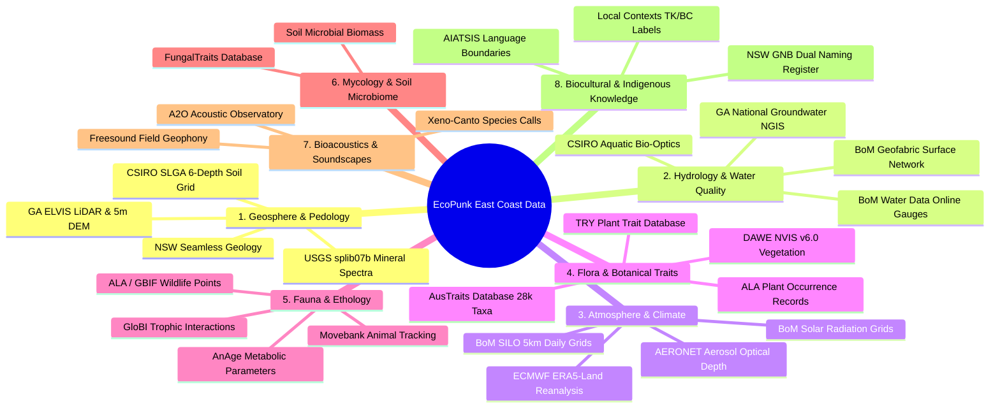
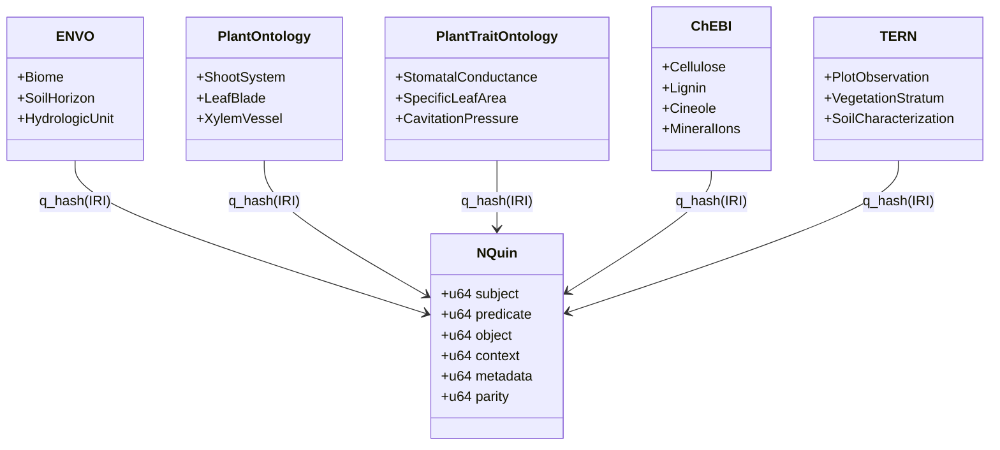

# East Coast Australia Ecological Dataset & Ontology Acquisition Plan
## Comprehensive Sourcing, Semantic Enrichment, and Runtime Asset Synthesis for the EcoPunk Substrate

> **Document Class:** Operational Plan & Dataset Acquisition Specification  
> **Workspace Anchor:** `c:\github\ecopunk` (`ecopunk-terrain` / `ecopunk-earth`)  
> **Target Region:** East Coast Australia Corridor (Noosa / SEQ $\to$ Sydney Basin $\to$ Snowy Mountains / Talbingo $\to$ Gippsland / Melbourne $\to$ SA Border)  
> **Target Substrates:** QualiaDB `.q42` Semantic Volumes · `.m64` Matter-64 Containers · `.10d` Manifolds · 16-KB GPU `ConstituentLUT`  
> **Status:** Active Execution Plan v1.0  

---

## 1. Executive Summary & Geographic Bounding Extent

This document establishes the authoritative data-sourcing and semantic-compilation plan for the **EcoPunk environmental substrate**. Rather than generating synthetic landscapes with ungrounded procedural noise, EcoPunk anchors itself in verified open-access Australian environmental datasets across the East Coast of Australia.

The spatial hierarchy connects broad continental journeys (Noosa to Melbourne / SA border) down to high-resolution local scenes, anchored initially at the **Talbingo / Kosciuszko Alpine & Tumut River Catchment** established in `game-demo`.

```
========================================================================================
MACRO CORRIDOR: East Coast Australia (Noosa, QLD to Port Phillip / Western VIC)
Bounding Box: Lat -26.0°S to -39.0°S | Lon 140.5°E to 153.8°E
----------------------------------------------------------------------------------------
Zone 1: South-East Queensland & Northern Rivers (Noosa, Brisbane, Tweed, Byron Bay)
Zone 2: Greater Sydney Basin & Illawarra (Hawkesbury, Blue Mountains, Shoalhaven)
Zone 3: High Country & Headwaters (Snowy Mountains, Monaro, Talbingo, Kosciuszko)
Zone 4: South-East Highlands & Coastal Plain (Gippsland, Yarra Valley, Melbourne)
Zone 5: Western Volcanic Plain (Otways, Grampians down toward SA border)
========================================================================================
MICRO FOCUS: Talbingo / Kosciuszko Alpine Catchment (game-demo active site pack)
Bounding Box: Lat -35.40°S to -36.20°S | Lon 148.15°E to 148.65°E
Datum: GDA2020 (EPSG:7844) | Projected: MGA Zone 55 (EPSG:7855) | Vertical: AHD (EPSG:5711)
Key Anchor Sites: The Pines, Humes Crossing, Jounama Creek, Yarrangobilly, Three Mile Dam
========================================================================================
```

---

## 2. Master Dataset Acquisition Directory (8 Domains)

This section provides the targeted dataset names, custodians, format specifications, licensing, and explicit web queries for automated agents or crawlers to locate direct download endpoints.



---

### Domain 1: Geosphere, Lithology, Stratigraphy & Pedology

#### 1.1 Digital Elevation Models & Micro-Topography
* **Target Datasets:**
  * **Geoscience Australia ELVIS Elevation Portal:** 1m and 5m High-Resolution LiDAR Digital Elevation Models (DEMs) covering Snowy River, Tumut River, Talbingo, and coastal catchments; 1-second (~30m) SRTM-derived hydrologically enforced DEM.
  * **Copernicus GLO-30 / GLO-90 DEM:** Continental-scale 30m/90m synthetic aperture radar elevation model for seamless horizon skirts.
  * **MERIT Hydro / HydroSHEDS:** Hydro-enforced global DEM with conditioned flow paths, river channel widths, and catchment accumulation rasters.
* **Format & Resolution:** Cloud-Optimized GeoTIFF (COG), 1m / 5m / 30m grid, float32 elevation in millimeters AHD (`EPSG:5711`).
* **Licensing:** Creative Commons Attribution 4.0 International (CC BY 4.0).
* **Gemini Discovery Queries:**
  * `"Geoscience Australia" ELVIS "elevation information system" LiDAR DEM GeoTIFF Snowy Mountains Talbingo`
  * `Copernicus DEM GLO-30 Australia East Coast Cloud Optimized GeoTIFF AWS S3`
  * `MERIT Hydro conditioned DEM flow accumulation river network Australia`

#### 1.2 Geology, Lithostratigraphy & Structural Faults
* **Target Datasets:**
  * **NSW Seamless Geology Project (v2.2, Geological Survey of NSW):** Continuous statewide lithostratigraphy, bedrock formations, metamorphic grades, fault lines, shear zones, and dykes across Lachlan Fold Belt and Sydney Basin.
  * **Geological Survey of Victoria (GSV) Seamless Geology:** Southern extension covering Gippsland, Victorian Alps, and Melbourne regolith.
  * **Geoscience Australia 1:1 Million National Surface Geology:** Continental geological unit polygons and age determinations.
* **Format & Resolution:** OGC GeoPackage (`.gpkg`), ESRI Shapefile, OGC WFS 2.0 Web Feature Service endpoints.
* **Attributes to Extract:** Formation name, stratigraphic age, lithological class (e.g., Granodiorite, Quartzose Sandstone, Basalt, Alluvium), structural dip/strike, weathering grade.
* **Gemini Discovery Queries:**
  * `"NSW Seamless Geology" dataset download GeoPackage MinView GSNSW`
  * `"Geoscience Australia" "Surface Geology of Australia" 1:1M WFS GeoPackage`
  * `"Geological Survey of Victoria" seamless geology data download`

#### 1.3 Soil Horizons & Subsurface Geotechnical Grids (SLGA)
* **Target Datasets:**
  * **CSIRO Soil and Landscape Grid of Australia (SLGA):** Continuous 90m national rasters for 6 standardized depth intervals matching EcoPunk's 6 subsurface strata layers:
    * Depth 1: 0–5 cm (Surface organic matter / humic epipedon)
    * Depth 2: 5–15 cm (A-horizon / topsoil)
    * Depth 3: 15–30 cm (A2/B1 transition)
    * Depth 4: 30–60 cm (B-horizon / illuvial clay/sand zone)
    * Depth 5: 60–100 cm (B2/C transition / weathered regolith)
    * Depth 6: 100–200 cm (Saprolite / deep regolith to bedrock)
  * Attributes per depth layer: Clay %, Silt %, Sand %, Bulk Density ($g/cm^3$), Available Water Capacity ($AWC$ %), Effective Cation Exchange Capacity ($ECEC$), Total Nitrogen %, Organic Carbon %, pH ($1:5 \text{ CaCl}_2$).
  * **ASRIS (Australian Soil Resource Information System):** Isbell Australian Soil Classification (ASC) order polygons (Dermosols, Kurosols, Tenosols, Organosols, Vertosols).
* **Format & Resolution:** Cloud-Optimized GeoTIFF, 3-arcsecond (~90m) raster grid, CSIRO Data Access Portal (DAP).
* **Gemini Discovery Queries:**
  * `"Soil and Landscape Grid of Australia" CSIRO Data Access Portal SLGA GeoTIFF clay sand bulk density`
  * `ASRIS "Australian Soil Resource Information System" national soil order Isbell download`

#### 1.4 Mineralogical Optical Spectra (Kubelka-Munk Radiative Transfer)
* **Target Datasets:**
  * **USGS Spectral Library (splib07b):** Laboratory spectrometer reflectance curves across 380 nm to 2500 nm for pure minerals (quartz, orthoclase, muscovite, kaolinite, goethite, hematite, basalt, calcite, pyrite, alluvial gold).
  * **NASA JPL ECOSTRESS Spectral Library (v2.0):** Terrestrial rocks, soils, and weathered regolith spectral reflectance curves.
* **Format & Resolution:** ASCII `.txt` / CSV / NetCDF spectral curves sampled at $\le 10\text{ nm}$ wavelength intervals.
* **Attributes to Extract:** Absorption coefficient $K_i(\lambda)$ and scattering coefficient $S_i(\lambda)$ in 8 primary engine wavebands: Ultraviolet (380–400nm), Blue (400–500nm), Green (500–600nm), Red (600–700nm), NIR-1 (700–850nm), NIR-2 (850–1100nm), SWIR-1 (1100–1700nm), SWIR-2 (1700–2500nm).
* **Gemini Discovery Queries:**
  * `USGS "Spectral Library Version 7" splib07b mineral reflectance data download`
  * `NASA JPL ECOSTRESS spectral library rocks minerals soil spectra ASCII`

---

### Domain 2: Hydrology, Fluvial Geomorphology & Water Quality

#### 2.1 River Networks, Catchment Basins & Surface Water
* **Target Datasets:**
  * **Bureau of Meteorology (BoM) Australian Hydrological Geospatial Fabric (Geofabric):** Surface Cartography, Surface Network, Surface Catchments, and Hydrologic Reporting Units covering the Murray-Darling Basin and East Coast Drainage Divisions.
  * **BoM Water Data Online:** Real-time and historical hourly streamflow gauge stations (discharge $m^3/s$, stage height $m$, water temperature, electrical conductivity).
* **Format & Resolution:** GeoPackage, OGC WaterML 2.0 / SOS (Sensor Observation Service) REST API.
* **Gemini Discovery Queries:**
  * `"Bureau of Meteorology" Geofabric "Surface Cartography" download GeoPackage`
  * `BoM "Water Data Online" streamflow gauge discharge API Murray-Darling East Coast`

#### 2.2 Groundwater Aquifers & Hydrogeology
* **Target Datasets:**
  * **Geoscience Australia National Groundwater Information System (NGIS):** Borehole lithology, groundwater levels, casing intervals, aquifer boundaries, and hydrogeological unit maps.
* **Format & Resolution:** GeoPackage / OGC WFS, tabular CSV borehole logs.
* **Attributes to Extract:** Hydraulic conductivity $K$ ($m/\text{day}$), transmissivity $T$, specific yield $S_y$, phreatic water table depth ($m$).
* **Gemini Discovery Queries:**
  * `"Geoscience Australia" "National Groundwater Information System" NGIS download`
  * `National Hydrogeological Map Australia aquifer permeability dataset`

#### 2.3 Aquatic Bio-Optics & Solute Concentrations
* **Target Datasets:**
  * **CSIRO Aquatic Bio-Optics Database & Inland Water Quality:** Jerlov optical water type classifications, colored dissolved organic matter ($CDOM$) absorption slope $S_{\text{CDOM}}$, total suspended sediment ($TSS$) specific scattering, chlorophyll-$a$ absorption spectra $a_{\text{chla}}(\lambda)$.
* **Format & Resolution:** NetCDF / CSV tables.
* **Gemini Discovery Queries:**
  * `CSIRO inland water quality bio-optical properties CDOM chlorophyll absorption dataset`
  * `Jerlov water types coastal inland water optical scattering absorption spectrum`

---

### Domain 3: Atmosphere, Microclimate & Radiative Transfer

#### 3.1 Daily & Hourly Climatological Surfaces
* **Target Datasets:**
  * **Bureau of Meteorology SILO Gridded Data (DES Queensland / BoM):** 0.05° (~5km) daily spatial rasters from 1889 to present: Maximum Temperature, Minimum Temperature, Daily Rainfall ($mm$), Pan Evaporation ($mm$), Vapor Pressure Deficit ($VPD$ in $kPa$), Net Radiation ($MJ/m^2$).
  * **ECMWF ERA5-Land Reanalysis:** 9km hourly atmospheric fields (10m $U/V$ wind vectors, surface solar radiation downwards $SSRD$, boundary layer height, 2m dewpoint temperature).
* **Format & Resolution:** NetCDF-4 (`.nc`), Cloud-Optimized GeoTIFF.
* **Gemini Discovery Queries:**
  * `SILO gridded climate data BoM Queensland 5km daily NetCDF rainfall temperature VPD`
  * `ERA5-Land hourly dataset Australia wind radiation Copernicus Climate Data Store`

#### 3.2 Solar Position, Sky Radiation & Atmospheric Aerosols
* **Target Datasets:**
  * **BoM Gridded Solar Radiation Archive:** Daily global horizontal irradiance ($GHI$) and direct normal irradiance ($DNI$).
  * **NASA AERONET (Aerosol Robotic Network):** Sunphotometer stations across East Coast Australia (e.g., Lucinda, Canberra, Tumbarumba, Melbourne): Aerosol Optical Depth ($AOD_{550}$), Ångström exponent (440–870nm), Mie scattering phase function asymmetry parameter $g_{\text{mie}}$.
* **Format & Resolution:** ASCII tabular tables, NetCDF.
* **Gemini Discovery Queries:**
  * `BoM solar radiation gridded data download satellite direct normal irradiance`
  * `NASA AERONET aerosol optical depth download Tumbarumba Canberra Melbourne`

---

### Domain 4: Botany, Plant Functional Types & Metamer Biophysics

#### 4.1 Plant Trait Databases (AusTraits & TRY)
* **Target Datasets:**
  * **AusTraits Database (v5.0+):** The authoritative open-access synthesized database of Australian plant traits (28,000+ taxa, 500+ traits, 1M+ observations).
  * **TRY Plant Trait Database:** Global standardized plant trait database.
* **Attributes to Extract:**
  * Specific Leaf Area ($SLA$ in $m^2/kg$, leaf mass per area $LMA$)
  * Wood density ($\rho_{\text{wood}}$ in $kg/m^3$ or $g/cm^3$)
  * Max canopy height ($H_{\text{max}}$ in $m$)
  * Stomatal conductance ($g_{s,\text{max}}$ in $mol \cdot m^{-2} s^{-1}$)
  * Xylem cavitation resistance ($P_{50}, P_{88}$ in $MPa$)
  * Rooting depth ($D_{\text{root}}$ in $m$) and root-to-shoot ratio ($R:S$)
  * Fire response strategy (epicormic resprouter, basal lignotuber, obligate seed bank)
  * Leaf tensile modulus and petiole bending stiffness ($EI$)
* **Format:** Parquet / CSV tabular database, Zenodo release repository.
* **Gemini Discovery Queries:**
  * `AusTraits database download Zenodo Australian plant traits CSV parquet`
  * `TRY plant trait database specific leaf area wood density stomatal conductance`

#### 4.2 Vegetation Mapping & Ecological Communities
* **Target Datasets:**
  * **National Vegetation Information System (NVIS v6.0 - DAWE):** Major Vegetation Groups (MVGs, 33 classes) and Major Vegetation Subgroups (MVSs, 85 classes) at 100m grid resolution across Australia.
  * **Atlas of Living Australia (ALA):** Geo-referenced plant species observation occurrences (100M+ records) across Eastern Australia, including phenological dates of flowering and fruiting.
* **Format & Resolution:** Cloud-Optimized GeoTIFF (NVIS 100m raster), Darwin Core Archive (DwC-A / Parquet) for ALA occurrences.
* **Gemini Discovery Queries:**
  * `NVIS "National Vegetation Information System" version 6.0 Major Vegetation Groups download raster`
  * `Atlas of Living Australia "Darwin Core Archive" species occurrence download API`

#### 4.3 Plant Morphogenetic Grammars & Allometry
* **Target Datasets:**
  * **PlantGL / OpenAlea Botanical L-System Rule Repositories:** Structural branching rules, phyllotaxis angles, apical dominance parameters, and allometric crown radius equations for Eucalyptus, Acacia, Casuarina, and Alpine Asteraceae.
* **Gemini Discovery Queries:**
  * `OpenAlea PlantGL functional structural plant model Eucalyptus L-system rules`
  * `Allometric biomass equations Australian trees crown radius diameter breast height`

---

### Domain 5: Zoology, Fauna Ethology & Locomotion

#### 5.1 Animal Movement Trajectories & Biologging
* **Target Datasets:**
  * **Movebank Biologging Data Repository:** Empirical high-frequency GPS and 3-axis accelerometer tracks of Australian wildlife (e.g., Common Wombat *Vombatus ursinus*, Eastern Grey Kangaroo *Macropus giganteus*, Koala *Phascolarctos cinereus*, Platypus *Ornithorhynchus anatinus*, Emu *Dromaius novaehollandiae*).
* **Attributes to Extract:** Step length distribution, turning angle distribution, velocity envelope ($v_{\text{walk}}, v_{\text{trot}}, v_{\text{sprint}}$), diurnal activity cycle, resting metabolic phases.
* **Format:** CSV / JSON / Movebank REST API.
* **Gemini Discovery Queries:**
  * `Movebank animal tracking data download Australia wombat kangaroo GPS accelerometer`

#### 5.2 Animal Functional Traits & Life Histories
* **Target Datasets:**
  * **AnAge (The Animal Ageing and Longevity Database):** Adult body mass ($kg$), basal metabolic rate ($BMR$ in Watts), body temperature ($^\circ\text{C}$), gestation duration, longevity.
  * **Encyclopedia of Life (EOL) TraitBank:** Dietary guild (herbivore, browser, grazer, insectivore, carnivore), foraging stratum (terrestrial, arboreal, fossorial, aquatic), locomotion class.
  * **GloBI (Global Biotic Interactions):** Graph of empirical ecological interactions (predator-prey, herbivore-plant, pollinator-flower).
* **Format:** Tabular TSV / CSV, RDF Turtle.
* **Gemini Discovery Queries:**
  * `AnAge database download longevity metabolic rate body mass species CSV`
  * `GloBI Global Biotic Interactions download edge list TSV Australia`

---

### Domain 6: Mycology, Soil Microbiome & Nutrient Cycles

#### 6.1 Fungal Traits & Mycorrhizal Networks
* **Target Datasets:**
  * **FungalTraits Database (Polme et al.):** Functional traits of fungi (ectomycorrhizal, arbuscular mycorrhizal, saprotrophic, wood-decay white/brown rot), primary host plant taxa, sporocarp fruiting temperature/moisture triggers.
  * **Earth Microbiome Project / Bioplatforms Australia Soil Microbiome:** Soil microbial biomass carbon ($MBC$), decomposition decay constants ($k_{\text{decay}}$), bacterial/fungal ratios.
* **Format:** Tabular CSV / Excel, Zenodo archive.
* **Gemini Discovery Queries:**
  * `FungalTraits database Polme et al download mycorrhizal saprotrophic traits CSV`
  * `Bioplatforms Australia soil microbiome data portal CSIRO`

---

### Domain 7: Bioacoustics, Soundscapes & Sonic Toponyms

#### 7.1 Continuous Field Soundscapes & Bioacoustic Archives
* **Target Datasets:**
  * **Australian Acoustic Observatory (A2O):** Continuous 24/7 acoustic monitoring across 400 stations in Australian terrestrial biomes: 2-year soundscapes capturing wind through eucalypt canopy, river turbulence, insect choruses, frog breeding choruses.
  * **Xeno-Canto & Macaulay Library:** Curated vocalization audio files (`.flac` / `.wav`) with annotated frequency bounds $[f_{\text{min}}, f_{\text{max}}]$ for Australian avian and amphibian species.
* **Format:** FLAC audio, CSV metadata with lat/lon coordinates and timestamps.
* **Gemini Discovery Queries:**
  * `Australian Acoustic Observatory A2O audio data download Open Science Framework`
  * `Xeno-Canto API Australian birds audio recordings flac metadata`

---

### Domain 8: Biocultural Stewardship, Indigenous Toponyms & Traditional Ecological Knowledge

#### 8.1 First Nations Languages, Clan Boundaries & Dual Naming
* **Target Datasets:**
  * **AIATSIS Map of Indigenous Australia:** Language groups, clan boundaries, and dialect regions across Eastern Australia (e.g., Ngarigo, Walgalu, Wiradjuri, D'harawal, Yuin, Gundungurra, Wurundjeri, Kulin Nation).
  * **NSW Geographical Names Board (GNB) Dual Naming Register:** Gazetted First Nations place names and geographic features with official bilingual nomenclature.
  * **Local Contexts (Traditional Knowledge & Biocultural Labels):** RDF schemas for TK Attribution, TK Provenance, TK Clan, and BC Labels.
* **Format:** GeoJSON, Shapefile, W3C Turtle (`.ttl`).
* **Gemini Discovery Queries:**
  * `AIATSIS "Map of Indigenous Australia" spatial data shapefile GeoJSON download`
  * `NSW Geographical Names Board "Dual Naming" register dataset download`
  * `Local Contexts Traditional Knowledge TK Labels RDF ontology turtle`

#### 8.2 Indigenous Seasonal Weather Calendars
* **Target Datasets:**
  * **CSIRO / BoM Indigenous Weather Knowledge:** Seasonal calendars (e.g., D'harawal 6 seasons, Gariwerd 6 seasons, Ngarigo alpine phenological indicators) linking botanical flowering events to animal migrations and climate transitions.
* **Gemini Discovery Queries:**
  * `Bureau of Meteorology "Indigenous Weather Knowledge" seasonal calendars data`

---

## 3. Formal Ontology Corpus Acquisition & Mapping

The table below lists the exact W3C/OBO ontology files to download, their authoritative IRIs, target named graph in QualiaDB, and their semantic function in `.q42` compilation.



| Ontology Prefix | Full Name | Primary Source URL / Download Endpoint | Target Qualia Named Graph (`q_hash`) | Semantic Function in EcoPunk `.q42` |
| :--- | :--- | :--- | :--- | :--- |
| **`envo:`** | Environment Ontology | `http://purl.obolibrary.org/obo/envo.owl` | `urn:qualia:ontology:envo` | Terrestrial biomes, soil horizons, river geomorphology, atmospheric states |
| **`po:`** | Plant Ontology | `http://purl.obolibrary.org/obo/po.owl` | `urn:qualia:ontology:po` | Botanical anatomical structures (phytomers, blades, petioles, roots, bark) |
| **`to:`** | Plant Trait Ontology | `http://purl.obolibrary.org/obo/to.owl` | `urn:qualia:ontology:to` | Physiological plant traits (hydraulic resistance, stomatal conductance, $SLA$) |
| **`pato:`** | Phenotype & Trait Ontology | `http://purl.obolibrary.org/obo/pato.owl` | `urn:qualia:ontology:pato` | Physical qualities (elasticity, porosity, friction, color, roughness) |
| **`chebi:`** | Chemical Entities of Biological Interest | `http://purl.obolibrary.org/obo/chebi.owl` | `urn:qualia:ontology:chebi` | Organic polymers (lignin, cellulose), minerals ($\text{SiO}_2$, calcite), nutrients |
| **`ncbitaxon:`** | NCBI Organismal Taxonomy | `http://purl.obolibrary.org/obo/ncbitaxon.owl` | `urn:qualia:ontology:ncbitaxon` | Full taxonomic hierarchy for flora, fauna, fungi, and bacterial species |
| **`uberon:`** | Integrated Cross-Species Anatomy | `http://purl.obolibrary.org/obo/uberon.owl` | `urn:qualia:ontology:uberon` | Animal musculoskeletal structures, limb joints, locomotion organs |
| **`tern:`** | TERN Ecosystem Surveillance | `https://w3id.org/tern/ontologies/tern/` | `urn:qualia:ontology:tern` | Australian plot observations, vegetation structure, soil surveys |
| **`aunsl:`** | Australian National Soil Legislation | Bundled in `qualia-core-db/ontologies/aunsl.ttl` | `urn:qualia:ontology:aunsl` | Australian Soil Classification (Isbell) soil orders, horizons, chemistry |
| **`dwc:`** | Darwin Core Biodiversity Standard | `http://rs.tdwg.org/dwc/terms/` | `urn:qualia:ontology:dwc` | Biodiversity occurrences, sampling events, specimen taxonomy |
| **`tk:` / `bc:`** | Local Contexts Traditional Knowledge | `https://localcontexts.org/ontology/tk-bc.ttl` | `urn:qualia:ontology:localcontexts` | Traditional Knowledge & Biocultural Labels, cultural protocol constraints |
| **`geo:`** | OGC GeoSPARQL | `http://www.opengis.net/ont/geosparql` | `urn:qualia:ontology:geo` | Spatial geometries, topological relationships, geodetic features |
| **`qudt:`** | Quantities, Units, Dimensions & Types | `http://qudt.org/schema/qudt/` | `urn:qualia:ontology:qudt` | Physical units of measure (pascals, meters, grams, seconds, watts) |

---

## 4. Multi-Physical Enrichment & Mathematical Coupling

Once raw tabular and spatial data are ingested into `.q42`, each entity and constituent is bound to explicit physical tensors required by the simulation kernels in `qualia-sim` and WebGPU compute shaders:

### 4.1 Subsurface Geomechanics (Mohr-Coulomb & Darcy Permeability)
Every soil layer in `M64StrataColumnRecord` is enriched with geotechnical parameters derived from SLGA sand/silt/clay fractions:
$$\tau_{\text{shear}} = c + (\sigma_{\text{normal}} - P_{\text{pore}}) \tan(\theta_{\text{friction}})$$
* **Cohesion $c$ ($kPa$):** Pure sand: $0\text{ kPa}$; Loam: $5–15\text{ kPa}$; Dense clay: $30–80\text{ kPa}$.
* **Friction Angle $\theta_{\text{friction}}$:** Sand: $32^\circ–38^\circ$; Loam: $26^\circ–30^\circ$; Clay: $18^\circ–24^\circ$.
* **Darcy Permeability $k_{\text{perm}}$ ($m/s$):** Coarse gravel: $10^{-2}\text{ m/s}$; Sand: $10^{-4}\text{ m/s}$; Silt: $10^{-6}\text{ m/s}$; Clay: $10^{-9}\text{ m/s}$.

### 4.2 Optical Radiative Transfer (Kubelka-Munk Spectral Homogenization)
Substrates are homogenized from mineral fractions into 8 EMF wavebands ($\lambda \in [380, 2500\text{ nm}]$) for the 16-KB GPU `ConstituentLUT`:
$$R_\infty(\lambda) = 1 + \frac{K(\lambda)}{S(\lambda)} - \sqrt{\left(\frac{K(\lambda)}{S(\lambda)}\right)^2 + 2\frac{K(\lambda)}{S(\lambda)}}$$
* When wet ($S_w > 0$), refractive index matching darkens the surface via the Bachmann relation:
$$R_{\text{wet}}(\lambda) = R_{\text{dry}}(\lambda) \cdot \frac{n_{\text{fluid}}}{n_{\text{mineral}}} \cdot \frac{1}{1 + \beta \cdot S_w}$$

### 4.3 Botanical Allometry & Metamer Hydraulic Dynamics
Vegetation entities evaluate real-time transpiration and stem flexion based on AusTraits parameters:
$$E = g_s \cdot \frac{\text{VPD}}{P_{\text{atm}}}, \quad g_s = g_0 + \frac{a_1 \cdot A_{\text{net}}}{(c_s - \Gamma^*) \cdot (1 + \text{VPD}/D_0)}$$
* Stem flexion under aerodynamic wind drag:
$$\mathbf{F}_{\text{drag}} = \frac{1}{2} \rho_{\text{air}} C_d A_{\text{crown}} \Vert\mathbf{u}_{\text{wind}}\Vert \mathbf{u}_{\text{wind}}, \quad \mathbf{s}_{\text{bend}} = \frac{\mathbf{F}_{\text{drag}}}{3 E I / L^3}$$

---

## 5. Automated Pipeline: Execution & Tooling Architecture

The operational workflow to execute this acquisition plan is automated via dedicated Python/Rust tools anchored in `ecopunk/scripts/`:

```
┌────────────────────────────────────────────────────────────────────────┐
│                   ECOPUNK DATASET ACQUISITION PIPELINE                 │
└────────────────────────────────────────────────────────────────────────┘
                                    │
    [Phase 1: Download & Ingestion - scripts/fetch_east_coast_data.py]
    Downloads: GA LiDAR COGs, SLGA soil grids, AusTraits CSV, OLS ontologies
                                    │
                                    ▼
    [Phase 2: Semantic Compilation - qualia-core-db::ontology_loader]
    Parses TTL/OBO via rio_turtle into canonical 48B NQuins in .q42 volumes
                                    │
                                    ▼
    [Phase 3: Biophysical Enrichment - scripts/enrich_q42_tensors.rs]
    Calculates Voigt-Reuss elasticities, Darcy permeability, and K(λ)/S(λ)
                                    │
                                    ▼
    [Phase 4: Runtime Asset Synthesis - crates/ecopunk-terrain]
    • Generates 16-KB GPU ConstituentLUT (256 x 64B flat binary table)
    • Compiles .m64 Mode 0x02 Strata Column Chunks (6-depth layers)
    • Packages .10d Manifold Heightfields & River Vector Geofabric
```

---

## 6. Actionable Checklist for Gemini Discovery

To execute this plan, use the following prioritized search and retrieval order:

- [ ] **Step 1: Download Core OLS Ontologies** (`envo.owl`, `po.owl`, `to.owl`, `pato.owl`, `chebi.owl`, `ncbitaxon.owl`, `uberon.owl`) and place in `qualiaDB/ontologies/`.
- [ ] **Step 2: Retrieve Talbingo / Snowy Mountains 5m DEM & LiDAR COG** from Geoscience Australia ELVIS portal (Lat -35.40 to -36.20, Lon 148.15 to 148.65).
- [ ] **Step 3: Download CSIRO SLGA 6-depth Soil Rasters** (Clay, Sand, Bulk Density) for the Talbingo tile footprint.
- [ ] **Step 4: Download AusTraits v5.0 Parquet/CSV dataset** from Zenodo.
- [ ] **Step 5: Extract USGS splib07b ASCII spectra** for Quartz, Feldspar, Kaolinite, Basalt, and Granite.
- [ ] **Step 6: Ingest BoM Geofabric Surface Water Network** covering Tumut River & Blowering Reservoir.
- [ ] **Step 7: Download AIATSIS First Nations Language Map** GeoJSON for the Ngarigo, Walgalu, and Wiradjuri boundaries.
- [ ] **Step 8: Execute `compile_raster_to_m64`** in `qualia-geospatial` to produce the first live `.m64` Mode 0x02 terrain chunk.
