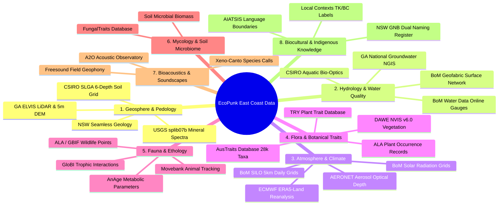
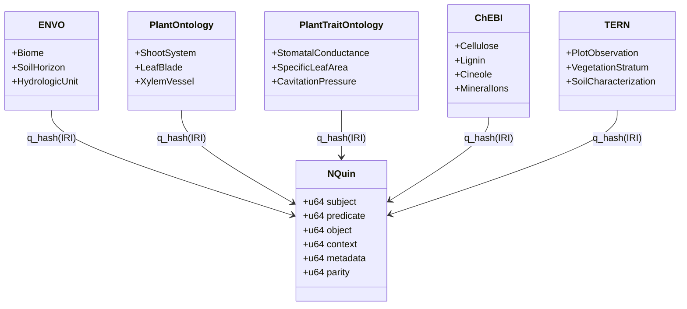

# East Coast Australia Ecological Dataset & Ontology Acquisition Plan
## Comprehensive Sourcing, Semantic Enrichment, and Runtime Asset Synthesis for the EcoPunk Substrate

> **Document Class:** Operational Plan & Dataset Acquisition Specification  
> **Workspace Anchor:** `c:\github\ecopunk` (`ecopunk-terrain` / `ecopunk-earth`)  
> **Target Region:** East Coast Australia Corridor (Noosa / SEQ $\to$ Sydney Basin $\to$ Snowy Mountains / Talbingo $\to$ Gippsland / Melbourne $\to$ SA Border)  
> **Target Substrates:** QualiaDB `.q42` Semantic Volumes · `.m64` Matter-64 Containers · `.10d` Manifolds · 16-KB GPU `ConstituentLUT`  
> **Status:** Active Execution Plan v1.0  

---

## 1. Executive Summary & Geographic Bounding Extent

This document establishes the authoritative data-sourcing and semantic-compilation plan for the **EcoPunk environmental substrate**. Rather than generating synthetic landscapes with ungrounded procedural noise, EcoPunk anchors itself in verified open-access Australian environmental datasets across the East Coast of Australia.

The spatial hierarchy connects broad continental journeys (Noosa to Melbourne / SA border) down to high-resolution local scenes, anchored initially at the **Talbingo / Kosciuszko Alpine & Tumut River Catchment** established in `game-demo`.

```
========================================================================================
MACRO CORRIDOR: East Coast Australia (Noosa, QLD to Port Phillip / Western VIC)
Bounding Box: Lat -26.0°S to -39.0°S | Lon 140.5°E to 153.8°E
----------------------------------------------------------------------------------------
Zone 1: South-East Queensland & Northern Rivers (Noosa, Brisbane, Tweed, Byron Bay)
Zone 2: Greater Sydney Basin & Illawarra (Hawkesbury, Blue Mountains, Shoalhaven)
Zone 3: High Country & Headwaters (Snowy Mountains, Monaro, Talbingo, Kosciuszko)
Zone 4: South-East Highlands & Coastal Plain (Gippsland, Yarra Valley, Melbourne)
Zone 5: Western Volcanic Plain (Otways, Grampians down toward SA border)
========================================================================================
MICRO FOCUS: Talbingo / Kosciuszko Alpine Catchment (game-demo active site pack)
Bounding Box: Lat -35.40°S to -36.20°S | Lon 148.15°E to 148.65°E
Datum: GDA2020 (EPSG:7844) | Projected: MGA Zone 55 (EPSG:7855) | Vertical: AHD (EPSG:5711)
Key Anchor Sites: The Pines, Humes Crossing, Jounama Creek, Yarrangobilly, Three Mile Dam
========================================================================================
```

---

## 2. Master Dataset Acquisition Directory (8 Domains)

This section provides the targeted dataset names, custodians, format specifications, licensing, and explicit web queries for automated agents or crawlers to locate direct download endpoints.



---

### Domain 1: Geosphere, Lithology, Stratigraphy & Pedology

#### 1.1 Digital Elevation Models & Micro-Topography
* **Target Datasets:**
  * **Geoscience Australia ELVIS Elevation Portal:** 1m and 5m High-Resolution LiDAR Digital Elevation Models (DEMs) covering Snowy River, Tumut River, Talbingo, and coastal catchments; 1-second (~30m) SRTM-derived hydrologically enforced DEM.
  * **NSW Spatial Services FSDF & Spatial Collaboration Portal:** Sub-meter to 2m LiDAR DEMs, 3D hydro-enforced stream lines, cadastral parcels, road centrelines, and state forest bounds (`https://portal.spatial.nsw.gov.au/server/rest/services/`).
  * **ACTmapi Open Data Portal:** Sub-meter LiDAR point clouds across Namadgi/Brindabella ranges, urban tree canopy inventory, and micro-catchments (`https://actmapi.act.gov.au/`).
  * **Vicmap Elevation / DataShare Victoria:** 1m–10m LiDAR and photogrammetric DEMs across Victorian Alps, Gippsland, and Melbourne catchments (`https://datashare.maps.vic.gov.au/`).
  * **Queensland QSpatial & Queensland Globe:** High-resolution coastal LiDAR DEMs (Noosa/SEQ) and 10m regional elevation grids (`https://qldspatial.information.qld.gov.au/`).
  * **Copernicus GLO-30 / GLO-90 DEM:** Continental-scale 30m/90m synthetic aperture radar elevation model for seamless horizon skirts.
  * **MERIT Hydro / HydroSHEDS:** Hydro-enforced global DEM with conditioned flow paths, river channel widths, and catchment accumulation rasters.
* **Format & Resolution:** Cloud-Optimized GeoTIFF (COG), LAS/LAZ point clouds, GeoPackage, float32 elevation in millimeters AHD (`EPSG:5711`).
* **Licensing:** Creative Commons Attribution 4.0 International (CC BY 4.0).
* **Gemini Discovery Queries:**
  * `"Geoscience Australia" ELVIS "elevation information system" LiDAR DEM GeoTIFF Snowy Mountains Talbingo`
  * `NSW Spatial Services FSDF LiDAR DEM download WFS REST API`
  * `Vicmap Elevation DataShare Victoria LiDAR DEM Alpine Gippsland`
  * `Copernicus DEM GLO-30 Australia East Coast Cloud Optimized GeoTIFF AWS S3`

#### 1.2 Geology, Lithostratigraphy & Structural Faults
* **Target Datasets:**
  * **NSW Seamless Geology Project (v2.2, Geological Survey of NSW / MinView):** Continuous statewide lithostratigraphy, bedrock formations, metamorphic grades, fault lines, shear zones, and dykes across Lachlan Fold Belt and Sydney Basin (`https://minview.geoscience.nsw.gov.au/`).
  * **Geological Survey of Victoria (GSV) Seamless Geology:** Southern extension covering Gippsland, Victorian Alps, and Melbourne regolith.
  * **Geoscience Australia 1:1 Million National Surface Geology:** Continental geological unit polygons and age determinations (`https://pid.geoscience.gov.au/def/voc/`).
* **Format & Resolution:** OGC GeoPackage (`.gpkg`), ESRI Shapefile, OGC WFS 2.0 Web Feature Service endpoints.
* **Attributes to Extract:** Formation name, stratigraphic age, lithological class (e.g., Granodiorite, Quartzose Sandstone, Basalt, Alluvium), structural dip/strike, weathering grade.
* **Gemini Discovery Queries:**
  * `"NSW Seamless Geology" dataset download GeoPackage MinView GSNSW`
  * `"Geoscience Australia" "Surface Geology of Australia" 1:1M WFS GeoPackage`
  * `"Geological Survey of Victoria" seamless geology data download`

#### 1.3 Soil Horizons & Subsurface Geotechnical Grids (SLGA & eSPADE)
* **Target Datasets:**
  * **CSIRO Soil and Landscape Grid of Australia (SLGA):** Continuous 90m national rasters for 6 standardized depth intervals matching EcoPunk's 6 subsurface strata layers:
    * Depth 1: 0–5 cm (Surface organic matter / humic epipedon)
    * Depth 2: 5–15 cm (A-horizon / topsoil)
    * Depth 3: 15–30 cm (A2/B1 transition)
    * Depth 4: 30–60 cm (B-horizon / illuvial clay/sand zone)
    * Depth 5: 60–100 cm (B2/C transition / weathered regolith)
    * Depth 6: 100–200 cm (Saprolite / deep regolith to bedrock)
  * Attributes per depth layer: Clay %, Silt %, Sand %, Bulk Density ($g/cm^3$), Available Water Capacity ($AWC$ %), Effective Cation Exchange Capacity ($ECEC$), Total Nitrogen %, Organic Carbon %, pH ($1:5 \text{ CaCl}_2$).
  * **NSW eSPADE (Soil & Land Information System):** Empirical field soil pit observations, laboratory pedology profiles, acid sulfate soil risk maps, and land capability classes across NSW (`https://espade.environment.nsw.gov.au/`).
  * **ISRIC SoilGrids v2.0 & WoSIS:** Harmonized global soil properties across the exact same 6 standard depth intervals (fallback / boundary validation).
  * **NCI THREDDS Data Server:** Direct programmatic OPeNDAP/NetCDF slicing of continental SLGA and ANUClimate grids (`https://thredds.nci.org.au/thredds/catalog.html`).
* **Format & Resolution:** Cloud-Optimized GeoTIFF, 3-arcsecond (~90m) raster grid, OPeNDAP NetCDF, CSV profiles.
* **Gemini Discovery Queries:**
  * `"Soil and Landscape Grid of Australia" CSIRO Data Access Portal SLGA GeoTIFF clay sand bulk density`
  * `eSPADE NSW soil profile database soil pit laboratory chemistry download`
  * `NCI THREDDS OPeNDAP SLGA soil grids Australia programmatic slice`

#### 1.4 Mineralogical Optical Spectra (Kubelka-Munk Radiative Transfer)
* **Target Datasets:**
  * **USGS Spectral Library (splib07b):** Laboratory spectrometer reflectance curves across 380 nm to 2500 nm for pure minerals (quartz, orthoclase, muscovite, kaolinite, goethite, hematite, basalt, calcite, pyrite, alluvial gold).
  * **NASA JPL ECOSTRESS Spectral Library (v2.0):** Terrestrial rocks, soils, and weathered regolith spectral reflectance curves.
  * **PROSPECT-D / EcoSIS Spectral Library:** Directional-hemispherical reflectance and transmittance spectra ($400–2500\text{ nm}$) linked to biochemical constituents (chlorophyll $C_{ab}$, carotenoids $C_{ar}$, water $C_w$, dry matter $C_m$).
* **Format & Resolution:** ASCII `.txt` / CSV / NetCDF spectral curves sampled at $\le 10\text{ nm}$ wavelength intervals.
* **Attributes to Extract:** Absorption coefficient $K_i(\lambda)$ and scattering coefficient $S_i(\lambda)$ in 8 primary engine wavebands: Ultraviolet (380–400nm), Blue (400–500nm), Green (500–600nm), Red (600–700nm), NIR-1 (700–850nm), NIR-2 (850–1100nm), SWIR-1 (1100–1700nm), SWIR-2 (1700–2500nm).
* **Gemini Discovery Queries:**
  * `USGS "Spectral Library Version 7" splib07b mineral reflectance data download`
  * `NASA JPL ECOSTRESS spectral library rocks minerals soil spectra ASCII`
  * `EcoSIS spectral library leaf reflectance transmittance PROSPECT-D`

---

### Domain 2: Hydrology, Fluvial Geomorphology & Water Quality

#### 2.1 River Networks, Catchment Basins & Surface Water
* **Target Datasets:**
  * **Bureau of Meteorology (BoM) Australian Hydrological Geospatial Fabric (Geofabric):** Surface Cartography, Surface Network, Surface Catchments, and Hydrologic Reporting Units covering the Murray-Darling Basin and East Coast Drainage Divisions (`http://geofabric.bom.gov.au/`).
  * **BoM Water Data Online & SOS2 Web Services:** Real-time and historical hourly streamflow gauge stations (discharge $m^3/s$, stage height $m$, water temperature, electrical conductivity) (`http://www.bom.gov.au/waterdata/services`).
  * **Digital Earth Australia (DEA) WaterBodies:** High-resolution multi-decadal satellite wetness and surface inundation surface area time series for every dam, billabong, and lake across Eastern Australia (`https://ows.dea.ga.gov.au/`).
  * **MERIT Hydro & HydroATLAS (Lehner et al.):** Hydro-enforced global 3-arcsecond (~90m) flow direction, upstream drainage area, stream order (Strahler), and 280 hydro-environmental catchment attributes.
* **Format & Resolution:** GeoPackage, OGC WaterML 2.0 / SOS REST API, Cloud-Optimized GeoTIFF.
* **Gemini Discovery Queries:**
  * `"Bureau of Meteorology" Geofabric "Surface Cartography" download GeoPackage`
  * `BoM "Water Data Online" streamflow gauge discharge API Murray-Darling East Coast`
  * `Digital Earth Australia WaterBodies surface water inundation time series download`

#### 2.2 Groundwater Aquifers & Hydrogeology
* **Target Datasets:**
  * **Geoscience Australia National Groundwater Information System (NGIS):** Borehole lithology, groundwater levels, casing intervals, aquifer boundaries, and hydrogeological unit maps.
* **Format & Resolution:** GeoPackage / OGC WFS, tabular CSV borehole logs.
* **Attributes to Extract:** Hydraulic conductivity $K$ ($m/\text{day}$), transmissivity $T$, specific yield $S_y$, phreatic water table depth ($m$).
* **Gemini Discovery Queries:**
  * `"Geoscience Australia" "National Groundwater Information System" NGIS download`
  * `National Hydrogeological Map Australia aquifer permeability dataset`

#### 2.3 Aquatic Bio-Optics & Solute Concentrations
* **Target Datasets:**
  * **CSIRO Aquatic Bio-Optics Database & Inland Water Quality:** Jerlov optical water type classifications, colored dissolved organic matter ($CDOM$) absorption slope $S_{\text{CDOM}}$, total suspended sediment ($TSS$) specific scattering, chlorophyll-$a$ absorption spectra $a_{\text{chla}}(\lambda)$.
  * **AUSRIVAS (Australian River Assessment System):** Benthic macroinvertebrate taxa tolerances (SIGNAL2 grades), linking stream dissolved oxygen, turbidity, and substrate cobble size to aquatic insect presence (`https://ausrivas.ewater.org.au/`).
* **Format & Resolution:** NetCDF / CSV tables, Access DB.
* **Gemini Discovery Queries:**
  * `CSIRO inland water quality bio-optical properties CDOM chlorophyll absorption dataset`
  * `AUSRIVAS macroinvertebrate water quality SIGNAL2 scores Australia river assessment`

---

### Domain 3: Atmosphere, Microclimate & Radiative Transfer

#### 3.1 Daily & Hourly Climatological Surfaces & Eddy Covariance
* **Target Datasets:**
  * **Bureau of Meteorology SILO Gridded Data (DES Queensland / BoM):** 0.05° (~5km) daily spatial rasters from 1889 to present: Maximum Temperature, Minimum Temperature, Daily Rainfall ($mm$), Pan Evaporation ($mm$), Vapor Pressure Deficit ($VPD$ in $kPa$), Net Radiation ($MJ/m^2$).
  * **ECMWF ERA5-Land Reanalysis:** 9km hourly atmospheric fields (10m $U/V$ wind vectors, surface solar radiation downwards $SSRD$, boundary layer height, 2m dewpoint temperature).
  * **CHELSA v2.1 (Climatologies at High Resolution):** 30-arcsec (~1km) orographically corrected temperature, precipitation, and 19 BIOCLIM variables accounting for cold-air drainage and windward/leeward rain shadows in the Snowy Mountains (`https://chelsa-climate.org/`).
  * **FLUXNET2015 / OzFlux (TERN):** Continuous half-hourly empirical measurements of Net Ecosystem Exchange ($NEE$), Latent Heat Flux ($LE$), Sensible Heat Flux ($H$), and soil heat flux at the **Tumbarumba OzFlux tower** (`-35.6566°S, 148.1517°E`, wet sclerophyll *Eucalyptus delegatensis* forest on the western border of the Talbingo micro-scene) and Cumberland Plain / Nimmo Plains towers (`https://www.ozflux.org.au/`).
* **Format & Resolution:** NetCDF-4 (`.nc`), Cloud-Optimized GeoTIFF, CSV.
* **Gemini Discovery Queries:**
  * `SILO gridded climate data BoM Queensland 5km daily NetCDF rainfall temperature VPD`
  * `OzFlux Tumbarumba eddy covariance half-hourly flux data download TERN`
  * `CHELSA climate bioclimatic variables Australia 30 arcsec GeoTIFF`

#### 3.2 Solar Position, Sky Radiation & Atmospheric Aerosols
* **Target Datasets:**
  * **BoM Gridded Solar Radiation Archive:** Daily global horizontal irradiance ($GHI$) and direct normal irradiance ($DNI$).
  * **NASA AERONET (Aerosol Robotic Network):** Sunphotometer stations across East Coast Australia (e.g., Lucinda, Canberra, Tumbarumba, Melbourne): Aerosol Optical Depth ($AOD_{550}$), Ångström exponent (440–870nm), Mie scattering phase function asymmetry parameter $g_{\text{mie}}$.
* **Format & Resolution:** ASCII tabular tables, NetCDF.
* **Gemini Discovery Queries:**
  * `BoM solar radiation gridded data download satellite direct normal irradiance`
  * `NASA AERONET aerosol optical depth download Tumbarumba Canberra Melbourne`

---

### Domain 4: Botany, Plant Functional Types & Metamer Biophysics

#### 4.1 Plant Trait Databases, Plot Surveillance & Remote Sensing
* **Target Datasets:**
  * **AusTraits Database (v5.0+):** The authoritative open-access synthesized database of Australian plant traits (28,000+ taxa, 500+ traits, 1M+ observations, Zenodo DOI: `10.5281/zenodo.3568417`).
  * **Flora of Australia & EUCLID (Centre for Australian National Biodiversity Research):** Detailed botanical keys for 900+ *Eucalyptus*, *Corymbia*, and *Angophora* taxa: bark type (stringybark, ironbark, box, ribbon gum), juvenile vs. adult leaf morphology, bud/fruit dimensions, and oil gland density (`https://profiles.ala.org.au/`).
  * **TERN AusPlots & EcoPlots:** Standardized $100\text{m} \times 100\text{m}$ field survey plots across Australia: basal area, canopy cover fractions, litter depth, coarse woody debris, and exact voucher-verified species co-occurrence matrices (`https://ecoplots.tern.org.au/`).
  * **NASA GEDI (Global Ecosystem Dynamics Investigation) L2A/L2B/L4A:** 25m footprint waveforms providing empirical vertical foliage profiles (Plant Area Index by 5m height bin), canopy top height, and aboveground biomass density.
  * **ETH / Meta Global Canopy Height (Lang et al. / Tolan et al.):** 1m to 10m continuous wall-to-wall tree height raster (COG) across Eastern Australia.
  * **TRY Plant Trait Database:** Global standardized plant trait database.
* **Attributes to Extract:**
  * Specific Leaf Area ($SLA$ in $m^2/kg$, leaf mass per area $LMA$)
  * Wood density ($\rho_{\text{wood}}$ in $kg/m^3$ or $g/cm^3$)
  * Max canopy height ($H_{\text{max}}$ in $m$)
  * Stomatal conductance ($g_{s,\text{max}}$ in $mol \cdot m^{-2} s^{-1}$)
  * Xylem cavitation resistance ($P_{50}, P_{88}$ in $MPa$)
  * Rooting depth ($D_{\text{root}}$ in $m$) and root-to-shoot ratio ($R:S$)
  * Fire response strategy (epicormic resprouter, basal lignotuber, obligate seed bank)
  * Leaf tensile modulus and petiole bending stiffness ($EI$)
* **Format:** Parquet / CSV tabular database, COG, HDF5, RDF Turtle.
* **Gemini Discovery Queries:**
  * `AusTraits database download Zenodo Australian plant traits CSV parquet`
  * `EUCLID eucalypts identification keys bark leaves fruit CANBR profiles`
  * `TERN AusPlots plot surveillance vegetation structure basal area download`
  * `NASA GEDI L2B canopy height profile Australia Snowy Mountains`

#### 4.2 High-Resolution Vegetation Mapping & Communities
* **Target Datasets:**
  * **NSW State Vegetation Type Map (SVTM - DPE / SEED):** Plant Community Types (PCTs) mapped at 5m–25m resolution across NSW, distinguishing frost-hollow *Poa* tussock grassland from adjacent *Eucalyptus pauciflora* woodland at Talbingo (`https://datasets.seed.nsw.gov.au/`).
  * **Victorian Ecological Vegetation Classes (EVCs - Vicmap / DataShare):** Statewide fine-scale native vegetation groups (`NV2005_EVCBCS`) across Victorian alpine and montane biomes.
  * **Queensland Regional Ecosystems (RE - QSpatial):** 1:10,000 coastal / 1:50,000 inland vegetation communities across South-East Queensland (Noosa corridor).
  * **National Vegetation Information System (NVIS v6.0 - DAWE):** Major Vegetation Groups (MVGs, 33 classes) and Major Vegetation Subgroups (MVSs, 85 classes) at 100m grid resolution across Australia.
  * **Atlas of Living Australia (ALA):** Geo-referenced plant species observation occurrences (100M+ records) across Eastern Australia, including phenological dates of flowering and fruiting.
* **Format & Resolution:** Cloud-Optimized GeoTIFF, GeoPackage / ESRI Shapefile, Darwin Core Archive (DwC-A).
* **Gemini Discovery Queries:**
  * `NSW State Vegetation Type Map SVTM Plant Community Types PCT GeoPackage download`
  * `Victoria Ecological Vegetation Classes EVC DataShare map download`
  * `Queensland Regional Ecosystems spatial dataset QSpatial download`

#### 4.3 Plant Morphogenetic Grammars & Allometry
* **Target Datasets:**
  * **Botanical Structural & L-System Allometry Repositories:** Structural branching rules, phyllotaxis angles, apical dominance parameters, and allometric crown radius equations for Eucalyptus, Acacia, Casuarina, and Alpine Asteraceae from canonical botanical literature (Prusinkiewicz & Lindenmayer 1990, Runions et al. 2007, Cescatti 1997).
* **Gemini Discovery Queries:**
  * `Functional structural plant model Eucalyptus L-system branching rules`
  * `Allometric biomass equations Australian trees crown radius diameter breast height`

---

### Domain 5: Zoology, Fauna Ethology & Locomotion

#### 5.1 Animal Movement Trajectories & Biologging
* **Target Datasets:**
  * **Movebank Biologging Data Repository:** Empirical high-frequency GPS and 3-axis accelerometer tracks of Australian wildlife (e.g., Common Wombat *Vombatus ursinus*, Eastern Grey Kangaroo *Macropus giganteus*, Koala *Phascolarctos cinereus*, Platypus *Ornithorhynchus anatinus*, Emu *Dromaius novaehollandiae*).
* **Attributes to Extract:** Step length distribution, turning angle distribution, velocity envelope ($v_{\text{walk}}, v_{\text{trot}}, v_{\text{sprint}}$), diurnal activity cycle, resting metabolic phases.
* **Format:** CSV / JSON / Movebank REST API.
* **Gemini Discovery Queries:**
  * `Movebank animal tracking data download Australia wombat kangaroo GPS accelerometer`

#### 5.2 Animal Functional Traits, Checklists & Life Histories
* **Target Datasets:**
  * **Australian Faunal Directory (AFD - DCCEEW):** Official taxonomic checklist, holotype records, and distributional bounds for Australian vertebrates and invertebrates (`https://biodiversity.org.au/afd/home`).
  * **SPRAT (Species Profile and Threats Database - EPBC Act):** Threat abatement profiles, foraging/breeding habitat polygons, and ecological community thresholds for threatened species (`https://www.environment.gov.au/cgi-bin/sprat/public/sprat.pl`).
  * **BirdLife Australia (Birdata & Australian Bird Data v1.0):** Morphological, ecological, and life-history traits for all Australian bird taxa (clutch size, foraging stratum, migration class, beak dimensions, wing loading) (`https://birdata.birdlife.org.au/`).
  * **Australian National Insect Collection (ANIC - CSIRO) & AusPollinators:** Insect occurrences, host-plant associations, and thermal tolerance bounds for native bees (*Tetragonula*, *Amegilla*), beetles, and alpine moths (Bogong moth *Agrotis infusa*) (`https://data.csiro.au/`).
  * **AnAge (The Animal Ageing and Longevity Database):** Adult body mass ($kg$), basal metabolic rate ($BMR$ in Watts), body temperature ($^\circ\text{C}$), gestation duration, longevity.
  * **Encyclopedia of Life (EOL) TraitBank:** Dietary guild (herbivore, browser, grazer, insectivore, carnivore), foraging stratum (terrestrial, arboreal, fossorial, aquatic), locomotion class.
  * **GloBI (Global Biotic Interactions):** Graph of empirical ecological interactions (predator-prey, herbivore-plant, pollinator-flower).
* **Format:** Tabular TSV / CSV, RDF Turtle, DwC-A.
* **Gemini Discovery Queries:**
  * `Australian Faunal Directory checklist download RDF Darwin Core`
  * `SPRAT Species Profile and Threats Database shapefile download`
  * `Birdata Australian bird traits dataset Dryad Zenodo download`
  * `GloBI Global Biotic Interactions download edge list TSV Australia`

---

### Domain 6: Mycology, Soil Microbiome & Nutrient Cycles

#### 6.1 Fungal Traits & Mycorrhizal Networks
* **Target Datasets:**
  * **FungalTraits Database (Polme et al.):** Functional traits of fungi (ectomycorrhizal, arbuscular mycorrhizal, saprotrophic, wood-decay white/brown rot), primary host plant taxa, sporocarp fruiting temperature/moisture triggers.
  * **Fungimap & Australian Microbiome Initiative (Bioplatforms Australia):** Georeferenced soil eDNA amplicon sequences (16S bacterial, ITS fungal) paired directly with soil chemistry at TERN AusPlots sites (`https://data.bioplatforms.com/`).
  * **Earth Microbiome Project / CSIRO Soil Microbiome:** Soil microbial biomass carbon ($MBC$), decomposition decay constants ($k_{\text{decay}}$), bacterial/fungal ratios.
* **Format:** Tabular CSV / Excel, FASTQ / OTU tables, Zenodo archive.
* **Gemini Discovery Queries:**
  * `FungalTraits database Polme et al download mycorrhizal saprotrophic traits CSV`
  * `Australian Microbiome Initiative soil eDNA data portal Bioplatforms TERN`

---

### Domain 7: Bioacoustics, Soundscapes & Sonic Toponyms

#### 7.1 Continuous Field Soundscapes & Bioacoustic Archives
* **Target Datasets:**
  * **Australian Acoustic Observatory (A2O):** Continuous 24/7 acoustic monitoring across 400 stations in Australian terrestrial biomes: 2-year soundscapes capturing wind through eucalypt canopy, river turbulence, insect choruses, frog breeding choruses.
  * **Xeno-Canto & Macaulay Library:** Curated vocalization audio files (`.flac` / `.wav`) with annotated frequency bounds $[f_{\text{min}}, f_{\text{max}}]$ for Australian avian and amphibian species.
* **Format:** FLAC audio, CSV metadata with lat/lon coordinates and timestamps.
* **Gemini Discovery Queries:**
  * `Australian Acoustic Observatory A2O audio data download Open Science Framework`
  * `Xeno-Canto API Australian birds audio recordings flac metadata`

---

### Domain 8: Biocultural Stewardship, Indigenous Toponyms & Traditional Ecological Knowledge

#### 8.1 First Nations Languages, Clan Boundaries & Dual Naming
* **Target Datasets:**
  * **AIATSIS Map of Indigenous Australia:** Language groups, clan boundaries, and dialect regions across Eastern Australia (e.g., Ngarigo, Walgalu, Wiradjuri, D'harawal, Yuin, Gundungurra, Wurundjeri, Kulin Nation).
  * **NSW Geographical Names Board (GNB) Dual Naming Register:** Gazetted First Nations place names and geographic features with official bilingual nomenclature.
  * **Local Contexts (Traditional Knowledge & Biocultural Labels):** RDF schemas for TK Attribution, TK Provenance, TK Clan, and BC Labels.
* **Format:** GeoJSON, Shapefile, W3C Turtle (`.ttl`).
* **Gemini Discovery Queries:**
  * `AIATSIS "Map of Indigenous Australia" spatial data shapefile GeoJSON download`
  * `NSW Geographical Names Board "Dual Naming" register dataset download`
  * `Local Contexts Traditional Knowledge TK Labels RDF ontology turtle`

#### 8.2 Indigenous Seasonal Weather Calendars
* **Target Datasets:**
  * **CSIRO / BoM Indigenous Weather Knowledge:** Seasonal calendars (e.g., D'harawal 6 seasons, Gariwerd 6 seasons, Ngarigo alpine phenological indicators) linking botanical flowering events to animal migrations and climate transitions.
* **Gemini Discovery Queries:**
  * `Bureau of Meteorology "Indigenous Weather Knowledge" seasonal calendars data`

---

## 3. Formal Ontology Corpus Acquisition & Mapping

The table below lists the exact W3C/OBO ontology files to download, their authoritative IRIs, target named graph in QualiaDB, and their semantic function in `.q42` compilation.



| Ontology Prefix | Full Name | Primary Source URL / Download Endpoint | Target Qualia Named Graph (`q_hash`) | Semantic Function in EcoPunk `.q42` |
| :--- | :--- | :--- | :--- | :--- |
| **`envo:`** | Environment Ontology | `http://purl.obolibrary.org/obo/envo.owl` | `urn:qualia:ontology:envo` | Terrestrial biomes, soil horizons, river geomorphology, atmospheric states |
| **`po:`** | Plant Ontology | `http://purl.obolibrary.org/obo/po.owl` | `urn:qualia:ontology:po` | Botanical anatomical structures (phytomers, blades, petioles, roots, bark) |
| **`to:`** | Plant Trait Ontology | `http://purl.obolibrary.org/obo/to.owl` | `urn:qualia:ontology:to` | Physiological plant traits (hydraulic resistance, stomatal conductance, $SLA$) |
| **`pato:`** | Phenotype & Trait Ontology | `http://purl.obolibrary.org/obo/pato.owl` | `urn:qualia:ontology:pato` | Physical qualities (elasticity, porosity, friction, color, roughness) |
| **`ro:`** | Relation Ontology (OBO) | `http://purl.obolibrary.org/obo/ro.owl` | `urn:qualia:ontology:ro` | Standardized ecological/causal edges (`part_of`, `trophically_interacts_with`, `has_host`) |
| **`ecocore:`** | Core Ecological Entities | `http://purl.obolibrary.org/obo/ecocore.owl` | `urn:qualia:ontology:ecocore` | Trophic roles (autotroph, detritivore, browser), foraging strategies, guilds |
| **`peco:`** | Plant Experimental Conditions | `http://purl.obolibrary.org/obo/peco.owl` | `urn:qualia:ontology:peco` | Abiotic/biotic exposure regimens (frost, drought stress, irradiance intensity) |
| **`flopo:`** | Flora Phenotype Ontology | `http://purl.obolibrary.org/obo/flopo.owl` | `urn:qualia:ontology:flopo` | Fine-grained morphology (leaf serration, bark fissuring, inflorescence geometry) |
| **`bco:`** | Biological Collections Ontology | `http://purl.obolibrary.org/obo/bco.owl` | `urn:qualia:ontology:bco` | Field sampling provenance, specimen vouchers, observational protocols |
| **`sweet:`** | Semantic Web for Earth & Env. | `http://sweetontology.net/` | `urn:qualia:ontology:sweet` | Earth systems: hydrology, geomorphology, thermodynamics, pedogenesis |
| **`sosa:` / `ssn:`** | Sensor, Observation, Sample, Actuator | `http://www.w3.org/ns/sosa/` | `urn:qualia:ontology:sosa` | Weather stations, flux towers, stream gauges, acoustic sensor observation logs |
| **`time:` / `gts:`** | OWL-Time & Geologic TimeScale | `http://www.w3.org/2006/time#` | `urn:qualia:ontology:time` | Phenological intervals, diurnal cycles, Indigenous seasons, bedrock ages |
| **`geosciml:`** | OGC GeoSciML (v4.1) | `http://resource.geosciml.org/schema/cgi/geosciml/4.1/` | `urn:qualia:ontology:geosciml` | Geologic units, shear displacement structures, lithological rock composition |
| **`hy_p:`** | OGC HY_Features (Hydrology) | `https://www.opengis.net/def/appschema/hy_features/hyf/` | `urn:qualia:ontology:hy_features` | Catchment topological graphs, nexus points, river reaches (BoM Geofabric) |
| **`chebi:`** | Chemical Entities of Biological Interest | `http://purl.obolibrary.org/obo/chebi.owl` | `urn:qualia:ontology:chebi` | Organic polymers (lignin, cellulose), minerals ($\text{SiO}_2$, calcite), nutrients |
| **`ncbitaxon:`** | NCBI Organismal Taxonomy | `http://purl.obolibrary.org/obo/ncbitaxon.owl` | `urn:qualia:ontology:ncbitaxon` | Full taxonomic hierarchy for flora, fauna, fungi, and bacterial species |
| **`uberon:`** | Integrated Cross-Species Anatomy | `http://purl.obolibrary.org/obo/uberon.owl` | `urn:qualia:ontology:uberon` | Animal musculoskeletal structures, limb joints, locomotion organs |
| **`tern:`** | TERN Ecosystem Surveillance | `https://w3id.org/tern/ontologies/tern/` | `urn:qualia:ontology:tern` | Australian plot observations, vegetation structure, soil surveys |
| **`aunsl:`** | Australian National Soil Legislation | Bundled in `qualia-core-db/ontologies/aunsl.ttl` | `urn:qualia:ontology:aunsl` | Australian Soil Classification (Isbell) soil orders, horizons, chemistry |
| **`dwc:`** | Darwin Core Biodiversity Standard | `http://rs.tdwg.org/dwc/terms/` | `urn:qualia:ontology:dwc` | Biodiversity occurrences, sampling events, specimen taxonomy |
| **`odrl:`** | W3C Open Digital Rights Language (v2.2) | `http://www.w3.org/ns/odrl/2/` | `urn:qualia:ontology:odrl` | Deontic rights, licensing permissions, cultural stewardship constraints |
| **`prov:`** | W3C PROV-O | `http://www.w3.org/ns/prov#` | `urn:qualia:ontology:prov` | Cryptographic provenance from custodian COG/CSV to compiled `.q42`/`.m64` |
| **`tk:` / `bc:`** | Local Contexts Traditional Knowledge | `https://localcontexts.org/ontology/tk-bc.ttl` | `urn:qualia:ontology:localcontexts` | Traditional Knowledge & Biocultural Labels, cultural protocol constraints |
| **`geo:`** | OGC GeoSPARQL | `http://www.opengis.net/ont/geosparql` | `urn:qualia:ontology:geo` | Spatial geometries, topological relationships, geodetic features |
| **`qudt:`** | Quantities, Units, Dimensions & Types | `http://qudt.org/schema/qudt/` | `urn:qualia:ontology:qudt` | Physical units of measure (pascals, meters, grams, seconds, watts) |

---

### 3.2 Authoritative Species RDF & Linked Data Endpoints

To satisfy the **SHACL-First Living Entities Convention** (`docs/manuals/standards/shacl-first-vs-owl-ok-class-list.md`), all biological organisms, species, specimens, and Country are modeled as `rdfs:Class` and validated via SHACL shapes. **`owl:Thing` is strictly forbidden for living entities and persons.**

The following table details the authoritative Australian Linked Data endpoints and SPARQL interfaces for retrieving canonical species RDF:

| Linked Data Source | Endpoint / SPARQL URL | Target Graph | Protocols & Formats | Query Scope / Retrieval Focus |
|:---|:---|:---|:---|:---|
| **Australian National Species List (auNSL)** | `https://biodiversity.org.au/voc/` & `https://catalogue.linked.data.gov.au/def/nsl` | `urn:qualia:ontology:aunsl_taxa` | Linked Data REST / JSON-LD / Turtle | Authoritative taxonomic concepts, scientific names, nomenclatural status, and persistent LSID identifiers for Australian flora (APC) and fauna (AFD). |
| **TERN GraphDB SPARQL** | `https://graphdb.tern.org.au/repositories/tern_repository` | `urn:qualia:ontology:tern_surveillance` | SPARQL 1.1 Protocol / Turtle | Plot observations, floristic vouchers, vegetation strata, and ecological surveillance links matching Australian subalpine and coastal biomes. |
| **Atlas of Living Australia (ALA) Linked Data** | `https://api.ala.org.au/occurrences/` & DwC RDF | `urn:qualia:ontology:ala_occurrences` | Darwin Core RDF / Turtle / JSON-LD | 100M+ occurrence records, coordinate precision, phenological dates (flowering, fruiting), and specimen images. |
| **AGLDWG Loc-I (Location Index)** | `https://linked.data.gov.au/dataset/loci` | `urn:qualia:ontology:loci` | GeoSPARQL / OGC API / Turtle | Connects ABS statistical blocks, BoM Geofabric catchments, and G-NAF via `geo:sfWithin`, `geo:sfTouches`. |
| **GA Geological Vocabularies** | `https://vocabs.gsq.digital/` & `https://pid.geoscience.gov.au/def/voc/` | `urn:qualia:ontology:ga_vocabs` | SKOS / RDF Turtle | Lithology, alteration types, stratigraphic eras (ICS Geologic TimeScale), and borehole logs. |
| **GBIF Backbone Taxonomy API** | `https://api.gbif.org/v1/species/` | `urn:qualia:ontology:gbif_backbone` | REST JSON-LD / Darwin Core | Global resolution of taxon keys, cross-mapped to NCBI, Catalogue of Life (CoL), and IUCN Red List. |
| **Catalogue of Life (CoL) ChecklistBank** | `https://api.checklistbank.org/` | `urn:qualia:ontology:col_checklist` | ColDP / JSON-LD / TSV | Comprehensive global species hierarchies and synonymy resolution. |
| **Open Tree of Life (OToL)** | `https://api.opentreeoflife.org/v3/` | `urn:qualia:ontology:otol_phylo` | Newick / NexSON / RDF | Synthetic phylogenetic tree of life for evolutionary distance and trait imputation. |
| **Wikidata SPARQL (Australian Biota)** | `https://query.wikidata.org/sparql` | `urn:qualia:ontology:wikidata_biota` | SPARQL 1.1 / JSON / Turtle | Cross-links between NCBI Taxon IDs, auNSL LSIDs, IUCN conservation status, and vernacular names in First Nations languages (Ngarigo, Wiradjuri, D'harawal, Yuin, Kulin). |
| **Global Biotic Interactions (GloBI)** | `https://api.globalbioticinteractions.org/` & RDF Dumps | `urn:qualia:ontology:globi_interactions` | RDF Turtle / TSV edge list | Empirical inter-species relational graph: predator-prey, herbivore-plant, pollinator-flower, and mycorrhizal associations. |
| **PLAZI TreatmentBank** | `http://tb.plazi.org/GgServer/sparql` | `urn:qualia:ontology:plazi_treatments` | SPARQL 1.1 / RDF XML / Turtle | Published taxonomic morphological descriptions, anatomical diagnoses, and holotype records. |
| **OpenBiodiv LOD Graph** | `http://graph.openbiodiv.net/` | `urn:qualia:ontology:openbiodiv` | SPARQL 1.1 / RDF Turtle | Combines Pensoft, Plazi, and GBIF taxonomic concepts via OpenBiodiv-O and FaBiO. |

#### Example auNSL / Wikidata SPARQL Discovery Query
```sparql
# Query Australian Subalpine & East Coast Biota with Indigenous Toponyms & IUCN Status
PREFIX wdt: <http://www.wikidata.org/prop/direct/>
PREFIX wd: <http://www.wikidata.org/entity/>
PREFIX rdfs: <http://www.w3.org/2000/01/rdf-schema#>

SELECT ?taxon ?scientificName ?commonName ?iucnStatus ?ncbiId WHERE {
  ?taxon wdt:P171* wd:Q25378 ; # Subtree of Eukaryota
         wdt:P183 wd:Q408 ;    # Endemic or native to Australia
         wdt:P225 ?scientificName .
  OPTIONAL { ?taxon wdt:P141 ?iucnStatus . }
  OPTIONAL { ?taxon wdt:P685 ?ncbiId . }
  OPTIONAL { ?taxon rdfs:label ?commonName . FILTER(LANG(?commonName) = "en") }
}
LIMIT 5000
```

---

### 3.3 Key Indicator Species Manifest (East Coast Corridor)

This manifest binds the East Coast Australia biological corridor—from the subalpine snowfields of Kosciuszko and Talbingo to the coastal forests of Sydney Basin and South-East Queensland—to explicit biophysical traits, procedural QualiaDB botanical morphogenesis, anatomical faunal pelts, and Holosonic audio:

| Species & Taxon Identifier | Common & First Nations Name | Habitat & Elev. Range | Biophysical Traits (AusTraits / AnAge) | Holographic 3D Embodiment ([`holographic-simulation-aaa-master-plan.md`](file:///c:/github/ecopunk/docs/plans/holographic-simulation-aaa-master-plan.md)) | Holosonic Audio Profile ([`Ecosphere Assets.md`](file:///c:/github/ecopunk/docs/Ecosphere%20Assets.md) §4.3) |
|:---|:---|:---|:---|:---|:---|
| ***Eucalyptus pauciflora***<br>`auNSL:taxa/apc/29456`<br>`NCBI:116962` | Snow Gum<br>*Ngarigo / Walgalu* | Subalpine ridges & frost hollows<br>(1100m – 1900m) | LMA: $185\text{ g/m}^2$<br>Wood Density: $780\text{ kg/m}^3$<br>$P_{50}: -4.5\text{ MPa}$<br>Epicormic resprouter | **Botanical Morphogenesis:** Multi-leader contorted cubic Bézier splines; wind-sheared leaning trunks; Cescatti asymmetric crown; mottled cream/olive/burnt-orange peeling ribbons; thick waxy falcate leaves with green SSS. | High-frequency sibilant wind hiss through stiff falcate foliage; dry ribbon bark fluttering in gale-force gusts. |
| ***Eucalyptus delegatensis***<br>`auNSL:taxa/apc/29081`<br>`NCBI:116952` | Alpine Ash / Woollybutt | Wet montane slopes<br>(900m – 1450m) | Max H: $65\text{m}$<br>Wood Density: $620\text{ kg/m}^3$<br>Obligate seeder (fire-sensitive) | **Botanical Morphogenesis:** Towering straight columnar trunks rising 12–18m before first branch; Bishop frame sweep with furrowed stringybark buttress on lower 60%; smooth white aloft. | Deep resonant branch swaying ($0.8\text{ Hz}$); low-frequency canopy roar under Beaufort 6+ winds. |
| ***Acacia pycnantha***<br>`auNSL:taxa/apc/41982`<br>`NCBI:53896` | Golden Wattle | Well-drained soils, open forest<br>(0m – 900m) | Nitrogen-fixing nodules<br>Phyllode $SLA: 6.2\text{ m}^2/\text{kg}$<br>High serotiny & hard seed coat | **Botanical Morphogenesis:** Multi-stemmed domed shrub ($4–8\text{m}$); smooth red-brown bark; abundant golden globular flower clusters (`#F5C222`) emitting floral scent markers. | Soft whisper in breeze; pod snapping acoustic trigger upon midday solar desiccation. |
| ***Callistemon citrinus***<br>`auNSL:taxa/apc/30412`<br>`NCBI:164478` | River Bottlebrush | Riparian corridors & creek banks<br>(0m – 1100m) | Flood-resilient root plate<br>High stem elasticity ($E: 5.8\text{ GPa}$) | **Botanical Morphogenesis:** Flexible arching weeping stems; papery grey bark; dense cylindrical crimson spikes (`#C41E28`) along stream banks. | Water-flow interaction resonance; stem deflection and splash when river stage height rises. |
| ***Poa sieberiana***<br>`auNSL:taxa/apc/34125`<br>`NCBI:367204` | Alpine Tussock Grass | Montane meadows & boulder fields<br>(600m – 2200m) | Frost-hardy ($T_{\min}: -18^\circ\text{C}$)<br>Deep fine fibrous root mat | **Procedural Grass Instances:** Dense hemisphere hummocks ($0.4\text{m}$); straw-gold and olive-green needle blades; real-time wind wave propagation. | High-pitch grass rustle ($3.2\text{ kHz}$); crunch underfoot when frozen. |
| ***Macropus giganteus***<br>`auNSL:taxa/afd/4512`<br>`NCBI:9315` | Eastern Grey Kangaroo | Grassy woodlands & alpine clearings<br>(0m – 1600m) | Adult Mass: $45–66\text{ kg}$<br>Hopping Efficiency: $v_{\text{hop}} \le 18\text{ m/s}$<br>BMR: $68\text{ W}$ | **Anatomical Skeleton & Pelt:** Natural subalpine winter pelt: woolly grey-brown (`#544E45`), ventral chest cream-grey (`#8C8578`), charcoal muzzle/paws (`#221F1B`); pentapedal tail locomotion and elastic Achilles tendon IK. | Deep guttural cough alarm call; rhythmic low-frequency ground-thumping footfalls. |
| ***Vombatus ursinus***<br>`auNSL:taxa/afd/4580`<br>`NCBI:29139` | Bare-Nosed Wombat | Subalpine forests & creek banks<br>(0m – 1800m) | Adult Mass: $25–35\text{ kg}$<br>Fossorial excavator<br>BMR: $32\text{ W}$ (low metabolism) | **Anatomical Skeleton & Pelt:** Robust planar barrel silhouette, muscular limbs with heavy digging claws, grizzled earth-brown coat (`#42362B`); rolling waddling gait. | Rasping warning hiss; subterranean soil excavation thuds. |
| ***Ornithorhynchus anatinus***<br>`auNSL:taxa/afd/4401`<br>`NCBI:9258` | Platypus | Mountain streams & freshwater pools<br>(0m – 1200m) | Body Mass: $1.2–2.4\text{ kg}$<br>Electroreceptive bill<br>Waterproof double-layer pelt | **Aquatic Kinematics:** Dorsoventrally flattened body, paddle-shaped tail, webbed forefeet; undulating semi-aquatic swimming and diving. | Subtle surface paddling ripples; diving plunge sound ($280\text{ Hz}$ resonance). |
| ***Banksia integrifolia***<br>`auNSL:taxa/apc/27850`<br>`NCBI:54950` | Coast Banksia | Coastal dunes & headlands<br>(0m – 300m) | Salt-spray tolerant<br>Proteoid cluster roots<br>Serotinous woody cones | **Botanical Morphogenesis:** Wind-sculpted gnarled trunks; dark rugose bark; silvery-white leaf undersides; cylindrical pale yellow flower spikes. | Dry foliage clatter under coastal gale; woody cone popping during fire front. |

---

### 3.4 Packaging into Hypermedia Containers (`.hmc`)

Following the definitive specifications in [`Ecosphere Assets.md`](file:///c:/github/ecopunk/docs/Ecosphere%20Assets.md) and [`digital-twin-asset-requirements.md`](file:///c:/github/ecopunk/docs/planning/tech/assets/digital-twin-asset-requirements.md):
1. **Root Master Index (`entry 0`)**: Cryptographically signed `manifest.json` indexing byte offsets, whole-file CRC-32C, and deontic rights.
2. **Layer 0 (`.q42` Semantic Volume)**: 48-byte `NQuin` records containing taxonomic partonomy, trophic edges, and ethnobotanical facts, bounded within the 42MB `SlgArena` Sentinel.
3. **Layer 1 (`.10d` SRD1 Surface Buffer)**: QualiaDB procedural botanical envelopes and Bishop sweeps converted into flat vertex/index buffers for WebGPU rendering.
4. **Layer 2 (`.10d` Spectral Tensors & Audio)**: Multispectral curves ($380–2500\text{ nm}$) and Holosonic audio synthesis shards.
5. **Layer 3 & 4 (Physics & VibeScript)**: Aeroelastic response curves, LTL temporal traces (`0x40..0x44`), and deterministic `VibeVm` behavioral state machines.

---

## 4. Multi-Physical Enrichment & Mathematical Coupling

Once raw tabular and spatial data are ingested into `.q42`, each entity and constituent is bound to explicit physical tensors required by the simulation kernels in `qualia-sim` and WebGPU compute shaders:

### 4.1 Subsurface Geomechanics (Mohr-Coulomb & Darcy Permeability)
Every soil layer in `M64StrataColumnRecord` is enriched with geotechnical parameters derived from SLGA sand/silt/clay fractions:
$$\tau_{\text{shear}} = c + (\sigma_{\text{normal}} - P_{\text{pore}}) \tan(\theta_{\text{friction}})$$
* **Cohesion $c$ ($kPa$):** Pure sand: $0\text{ kPa}$; Loam: $5–15\text{ kPa}$; Dense clay: $30–80\text{ kPa}$.
* **Friction Angle $\theta_{\text{friction}}$:** Sand: $32^\circ–38^\circ$; Loam: $26^\circ–30^\circ$; Clay: $18^\circ–24^\circ$.
* **Darcy Permeability $k_{\text{perm}}$ ($m/s$):** Coarse gravel: $10^{-2}\text{ m/s}$; Sand: $10^{-4}\text{ m/s}$; Silt: $10^{-6}\text{ m/s}$; Clay: $10^{-9}\text{ m/s}$.

### 4.2 Optical Radiative Transfer (Kubelka-Munk Spectral Homogenization)
Substrates are homogenized from mineral fractions into 8 EMF wavebands ($\lambda \in [380, 2500\text{ nm}]$) for the 16-KB GPU `ConstituentLUT`:
$$R_\infty(\lambda) = 1 + \frac{K(\lambda)}{S(\lambda)} - \sqrt{\left(\frac{K(\lambda)}{S(\lambda)}\right)^2 + 2\frac{K(\lambda)}{S(\lambda)}}$$
* When wet ($S_w > 0$), refractive index matching darkens the surface via the Bachmann relation:
$$R_{\text{wet}}(\lambda) = R_{\text{dry}}(\lambda) \cdot \frac{n_{\text{fluid}}}{n_{\text{mineral}}} \cdot \frac{1}{1 + \beta \cdot S_w}$$

### 4.3 Botanical Allometry & Metamer Hydraulic Dynamics
Vegetation entities evaluate real-time transpiration and stem flexion based on AusTraits parameters:
$$E = g_s \cdot \frac{\text{VPD}}{P_{\text{atm}}}, \quad g_s = g_0 + \frac{a_1 \cdot A_{\text{net}}}{(c_s - \Gamma^*) \cdot (1 + \text{VPD}/D_0)}$$
* Stem flexion under aerodynamic wind drag:
$$\mathbf{F}_{\text{drag}} = \frac{1}{2} \rho_{\text{air}} C_d A_{\text{crown}} \Vert\mathbf{u}_{\text{wind}}\Vert \mathbf{u}_{\text{wind}}, \quad \mathbf{s}_{\text{bend}} = \frac{\mathbf{F}_{\text{drag}}}{3 E I / L^3}$$

---

## 5. Automated Pipeline: Execution & Tooling Architecture

The operational workflow to execute this acquisition plan is automated via dedicated Python/Rust tools anchored in `ecopunk/scripts/`:

```
┌────────────────────────────────────────────────────────────────────────┐
│                   ECOPUNK DATASET ACQUISITION PIPELINE                 │
└────────────────────────────────────────────────────────────────────────┘
                                    │
    [Phase 1: Download & Ingestion - scripts/fetch_east_coast_data.py]
    Downloads: GA LiDAR COGs, SLGA soil grids, AusTraits CSV, OLS ontologies
                                    │
                                    ▼
    [Phase 2: Semantic Compilation - qualia-core-db::ontology_loader]
    Parses TTL/OBO via rio_turtle into canonical 48B NQuins in .q42 volumes
                                    │
                                    ▼
    [Phase 3: Biophysical Enrichment - scripts/enrich_q42_tensors.rs]
    Calculates Voigt-Reuss elasticities, Darcy permeability, and K(λ)/S(λ)
                                    │
                                    ▼
    [Phase 4: Runtime Asset Synthesis - crates/ecopunk-terrain]
    • Generates 16-KB GPU ConstituentLUT (256 x 64B flat binary table)
    • Compiles .m64 Mode 0x02 Strata Column Chunks (6-depth layers)
    • Packages .10d Manifold Heightfields & River Vector Geofabric
```

### 5.1 Direct Programmatic Ingestion Endpoints Registry (`config/endpoints.toml`)

The machine-actionable REST, STAC, WCS, OPeNDAP, and SPARQL endpoints below are pre-wired for execution via `scripts/fetch_east_coast_data.py`:

```toml
# ============================================================================
# ECOPUNK DATA ACQUISITION ENDPOINT REGISTRY
# Bounding Box (Talbingo Micro): [148.15, -36.20, 148.65, -35.40] (EPSG:4326)
# ============================================================================

[geospatial.australia]
dea_stac_api          = "https://explorer.sandbox.dea.ga.gov.au/stac"
elvis_fsdf_stac       = "https://elvis.ga.gov.au/api/v1/search"
nsw_spatial_rest      = "https://portal.spatial.nsw.gov.au/server/rest/services"
nsw_seed_ckan_api     = "https://datasets.seed.nsw.gov.au/api/3/action"
gsnsw_geology_wfs     = "https://gs.geoscience.nsw.gov.au/geoserver/wfs"
actmapi_arcgis_rest   = "https://data.actmapi.act.gov.au/arcgis/rest/services"
vic_datashare_wfs     = "https://opendata.maps.vic.gov.au/geoserver/wfs"
csiro_slga_wcs        = "https://www.asris.csiro.au/arcgis/services/TERN"
nci_thredds_dap       = "https://thredds.nci.org.au/thredds/dodsC"
bom_geofabric_wfs     = "http://geofabric.bom.gov.au/simplefeatures/ows"
bom_water_sos2        = "http://www.bom.gov.au/waterdata/services"

[biodiversity.australia]
ala_biocache_api      = "https://biocache-ws.ala.org.au/ws/occurrences/search"
aunsl_sparql          = "https://biodiversity.org.au/nsl/services/sparql"
tern_graphdb_sparql   = "https://graphdb.tern.org.au/repositories/tern_repository"
bionet_nsw_odata      = "https://data.bionet.nsw.gov.au/biosvcapp/odata"
austraits_zenodo_api  = "https://zenodo.org/api/records/7368074" # Concept DOI: 10.5281/zenodo.3568417
a2o_acoustic_api      = "https://api.acousticobservatory.org"

[lod_cloud.international]
wikidata_sparql       = "https://query.wikidata.org/sparql"
gbif_species_api      = "https://api.gbif.org/v1/species"
globi_interactions    = "https://api.globalbioticinteractions.org/interaction"
plazi_treatment_sparql= "http://tb.plazi.org/GgServer/sparql"
col_checklist_api     = "https://api.checklistbank.org"
opentree_phylo_api    = "https://api.opentreeoflife.org/v3"
agldwg_vocab_sparql   = "https://vocabs.ardc.edu.au/repository/api/sparql"

[ontologies.obo_w3c]
envo_owl              = "http://purl.obolibrary.org/obo/envo.owl"
po_owl                = "http://purl.obolibrary.org/obo/po.owl"
to_owl                = "http://purl.obolibrary.org/obo/to.owl"
pato_owl              = "http://purl.obolibrary.org/obo/pato.owl"
ro_owl                = "http://purl.obolibrary.org/obo/ro.owl"
ecocore_owl           = "http://purl.obolibrary.org/obo/ecocore.owl"
flopo_owl             = "http://purl.obolibrary.org/obo/flopo.owl"
chebi_owl             = "http://purl.obolibrary.org/obo/chebi.owl"
uberon_owl            = "http://purl.obolibrary.org/obo/uberon.owl"
geosparql_ttl         = "http://www.opengis.net/ont/geosparql"
qudt_ttl              = "http://qudt.org/2.1/schema/qudt"
sosa_ttl              = "http://www.w3.org/ns/sosa/"
odrl_ttl              = "http://www.w3.org/ns/odrl/2/ODRL22.ttl"
local_contexts_ttl    = "https://localcontexts.org/ontology/tk-bc.ttl"
```

---

## 6. Actionable Checklist for Gemini Discovery

To execute this plan, use the following prioritized search and retrieval order:

- [ ] **Step 1: Download Core OLS Ontologies** (`envo.owl`, `po.owl`, `to.owl`, `pato.owl`, `chebi.owl`, `ncbitaxon.owl`, `uberon.owl`) and place in `qualiaDB/ontologies/`.
- [ ] **Step 2: Retrieve Talbingo / Snowy Mountains 5m DEM & LiDAR COG** from Geoscience Australia ELVIS portal (Lat -35.40 to -36.20, Lon 148.15 to 148.65).
- [ ] **Step 3: Download CSIRO SLGA 6-depth Soil Rasters** (Clay, Sand, Bulk Density) for the Talbingo tile footprint.
- [ ] **Step 4: Download AusTraits v5.0 Parquet/CSV dataset** from Zenodo.
- [ ] **Step 5: Extract USGS splib07b ASCII spectra** for Quartz, Feldspar, Kaolinite, Basalt, and Granite.
- [ ] **Step 6: Ingest BoM Geofabric Surface Water Network** covering Tumut River & Blowering Reservoir.
- [ ] **Step 7: Download AIATSIS First Nations Language Map** GeoJSON for the Ngarigo, Walgalu, and Wiradjuri boundaries.
- [ ] **Step 8: Execute `compile_raster_to_m64`** in `qualia-geospatial` to produce the first live `.m64` Mode 0x02 terrain chunk.
