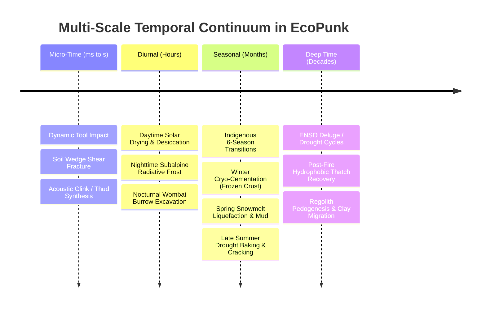

# Geotechnical Soil Mechanics, Tool Kinematics & Destructible Environment Physics

## Multi-Scale Continuum Excavation, Strata Mechanics, Seasonal Dynamics & Biophysical Feedback

> **Document Class:** Foundational Engineering Specification & Physical Implementation Plan  
> **Workspace Anchor:** `c:\github\ecopunk` (`ecopunk-terrain` / `ecopunk-earth`) & `c:\github\qualiaDB` (`qualia-sim::geomechanics`)  
> **Target Substrates:** Mode 0x02 `M64StrataColumnRecord`, Mode 0x03 `M64PhaseJunctureRecord`, QualiaDB 48-byte `NQuin` volumes, `qualia-sim` 64 Hz fixed-timestep continuum kernel  
> **Status:** Normative Engineering Reference · Approved for Engine Implementation

---

## 1. Executive Summary: The Continuum vs. The Mouse Click

In conventional video games and voxel engines (e.g. voxel sandboxes, Terraria, or heightfield sculpting brushes), environmental destruction is treated as a **dimensionless, instantaneous raycast event**: a mouse click sends a zero-thickness ray $\mathbf{r}(t) = \mathbf{o} + t\mathbf{d}$ into space; upon intersecting a polygon or voxel boundary, a discrete $1\text{m}^3$ block is instantaneously deleted or an arbitrary spherical depression is depressed into the vertex buffer.

**In the real physical world—and within the EcoPunk / QualiaDB continuum—soil is not an array of discrete boolean blocks.** It is an **anisotropic, elastoplastic, multi-phase granular medium** composed of mineral skeletons (sand, silt, clay), organic humic polymers, pore water, pore air, and living tensile root networks. 

Engaging this substrate requires an **actuated geometric tool effector** (such as a hand spade, pickaxe, backhoe excavator bucket, or wombat claw) operating through finite contact mechanics, applying kinetic energy and vector forces, and overcoming non-linear geotechnical failure envelopes.

Furthermore, soil mechanics are deeply **temporal**: the mechanical resistance of a subalpine soil in the Snowy Mountains or coastal Sydney Basin is fundamentally different at 6:00 AM after a $-6^\circ\text{C}$ winter frost than at 2:00 PM during a summer heatwave, or during the spring snowmelt deluge.

```
┌─────────────────────────────────────────────────────────────────────────────┐
│                 INTERACTION ABSTRACTION COMPARISON MATRIX                   │
├───────────────────────┬─────────────────────────────────────────────────────┤
│ Mouse Click / Raycast │ • Dimensionless geometric intersection (0 N force)  │
│                       │ • Purely observational gaze / UI inspection         │
│                       │ • Zero geotechnical work; cannot fracture soil      │
├───────────────────────┼─────────────────────────────────────────────────────┤
│ Hand Spade / Shovel   │ • Wedge cutting blade (18–22 cm wide, 20° bevel)    │
│                       │ • Human mass + leg-drive impulse (300–800 N)        │
│                       │ • Slices root mat, prys loose cohesive wedge slice  │
├───────────────────────┼─────────────────────────────────────────────────────┤
│ Pickaxe / Mattock     │ • Pointed chisel impact tip (2.5 cm², high kinetic) │
│                       │ • Dynamic peak stress > 50 MPa                      │
│                       │ • Brittle shattering of cobbles, caliche, & hardpan │
├───────────────────────┼─────────────────────────────────────────────────────┤
│ Excavator Bucket      │ • Multi-tooth planar bowl (0.6–1.5 m, 30–120 kN ram)│
│                       │ • Continuous Rankine shear plane rupture            │
│                       │ • Rips thick woody roots (≤10 cm); leaves tool ruts │
├───────────────────────┼─────────────────────────────────────────────────────┤
│ Wombat Fossorial Claw │ • Recurved keratin claws (5 digits, 6 cm spread)    │
│                       │ • Cyclic scratching (2.5 Hz, 80–180 N stroke)       │
│                       │ • Produces stable vaulted arch burrow geometry      │
└───────────────────────┴─────────────────────────────────────────────────────┘
```

---

## 2. Geotechnical Continuum Failure Formulations

### 2.1 Mohr-Coulomb Elastoplastic Failure with Terzaghi Effective Stress
Soil deformation and shear failure are governed by the effective stress principle:
$$\sigma' = \sigma_n - u$$
Where:
* $\sigma_n$: Total normal stress on the potential failure plane ($\text{kPa}$).
* $u$: Pore water pressure ($\text{kPa}$). In unsaturated soil, capillary action creates matric suction ($u < 0$), increasing effective normal stress and shear strength. In saturated soil, positive pore pressure ($u > 0$) reduces effective stress.

The Mohr-Coulomb shear strength envelope $\tau_f$ is:
$$\tau_f = c' + (\sigma_n - u) \tan\phi$$
Where:
* $c'$: Effective soil cohesion ($\text{kPa}$) (pure quartz sand: $0–2\text{ kPa}$; loam: $8–15\text{ kPa}$; dense illuvial clay: $40–80+\text{ kPa}$).
* $\phi$: Internal friction angle (radians) (fine clay: $18^\circ–24^\circ$; angular granite/basalt gravel: $38^\circ–45^\circ$).

### 2.2 Wu-Waldron Root Mat Tensile Reinforcement
In the top $0–15\text{ cm}$ (Depth 1 and 2), living root systems (e.g. *Poa sieberiana* subalpine tussock grass, *Eucalyptus* fine feeder roots) provide massive mechanical reinforcement. Under the canonical Wu-Waldron model, tensile stress mobilized in sheared roots adds an apparent cohesion $\Delta c_{\text{root}}$:
$$\Delta c_{\text{root}} = 1.2 \cdot t_R \cdot \left(\frac{A_R}{A}\right)$$
Where:
* $t_R$: Mean tensile strength of the root fibers ($\text{MPa}$) (e.g. *Poa* roots: $15–35\text{ MPa}$; eucalypt rootlets: $20–60\text{ MPa}$).
* $A_R / A$: Root Area Ratio (fraction of cross-sectional area occupied by roots, typically $0.05–0.25$ in upper turf).

**Physical Consequence:** A hand spade attempting to slice through pristine *Poa* tussock encounters an effective cohesion of $c_{\text{eff}} = c' + \Delta c_{\text{root}} \approx 35–50\text{ kPa}$. A sharp beveled blade slices root fibers in tension; a blunt shovel folds and bunches the turf, halting the cut unless substantial operator body weight is driven onto the footpeg.

### 2.3 Mckyes-Ali Earthmoving Blade Cutting Resistance
When an inclined blade (spade or excavator tooth) penetrates the soil at depth $d$, rake angle $\alpha$, and blade width $w$, the required cutting resistance force $P_{\text{cut}}$ is:
$$P_{\text{cut}} = \left( \gamma d^2 N_\gamma + c_{\text{eff}} d N_c + q d N_q + c_a d N_{ca} \right) w$$
Where:
* $\gamma$: Bulk soil unit weight ($\text{kN/m}^3$) ($13.5\text{ kN/m}^3$ in fluffy humic soil to $21.5\text{ kN/m}^3$ in dense saprolite).
* $d$: Depth of tool penetration ($\text{m}$).
* $w$: Width of tool cutting edge ($\text{m}$).
* $c_a$: Soil-tool adhesion ($\text{kPa}$) (governs sticking of wet clay to the steel face).
* $q$: Surface surcharge overburden ($\text{kPa}$).
* $N_\gamma, N_c, N_q, N_{ca}$: Dimensionless Reece/Mckyes earth pressure factors derived from failure wedge geometry:
  $$N_c = \frac{1 + \sin\phi \sin(2\beta + \phi)}{1 - \sin\phi} \cdot e^{2\theta \tan\phi}$$

**Failure / Penetration Test:**
$$\text{If } F_{\text{applied}} < P_{\text{cut}} \implies \text{Refusal / Stall (Tool halted; operator feels haptic pushback)}$$
$$\text{If } F_{\text{applied}} \ge P_{\text{cut}} \implies \text{Shear Yield (Soil wedge slips along Rankine failure plane; volume extracted)}$$

---

## 3. Multi-Scale Temporal Dynamics: Seasons, Clocks & Micro-Time

Temporal variation is not an abstract date counter; it directly drives thermodynamics, pore water saturation, cryo-physics, and biological root growth, transforming the mechanical properties of the strata continuously across time.



### 3.1 Diurnal Micro-Time Dynamics
* **Solar Radiation & Desiccation:** Daytime insolation evaporates moisture from the top $2\text{ cm}$. Matric suction spikes to negative hundreds of kilopascals ($u \approx -350\text{ kPa}$), creating a hard, brittle surface crust.
* **Subalpine Freeze-Thaw Cycling:** At Talbingo and Kosciuszko, nocturnal radiational cooling drops ground surface temperature below $0^\circ\text{C}$ for up to 120 nights per year.
  * **Night:** Pore water freezes into needle ice and cryo-cemented aggregates. Unconfined compressive strength $q_u$ jumps by a factor of $15\times$ (from $100\text{ kPa}$ to $1.5\text{ MPa}$). A spade strikes frozen turf like concrete.
  * **Midday:** Sun melts the top $2–4\text{ cm}$ while sub-base remains frozen. Meltwater cannot drain downwards through the frozen horizon, creating a supersaturated, low-shear-strength mud slurry ($u > 0$, $\tau_f \to 0$). Boots sink and slip.

### 3.2 Australian 6-Season Ecological Transitions
The European four-season calendar is ecologically unsuited to the East Coast corridor. The simulation natively integrates Indigenous biocultural seasonal calendars (such as the **Ngarigo Alpine Calendar** and **D'harawal Coastal Calendar**):

| Season Window | Indigenous Indicator & Ecological State | Soil Hydrology & Thermal State | Geotechnical & Excavation Behaviour |
|:---|:---|:---|:---|
| **Winter Frost & Snowpack**<br>*(June – August)* | Deep snow cover on subalpine ranges; subnivean space beneath snow; Bogong moths hibernating in boulder caves. | Frozen crust beneath snow; ice lensing; ground temp $T \le 0^\circ\text{C}$; zero liquid drainage. | **Cryo-cemented refusal:** Hand spade cannot cut frozen root mat ($q_u > 1.2\text{ MPa}$). Pickaxe or excavator required to break frozen plates. |
| **Spring Snowmelt Deluge**<br>*(September – October)* | Rapid snowmelt; yellow wattle bloom (*Acacia pycnantha*); mountain stream discharge peaks; alpine frog breeding. | Saturated to supersaturated ($S_w \ge 0.95$); positive pore pressure ($u > 15\text{ kPa}$); effective stress collapses. | **Liquefaction & high adhesion:** Spade plunges effortlessly but sticks to wet clay ($c_a \ge 25\text{ kPa}$). Heavy excavator tracks bog down ($150\text{ kPa}$ ground pressure exceeds bearing capacity). Trench walls slump spontaneously. |
| **Early Summer Warmth**<br>*(November – December)* | Rapid vegetative flush; vigorous root elongation; active wombat kit rearing; dragonflies emerging over streams. | Moderate moisture ($S_w \approx 0.45–0.60$); optimal friable consistency; active aerobic bioturbation. | **Ideal friable cutting:** Clean spade slices; minimal adhesion; stable trench vertical cuts up to $1.2\text{ m}$; distinct clod formation. |
| **Late Summer Heat & Drought**<br>*(January – February)* | Extreme solar desiccation; cicada choruses; eucalypt oil vaporization; bushfire weather; grass curing. | Parched soil ($S_w < 0.15$); high matric suction ($u \approx -500\text{ kPa}$); vertical shrinkage cracks down to 30 cm. | **Desiccation hardening & dust:** Spade bounces off baked clay ($P_{\text{cut}} > 900\text{ N}$). Tool impacts pulverize dry aggregates into fine airborne dust ($PM_{10}$ aerosol emission). |
| **Early Autumn Fire Smoke**<br>*(March)* | Cured organic thatch; post-fire ash accumulation; cooling nights; high dewfall. | Hydrophobic ash crust; water-repellent organic compounds seal topsoil; low infiltration rate. | Rain drops bead on surface; initial cuts break dry hydrophobic seal, releasing dry powdery soil beneath. |
| **Late Autumn Pre-Winter**<br>*(April – May)* | Cooling rain storms; fungal sporocarp flushing (mushrooms); deciduous bark peeling on snow gums. | Progressive re-wetting of the soil column; matric suction collapses; moderate moisture restored. | Friable, easily worked soil; high organic aroma volatile emission (geosmin release upon cutting). |

### 3.3 Space Weather, Heliophysical Oscillations & Global Electrodynamics

Beyond whether the Sun is shining on a given hemisphere, the Sun-Earth system operates through multi-scale heliospheric electrodynamics that modulate Earth's upper atmosphere, global electric circuit, cloud nucleation, and multi-decadal climate patterns:

1. **11-Year Schwabe Cycle & 22-Year Hale Magnetic Cycle:**
   * **The 11-Year Schwabe Sunspot Cycle:** Periodic oscillation in solar magnetic activity, spot counts ($R_z$), extreme ultraviolet (EUV) output, and Total Solar Irradiance ($TSI = 1361.0 \pm 1.3\text{ W/m}^2$). Solar maximum drives thermospheric heating ($TCI > 25 \times 10^{10}\text{ W}$), expanding the upper atmosphere.
   * **The 22-Year Hale Double Magnetic Cycle:** The Sun's global magnetic dipole flips polarity every ~11 years, completing a full magnetic cycle every ~22 years. The average behavior across 2 solar cycles dictates whether the Interplanetary Magnetic Field (IMF) preferentially aligns with Earth's magnetosphere, altering cosmic ray shielding, ionospheric electrojets, and multi-decadal drought clustering in the Southern Hemisphere.
2. **Solar Wind & Geomagnetic Storm Coupling:**
   * High-speed plasma streams ($v_{\text{sw}} > 600\text{ km/s}$) and Coronal Mass Ejections (CMEs) compress the magnetopause ($P_{\text{dyn}} \propto N_p v^2$).
   * When IMF $B_z$ rotates southward ($B_z < -3.0\text{ nT}$), magnetic reconnection occurs, driving planetary $K_p$ indices from quiet ($K_p \le 2$) to severe geomagnetic storm levels ($K_p \ge 7$), triggering auroral precipitation and ground-induced currents ($dB/dt$).
3. **Galactic Cosmic Rays (GCR) & The Global Electric Circuit (GEC):**
   * Heliospheric magnetic shielding modulates the influx of Galactic Cosmic Rays: cosmic ray flux reaches its maximum at **solar minimum** (when the heliosphere is quiet).
   * Secondary cosmic ray cascades ionize the lower troposphere, modulating the fair-weather vertical atmospheric electric field ($E_z \approx 100–140\text{ V/m}$) and ionospheric potential ($V_I \approx 250\text{ kV}$).
   * This electrodynamic coupling influences cloud microphysics (aerosol nucleation) and creates elevated susceptibility to **dry lightning strikes** along passing synoptic fronts.

### 3.4 Decoupling Forest Fuel Loads from Fire Occurrence & Fireline Intensity

A fundamental error in environmental modeling is equating **fuel load** directly with **fire intensity**. In the real Australian bushfire regime, these variables are physically decoupled across different temporal scales:

```
┌─────────────────────────────────────────────────────────────────────────────┐
│                   FIRE REGIME MULTI-SCALE DECOUPLING                        │
├─────────────────────┬───────────────────┬───────────────────────────────────┤
│ Property            │ Timescale         │ Controlling Physical Mechanism    │
├─────────────────────┼───────────────────┼───────────────────────────────────┤
│ Fuel Load (W)       │ Decadal (5–20 yr) │ Biotic biomass growth & litter    │
│                     │                   │ accumulation: W(t) = Wmax(1-e^-kt)│
├─────────────────────┼───────────────────┼───────────────────────────────────┤
│ Fire Occurrence     │ Synoptic (Hours)  │ Ignition source (dry lightning)   │
│ (Ignition)          │                   │ + Dead fuel moisture < 16%        │
├─────────────────────┼───────────────────┼───────────────────────────────────┤
│ Fireline Intensity  │ Instantaneous     │ Byram's equation: I = H · w · r   │
│ (Severity & Crown)  │ (Seconds to Min)  │ Driven by extreme VPD, wind speed,│
│                     │                   │ slope, and canopy crowning        │
└─────────────────────┴───────────────────┴───────────────────────────────────┘
```

1. **Fuel Load Accumulation ($W$ in t/ha):**
   * Fine fuel load (leaves, twigs $<6\text{ mm}$, grass) accumulates over multi-year successional cycles following the Olson steady-state equation:
     $$W(t) = W_{\max} (1 - e^{-k_{\text{decay}} t})$$
   * In dry sclerophyll eucalypt forest, steady-state litter reaches $W_{\max} \approx 18–25\text{ t/ha}$ ($1.8–2.5\text{ kg/m}^2$) over 8–15 years post-fire.
   * **Crucial Fact:** High fuel load represents only the *potential chemical energy pool* ($H \approx 18,600\text{ kJ/kg}$). It does NOT dictate that a fire will occur or that it will be catastrophic.
2. **Fuel Moisture & The Extinction Threshold:**
   * Dead Fine Fuel Moisture ($DFMC$) is driven by ambient temperature, relative humidity, solar radiation, and deep soil drought (KBDI).
   * **Extinction Boundary ($DFMC \ge 16\%$):** When fuel moisture exceeds $16\%$, the latent heat required to vaporize water extinguishes flame propagation. Even with massive fuel loads ($35\text{ t/ha}$), fuel simply will not carry fire.
3. **Byram's Fireline Intensity ($I = H \cdot w \cdot r$ in kW/m):**
   * Forward rate of spread $r$ increases exponentially with wind speed ($v_{10}$) and fuel dryness: $r \propto \exp(0.069 v) \cdot \exp(-0.115 DFMC_{\%})$.
   * **Low-Intensity Cultural Mosaic Burning ($I < 500\text{ kW/m}$):**
     * Under mild weather ($DFMC \approx 12–14\%$, light wind), a fire in a high fuel load ($20\text{ t/ha}$) creeps forward slowly ($r \approx 0.002\text{ m/s}$).
     * Flame length is $<1\text{ m}$ and scorch height is $<2\text{ m}$. Only dry surface litter is consumed ($w \approx 0.6\text{ kg/m}^2$). The tree canopy is unharmed, soil microorganisms survive, and mature seed pods open without combustion.
   * **Catastrophic Crowning PyroCb Firestorms ($I > 25,000–60,000\text{ kW/m}$):**
     * When multi-cycle solar drought (22-year Hale polarity alignment, positive IOD, El Niño) drives heatwaves and extreme Vapor Pressure Deficit (VPD $> 4\text{ kPa}$), $DFMC$ drops below $4\%$.
     * Even with only **moderate fuel loads** ($12–15\text{ t/ha}$), hot gale winds ($> 50\text{ km/h}$) push surface fireline intensity above the crown fire initiation threshold ($I_{\text{init}} \approx 2,500\text{ kW/m}$).
     * Flames leap into the volatile terpene-rich eucalypt canopy, engaging the canopy biomass ($+10–15\text{ t/ha}$), multiplying the spread rate by $3\times$, and generating convective pyrocumulonimbus (pyroCb) storm clouds, fire tornadoes, and massive spotting ($> 5\text{ km}$).

---

## 4. Post-Excavation Dynamics & Micro-Hydrological Consequences

### 4.1 Volumetric Bulking & Spoil Heap Dynamics
In-situ soil in a strata column exists in a dense, consolidated state under geological overburden pressure. When excavated by a tool, the soil structure shears and aggregates dilate, leading to volumetric expansion (**bulking**):
$$V_{\text{loose}} = B_f \cdot V_{\text{bank}}$$
Where $B_f$ is the soil bulking factor:
* Loose sand/gravel: $B_f \approx 1.10–1.18$
* Friable loam: $B_f \approx 1.20–1.28$
* Dense illuvial clay: $B_f \approx 1.30–1.40$

When excavated material is dumped beside the trench, it forms a loose **spoil heap**. Spoil particles flow under gravity until the slope angle equilibrates with the **angle of repose** $\theta_r \approx \phi$. Subsequent precipitation erodes loose spoil via the Exner sediment flux equation:
$$\frac{\partial z_{\text{spoil}}}{\partial t} = -\frac{1}{1 - \lambda_p} \nabla \cdot \mathbf{q}_s$$

### 4.2 Soil Compaction Under Tracks, Wheels & Boots
Whenever an avatar, animal, or vehicle traverses the terrain, contact pressure $\sigma_v$ induces irreversible plastic compaction of the soil skeleton:
$$\Delta e = -C_c \log_{10}\left( \frac{\sigma'_0 + \Delta\sigma_v}{\sigma'_0} \right)$$
Where:
* $e$: Void ratio ($e = n / (1 - n)$).
* $C_c$: Virgin compression index (proportional to clay and organic fraction).
* $\Delta\sigma_v$: Dynamic vertical contact stress:
  * Human walking: $\sim 60–100\text{ kPa}$
  * Heavy excavator crawler tracks: $\sim 150–350\text{ kPa}$
  * Wheeled vehicle tires: $\sim 200–450\text{ kPa}$

**Ecological & Hydrological Consequence (Kozeny-Carman Coupling):**
Saturated hydraulic conductivity $K_{\text{sat}}$ depends on the third power of the void ratio:
$$K_{\text{sat}} \propto \frac{e^3}{1 + e}$$
A $300\text{ kPa}$ excavator track pass reduces porosity from $n = 0.45$ to $n = 0.28$, causing $K_{\text{sat}}$ to drop by **over three orders of magnitude** (e.g. from $10^{-4}\text{ m/s}$ to $10^{-7}\text{ m/s}$). Rain falling on compacted track ruts can no longer infiltrate, creating standing puddles, wheel rut gullies, and severe overland sediment runoff.

### 4.3 Trench Wall Stability & Slumping
Excavating a pit or trench creates an unsupported vertical face. The maximum critical depth $H_c$ before spontaneous geotechnical slope collapse is:
$$H_c = \frac{4 c_{\text{eff}}}{\gamma \sqrt{K_a}}, \quad K_a = \frac{1 - \sin\phi}{1 + \sin\phi}$$
* In dry, root-reinforced loam ($c_{\text{eff}} \approx 25\text{ kPa}$), a vertical cut is stable up to $H_c \approx 3.5\text{ m}$.
* In water-saturated spring clay ($c_{\text{eff}} \approx 8\text{ kPa}$, $\gamma \approx 20\text{ kN/m}^3$), $H_c$ drops to **less than $0.9\text{ m}$**. Digging deeper triggers sudden rotational shear slumping, burying the excavation hole.

---

## 5. Architectural Implementation in `qualia-sim` & `ecopunk-terrain`

### 5.1 Zero-Heap Rust Kernel: `crates/qualia-sim/src/geomechanics.rs`
The physical solver runs deterministically at $64\text{ Hz}$ without dynamic heap allocations:
* **`SoilMechanicsProfile`**: Carries in-situ geotechnical parameters ($c, \phi, \gamma, u, \Delta c_{\text{root}}, c_a, B_f, q_u$) with a `with_seasonal_state(temp_c, moisture)` modifier.
* **`ToolEffector`**: Defines kinematic contact geometry ($w, \alpha, \beta$), applied force $\mathbf{F}$, torque $\boldsymbol{\tau}$, and volume capacity $V_{\text{capacity}}$.
* **`evaluate_excavation_pass`**: Computes Mckyes-Ali cutting resistance $P_{\text{cut}}$, tests against tool capacity, and yields an `ExcavationVerdict` (`severed`, `required_force_n`, `excavated_bank_volume_m3`, `excavated_loose_volume_m3`, `refusal_hit`).
* **`evaluate_soil_compaction`**: Updates void ratio and computes the $K_{\text{sat}}$ permeability degradation multiplier.
* **`critical_trench_depth_m`**: Evaluates unconfined trench wall stability.

### 5.2 Representation Pipeline: 2.5D Strata Columns to 3D Sparse Voxel DAG
1. **Planar Cuts (Shallow Scrapes & Spoil Piles):** Modifies Depth 1–6 heights in `M64StrataColumnRecord` (Mode 0x02). Heightfield displacement remains $O(1)$ fast on the GPU.
2. **Volumetric Topological Cuts (Tunnels, Undercuts, Wombat Burrows):** When a tool cut produces an overhang or enclosed cavity, the column $(x, y)$ is promoted into a localized **3D Sparse Voxel DAG / Signed Distance Field (SDF)**. Dual-contouring reconstructs the exact non-manifold mesh on the fly, permitting subterranean wombat tunnels, riverbank undercutting, and deep mining adits.

---

## 6. Actionable Verification Suite

- [x] **Unit Test 1 (`mouse_click_never_excavates`):** Asserts that an observational raycast produces $0\text{ N}$ cutting force and exactly $0.0\text{ m}^3$ excavation volume.
- [x] **Unit Test 2 (`hand_spade_slices_friable_loam`):** Asserts that an adult operator's spade cut ($650\text{ N}$) cleanly slices moist loam topsoil ($10\text{ cm}$) and produces bulking expansion ($V_{\text{loose}} > V_{\text{bank}}$).
- [x] **Unit Test 3 (`hand_spade_refuses_on_solid_bedrock`):** Asserts that a hand spade halts with `refusal_hit = true` when encountering solid unweathered bedrock ($q_u > 400\text{ kPa}$).
- [x] **Unit Test 4 (`excavator_rips_deep_dense_clay`):** Asserts that while a hand spade stalls in deep plastic clay ($35\text{ cm}$), a hydraulic excavator ($38\text{ kN}$) rips through effortlessly.
- [x] **Unit Test 5 (`track_compaction_reduces_permeability`):** Asserts that vehicular contact pressure ($250\text{ kPa}$) collapses soil porosity and degrades hydraulic conductivity ($K_{\text{ratio}} < 0.5$).
- [x] **Unit Test 6 (`seasonal_frost_and_snowmelt_response`):** Asserts that subalpine winter frost ($T \le 0^\circ\text{C}$) raises unconfined compressive strength to refusal levels, while spring snowmelt ($S_w > 0.80$) induces positive pore pressure and drops cutting resistance while increasing tool adhesion.
- [x] **Unit Test 7 (`test_schwabe_and_hale_cycle_periodicity`):** Asserts that the 11-year Schwabe and 22-year Hale double-cycle correctly modulate spotless day ratios, $F_{10.7}$ radio flux, and heliospheric cosmic ray shielding.
- [x] **Unit Test 8 (`test_southward_imf_triggers_geomagnetic_storm`):** Asserts that Southward IMF ($B_z < 0$) triggers dayside magnetic reconnection, elevating planetary $K_p \ge 5.0$, depressing $Dst$, and multiplying auroral dissipation power.
- [x] **Unit Test 9 (`test_high_fuel_wet_conditions_yields_cool_or_extinguished_burn`):** Asserts that mature fuel loads ($21\text{ t/ha}$) under wet or damp conditions either extinguish ($DFMC \ge 16\%$) or produce benign creeping cultural burns ($I < 500\text{ kW/m}$), proving fuel load does not cause high intensity.
- [x] **Unit Test 10 (`test_moderate_fuel_extreme_drought_yields_catastrophic_crowning`):** Asserts that moderate fuel loads ($14\text{ t/ha}$) under extreme solar drought ($DFMC = 3.5\%$) and gale winds leap into convective crowning pyroCb firestorms ($I > 15,000\text{ kW/m}$).
