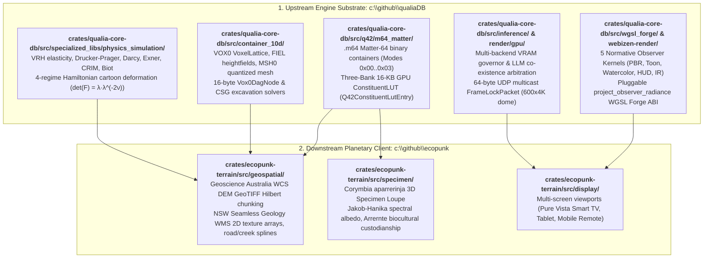

# QualiaDB & Ecopunk: Earth-Terrain & Continuum Physics Engine
## Comprehensive Implementation Plan & Engine Uplift

> **Document Class:** Normative Engineering Implementation Plan & Subsystem Architecture  
> **Primary Upstream Engine Codebase:** `c:\github\qualiaDB` (`crates/qualia-core-db`, `crates/webizen-render`, `crates/wgsl_forge`)  
> **Downstream Planetary Client Codebase:** `c:\github\ecopunk` (`crates/ecopunk-terrain`)  
> **Target Execution Agent Profile:** Antigravity / Gemini Agent (Medium Reasoning Tier)  
> **Governing Specifications:**  
> - [`earth-terrain-architecture-and-spatial-formats.md`](file:///c:/github/ecopunk/docs/plans/holo/earth-terrain-architecture-and-spatial-formats.md) (Long-form mathematical and architectural specification)  
> - [`earth_terrain_architecture_and_spatial_formats.md`](file:///c:/github/ecopunk/docs/plans/holo/earth_terrain_architecture_and_spatial_formats.md) (v2.0 Normative Resolutions to Architectural Questions)  
> - [`c:\github\qualiaDB\AGENTS.md`](file:///c:/github/qualiaDB/AGENTS.md) (QualiaDB Immovable Rules: Zero-Heap, 42MB Sentinel, 48B NQuin, Fiduciary Integrity)  
> - [`tensor-10d.md`](file:///c:/github/ecopunk/docs/planning/tech/tensor-10d.md) (QualiaDB 10D Tensor Manifolds)  
> - [`p64-weight-container-standard.md`](file:///c:/github/qualiaDB/docs/manuals/standards/p64-weight-container-standard.md) (Parameter-64 / Matter-64 Universal Memory Layout)  

---

## 1. Executive Summary & Codebase Architecture

### 1.1 The Engine Uplift Hierarchy
This implementation plan establishes the architectural and engineering roadmap to upgrade the **QualiaDB core engine** (`qualiaDB`) so that it natively supports **universal continuum physics, 10D terrain manifolds, `.m64` Matter-64 containers, 16-KB banked GPU constituent LUTs, mathematical homogenization, and holographic rendering**. 

By uplifting `qualiaDB` at the foundational layer, all downstream applications—including **`ecopunk`** (planetary landscape simulation, Geoscience Australia DEM/WMS streaming, and ecological specimen loupes), **`game-demo`**, **`poet`**, and **`storytold`**—inherit these capabilities directly via zero-copy C-ABI links:



### 1.2 Non-Negotiable Directives for Medium-Tier Reasoning Agents
When executing any task from this plan:
1. **Single-Task Scope:** Never attempt to implement multiple tasks or cross phase boundaries in a single turn. Complete one task, verify its tests, and await user confirmation.
2. **Zero-Heap Hot-Path Invariant (`Tier 1`):**
   - Strictly adhere to [`c:\github\qualiaDB\AGENTS.md` §0 & §0-A](file:///c:/github/qualiaDB/AGENTS.md): No `Vec`, `String`, or `Box` inside evaluation loops, query kernels, or per-frame raymarching.
   - Caller supplies fixed-size `&mut [T]` output buffers; use `[T; N]` stack arrays for local state.
   - Memory must stay within the 42 MiB `SlgArena` CPU Sentinel or the hardware-allocated `HypermediaGpuRing`.
3. **Explicit Memory Layouts (`bytemuck::Pod` & `bytemuck::Zeroable`):**
   - Every binary record crossing the disk/WASM/GPU boundary MUST be `#[repr(C, align(64))]` or `#[repr(C, align(16))]`.
   - Never rely on compiler-inserted padding; declare explicit `_reserved: [u8; N]` fields.
   - Always write an accompanying unit test asserting:
     ```rust
     assert_eq!(std::mem::size_of::<MyStruct>(), EXACT_BYTES);
     assert_eq!(std::mem::align_of::<MyStruct>(), EXACT_ALIGN);
     ```
4. **Fiduciary & Human Rights Baseline:**
   - In accordance with `AGENTS.md`, all physical parameters, geodetic coordinates, and mineral laws operate as an open, unenclosed commons with zero DRM or commercial blockers.
   - Provenance and biocultural attribution ($w = 5$) are carried passively via 64-bit `provenance_did_hash` fields and `.q42` NQuins without ever blocking graphics or physics execution.

---

## 2. Upstream vs. Downstream Codebase Allocation

| Engine Capability | Upstream Primary Repo (`qualiaDB`) | Downstream Client Repo (`ecopunk`) |
| :--- | :--- | :--- |
| **`.m64` Matter-64 Format** | `crates/qualia-core-db/src/q42/m64_matter/` (core binary layouts, reader, writer, Bao validation) | Imports and uses `qualia_core_db::q42::m64_matter::*` |
| **Three-Bank 16-KB GPU LUT** | `crates/qualia-core-db/src/q42/m64_matter/banked_lut.rs` | Populates regional Australian minerals & folklore recipes |
| **10D Manifold Terrain Sections** | `crates/qualia-core-db/src/container_10d/` (`field_section.rs`, `mesh_section.rs`, `voxel_section.rs`) | Mounts regional `.10d` chunks from `.hmc` archives |
| **Continuum Homogenization** | `crates/qualia-core-db/src/specialized_libs/physics_simulation/` (VRH, Drucker-Prager, Darcy, Exner, CRIM, Biot) | Calls homogenization kernels on soil constituent stacks |
| **Cartoon Kinetics & Deformation** | `crates/qualia-core-db/src/specialized_libs/physics_simulation/cartoon_deformation.rs` | Applies cartoon bounds to Australian wildlife and avatars |
| **Observer Projection Kernels** | `crates/qualia-core-db/src/wgsl_forge/` & `crates/webizen-render/` (5 normative kernels + Naga ABI) | Selects observer kernel mode (PBR, Toon, Watercolor) |
| **Hardware Governor & Frame-Lock** | `crates/qualia-core-db/src/inference/thermal_telemetry.rs` & `render/gpu/frame_lock.rs` | Runs telemetry loop and multicasts 64B `FrameLockPacket` |
| **Geospatial Data Ingestion** | Provides generic raster/point importers | `crates/ecopunk-terrain/src/geospatial/` (DEM GeoTIFFs, NSW Seamless Geology WMS, road/creek splines) |
| **Ecological Specimen Loupe** | Provides generic 10D allometric growth solver | `crates/ecopunk-terrain/src/specimen/` (*Corymbia aparrerinja* bark albedo, Arrernte biocultural display) |

---

## 3. Phase 1: Core Binary Containers & Banked LUT Bridge in QualiaDB (Weeks 1–2)

### Task 1.1: `M64ChunkDirectoryEntry` Layout & Index Table
- **Target Repo & File:** `c:\github\qualiaDB\crates\qualia-core-db\src\q42\m64_matter\chunk_directory.rs`
- **Module Registration:** Register in `crates/qualia-core-db/src/q42/m64_matter/mod.rs` and re-export in `q42/mod.rs`.
- **Requirements:**
  1. Define `M64ChunkDirectoryEntry` as strictly 64 bytes with 64-byte alignment:
     ```rust
     #[repr(C, align(64))]
     #[derive(Copy, Clone, Debug, PartialEq, bytemuck::Pod, bytemuck::Zeroable)]
     pub struct M64ChunkDirectoryEntry {
         pub chunk_uuid: [u8; 16],          // 16B: Canonical UUID / content-addressed hash
         pub spatial_hilbert_index: u64,    // 8B: 2D/3D Hilbert space-filling curve coordinate
         pub byte_offset: u64,              // 8B: Absolute byte offset in .m64 file
         pub byte_length: u32,              // 4B: Exact byte length of chunk (multiple of 64)
         pub record_count: u32,             // 4B: Number of 64B records in chunk
         pub srid_geodetic_code: u32,       // 4B: EPSG/SRID code (e.g. 4326 for WGS84, 7844 for GDA2020)
         pub lut_bank_epoch_id: u16,        // 2B: Identifier of the Bank 1 LUT recipe set for this chunk
         pub chunk_record_mode: u8,         // 1B: 0x00=Point, 0x01=Holo, 0x02=Strata, 0x03=PhaseJuncture
         pub compression_flags: u8,         // 1B: 0=Uncompressed mmap, 1=LZ4 block, 2=Bao verified
         pub bao_root_hash_prefix: [u8; 16],// 16B: Prefix of BLAKE3-Bao verified outboard hash tree
         pub entry_crc32c: u32,             // 4B: CRC-32C checksum of bytes 0..59 (Total = 64B)
     }
     ```
  2. Implement `M64ChunkDirectoryEntry::compute_crc32c(&self) -> u32` using `crc32fast::Hasher`.
  3. Implement `M64ChunkDirectoryEntry::validate(&self) -> Result<(), M64Error>`.
- **Unit Tests:**
  - `test_chunk_directory_entry_size_and_alignment`: Verify size == 64 and align == 64.
  - `test_chunk_directory_entry_crc_roundtrip`: Confirm CRC computation and rejection on single-bit flips.
- **Verification Command:** `cargo test --package qualia-core-db -- chunk_directory`

---

### Task 1.2: `M64StrataColumnRecord` (Mode 0x02)
- **Target Repo & File:** `c:\github\qualiaDB\crates\qualia-core-db\src\q42\m64_matter\strata_record.rs`
- **Module Registration:** Register in `crates/qualia-core-db/src/q42/m64_matter/mod.rs` and re-export in `q42/mod.rs`.
- **Requirements:**
  1. Define `M64StrataColumnRecord` as strictly 64 bytes with 64-byte alignment:
     ```rust
     #[repr(C, align(64))]
     #[derive(Copy, Clone, Debug, PartialEq, bytemuck::Pod, bytemuck::Zeroable)]
     pub struct M64StrataColumnRecord {
         pub surface_elevation_mm: i32,     // 4B: Surface elevation Z in mm relative to geodetic datum
         pub water_table_depth_mm: u16,     // 2B: Depth from surface to water table in mm
         pub surface_fluid_depth_mm: u16,   // 2B: Depth of flowing surface water (river/flood) in mm
         pub fluid_velocity_xy: [i16; 2],   // 4B: Surface fluid flow velocity vector in mm/s
         pub fluid_sediment_load_ppm: u16,  // 2B: Suspended sediment concentration in parts-per-million
         pub surface_roughness_mm: u16,     // 2B: Hydrodynamic Mannings n / surface roughness
         // 6-Layer Subsurface Stratigraphic Stack (each layer = 6 bytes, Total = 36B)
         // Layer 0: Topsoil/Humus, Layer 1: Clay/Silt, Layer 2: Alluvial Gravel,
         // Layer 3: Weathered Clasts, Layer 4: Fractured Basalt, Layer 5: Solid Bedrock
         pub layer_thickness_mm: [u16; 6],  // 12B: Thickness of layers 0..5 in mm
         pub layer_lut_index: [u8; 6],      // 6B: Index into 16-KB ConstituentLUT (Bank 0 or 1)
         pub layer_moisture_pct: [u8; 6],   // 6B: Volumetric water saturation Sw (0..100 maps to 0..255)
         pub layer_compaction_pct: [u8; 6], // 6B: Overburden compaction ratio (0..100 maps to 0..255)
         pub layer_artefact_mask: [u8; 6],  // 6B: Bitmask of embedded artefacts (gold, quartz, fossils)
         // Macro Mechanical / Sensor Summary (8B)
         pub bulk_shear_strength_kpa: u16,  // 2B: Homogenized Mohr-Coulomb cohesion c in kPa
         pub angle_of_repose_deg10: u16,    // 2B: Bulk angle of repose θ in 0.1 degree units (e.g. 340 = 34.0°)
         pub gpr_dielectric_perm_x100: u16, // 2B: CRIM complex relative permittivity ε_eff * 100
         pub acoustic_p_wave_m_s: u16,      // 2B: Biot poroelastic P-wave velocity in m/s
         // Integrity (4B)
         pub record_crc32c: u32,            // 4B: CRC-32C checksum of bytes 0..59 (Total = 64B)
     }
     ```
  2. Implement zero-heap accessor methods:
     - `total_soil_depth_mm(&self) -> u32`: Sum of `layer_thickness_mm[0..5]`.
     - `bedrock_elevation_mm(&self) -> i32`: Surface elevation minus total soil depth.
     - `layer_at_depth_mm(&self, depth_mm: u32) -> Option<usize>`: $O(1)$ stack iteration to locate stratum index.
- **Unit Tests:**
  - `test_strata_record_size_and_alignment`: Confirm size == 64, align == 64.
  - `test_strata_depth_navigation`: Confirm correct stratum returned for various excavation depths.
- **Verification Command:** `cargo test --package qualia-core-db -- strata_record`

---

### Task 1.3: `M64PhaseJunctureRecord` (Mode 0x03)
- **Target Repo & File:** `c:\github\qualiaDB\crates\qualia-core-db\src\q42\m64_matter\phase_juncture.rs`
- **Module Registration:** Register in `crates/qualia-core-db/src/q42/m64_matter/mod.rs` and re-export in `q42/mod.rs`.
- **Requirements:**
  1. Define `M64PhaseJunctureRecord` as strictly 64 bytes with 64-byte alignment:
     ```rust
     #[repr(C, align(64))]
     #[derive(Copy, Clone, Debug, PartialEq, bytemuck::Pod, bytemuck::Zeroable)]
     pub struct M64PhaseJunctureRecord {
         pub quantum_branch_id: u32,        // 4B: Simulation branch q (0 = ground truth, >0 = speculative)
         pub boundary_flags: u32,           // 4B: Boundary condition flags (tool excavation, collapse, flood)
         pub anchor_pos_mm: [i32; 3],       // 12B: Focal spatial center (x, y, z) in mm
         pub excavation_radius_mm: u16,     // 2B: Spherical/CSG radius of tool excavation cavity
         pub excavated_lut_material: u8,    // 1B: LUT index of material removed
         pub re_inflation_delay_ticks: u8,  // 1B: Simulation ticks remaining before cartoon reinflation
         pub action_integral_s: f32,        // 4B: Stationary-action value; holds volume deficit ΔV for reinflation
         pub stress_energy_tensor: [f32; 4],// 16B: Relativistic T_μν / continuum Cauchy stress components
         pub provenance_did_hash: u64,      // 8B: FNV-1a hash of actor DID responsible for state change
         pub lamport_clock: u64,            // 8B: Monotonic Lamport timestamp of modification
         pub record_crc32c: u32,            // 4B: CRC-32C checksum of bytes 0..59 (Total = 64B)
     }
     ```
  2. Implement `is_ground_truth(&self) -> bool { self.quantum_branch_id == 0 }`.
  3. Implement `volume_deficit_m3(&self) -> f32`: Returns `self.action_integral_s` when `boundary_flags` indicates a cartoon wafer deformation.
- **Unit Tests:**
  - `test_phase_juncture_record_size_and_alignment`: Confirm size == 64, align == 64.
  - `test_re_inflation_deficit_roundtrip`: Confirm volume deficit correctly preserved.
- **Verification Command:** `cargo test --package qualia-core-db -- phase_juncture`

---

### Task 1.4: Three-Bank 16-KB GPU `ConstituentLUT` Manager
- **Target Repo & File:** `c:\github\qualiaDB\crates\qualia-core-db\src\q42\m64_matter\banked_lut.rs`
- **Module Registration:** Register in `crates/qualia-core-db/src/q42/m64_matter/mod.rs` and re-export in `q42/mod.rs`.
- **Architectural Rules (from v2.0 §4.2):**
  - Total LUT size is strictly **256 entries $\times$ 64 bytes = 16,384 bytes (16 KB)**.
  - **Bank 0 (`0x00..0x7F`, 128 slots):** Globally pinned terrestrial baseline (Quartz, Kaolinite, Hematite, Humus, Fresh Water, Salt Water, Granite, Basalt, etc.).
  - **Bank 1 (`0x80..0xDF`, 96 slots):** Dynamically paged per chunk boundary via a 6,144-byte (6 KB) async DMA upload keyed by `M64ChunkDirectoryEntry::lut_bank_epoch_id`.
  - **Bank 2 (`0xE0..0xFF`, 32 slots):** Cross-boundary blend window and $q > 0$ reactive materials.
- **Requirements:**
  1. Define `BankedConstituentLut`:
     ```rust
     pub const LUT_TOTAL_ENTRIES: usize = 256;
     pub const BANK_0_PINNED_COUNT: usize = 128;
     pub const BANK_1_PAGED_COUNT: usize = 96;
     pub const BANK_2_BLEND_COUNT: usize = 32;

     #[repr(C, align(64))]
     pub struct BankedConstituentLut {
         pub entries: [Q42ConstituentLutEntry; LUT_TOTAL_ENTRIES], // 16 KB flat buffer
         pub active_bank_1_epoch_id: u16,
         pub is_dirty: bool,
     }
     ```
  2. Implement methods:
     - `new_with_terrestrial_defaults() -> Self`: Populates Bank 0 with certified mineral coefficients.
     - `page_bank_1(&mut self, epoch_id: u16, paged_recipes: &[Q42ConstituentLutEntry; BANK_1_PAGED_COUNT]) -> Result<(), LutError>`: Updates Bank 1 and marks `is_dirty = true` without modifying Bank 0.
     - `as_gpu_bytes(&self) -> &[u8; 16384]`: Zero-copy cast into uniform/storage buffer upload slice via `bytemuck::bytes_of(&self.entries)`.
- **Unit Tests:**
  - `test_banked_lut_size_and_layout`: Assert total buffer is exactly 16,384 bytes with 64-byte alignment.
  - `test_bank_1_paging_isolation`: Confirm paging Bank 1 does not overwrite Bank 0 or Bank 2.
- **Verification Command:** `cargo test --package qualia-core-db -- banked_lut`

---

### Task 1.5: 10D Manifold `VOX0` Voxel Lattice Section in QualiaDB
- **Target Repo & File:** `c:\github\qualiaDB\crates\qualia-core-db\src\container_10d\voxel_section.rs`
- **Module Registration:** Register in `crates/qualia-core-db/src/container_10d/mod.rs` and update `section.rs` with `VoxelLattice = 12`.
- **Requirements:**
  1. Implement zero-heap parser and encoder for `VOX0`:
     - Reads/writes 3D Sparse Voxel Octree / DAG records.
     - Operates over caller-supplied fixed slice `&mut [u8]`.
  2. Define 16-byte `Vox0DagNode`:
     ```rust
     #[repr(C, align(16))]
     #[derive(Copy, Clone, Debug, PartialEq, bytemuck::Pod, bytemuck::Zeroable)]
     pub struct Vox0DagNode {
         pub child_mask: u8,               // 1B: Valid octant child bitmask (8 bits)
         pub leaf_mask: u8,                // 1B: Bitmask of octants that terminate as leaves
         pub primary_material_lut: u8,     // 1B: Majority constituent LUT index
         pub secondary_material_lut: u8,   // 1B: Secondary constituent LUT index
         pub child_ptr_or_density: u32,    // 4B: Arena index to child nodes, or packed density field
         pub normal_oct_snorm8: [i8; 2],   // 2B: Octahedral encoded surface normal vector
         pub moisture_u8: u8,              // 1B: Volumetric moisture saturation Sw
         pub compaction_u8: u8,            // 1B: Soil compaction / hardness metric
         pub node_crc16: u16,              // 2B: Integrity checksum
         pub _reserved: [u8; 2],           // 2B: Explicit zero padding (Total = 16B)
     }
     ```
- **Unit Tests:**
  - `test_vox0_section_encoding_roundtrip`: Encode and decode a 3D block of voxels, validating zero heap allocation.
- **Verification Command:** `cargo test --package qualia-core-db -- voxel_section`

---

## 4. Phase 2: Homogenization Engine & Observer Projection Kernels in QualiaDB (Weeks 3–4)

### Task 2.1: Mathematical Homogenization Operators
- **Target Repo & Files:**
  - `c:\github\qualiaDB\crates\qualia-core-db\src\specialized_libs\physics_simulation\homogenization_mech.rs`
  - `c:\github\qualiaDB\crates\qualia-core-db\src\specialized_libs\physics_simulation\homogenization_hydro.rs`
  - `c:\github\qualiaDB\crates\qualia-core-db\src\specialized_libs\physics_simulation\homogenization_optic.rs`
  - `c:\github\qualiaDB\crates\qualia-core-db\src\specialized_libs\physics_simulation\homogenization_acoust.rs`
- **Formulas to Implement:**
  1. **Voigt-Reuss-Hill Moduli:** $K_{\text{VRH}} = \frac{1}{2}\left[\sum \phi_i K_i + (\sum \frac{\phi_i}{K_i})^{-1}\right]$.
  2. **Drucker-Prager Yield Stress:** $\sigma_y = \frac{6 c \cos\theta}{\sqrt{3}(3 - \sin\theta)} + \frac{2 \sin\theta}{\sqrt{3}(3 - \sin\theta)} I_1$.
  3. **Kozeny-Carman Darcy Permeability:** $k_{\text{perm}} = \frac{d_{\text{eff}}^2}{180}\frac{\varphi^3}{(1 - \varphi)^2}$.
  4. **Exner Sediment Conservation:** $(1 - \lambda_p)\frac{\partial z_{\text{bed}}}{\partial t} = -\nabla \cdot \mathbf{q}_s$.
  5. **Bachmann Pore-Water Meniscus Darkening:** $R_{\text{wet}}(\lambda) = R_{\text{dry}}(\lambda)\frac{n_w^2}{n_m^2}[1 - S_w(1 - \frac{1}{n_w^2})]$.
  6. **CRIM Dielectric Permittivity:** $\sqrt{\varepsilon_{\text{eff}}^*} = (1 - \varphi)\sum \phi_i \sqrt{\varepsilon_i^*} + \varphi S_w \sqrt{\varepsilon_w^*} + \varphi(1 - S_w)\sqrt{\varepsilon_{\text{air}}^*}$.
  7. **Biot Poroelastic Acoustics:** $v_P = \sqrt{\frac{K_{\text{VRH}} + \frac{4}{3}G_{\text{VRH}}}{\rho_{\text{bulk}}}}$.
- **Verification Command:** `cargo test --package qualia-core-db -- homogenization`

---

### Task 2.2: Parameterized 4-Regime Cartoon Kinetics & Deformation
- **Target Repo & File:** `c:\github\qualiaDB\crates\qualia-core-db\src\specialized_libs\physics_simulation\cartoon_deformation.rs`
- **Formulas to Implement (from v2.0 §4.6.3 & §4.6.4):**
  1. Singular-value floor & parameterized Jacobian:
     $$\tilde{\lambda} = \max(\lambda, \varepsilon_{\text{wafer}})$$
     $$\mathbf{F}_{\text{cartoon}} = \mathbf{R} \operatorname{diag}\left(\tilde{\lambda}^{-\nu_{\text{cartoon}}}, \tilde{\lambda}^{-\nu_{\text{cartoon}}}, \tilde{\lambda}\right) \mathbf{R}^T$$
     $$\det(\mathbf{F}) = \tilde{\lambda}^{1 - 2\nu_{\text{cartoon}}}$$
  2. Anharmonic cubic potential well (anticipation & snap):
     $$\ddot{\mathbf{q}} + \gamma \dot{\mathbf{q}} + k \mathbf{q} + a \mathbf{q}^2 + b \mathbf{q}^3 = \frac{\mathbf{F}_{\text{ext}}}{m}$$
  3. Comedic aerodynamic hang-time impulse at trajectory apexes:
     $$\mathbf{F}_{\text{aero}} = -\frac{1}{2} \rho C_d A \|\mathbf{v}\|\mathbf{v} + C_{\text{cartoon}} \exp\left(-\frac{\|\mathbf{v}\|^2}{2 v_0^2}\right)\hat{\mathbf{z}}$$
- **Verification Command:** `cargo test --package qualia-core-db -- cartoon_deformation`

---

### Task 2.3: Five Normative Observer Projection Kernels in `wgsl_forge`
- **Target Repo & File:** `c:\github\qualiaDB\crates\qualia-core-db\src\wgsl_forge\observer_kernels.rs`
- **Requirements:**
  1. Implement and validate WGSL compute/fragment kernels via `naga`:
     - `0x00`: Spectral Cook-Torrance PBR + CIE 1931 XYZ color matching.
     - `0x01`: Cel-Shaded Toon with 3-tone register quantization and screen-space Sobel depth/normal inking.
     - `0x02`: Storybook Watercolor with 2-pass Kubelka-Munk paper diffusion and coffee-ring edge darkening.
     - `0x03`: Holographic / GPR Tactical HUD with scanlines, dielectric impedance contrast, and semantic wireframe.
     - `0x04`: Planck Blackbody Thermal infrared pseudocolor.
  2. Expose the open `project_observer_radiance` WGSL ABI for user-defined kernels (`0x05..0xFF`).
- **Verification Command:** `cargo test --package qualia-core-db -- observer_kernels`

---

## 5. Phase 3: Geospatial Ingestion & Downstream Integration in Ecopunk (Weeks 5–6)

### Task 3.1: WCS / DEM GeoTIFF Hilbert-Sorted Ingestor in Ecopunk
- **Target Repo & File:** `c:\github\ecopunk\crates\ecopunk-terrain\src\geospatial\geotiff.rs`
- **Requirements:**
  1. Consume `qualia_core_db::q42::m64_matter::*`.
  2. Ingest Geoscience Australia 1-arc-second (~30m) or 5m LiDAR DEM GeoTIFFs.
  3. Partition elevation heights into $64 \times 64$ cell chunks sorted along a 2D Hilbert space-filling curve.
  4. Output `.m64` files with valid chunk directory tables.
- **Verification Command:** `cargo test --package ecopunk-terrain -- geotiff`

---

### Task 3.2: WMS Satellite & GSNSW Seamless Geology Texture Streamer
- **Target Repo & File:** `c:\github\ecopunk\crates\ecopunk-terrain\src\geospatial\wms_streamer.rs`
- **Requirements:**
  1. Stream satellite imagery and NSW Seamless Geology raster tiles via OGC WMS/WMTS endpoints.
  2. Cache 256x256 tiles into a GPU 2D Texture Array.
  3. Map geological unit codes to `BankedConstituentLut` mineral indices.
- **Verification Command:** `cargo test --package ecopunk-terrain -- wms_streamer`

---

### Task 3.3: Vector Corridor Conformer
- **Target Repo & File:** `c:\github\ecopunk\crates\ecopunk-terrain\src\geospatial\corridor.rs`
- **Requirements:**
  1. Ingest vector GeoJSON/WFS features (creek centerlines, fire trails, walking tracks).
  2. Evaluate Hermite cubic spline cross-sections.
  3. Dynamically impress roadbeds and drainage ditches into heightfields without mesh cracking.
- **Verification Command:** `cargo test --package ecopunk-terrain -- corridor`

---

## 6. Phase 4: Dynamic Hardware Governor, Distributed Display & Verification (Weeks 7–8)

### Task 4.1: Upstream Hardware Governor & Frame-Lock in QualiaDB
- **Target Repo & Files:**
  - `c:\github\qualiaDB\crates\qualia-core-db\src\inference\thermal_telemetry.rs` (Telemetry across NVML, DXGI, Vulkan, Metal, WebGPU)
  - `c:\github\qualiaDB\crates\qualia-core-db\src\render\gpu\frame_lock.rs` (64B `FrameLockPacket` and ray-bundle conical slicing for 600x4K dome)
- **Requirements:**
  1. Throttle terrain compute passes during LLM active token decode ($\tau_{\text{compute}} \le 2.5\text{ ms}$).
  2. Multicast 64-byte `FrameLockPacket` over UDP for microsecond frame synchronization.
- **Verification Command:** `cargo test --package qualia-core-db -- frame_lock`

---

### Task 4.2: Downstream 3D Specimen Loupe & Companion Displays in Ecopunk
- **Target Repo & Files:**
  - `c:\github\ecopunk\crates\ecopunk-terrain\src\specimen\loupe.rs`
  - `c:\github\ecopunk\crates\ecopunk-terrain\src\display\companion.rs`
- **Requirements:**
  - WebRTC proximity triggering from primary vista to companion tablet/phone.
  - Interactive allometric growth slider ($0.5\text{ m} \to 20\text{ m}$) for *Corymbia aparrerinja* (Ghost Gum), Jakob-Hanika spectral albedo curves ($74.2\%$ visible reflection), and Arrernte biocultural custodianship.
- **Verification Command:** `cargo test --package ecopunk-terrain -- specimen`

---

### Task 4.3: Automated Visual Verification Suite (`check-terrain.mjs`)
- **Target Repo & File:** `c:\github\ecopunk\scripts\check-terrain.mjs`
- **Requirements:**
  - Headless Playwright/Chrome automation script.
  - Verifies WebGPU terrain rendering, voxel excavations, cel-shaded toon rendering, and 60 FPS presentation stability.
- **Verification Command:** `node scripts/check-terrain.mjs`

---

## 7. Execution Checklist & Milestone Gates

| Milestone | Codebase Target | Gate Criteria |
| :--- | :--- | :--- |
| **Phase 1** | `qualiaDB` | All `.m64` modes (`0x00..0x03`), `ChunkDirectory`, 16-KB `BankedConstituentLut`, and `VOX0` section compile cleanly with 64B alignment and $100\%$ unit test pass rate. |
| **Phase 2** | `qualiaDB` | SIMD micromechanics, 16B SVDAG CSG excavation, 4-regime cartoon deformation, and all 5 Naga WGSL kernels pass validation. |
| **Phase 3** | `ecopunk` | Real Geoscience Australia DEM GeoTIFF imported to Hilbert `.m64` tiles with NSW geology draping using `qualia_core_db`. |
| **Phase 4** | `qualiaDB` + `ecopunk` | VRAM governor throttles during LLM decode; 600-screen dome packets multicast; Playwright headless visual receipts green. |
