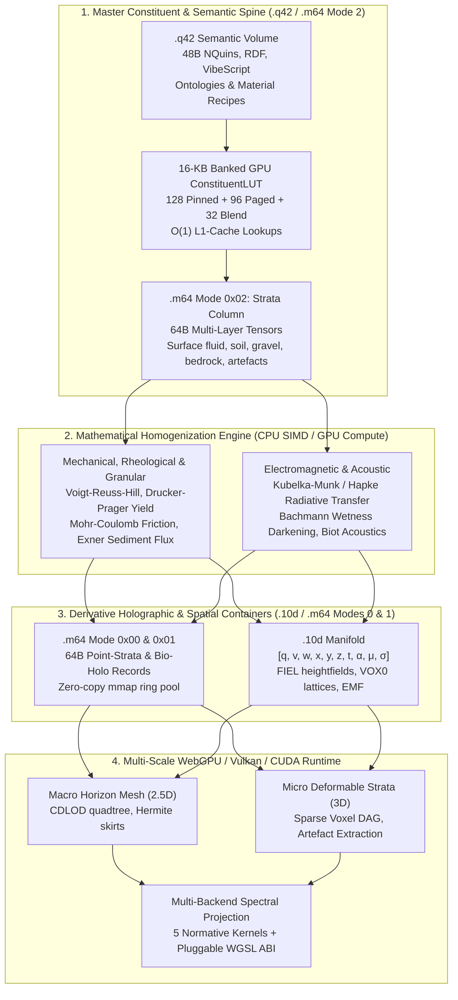
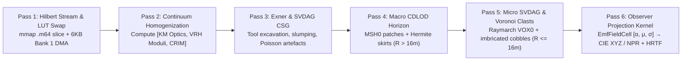

# Earth-Terrain & Continuum Physics Architecture (v2.0)

## 10D Manifolds, .m64 Matter-64 Point-Tensor Containers, Master Constituent Homogenization & Holographic Voxel-Mesh Streaming

**Document File Name:** `earth-terrain-architecture-and-spatial-formats.md`  
**Target Repository Path:** `c:\github\ecopunk\docs\planning\tech\earth-terrain-architecture-and-spatial-formats.md`  
**Crate Anchor:** `c:\github\ecopunk\crates\ecopunk-terrain` (`ecopunk-terrain` / `ecopunk-earth`)  
**Key Standards & Substrates:** QualiaDB 10D Tensor Manifolds (`c:\github\ecopunk\docs\planning\tech\tensor-10d.md`) · P64 / M64 Weight & Matter-Tensor Standard (`c:\github\qualiaDB\docs\manuals\standards\p64-weight-container-standard.md`) · Q42 Semantic Volumes (`Q42\0`) · GSNSW Seamless Geology & WGS84 Geodetic Datums  
**Status:** Architectural Specification v2.0 · Normative Binary Format, Codebase & Graphics Engine Reference

## 1. Executive Summary & Strategic Scope

### 1.1 The Objective: Master Constituent-First World Construction

To migrate and elevate the terrain and spatial mechanics developed in `game-demo` into a dedicated, foundational terrain, graphics, and continuum physics engine anchored inside **ecopunk** (`crates/ecopunk-terrain`).

Rather than relying on traditional 3D game assets—static polygon boundary meshes and baked RGBA bitmaps that lack underlying physical meaning—this engine implements a **Master Generative Construction Method**. Matter, fluids, geological strata, and biological entities are recorded as **compositional constituent arrays** (mineral fractions, organic detritus, pore fluids, trace heavy metals, and embedded physical artefacts) in `.q42` and `.m64`. Mathematical homogenization operators process these raw constituent arrays on CPU SIMD and GPU compute queues to derive bulk mechanical, hydraulic, thermal, acoustic, and electromagnetic properties *prior* to synthesizing derivative holographic (`.10d` / `.m64`) representations on the fly.

This engine is grounded in verifiable geospatial data (WGS84 coordinates, Geoscience Australia DEM elevation models, NSW Seamless Geology stratigraphy, and IBRA ecological boundaries) while delivering an **exacting, multi-scale, explorable, and destructible world**.

### 1.2 Core Architectural Principles

1. **Master Constituent-First Construction:** Visual, physical, and acoustic properties are never hand-painted approximations; they are mathematically derived from the underlying material composition, grain-size distributions, pore fluids, and artefact fields at $(x, y, z, t)$.
2. **Unified Multimodal Container Triad:**
   - **`.q42` (Semantic Graph Volume):** The immutable semantic spine of 48-byte `NQuin` records carrying ontological facts, constituent material recipes, provenance, and VibeScript behavioral logic.
   - **`.10d` (Tensor10D):** Multi-dimensional manifold container for analytical geometry (`FIEL`), quantized surface patches (`MSH0`), sparse destructible voxel DAGs (`VOX0`), branching temporal motion graphs, camera ray bundles, and spectral radiance fields (`[α, μ, σ]`).
   - **`.m64` (Matter-64 Multi-Modal Container):** 64-byte aligned, zero-copy, memory-mappable container representing the physical and material universe (complementing `.p64`, which represents neural/probabilistic weights). Operates across four canonical modes: **Mode `0x00`** (`M64PointRecord` for LiDAR / geodetic anchor points), **Mode `0x01`** (`M64HoloEntityRecord` for flora & fauna morphogenesis), **Mode `0x02`** (`M64StrataColumnRecord` for surface fluid & 6-layer subsurface constituent stacks), and **Mode `0x03`** (`M64PhaseJunctureRecord` for quantum $q$-branch boundary conditions and tool excavations).
3. **Zero-Heap 16-KB Banked GPU `ConstituentLUT` Bridge:** A deterministic pass compiles `.q42` material recipes into a flat $256 \times 64\text{-byte}$ table (16 KB total) in GPU Uniform/Storage memory (`0x00..0x7F` pinned terrestrial baseline; `0x80..0xDF` dynamically paged per biome/narrative chunk; `0xE0..0xFF` cross-boundary transition window). Shaders perform $O(1)$ L1-cache lookups without parsing RDF strings in hot loops.
4. **Dual-Layer Continuum (Watertight Horizon Mesh + Near-Field Volumetric Voxels):** Seamless transition between broad-scale continuous heightfield meshes for distant horizon ridgelines and micro-scale deformable voxel lattices for near-field interaction (excavating soil, uncovering embedded artefacts, moving river boulders, and hydraulic panning for alluvial gold).
5. **Strict Zero-Heap & Dual-Ring Compliance:** All hot-path query loops, homogenization evaluators, raymarching kernels, and mesh extraction passes operate over caller-supplied fixed buffers (`SlgArena` at 42 MiB on CPU; `HypermediaGpuRing` on GPU) with zero dynamic heap allocation (`Vec`, `String`, `Box`).
6. **Open Standards, Unenclosed Physical Commons & Zero-Blocker Execution:** Independent nomenclature (`ecopunk-terrain` / `ecopunk-earth`) adhering to verifiable open standards. All physical datums, geodetic coordinates, mineral laws, and runtime execution operate as an open, unenclosed commons with zero runtime DRM or cognitive blockers; cultural attribution ($w = 5$) and provenance are carried passively in `.q42` NQuins and 64-bit `provenance_did_hash` fields without ever stalling the graphics or physics pipeline.



### 1.3 Continuity & Non-Deprecation: Extending the Astrophysics & High-Dimensional Physics Foundations

A foundational mandate of this architecture is **strict preservation and extension of earlier definitions**: we do not deprecate, rewrite, or replace the earlier 10D mathematical definitions developed for astrophysics, general relativity, quantum vacuum mechanics (chaoitons), or epistemic logic. Instead, the Earth-terrain architecture is a **direct specialization and extension of the universal high-dimensional physics manifold** at planetary and landscape scales.

#### 1.3.1 The Canonical "Two Tens" Architecture (T14 / T16)

The engine preserves the normative division between the two complementary 10D structures established in `qualia-core-db/src/modalities/manifold.rs`:

1. **`Tensor10D` (Physics, Spacetime Pose & Query Lanes):**
   $$\mathbf{c} = [q, v, w, x, y, z, t, \alpha, \mu, \sigma]$$
   - **$q$ (Quantum Context / Superposition):** $q = 0$ collapsed ground truth; $q > 0$ pending GSR escrow or speculative simulation branches.
   - **$v$ (Metric / Variety Class):** $v = 0$ Euclidean tangent space; $v = 1$ toroidal/cyclic; $v = 2$ hyperbolic taxonomic/gravitational trees; $v \ge 3$ boundary cliques.
   - **$w$ (Manifold Domain Index):** $w = 0$ bio/medical; $w = 1$ legal; $w = 2$ personal/agency; **$w = 3$ environmental / sensor / geoscience (Ecopunk canonical domain)**; $w = 4$ socioeconomic commons; $w = 5$ biocultural & mythological lore; $w = 6$ speculative eco-punk; $w = 7$ whimsical/educational cartoon layer.
   - **$x, y, z, t$ (Spacetime Embedding):** 3D spatial coordinates + 4th dimension coordinate time.
   - **$\alpha$ (Amplitude / Invariant Mass):** Celestial body mass for N-body gravitation in astrophysics; surface load, bulk soil mass, and solar irradiance flux in terrain physics.
   - **$\mu$ (Modulation / In-Band Provenance Carrier):** Embedded cryptographic DID and sensor provenance in signal guard bands.
   - **$\sigma$ (Spectral Signature):** Full Electromagnetic Spectrum (EMF) Spectral Power Distribution (SPD) and acoustic wavefield band vector, replacing synthetic RGB.

2. **`ManifoldCoordinate10D` / `Epistemic10D` / `Attention10D` (Epistemic, Attention & Field States):**
   $$\mathbf{e} = [\text{scale}, \text{depth}, \text{weight}, \text{spin}, \text{decay}, \text{entropy}, \text{phase}, \text{freq}, \text{density}, \text{curvature}]$$
   - **`scale`:** Logarithmic scale continuum connecting cosmic distances ($\text{Mpc}, \text{AU}$) down through planetary topography ($\text{km}, \text{m}$) to crystalline mineral lattices ($\text{nm}$).
   - **`manifold_curvature`:** Spacetime Riemann curvature $R_{\mu\nu}$ and gravitational potential wells, directly shared between astrophysical orbital mechanics and planetary topographic slope gravity.
   - **`density_threshold`:** Critical mass density for gravitational collapse in astrophysics, and phase-change thresholds (fluid liquefaction, Mohr-Coulomb soil shear failure) in geophysics.
   - **`topological_spin`:** Intrinsic angular momentum, frame-dragging (Kerr metric), phyllotaxis chirality, and particle curl in atmospheric/fluvial vorticity.
   - **`recurrence_frequency`:** Pulsar and orbital resonance $\omega$ in astrophysics; wave dispersion, tidal cycles, and acoustic resonance in terrestrial hydrodynamics.

#### 1.3.2 Shared Solvers & The Gravito-Thermodynamic Continuum

The earlier astrophysics solvers in `crates/qualia-core-db/src/specialized_libs/physics_simulation/` remain directly active:
- **Astrophysics Newtonian N-Body Gravitation (`nbody.rs`):**
  $$\mathbf{a}_i = \sum_{j \ne i} G m_j \frac{\mathbf{r}_j - \mathbf{r}_i}{\left(\|\mathbf{r}_j - \mathbf{r}_i\|^2 + \varepsilon^2\right)^{3/2}}$$
  Directly governs celestial lighting ephemerides (solar/lunar zenith and tidal forcing) and ballistic rockfall/scree dynamics.
- **Quantum Vacuum & Chaoiton Radial Profiles (`ode_solver.rs`):** Preserved as the foundational continuous field solver, modeling radial decay and non-linear wave interactions.
- **12D Gravito-Thermodynamic Tensor Variant ($[q, v, w, x, y, z, t, T, P, \alpha, \mu, \sigma]$):** Temperature $T$ and pressure $P$ operate as first-class physical drivers from stellar interiors down to atmospheric barometric wind gradients ($-\frac{1}{\rho}\nabla P$) and subsurface lithospheric pore pressures.

#### 1.3.3 Seamless Section Compatibility in `.10d` Containers

All 21 canonical section types defined in `container_10d/section.rs` remain authoritative:
- **`FieldSidecar = 8` (`FIEL`):** Uses existing `FieldTypeKind::{Scalar, Vector, Tensor, Spectral}` and `FieldRepresentationKind::{Grid, Mesh, Particles, Analytic, Sampled}` to carry continuous pressure, velocity, and temperature fields.
- **`QuantizedMesh = 1` (`MSH0`):** Carries continuous LOD terrain surface patches.
- **`Topology = 10` & `SpatialIndex = 11`:** BVH and half-edge topological graphs.
- **`HierarchicalSurfels = 20` & `HyperspectralCube = 21`:** Far-field Gaussian surfels and multi-band sensor reflectance cubes.

## 2. Review of the .10d Manifold Capabilities & Section Binary Layouts

The 10D tensor architecture in QualiaDB uses the canonical axis order:
$$\mathbf{c} = [q, v, w, x, y, z, t, \alpha, \mu, \sigma]$$

### 2.1 Geometry ($x, y, z + v$ Metric Class) & Normative .10d Binary Headers

- **Analytical Heightfields (`FIEL` section):** Stored as 2D gridded or spline scalar fields $z = f(x, y)$ inside the 10D manifold. Neighbor adjacency is implicit ($O(1)$ zero-heap lookups), guaranteeing watertight surface evaluation for collision, slope, aspect, and analytical surface normals.
- **Quantized Mesh Patches (`MSH0` section):** Quantized 16-bit vertex positions with compact index buffers for GPU rasterization.
- **Volumetric Voxel Lattices (`VOX0` section):** 3D Sparse Voxel Directed Acyclic Graph (SVDAG) density and constituent material grids for subterranean and destructible volumes.
- **Topological Variety ($v$ axis):** $v = 0$ Euclidean tangent plane; $v = 1$ cyclic/toroidal; $v = 2$ hyperbolic taxonomic/botanical trees; $v \ge 3$ closed polygon boundary cliques.

#### 2.1.1 Section `8` (`FIEL` — Continuous Analytical & Gridded Field Header, 64 Bytes)

```rust
/// Binary header for .10d Section 8 (FIEL) carrying 2D elevation z = f(x,y), Eulerian velocity, or barometric pressure.
#[repr(C, align(64))]
#[derive(Copy, Clone, bytemuck::Pod, bytemuck::Zeroable)]
pub struct TenDFieldSectionHeader {
    pub magic: [u8; 4],               // 4B: ASCII `FIEL`
    pub field_type_kind: u8,          // 1B: 0=Scalar(Elevation/Pressure), 1=Vector(Wind/Flow), 2=Tensor, 3=Spectral
    pub representation_kind: u8,      // 1B: 0=Grid, 1=Mesh, 2=Particles, 3=AnalyticSpline, 4=Sampled
    pub value_dtype: u8,              // 1B: 0=f16, 1=f32, 2=i16_quantized, 3=u8_norm
    pub channel_count: u8,            // 1B: Channels per sample (1 for z, 3 for Hermite [z, dz/dx, dz/dy] or velocity)
    pub grid_dims: [u32; 3],          // 12B: [nx, ny, nz] sample counts (nz = 1 for 2.5D heightfields)
    pub world_origin_xyz: [f32; 3],   // 12B: Local datum offset (x0, y0, z0) in meters
    pub cell_spacing_xyz: [f32; 3],   // 12B: Grid step [dx, dy, dz] in meters
    pub min_max_bounds: [f32; 2],     // 8B: [min_val, max_val] for O(1) vertical frustum & raymarch AABB culling
    pub payload_byte_offset: u64,     // 8B: 64B-aligned offset to raw sample array
    pub section_crc32c: u32,          // 4B: CRC-32C checksum (Total = 64B exact)
}
```

#### 2.1.2 Section `1` (`MSH0` — Quantized 16-Bit CDLOD Patch Mesh Header, 64 Bytes)

```rust
/// Binary header for .10d Section 1 (MSH0) carrying quantized 16-bit vertex patches and Hermite horizon skirts.
#[repr(C, align(64))]
#[derive(Copy, Clone, bytemuck::Pod, bytemuck::Zeroable)]
pub struct TenDMeshSectionHeader {
    pub magic: [u8; 4],               // 4B: ASCII `MSH0`
    pub lod_level: u8,                // 1B: Quadtree LOD tier (0 = highest detail, 7 = 60km horizon)
    pub skirt_topology_flags: u8,     // 1B: Bitflags for N/S/E/W Hermite crack-prevention skirts
    pub vertex_stride_bytes: u16,     // 2B: Bytes per vertex (default 16B: [u16; 3] pos + [i16; 2] oct_normal + [u8; 4] mat_weights + u16 uv)
    pub vertex_count: u32,            // 4B: Number of vertices in patch
    pub index_count: u32,             // 4B: Number of u16/u32 triangle indices
    pub aabb_min: [f32; 3],           // 12B: Patch bounding box minimum (meters)
    pub aabb_max: [f32; 3],           // 12B: Patch bounding box maximum (meters)
    pub vertex_buffer_offset: u64,    // 8B: 64B-aligned byte offset to vertex array
    pub index_buffer_offset: u64,     // 8B: 64B-aligned byte offset to index array
    pub morph_start_end_dist: [f16; 2], // 4B: CDLOD continuous vertex morph distances [d_start, d_end]
    pub section_crc32c: u32,          // 4B: CRC-32C checksum (Total = 64B exact)
}
```

#### 2.1.3 Section `14` (`VOX0` — Sparse Voxel DAG Node, 16 Bytes / 4-Node Cache Line)

```rust
/// 16-byte Sparse Voxel DAG node (4 nodes per 64B CPU/GPU cache line).
/// Enables O(depth) raymarching and instant bitwise CSG excavation without heap pointers.
#[repr(C, align(16))]
#[derive(Copy, Clone, bytemuck::Pod, bytemuck::Zeroable)]
pub struct Vox0DagNode {
    pub child_bitmask: u8,            // 1B: 8-bit occupancy mask for octant children [0..7]
    pub dominant_material_lut: u8,    // 1B: Primary u8 index into 16-KB GPU ConstituentLUT
    pub secondary_material_lut: u8,   // 1B: Secondary u8 index for intimate mixture boundary
    pub mixture_ratio_and_wetness: u8,// 1B: High nibble = φ_2 ratio (0..15), Low nibble = water saturation S_w (0..15)
    pub sdf_signed_distance_mm: i16,  // 2B: Signed distance to surface in millimeters (for smooth Dual Contouring)
    pub compaction_and_damage: u16,   // 2B: [u8 OCR compaction, u8 accumulated shear damage / fracture state]
    pub first_child_pool_idx: u32,    // 4B: Relative index into SlgArena / HypermediaGpuRing Vox0DagNode pool (0 = leaf)
    pub deduplication_hash: u32,      // 4B: Bottom-up Merkle hash for DAG subtree instancing (Total = 16B)
}
```

### 2.2 Animation & Action-Driven Branching Motion Graphs ($t + q$)

- **Temporal Axis ($t$):** Represents physical coordinate time or continuous animation progression.
- **Quantum Superposition Axis ($q$):** Represents **branching action paths** and speculative state horizons ($q = 0$ collapsed ground truth; $q > 0$ predicted trajectories, candidate fluid flows, or dilated specimen inspection timelines).
- **The Graph Motion Function:**
  $$\mathbf{s}_{t + \Delta t} = \mathcal{G}(\mathbf{s}_t, \mathbf{a}_t, q)$$

### 2.3 Cameras, Frustums & Trajectories

A camera in `.10d` is parameterized as an oriented spatio-temporal ray bundle with focal origin $(x, y, z) \in \mathbb{R}^3$, direction cosines / unit quaternion orientation, lens FOV/near/far metadata, and continuous cubic Hermite camera rails parameterized by $t$.

### 2.4 Lighting, Atmospheric Radiance & The EMF Primitive ($\alpha, \mu, \sigma$)

- **Amplitude ($\alpha$):** Total radiant power / luminous flux ($\text{W/m}^2$) or acoustic sound pressure level $L_p$.
- **Modulation ($\mu$):** Carrier of phase modulation, Doppler frequency shift, bandwidth spread, and in-band 64-bit cryptographic DID/sensor provenance.
- **Spectral Signature ($\sigma$):** Continuous frequency/wavelength distribution across Visual ($380\text{–}780\text{ nm}$), Sonic ($20\text{ Hz}\text{–}20\text{ kHz}$), Thermal/IR ($700\text{ nm}\text{–}1\text{ mm}$), and Radio/Microwave (UWB/GPR).

```rust
/// GPU-resident 64-byte EMF Radiance & Acoustic Wavefield cell bridging .10d [α, μ, σ] to WGSL Forge kernels.
#[repr(C, align(64))]
#[derive(Copy, Clone, bytemuck::Pod, bytemuck::Zeroable)]
pub struct EmfFieldCell {
    pub world_pos_and_alpha: [f32; 4], // 16B: [x, y, z, α (total radiant flux W/m² or acoustic pressure Pa)]
    pub ray_dir_and_phase: [f16; 4],   // 8B:  [dir_x, dir_y, dir_z, phase_modulation]
    pub spd_visual_nir: [u8; 16],      // 16B: σ Visual/NIR 16-band normalized SPD (380nm–1000nm)
    pub sonic_cqt_bands: [u8; 8],      // 8B:  σ Sonic 8-band Constant-Q acoustic harmonic envelope (20Hz–20kHz)
    pub thermal_kelvin: f16,           // 2B:  Surface / medium Planck temperature T (Kelvin)
    pub polarization_stokes: [i8; 2],  // 2B:  Quantized linear/circular polarization [Q/I, U/I] for water/sky glare
    pub mu_provenance_guard: u64,      // 8B:  μ-axis in-band sensor/source DID hash
    pub cell_flags_and_crc: u32,       // 4B:  Active band mask & parity (Total = 64B)
}
```

### 2.5 The High-Efficiency Multi-Backend Spectral Converter (Vulkan, CUDA, WebGPU, Metal)

$$\text{EMF Primitive } [\alpha, \mu, \sigma] \longrightarrow \text{Physical Field } \Phi(\lambda \text{ or } \omega) \longrightarrow \text{Observer Projection}$$

```text
                          ┌─── Visual Projection ────► CIE 1931 XYZ / NPR ─► Display Gamut (sRGB/DCI-P3/Rec.2020)
                          │    (380–780 nm)
EMF Primitive [α, μ, σ] ──┼─── Sonic Projection ─────► Wave Superposition ─► Binaural HRTF Audio Buffer
(Stored Physical Truth)   │    (20 Hz – 20 kHz)
                          │
                          └─── Thermal / IR / GPR ───► Planck / CRIM ──────► Sensor Heatmap & Radar B-Scan
```

Defined in `qualia-core-db/src/render/spectral_kernel.rs` and compiled via Naga to **Vulkan (SPIR-V)**, **CUDA (PTX)**, **WebGPU (WGSL)**, and **Metal (MSL)**, keeping the 41-sample CIE 1931 $2^\circ$ Colour Matching Functions $(\bar{x}, \bar{y}, \bar{z})$ and HRTF tables entirely register- and workgroup-resident.

## 3. Multi-Agent Relativistic Time, Predicate Structures & Historical Manifolds

In spatial environmental engines and multi-agent ecosystems, **time cannot be treated as a trivial monotonic scalar float or integer counter**. QualiaDB formalizes a **Four-Tier Relativistic Temporal Architecture**:

```text
┌────────────────────────────────────────────────────────────────────────────────────────┐
│ LEVEL 4: Cosmic / Geological / Historical Epoch (The Setting / Construct Frame)        │
│ • Deep Time (Ma / ka), Stratigraphic horizons (NSW Seamless Geology), Calendrical UTC │
│ • Context DID isolation: context = q_hash("did:q42:world:scenario_1850_clearance")    │
│ • Paraconsistent Multi-World logic: past states coexist without logical explosion      │
└───────────────────────────────────────────┬────────────────────────────────────────────┘
                                            │ Anchors
┌───────────────────────────────────────────▼────────────────────────────────────────────┐
│ LEVEL 3: Semantic Predicate Time (Multi-Agent Modal & Causal Relativity)               │
│ • Allen Interval Algebra (7 opcodes 0x40+): Before, Meets, Overlaps, During, etc.      │
│ • Linear Temporal Logic (LTL 0x40–0x44): G(φ), F(φ), X(φ), φ U ψ, φ R ψ                │
│ • NQuin Metadata bits [32..60]: 29-bit Lamport Logical Clock for causal tie-breaking   │
│ • NQuin Predicate MSB & Opcode: Deontic validity epochs, Defeasible expiry epochs      │
└───────────────────────────────────────────┬────────────────────────────────────────────┐
                                            │ Evaluates against
┌───────────────────────────────────────────▼────────────────────────────────────────────┐
│ LEVEL 2: Relativistic Observer & Manifold Time (The Observer's State Frame)            │
│ • Tensor10D coordinate time t vs Proper Time τ: dτ² = g_μν dx^μ dx^ν                   │
│ • Epistemic10D: scale, attention_depth, recurrence_frequency ω, decay γ               │
│ • Observer velocity / Lorentz boost / Perceptual dilation (v_obs / c_sim)              │
│ • Subjective attention time: dilation during high-stress / micro-inspection (q > 0)    │
└───────────────────────────────────────────┬────────────────────────────────────────────┘
                                            │ Projects to
┌───────────────────────────────────────────▼────────────────────────────────────────────┐
│ LEVEL 1: Discrete Execution & Frame-Lock Time (The Presentation Frame)                 │
│ • Monotonic simulation tick t_sim (integer ticks since simulation epoch)               │
│ • Frame-delta dt (sub-millisecond delta for numerical integration: Verlet, RK4)        │
│ • FrameLockPacket (64B multicast synchronization across 600-screen dome cluster)       │
└────────────────────────────────────────────────────────────────────────────────────────┘
```

### 3.1 Level 1: Discrete Execution & Presentation Frame Time ($t_{\text{sim}}, \Delta t$)

- **Numerical Integration ($\Delta t$):** Symplectic Euler, Velocity Verlet, and RK4 integrators evaluate fluid advection, particle sediment transport, and rigid-body rock collisions at fixed sub-millisecond deltas ($\Delta t = 16.66\text{ ms}$ or $8.33\text{ ms}$), preventing energy drift.
- **Dome Frame-Lock Synchronization:** In industrial full-dome installations ($600 \times 4\text{K}$ displays), the master authority broadcasts the monotonic simulation tick $t_{\text{sim}}$ inside the 64-byte `FrameLockPacket`.

### 3.2 Level 2: Relativistic Observer & Manifold Time ($\tau, t, \mathbf{e}$)

- **Coordinate Time ($t$) vs. Proper Time ($\tau$):**
  $$d\tau = \sqrt{g_{00} + 2 g_{0i} u^i + g_{ij} u^i u^j} \, dt$$
- **Epistemic & Attention Dilation (`Epistemic10D`):** When an observer uses a companion tablet to inspect an ecological specimen via the Specimen Loupe, `attention_depth` increases and local specimen simulation branches into $q > 0$, allowing multi-decade allometric growth scrubbing without warping coordinate time $t$ for macro observers ($q = 0$).
- **Harmonic Frequencies ($\omega$):** Cyclic biological and environmental processes (diurnal solar irradiance, tidal surges, botanical sap transpiration) are parameterized as harmonic frequencies $\omega$.

### 3.3 Level 3: Semantic Predicate Structure & Multi-Agent Causal Relativity

Every assertion, observation, biological state, or property path is stored as an immutable 48-byte `NQuin`:

```text
Field      Bits      Temporal, Stylization & Provenance Bit Layout (48-Byte NQuin)
─────────────────────────────────────────────────────────────────────────────────────
subject    [0..62]   Entity or Agent DID hash (q_hash of IRI)
           [63]      Modality MSB flag

predicate  [63]      DEFEATER_BIT: 1 if this temporal claim defeats an earlier rule
           [24..62]  Property-path IRI hash (e.g. q_hash("bio:floweringSeason"))
           [16..23]  StylizationProfileId (0x00..0x04 normative kernels; 0x05..0xFF custom)
           [8..15]   Custodial & Provenance Flags (passive semantic layer)
           [0..7]    Temporal / Modal Opcode (0x40..0x46 Allen Intervals; 0x40..0x44 LTL)

object     [60..62]  Inline Type Tag (0b001 = Integer timestamp, 0b010 = Decimal epoch)
           [0..59]   Payload: Timestamp epoch, duration, custodian DID hash, or target hash

context    [0..55]   World / Construct DID hash (anchors historical & w-domain scenarios)
           [56..63]  Domain & Custodial Scope (w = 0..8+)

metadata   [32..60]  29-Bit Lamport Logical Clock (strict causal order across agents)
           [30..31]  2-Bit DeformationRegime (00=Isochoric, 01=SlapstickWafer, 10=Auxetic, 11=Rigid)
           [16..29]  Squash-Stretch Elasticity Multiplier (14-bit fixed point 0.0..4.0)
           [0..15]   Stylization Weight / Line-Width / Expiry Epoch
           [61..62]  PermissiveRoutingLane

parity     [0..63]   XOR fold (ECC integrity verification)
```

1. **The 29-Bit Lamport Logical Clock (`metadata[32..60]`):** Guarantees strict causal partial ordering ($A \longrightarrow B \implies L(A) < L(B)$) with deterministic tie-breaking (`crdt.rs::resolve_lww`).
2. **Allen Interval Algebra (`modalities/spatio_temporal.rs`):** Implements `OP_BEFORE` (`0x40`), `OP_MEETS` (`0x41`), `OP_OVERLAPS` (`0x42`), `OP_STARTS` (`0x43`), `OP_DURING` (`0x44`), `OP_FINISHES` (`0x45`), and `OP_EQUALS` (`0x46`).
3. **Linear Temporal Logic (`modalities/temporal_ltl.rs`):** Evaluates $\mathbf{G}(\varphi)$ (`0x40`), $\mathbf{F}(\varphi)$ (`0x41`), $\mathbf{X}(\varphi)$ (`0x42`), $\varphi \,\mathbf{U}\, \psi$ (`0x43`), and $\varphi \,\mathbf{R}\, \psi$ (`0x44`) over execution slices with zero heap allocation.

### 3.4 Level 4: The Historical Construct, Setting Frame & Deep Time

QualiaDB eliminates multi-epoch contradiction ($\text{TreeAt}(x,y,z) \land \neg\text{TreeAt}(x,y,z) \implies \bot$) via **Construct-Bound Multi-World Isolation**:
1. **Context-Grounded Historical Manifolds (`context` field):** Carries $\text{context} = \text{q\_hash}(\text{"did:q42:world:scenario\_1850\_clearance"})$.
2. **Temporal Coordinate Transformation:** $T = T_{\text{base}} + \kappa \cdot t$.
3. **Paraconsistent Multi-World Querying (`modalities/paraconsistent.rs`):** Evaluates cross-temporal erosion differentials $\Delta z(x, y)$ across isolated routing lanes (`PermissiveRoutingLane::Spatial`) with zero heap allocation.

## 4. The Master Generative Construction Pipeline: From Constituent Arrays to Holographic Assets

### 4.1 The Core Paradigm Shift: Traditional 3D Assets vs. The Master Construction Method

| Engineering Attribute | Traditional 3D Asset (Mesh + Baked PBR) | Qualia Master Constituent Construction |
| :--- | :--- | :--- |
| **Primary Master Representation** | Boundary polygon mesh + 2D RGBA bitmap textures | Compositional constituent array + embedded artefact field |
| **Ontological Depth** | Zero (hollow optical shell; no interior matter) | Complete (mass, density, mineralogy, fluids, grain statistics) |
| **Visual Appearance** | Hand-painted albedo texture clamped to sRGB | Solved via Kubelka-Munk & Hapke radiative transfer across EMF $\sigma$ |
| **Soil Wetness & Darkening** | Artist-painted "wet dirt" decal or shader multiplier | Derived via Ångström / Bachmann pore-water meniscus internal reflection |
| **Acoustic Signature** | Triggered playback of pre-recorded `.wav` foley files | Synthesized live from Biot poroelasticity and grain collision frequencies |
| **Mechanical Excavation** | Rigid collider cut or pre-fractured mesh chunks | Drucker-Prager yield criterion & Mohr-Coulomb shear failure |
| **Hydraulic Gold Panning** | Scripted animation or particle system trick | Physical Stokes differential settling & critical Shields shear entrainment |
| **Subsurface Remote Sensing** | Impossible without custom game-specific mini-games | Physically evaluated via CRIM dielectric contrast and magnetic permeability |

### 4.2 The .q42 Semantic Spine & The Banked 16-KB GPU `ConstituentLUT` Bridge (Advisor Resolution #1)

To preserve $O(1)$ GPU L1-cache lookup speed via compact 1-byte `u8` constituent indices inside 64-byte `.m64` records while supporting arbitrarily rich multi-biome and multi-world ($w \ge 5$) material vocabularies, `ecopunk-terrain` partitions the $256 \times 64\text{-byte}$ ($16\text{ KB}$) `ConstituentLUT` into **Three Hardware Banks**:

```text
┌────────────────────────────────────────────────────────────────────────────────────────┐
│ BANK 0: Slots 0x00..0x7F (128 Entries = 8,192 Bytes) — PINNED UNIVERSAL BASELINE       │
│ • Immutable across all biomes, chunks, and w-domains; permanently resident in GPU L1.  │
│ • Verified terrestrial minerals (Quartz, Kaolinite, Illite, Smectite, Basalt, Granite, │
│   Hematite, Magnetite, Calcite, Dolomite, Gypsum, Olivine, Feldspar, Alluvial Au),     │
│   fluids (Freshwater, Brine, Crude Oil, Air), and organic baselines (Humus, Lignin).   │
├────────────────────────────────────────────────────────────────────────────────────────┤
│ BANK 1: Slots 0x80..0xDF (96 Entries = 6,144 Bytes) — REGIONAL / DOMAIN WORKING SET    │
│ • Dynamically paged per HMC regional cluster or narrative w-domain boundary.           │
│ • Keyed by 16-bit `lut_bank_epoch_id` in `M64ChunkDirectoryEntry`.                     │
│ • Holds biome-specific lithologies, speculative/fantasy ores (Levitite, Luminite,      │
│   Bouncite), or scenario-specific compounds. Uploaded via 6-KB async DMA.              │
├────────────────────────────────────────────────────────────────────────────────────────┤
│ BANK 2: Slots 0xE0..0xFF (32 Entries = 2,048 Bytes) — CROSS-BOUNDARY & TRANSIENT POOL  │
│ • Double-buffered 16+16 slot window for seamless cross-biome / cross-w transitions     │
│   plus player-synthesized or chemically reacted local materials on branch q > 0.       │
└────────────────────────────────────────────────────────────────────────────────────────┘
```

```rust
/// Compiled from .q42 NQuin triples into a 16-KB GPU Uniform/Storage LUT (256 x 64B).
/// Every byte is dedicated to physical, optical, acoustic, thermal, and electromagnetic solver parameters.
#[repr(C, align(64))]
#[derive(Copy, Clone, bytemuck::Pod, bytemuck::Zeroable)]
pub struct Q42ConstituentLutEntry {
    pub nquin_subject_hash: u64,        // 8B: Canonical 64-bit FNV-1a hash of the .q42 constituent IRI
    pub specific_gravity: f16,          // 2B: Density relative to water (e.g. 2.65 quartz, 19.3 Au, -1.8 Levitite)
    pub porosity_permeability: [u8; 2], // 2B: [Intrinsic porosity φ_0, Darcy log10-permeability κ]
    pub cohesion_kpa: f16,              // 2B: Mohr-Coulomb intrinsic cohesion (c_0)
    pub friction_repose_rad: f16,       // 2B: Internal friction / Angle of repose (θ_f)
    pub viscosity_yield: [f16; 2],      // 4B: Herschel-Bulkley [Consistency K_flow, Yield stress τ_y]
    pub grain_phi_stats: [i8; 4],       // 4B: Krumbein [mean_phi, std_phi, sphericity, imbrication]
    pub elastic_moduli: [f16; 2],       // 4B: [Bulk Modulus K_bulk (GPa), Poisson's Ratio ν]
    pub spectral_spd_curve: [u8; 16],   // 16B: 16-band Kubelka-Munk R_dry reflectance (400nm–1000nm, σ-axis)
    pub acoustic_impedance: f16,        // 2B: Specific acoustic impedance Z (MRayls)
    pub biotic_fertility: u8,           // 1B: Nutrient index for flora morphogenesis
    pub phase_change_thresh: u8,        // 1B: Epistemic10D density_threshold for liquefaction / yield
    pub dielectric_magnetic: [u8; 2],   // 2B: [Real permittivity ε'_r, Relative magnetic permeability μ_r]
    pub thermal_props: [f16; 2],        // 4B: [Thermal conductivity k_th (W/m·K), Specific heat c_p (kJ/kg·K)]
    pub optical_ior_sss: [f16; 2],      // 4B: [Refractive index n_ior, Subsurface scattering mean free path (mm)]
    pub restitution_damping: [u8; 2],   // 2B: [Restitution e (0..255 -> 0.0..2.0), Anharmonic stiffness]
    pub lut_bank_epoch_id: u16,         // 2B: Bank epoch tag verifying chunk-to-LUT synchronization
    pub _reserved_crc: u16,             // 2B: Entry parity check (Total = 64 bytes exact)
}
```

### 4.3 Mathematical Homogenization Operators

Let a spatial cell (voxel or stratum horizon) consist of $N$ solid mineral/organic constituents with volumetric fractions $\phi_i$ ($\sum_{i=1}^{N} \phi_i = 1 - \varphi$), total porosity $\varphi$, water saturation $S_w \in [0, 1]$, and normalized solid matrix fractions $\tilde{\phi}_i = \phi_i / (1 - \varphi)$:

#### 4.3.1 Optical & Spectral Homogenization (Kubelka-Munk, Hapke & Bachmann-Mualem)

- **Intimate Mixture Composite (Kubelka-Munk / Hapke):**
  $$K_{\text{mix}}(\lambda) = \sum_{i=1}^{N} \frac{\phi_i}{d_i} K_i(\lambda), \qquad S_{\text{mix}}(\lambda) = \sum_{i=1}^{N} \frac{\phi_i}{d_i} S_i(\lambda)$$
  $$R_{\text{dry}}(\lambda) = 1 + \frac{K_{\text{mix}}(\lambda)}{S_{\text{mix}}(\lambda)} - \sqrt{\left(\frac{K_{\text{mix}}(\lambda)}{S_{\text{mix}}(\lambda)}\right)^2 + 2\frac{K_{\text{mix}}(\lambda)}{S_{\text{mix}}(\lambda)}}$$
- **Pore-Water Internal Reflection (Ångström / Bachmann-Mualem Wetness Model):**
  $$R_{\text{wet}}(\lambda, S_w) = \frac{R_{\text{dry}}(\lambda)}{n_{\text{water}}^2 \left(1 - R_{\text{dry}}(\lambda)\right) \cdot \Theta(S_w) + R_{\text{dry}}(\lambda)}, \qquad \Theta(S_w) = S_w^{\kappa}$$
- **Micro-Topographic Normal & Roughness Derivation:**
  $$\alpha_{\text{rough}} = \operatorname{clamp}\left(\gamma_0 \ln\left(1 + \frac{d_{50}}{d_{\text{ref}}}\right) \cdot \sigma_g \left(1 - 0.6 S_w^2\right), \; 0.04, \; 1.0\right)$$

#### 4.3.2 Mechanical, Rheological & Excavation Homogenization

- **Elastic Moduli (Voigt-Reuss-Hill Average):**
  $$M_V = \sum_{i=1}^N \tilde{\phi}_i M_i, \qquad M_R = \left(\sum_{i=1}^N \frac{\tilde{\phi}_i}{M_i}\right)^{-1}, \qquad M_{\text{eff}} = \frac{1}{2}(M_V + M_R)(1 - \varphi)^{m_p}$$
- **Yield & Shear Failure (Drucker-Prager / Mohr-Coulomb):**
  $$c_{\text{eff}} = c_0(\phi_{\text{clay}}) + \tau_{\text{root}} \phi_{\text{root}} + \chi(S_w) \cdot p_{\text{capillary}}(S_w, d_{50}), \qquad \tan \theta_{\text{friction}} = \sum_{i=1}^N \tilde{\phi}_i \tan \theta_i \cdot (1 - \beta_{\text{lub}} S_w)$$

#### 4.3.3 Hydraulic & Sediment Transport Homogenization (Kozeny-Carman, Shields & Exner)

- **Darcy Hydraulic Permeability ($k_{\text{perm}}$) & Shields Entrainment ($\tau_{c,i}^*$):**
  $$k_{\text{perm}} = \frac{d_{\text{eff}}^2}{180} \frac{\varphi^3}{(1 - \varphi)^2}, \qquad \tau_{c,i}^* = \frac{\tau_{\text{flow}}}{(\rho_i - \rho_{\text{fluid}}) g d_i}$$
- **Exner Equation of Sediment Conservation:**
  $$(1 - \varphi) \frac{\partial z_{\text{bed}}}{\partial t} = -\nabla \cdot \mathbf{q}_s\left(\mathbf{u}_{\text{fluid}}, \nabla z_{\text{bed}}, \theta_{\text{repose}}\right)$$

#### 4.3.4 Electromagnetic (GPR / Metal Detector) & Biot Acoustic Homogenization

- **Complex Dielectric Permittivity (CRIM Model) & Poroelastic Wave Speed:**
  $$\sqrt{\varepsilon_{\text{eff}}^*} = (1 - \varphi) \sum_{i=1}^N \tilde{\phi}_i \sqrt{\varepsilon_i^*} + \varphi S_w \sqrt{\varepsilon_{\text{water}}^*} + \varphi (1 - S_w) \sqrt{\varepsilon_{\text{air}}^*}, \qquad v_P = \sqrt{\frac{K_{\text{eff}} + \frac{4}{3}G_{\text{eff}}}{\rho_{\text{eff}}}}$$

### 4.4 Formulaic Flora, Fauna & Fluid Coupling (Physics-Driven Dynamic Entities)

- **Fluid-Structure Interaction:** Eulerian fluid velocity $\mathbf{u}_{\text{fluid}}(x, y, z, t)$ from `.10d` `FIEL` drives hydrodynamic/aerodynamic drag on segment $k$ of `M64HoloEntityRecord`:
  $$\mathbf{F}_{\text{drag}, k} = \frac{1}{2} \rho_{\text{fluid}} C_d A_k \|\mathbf{u}_{\text{fluid}} - \dot{\mathbf{s}}_k\| (\mathbf{u}_{\text{fluid}} - \dot{\mathbf{s}}_k)$$
  $$\mathbf{s}_k(t, q) = \underbrace{\mathbf{s}_{k,0}(t_{\text{growth}})}_{\text{Allometric Growth}} + \underbrace{\frac{\mathbf{F}_{\text{drag}, k}}{\alpha_k \omega_k^2}}_{\text{Steady Current Bend}} + \underbrace{\sum_{m=1}^{3} B_m(q) e^{-\gamma_k t} \sin(\omega_k t + \mathbf{k}_m \cdot \mathbf{x} + \phi_m)}_{\text{Vortex Shedding / Flutter}}$$
- **Root-Soil Anchoring:** Overturning resistance is governed by $\tau_{\text{shear}} = c_{\text{eff}} + (\sigma_{\text{normal}} - P_{\text{pore}}) \tan \theta_{\text{friction}}$ in the hosting `M64StrataColumnRecord`.

### 4.5 Sub-Voxel Embedded Artefact Distributions & Stochastic Instantiation

- **Statistical Field Encoding (`.m64` Mode `0x02`):** Stores `artefact_class_mask`, `artefact_poisson_lambda`, and `artefact_spatial_seed`. While buried ($q = 0$), artefacts perturb bulk $\rho_{\text{eff}}$, $\varepsilon_{\text{eff}}^*$, and $\mu_{\text{eff}}$ for GPR/metal-detector sweeps without instantiating 3D meshes.
- **Lazy Wavefront Collapse on Excavation:** When an excavation tool intersects voxel $(x, y, z)$, a deterministic 3D Spatial Poisson Point Process seeded by `fnv1a_64(voxel_coord ^ provenance_did_hash)` evaluates $N_{\text{artefacts}} \sim \operatorname{Poisson}(\lambda_{\text{artefact}} \cdot V_{\text{voxel}})$ and instantiates `M64HoloEntityRecord` (Mode `0x01`) coated in wet soil reflectance $R_{\text{wet}}(\lambda, S_w)$.

### 4.6 Fictional, Stylized & Speculative Representations (Cartoon Physics, Fantasy Materials & NPR Observers)

#### 4.6.1 The Four Modalities

| Modality | Description | Examples | Physical Law Enforcement | Observer Projection |
| :--- | :--- | :--- | :--- | :--- |
| **A. Veridical Physical Realism** | Exact real-world geodetic datums, verified mineral compositions, real botanical growth, and measured spectral albedo. | *Corymbia aparrerinja* (Ghost Gum), NSW Seamless Geology, Snowy River hydrology. | Strict energy conservation, true Darcy permeability, Cook-Torrance microfacets, $\det(\mathbf{F}) = 1$. | Kernel `0x00`: Full PBR, CIE 1931 XYZ, continuous Rayleigh/Mie scattering. |
| **B. Stylized / Cartoonish Real-World Objects** | Real-world biological and geological entities represented through cartoonish, caricature, or storybook aesthetics. | A cartoon wombat with expressive squash-and-stretch or steamrolled flattening, whimsical baobab trees, rounded boulders. | Parameterized Jacobian $\det(\mathbf{F}) = \tilde{\lambda}\lambda^{-2\nu_{\text{cartoon}}}$, anharmonic potential wells, authentic slope reaction. | Kernel `0x01` (Cel-Shaded Toon) or Kernel `0x02` (Storybook Watercolor). |
| **C. Speculative & Alternate-History Geoscience** | Plausible or speculative geological and ecological phenomena grounded in physical principles. | Post-anthropocene flooded alpine valleys, geo-engineered regolith, solar-punk water harvesting structures. | Modified environmental boundary conditions (elevated $P_{\text{pore}}$, shifted climate tensors), real sediment hydraulics. | Any observer kernel; retains real sensor detection (GPR, acoustics, thermal). |
| **D. Completely Fictional / Fantasy Entities & Objects** | Imaginary matter, creatures, artefacts, and non-terrestrial topographies unconstrained by standard Earth parameters. | Floating sky-islands, mythical spirits, speculative ores (*Levitite*, *Luminite*, *Bouncite*), thixotropic slime golems. | Custom constituent tensors in Bank 1 (`0x80..0xDF`): negative mass $\alpha < 0$, super-elastic restitution $e > 1$, Herschel-Bulkley gels. | Any normative (`0x00..0x04`) or pluggable (`0x05..0xFF`) observer kernel. |

#### 4.6.2 Ontological Modeling & Speculative Matter in Bank 1 (`0x80..0xDF`)

Fictional entities subclass `bio:Fauna` or `geo:Mineral` in `.q42` while binding to Regional LUT Bank 1 (`0x80..0xDF`):
1. **Anti-Gravitational Matter (*Levitite*):** $\rho = -1800.0\text{ kg/m}^3$ ($\alpha < 0$), generating upward buoyancy $\mathbf{F}_{\text{buoyancy}} = -(\rho_{\text{matter}} - \rho_{\text{fluid}}) g V \hat{\mathbf{z}}$.
2. **Super-Elastic Cartoon Rubber-Rock (*Bouncite*):** Restitution $e = 1.25$, bulk modulus $K_{\text{bulk}} = 12.0\text{ MPa}$, auxetic Poisson ratio $\nu = -0.3$.
3. **Bioluminescent Singing Mineral (*Luminite*):** Inverted absorption $\alpha_{\text{absorb}}(\lambda) < 0$ at $\lambda = 520\text{ nm}$ coupled to a $Q = 10^4$ Sonic Band resonance at $440\text{ Hz}$.
4. **Thixotropic Slime (*Ectoplasm*):** Herschel-Bulkley fluid-solid ($\tau = \tau_{\text{yield}} + K_{\text{flow}} \dot{\gamma}^n$).

#### 4.6.3 Generalized Cartoon Compressibility & Slapstick Projection Collapse (Advisor Resolution #2)

Let $\mathbf{F} = \partial \mathbf{x} / \partial \mathbf{X}$ be the local deformation gradient under axial compression $\lambda$ along impact normal $\hat{\mathbf{n}}$. Controlled by the 2-bit `DeformationRegime` flag (`M64HoloEntityRecord::phase_attractor_mask[14..15]` and `NQuin::metadata[30..31]`), transverse expansion follows the comedic Poisson exponent $\nu_{\text{cartoon}}$ with singular-value floor $\tilde{\lambda} = \max(\lambda, \varepsilon_{\text{wafer}})$:
$$\mathbf{F}_{\text{cartoon}}(\lambda, \nu_{\text{cartoon}}) = \mathbf{R} \begin{bmatrix} \lambda^{-\nu_{\text{cartoon}}} & 0 & 0 \\ 0 & \lambda^{-\nu_{\text{cartoon}}} & 0 \\ 0 & 0 & \tilde{\lambda} \end{bmatrix} \mathbf{R}^T, \qquad \det(\mathbf{F}_{\text{cartoon}}) = \tilde{\lambda} \cdot \lambda^{-2\nu_{\text{cartoon}}}$$

- **Regime `0b00` (Strict Isochoric Continuum, $\nu_{\text{cartoon}} = 0.5, \det(\mathbf{F}) = 1$):** Exact 3D volume preservation for veridical physics ($w = 3$) and standard rubbery squash-and-stretch.
- **Regime `0b01` (Bounded Slapstick Wafer Collapse, $\nu_{\text{cartoon}} \in [0.0, 0.15], \varepsilon_{\text{wafer}} = 0.015$):** Admits non-volume-preserving flattening into a thin disc with bounded $1.0\times\text{–}1.35\times$ lateral widening and finite, NaN-free inverse-transpose normals $\mathbf{F}^{-T}\mathbf{n}$. Invariant mass $\alpha$ is strictly conserved ($\rho_{\text{compressed}} = \rho_0 / \det\mathbf{F}$), and the geometric volume deficit $\Delta V = V_0(1 - \det\mathbf{F})$ is stored as decompression potential $U_{\text{wafer}} = \frac{1}{2}K_{\text{reinflate}}(\Delta V)^2$ in `M64PhaseJunctureRecord::action_integral_s` to drive spring-loaded re-inflation inside the anharmonic Hamiltonian:
  $$H(\mathbf{p}, \mathbf{q}) = \frac{1}{2} \mathbf{p}^T \mathbf{M}^{-1} \mathbf{p} + \frac{1}{2} k \mathbf{q}^2 + \frac{1}{3} a \mathbf{q}^3 + \frac{1}{4} b \mathbf{q}^4 + U_{\text{wafer}}(\det \mathbf{F})$$
- **Regime `0b10` (Auxetic Puff, $\nu_{\text{cartoon}} < 0$):** Expands transversely when stretched.
- **Regime `0b11` (Rigid Metric Invariant, $\nu_{\text{cartoon}} = 0, \tilde{\lambda} = 1$):** Pure rigid-body impulse response.

#### 4.6.4 The 5 Normative Observer Projection Kernels (`0x00..0x04`) & Pluggable WGSL Forge ABI (`0x05..0xFF`) (Advisor Resolution #3)

1. **Kernel `0x00` — Veridical Spectral PBR:**
   $$\begin{bmatrix} X \\ Y \\ Z \end{bmatrix} = \Delta\lambda \sum_{k=1}^{16} \alpha \cdot E_{\text{inc}}(\lambda_k) \left( k_d \frac{R_{\text{wet}}(\lambda_k, S_w)}{\pi} + f_{\text{CT}}(\lambda_k) \right) (\mathbf{n} \cdot \mathbf{l})_+ \begin{bmatrix} \bar{x}(\lambda_k) \\ \bar{y}(\lambda_k) \\ \bar{z}(\lambda_k) \end{bmatrix}$$
2. **Kernel `0x01` — Cel-Shaded Ink & Paint:**
   $$I_{\text{cel}} = \frac{\lfloor N_{\text{tones}} \cdot I_{\text{diff}} + 0.5 \rfloor}{N_{\text{tones}}}, \qquad E_{\text{ink}} = \left(\frac{\|\nabla z\|}{z} > \tau_z\right) \lor \left(\|\nabla \mathbf{n}\| > \tau_n\right) \lor \left(\|\nabla \text{mat\_id}\| > 0\right)$$
3. **Kernel `0x02` — Storybook Watercolor & Pigment Wash:**
   $$R_{\text{watercolor}}(\lambda) = R_{\text{KM}}(\lambda) + \frac{T_{\text{KM}}^2(\lambda) R_{\text{paper}}(\lambda)}{1 - R_{\text{KM}}(\lambda) R_{\text{paper}}(\lambda)} \cdot \left(1 - \beta_{\text{ring}} \|\nabla I_{\text{diff}}\|\right)$$
4. **Kernel `0x03` — Technical / Holographic GPR Diagnostic HUD:**
   $$I_{\text{hud}} = I_{\text{base}} \cdot 0.25 + c_{\text{iso}} \exp\left(-\frac{\operatorname{fract}(z / \Delta z_{\text{contour}})^2}{2\sigma_w^2}\right) + c_{\text{gpr}} \left|\frac{\partial \sqrt{\varepsilon_{\text{eff}}^*}}{\partial z}\right|$$
5. **Kernel `0x04` — Thermal & Hyperspectral Sensor Projection:** Evaluates Planck blackbody radiance $B(\lambda, T_{\text{surface}})$ and SWIR mineral absorption band ratios.
6. **Pluggable `ObserverProjectionAbi` (`0x05..0xFF`):** Compiled via Naga from declarative `.q42`/`.vibe` modules with zero heap allocation and $\le 16\text{ KB}$ workgroup memory:
   ```wgsl
   fn project_observer_radiance(in: ObserverProjectionInput, lut: Q42ConstituentLutEntry) -> vec4<f32>;
   ```

#### 4.6.5 Narrative Manifold Domains ($w \ge 5$) & Passive Cultural Provenance (Advisor Resolution #4)

- **Spatial Coexistence Across $w$:** $w = 3$ (Veridical Geoscience), $w = 5$ (Biocultural & Mythological Lore), $w = 6$ (Speculative Eco-Punk), and $w = 7$ (Educational Cartoon Layer) share WGS84 coordinates and cross-fade via $\mathbf{c}(w) = (1 - \lambda)\mathbf{c}_{w=3} + \lambda\mathbf{c}_{w=7}$.
- **Unenclosed Commons & Passive Provenance:** All physical datums, geological strata, and mineral laws belong to the unowned natural commons (`0b00`), and epistemic execution is 100% free of runtime commercial blockers or usury ($\partial O / \partial t|_{\text{interest}} \equiv 0$). Cultural attribution in $w = 5$ (`CUSTODIAL_ATTRIBUTION_REQ`, `NON_EXTRACTIVE_SACRED`) and any residual contributor obligation accounting in $w = 4$ are stored passively in `.q42` `NQuin::predicate[8..15]` and `provenance_did_hash: u64`—never polluting GPU structs or stalling the frame loop.

## 5. The .m64 Matter-64 Multi-Modal Container Specification

### 5.1 Normative .m64 File Header (64 Bytes) & Chunk Directory Entry (64 Bytes)

| Offset | Size | Field Name | Type | Purpose |
| :--- | :--- | :--- | :--- | :--- |
| `0x00` | 4B | `magic` | `[u8; 4]` | ASCII `m64\0` (`e64\0` accepted as transparent backward-compatible alias) |
| `0x04` | 2B | `version` | `u16` | Container format version (`2`) |
| `0x06` | 2B | `default_mode` | `u16` | `0`=PointStrata, `1`=HoloEntity, `2`=StrataColumn, `3`=PhaseJuncture |
| `0x08` | 8B | `header_size` | `u64` | Fixed `64` (`0x40`) |
| `0x10` | 8B | `total_file_size` | `u64` | Total container byte length |
| `0x18` | 8B | `spatial_origin` | `[f32; 2]` | Reference WGS84 Latitude (`f32`), Longitude (`f32`) or Local Datum $(x_0, y_0)$ |
| `0x20` | 8B | `elevation_datum` | `[f32; 2]` | Baseline altitude $z_0$ (`f32`, AHD meters) and vertical scale factor (`f32`) |
| `0x28` | 8B | `chunk_table_offset` | `u64` | 64B-aligned byte offset to the `M64ChunkDirectoryEntry` array |
| `0x30` | 4B | `chunk_count` | `u32` | Total number of spatial/functional partition chunks |
| `0x34` | 2B | `active_lut_bank_epoch` | `u16` | Default regional `ConstituentLUT` Bank 1 (`0x80..0xDF`) epoch ID |
| `0x36` | 2B | `srid_geodetic_code` | `u16` | EPSG / Geodetic datum code (e.g., `4326` WGS84, `7844` GDA2020) |
| `0x38` | 4B | `bao_root_hash_prefix` | `u32` | Upper 32 bits of BLAKE3 Bao outboard root hash for fast slice verification |
| `0x3C` | 4B | `header_crc32c` | `u32` | Hardware CRC-32C checksum of bytes `0x00..0x3B` |

```rust
/// 64-byte directory descriptor for each spatial tile / chunk inside an .m64 container.
#[repr(C, align(64))]
#[derive(Copy, Clone, bytemuck::Pod, bytemuck::Zeroable)]
pub struct M64ChunkDirectoryEntry {
    pub hilbert_spatial_key: u64,     // 8B: 64-bit 3D Morton/Hilbert curve key (lod, tile_x, tile_y, tile_z)
    pub byte_offset: u64,             // 8B: 64B-aligned byte offset to the first record in this chunk
    pub record_count: u32,            // 4B: Number of 64-byte records in this chunk
    pub record_mode: u8,              // 1B: 0x00=Point, 0x01=HoloEntity, 0x02=StrataColumn, 0x03=PhaseJuncture
    pub lod_tier: u8,                 // 1B: Spatial LOD tier (0 = 5cm micro, 1 = 25cm, 2 = 1m, ..., 7 = 64m macro)
    pub lut_bank_epoch_id: u16,       // 2B: Required GPU ConstituentLUT Bank 1 epoch ID for this chunk
    pub aabb_min_local: [f32; 3],     // 12B: Chunk local bounding box min (x, y, z) in meters
    pub aabb_max_local: [f32; 3],     // 12B: Chunk local bounding box max (x, y, z) in meters
    pub blake3_subtree_hash: [u8; 12],// 12B: Truncated 96-bit BLAKE3 Bao chunk hash for verified slice streaming
    pub chunk_crc32c: u32,            // 4B: CRC-32C checksum of the chunk payload (Total = 64B exact)
}
```

### 5.2 Mode `0x00`..`0x03`: Normative 64-Byte Record Structs

```rust
#[repr(C, align(64))]
#[derive(Copy, Clone, bytemuck::Pod, bytemuck::Zeroable)]
pub struct M64PointRecord {
    pub x: f32,                     // 4B: Local offset from chunk origin (meters)
    pub y: f32,                     // 4B: Local offset from chunk origin (meters)
    pub z: f32,                     // 4B: Elevation relative to datum (meters)
    pub intensity: f32,             // 4B: LiDAR return intensity or sensor signal
    pub normal: [i16; 3],           // 6B: Quantized normal vector [-32767..32767]
    pub classification: u8,         // 1B: ASPRS LiDAR class (Ground, Low Veg, High Veg, Water)
    pub return_number: u8,          // 1B: Pulse return index
    pub spectral_sig: [u8; 8],      // 8B: 8-band homogenized EMF reflectance (Visible + NIR/SWIR)
    pub physical_props: u32,        // 4B: Packed bulk density, hardness, porosity
    pub mixture_palette_idx: u32,   // 4B: Index into Mode 0x02 strata column material table
    pub timestamp: u32,             // 4B: Survey / construct epoch timestamp
    pub provenance_did_hash: u64,   // 8B: FNV-1a hash of data source / sensor DID
    pub _reserved_crc: [u8; 12],    // 12B: Alignment padding & record CRC-32C (Total = 64B)
}

#[repr(C, align(64))]
#[derive(Copy, Clone, bytemuck::Pod, bytemuck::Zeroable)]
pub struct M64HoloEntityRecord {
    pub local_origin: [f16; 3],       // 6B: Local parent-relative anchor (x, y, z)
    pub metric_variety: u8,           // 1B: v-axis (0=Euclidean, 1=Cyclic, 2=Hyperbolic Tree)
    pub semantic_node_idx: u8,        // 1B: Link to .q42 NQuin ontological rule index
    pub parent_joint_offset: i16,     // 2B: Relative index to parent M64HoloEntityRecord (0 = root)
    pub scale_bounds: [f16; 2],       // 4B: [min_scale, max_scale] allometric growth limits
    pub topological_spin: i16,        // 2B: Quantized phyllotaxis / chirality curl
    pub natural_freq_omega: [f16; 3], // 6B: 3-axis eigen-frequencies (ω_x, ω_y, ω_z)
    pub damping_decay: f16,           // 2B: Energy dissipation / stiffness (γ)
    pub mass_amplitude: f16,          // 2B: α-axis invariant mass / structural rigidity
    pub phase_attractor_mask: u16,    // 2B: Bits [0..13] q-branch mask, Bits [14..15] DeformationRegime
    pub hamiltonian_potential: u32,   // 4B: Packed 4x8-bit anharmonic potential well coefficients (k, a, b, ν_cartoon)
    pub sdf_harmonics: [i8; 12],      // 12B: Quantized Spherical Harmonic / Bessel weights
    pub tropism_sensitivity: [i8; 4], // 4B: [Phototropism, Gravitropism, Hydrotropism, Wind]
    pub spectral_spd_base: [u8; 6],   // 6B: 6-band EMF reflectance (Chlorophyll/Melanin/Mineral)
    pub subsurface_roughness: [u8; 2],// 2B: [Subsurface scattering, Microfacet roughness]
    pub provenance_did_hash: u64,     // 8B: μ-axis FNV-1a hash of Q42 provenance / seed genome (Total = 64B)
}

#[repr(C, align(64))]
#[derive(Copy, Clone, bytemuck::Pod, bytemuck::Zeroable)]
pub struct M64StrataColumnRecord {
    pub fluid_depth_m: f16,           // 2B: Water / fluid layer depth (meters, 0.0 = dry)
    pub fluid_velocity_xy: [f16; 2],  // 4B: 2D surface fluid flow velocity vector (m/s)
    pub suspended_sediment_ppm: u16,  // 2B: Turbidity / suspended silt concentration
    pub pore_water_pressure_kpa: u16, // 2B: Pore-water pressure (triggers slumping when high)
    pub surface_roughness_cm: u8,     // 1B: Bed micro-roughness / hydraulic Manning's n
    pub fluid_salinity_ppt: u8,       // 1B: Parts per thousand salinity
    pub bedrock_elevation_offset: f16,// 2B: Depth from surface to impermeable bedrock (m)
    pub surface_temperature_c: i16,   // 2B: Surface temperature in centi-degrees Celsius
    pub layer_thickness_cm: [u8; 6],  // 6B: Thickness of layers 1..6 (Topsoil, Clay, Gravel, etc.)
    pub layer_material_lut: [u8; 6],  // 6B: u8 indices into 16KB Banked Q42ConstituentLutEntry table
    pub layer_compaction_ocr: [u8; 4],// 4B: Over-consolidation compaction ratios for top 4 layers
    pub artefact_class_mask: u32,     // 4B: Bitflags: [Alluvial Au, Quartz cobble, Charcoal, Relic]
    pub artefact_poisson_lambda: f32, // 4B: Mean count per m³ (λ) for lazy Poisson collapse
    pub artefact_spatial_seed: u32,   // 4B: PRNG spatial seed for reproducible generation
    pub target_q42_recipe_idx: u32,   // 4B: Link to .q42 semantic recipe NQuin
    pub bulk_density_kg_m3: u16,      // 2B: Bulk effective density ρ_eff (kg/m³)
    pub bulk_cohesion_kpa: u16,       // 2B: Effective shear cohesion c_eff (kPa)
    pub bulk_friction_angle_deg: u8,  // 1B: Internal friction angle φ_friction in degrees
    pub hydraulic_perm_log10: i8,     // 1B: Log10 Darcy permeability: log10(k in m/s)
    pub dielectric_permittivity_re: u16, // 2B: Real permittivity ε'_eff * 100 (for GPR/Radar)
    pub provenance_did_hash: u64,     // 8B: μ-axis FNV-1a hash of geological source authority (Total = 64B)
}

#[repr(C, align(64))]
#[derive(Copy, Clone, bytemuck::Pod, bytemuck::Zeroable)]
pub struct M64PhaseJunctureRecord {
    pub generalized_q_coord: [f16; 3],  // 6B: Canonical coordinate position q (x, y, z)
    pub canonical_momentum_p: [f16; 3], // 6B: Canonical conjugate momentum p = m*v
    pub metric_variety_v: u8,           // 1B: Metric variety class v
    pub active_branch_q: u8,            // 1B: Quantum simulation branch index q
    pub total_energy_h: f16,            // 2B: Conserved Hamiltonian energy H = T + V
    pub potential_curvature: [f16; 3],  // 6B: Hessian of potential ∂²V/∂q² (stiffness matrix)
    pub damping_tensor_gamma: [f16; 3], // 6B: Rayleigh dissipation coefficients (γ_x, γ_y, γ_z)
    pub action_integral_s: f32,         // 4B: Classical action S = ∫ L dt (or stored wafer volume-deficit potential U_wafer)
    pub poincare_section_normal: [i16; 3], // 6B: Quantized normal to Poincaré surface of section
    pub limit_cycle_period_ms: u16,     // 2B: Period T of the gait/vortex orbit (ms)
    pub lyapunov_exponent: i16,         // 2B: Quantized maximum Lyapunov exponent (stability)
    pub attractor_basin_radius: f16,    // 2B: Radius of convergence for transition
    pub transition_target_idx: u32,     // 4B: Relative index to target gait/state node
    pub control_impulse_vector: [i16; 3], // 6B: External control actuation vector
    pub control_action_cost: u16,       // 2B: Metabolic / fuel energy cost
    pub semantic_action_did_hash: u64,  // 8B: FNV-1a hash of action definition in .q42 (Total = 64B)
}
```

### 5.3 Procedural Voronoi Micro-Geometry & HMC/Bao Packaging

- **Procedural 3D Voronoi River Clasts:** At close camera range ($R \le 4\text{ m}$), stones and gravel clasts are synthesized in the raymarching / dual-contouring shader from 3D Voronoi cellular basis functions modulated by Krumbein $(\mu_\phi, \sigma_\phi, \psi)$ and rotated by `fluid_velocity_xy` for authentic upstream hydrodynamic imbrication.
- **HMC Archive & Bao 1-KiB Outboard Trees:** Packages `.q42`, `.10d`, `.m64`, and `.vibe` with BLAKE3 Bao outboard merkle trees for $O(\log N)$ verified random-access tile streaming into the 42 MiB CPU `SlgArena` and GPU `HypermediaGpuRing`.

## 6. Codebase Architecture (`crates/ecopunk-terrain`), Destructible Strata & GPU Frame-Graph

### 6.1 Normative Crate Layout (`c:\github\ecopunk\crates\ecopunk-terrain`)

```text
c:\github\ecopunk\crates\ecopunk-terrain\
├── Cargo.toml                        # Zero-heap runtime deps: bytemuck, wgpu, naga, blake3, crc32c
└── src\
    ├── lib.rs                        # Crate root, SlgArena (42 MiB) & HypermediaGpuRing exports
    ├── container_m64\
    │   ├── mod.rs                    # M64Header, M64ChunkDirectoryEntry, zero-copy mmap slice reader/writer
    │   ├── modes.rs                  # Mode 0x00..0x03 64-byte Pod structs & SIMD batch accessors
    │   └── bao_stream.rs             # BLAKE3 Bao 1-KiB outboard slice verifier & Hilbert range seeker
    ├── container_10d\
    │   ├── mod.rs                    # FIEL, MSH0, VOX0 section parsers & EmfFieldCell ring bindings
    │   └── svdag.rs                  # 16-byte Vox0DagNode pool, O(depth) raymarcher & bitwise CSG excavator
    ├── lut_bridge\
    │   ├── mod.rs                    # Q42ConstituentLutEntry (256 x 64B) compiler from .q42 NQuins
    │   └── bank_pager.rs             # Three-Bank manager (128 Pinned + 96 Paged + 32 Blend) & 6-KB async DMA
    ├── homogenizer\
    │   ├── optical_km.rs             # Kubelka-Munk / Hapke 16-band solver & Bachmann wetness darkening
    │   ├── mechanical_vrh.rs         # Voigt-Reuss-Hill moduli, Drucker-Prager yield & Mohr-Coulomb shear
    │   ├── hydraulic_exner.rs        # Kozeny-Carman permeability, Shields panning & Exner slope slumping
    │   └── crim_biot.rs              # CRIM complex dielectric permittivity (GPR) & Biot CQT acoustics
    ├── render_pipeline\
    │   ├── cdlod_horizon.rs          # Macro 2.5D quadtree LOD selector, Hermite skirts & vertex morphing
    │   ├── micro_voronoi.rs          # Near-field 3D Voronoi clast generator with hydrodynamic imbrication
    │   ├── cartoon_kinematics.rs     # 4-regime F_cartoon Jacobian, anharmonic Hamiltonian & wafer recovery
    │   └── wgsl_forge.rs             # 5 Normative Observer Kernels (0x00..0x04) + Naga pluggable ABI
    ├── governor\
    │   ├── telemetry.rs              # NVML, DXGI, VK_EXT_memory_budget, Metal & wgpu::Limits samplers
    │   └── pid_arbitrator.rs         # LlmWorkloadPhase time-slicer (2.5ms ActiveDecode vs 12ms Idle)
    └── distributed_display\
        ├── dome_frustum.rs           # 600-wedge conical frustum slicer & FrameLockPacket (64B UDP multicast)
        └── companion_loupe.rs        # WebRTC/CRDT state sync for Tablet Specimen Loupe (q > 0 dilation)
```

### 6.2 Hybrid Dual-Layer Strata & 6-Pass GPU Execution Pipeline

```text
Depth (m)   Geological Stratum               Physical Behavior
─────────────────────────────────────────────────────────────────────────────
+0.0 m      Organic Topsoil / Humus          Loose, easily dug with spade, fertile
-0.4 m      Alluvial Clay / Silt             Cohesive, malleable, retains water
-1.2 m      River Bed Gravel / Quartz Sand   Dense, granular, gold nuggets settle here
-2.8 m      Weathered Fractured Basalt       Requires pickaxe/tool, breaks into boulders
-6.0 m+     Solid Granite Bedrock            Impacting surface, water-table barrier
```



## 7. Dynamic Resource Monitoring, VRAM Governor & Multi-GPU Topology

### 7.1 Multi-Backend Telemetry & LLM Workload Arbitration

`VramAndComputeGovernor` samples **NVML** (`NvmlThermalGovernor`), **Windows DXGI** (`IDXGIAdapter3::QueryVideoMemoryInfo`), **Vulkan** (`VK_EXT_memory_budget`), **Apple Metal** (`MTLDevice::recommendedMaxWorkingSetSize`), and **WebGPU** (`wgpu::Limits`), adapting `HypermediaGpuRing` and compute time-slices across `LlmWorkloadPhase::{Idle, PromptProcessing, ActiveDecode}`:

| Hardware Class | Typical VRAM | LLM Allocation Budget | Terrain Memory Budget (`GpuRing`) | Terrain Simulation Fidelity |
| :--- | :--- | :--- | :--- | :--- |
| **Integrated / Entry** (Intel Xe, Steam Deck, Mobile) | 2–6 GB (Shared) | CPU-only / Remote Fallback | 64 MiB | 2.5D analytical heightfield, flat water, 0 voxel SVDAG |
| **Mainstream Desktop / Laptop** (RTX 4060, Apple M3 16GB) | 8–12 GB | 4–6 GB (4B / 7B Q4_K_M) | 256 MiB | CDLOD quadtree mesh, local SVDAG ($R \le 8\text{ m}$), PBR |
| **Enthusiast / Workstation** (RTX 4090, Apple M3 Max 64GB) | 16–24 GB | 10–14 GB (8B / 14B Q8) | 1024–2048 MiB | Full Cook-Torrance raymarching, SVDAG ($R \le 24\text{ m}$), flora harmonics |
| **Enterprise / Multi-GPU** (Dual 4090, A100/H100, M2 Ultra) | 48–192+ GB | 32–70 GB (70B / 120B MoE) | 8192–32768 MiB | Infinite LOD, full 3D stratigraphy ($R \le 64\text{ m}$), 600-screen dome output |

On dual-GPU workstations, **GPU 0** executes LLM inference (`QTensorEngine`) and Eulerian Navier-Stokes / Exner compute, transferring updated buffers via PCIe P2P DMA to **GPU 1**, which is dedicated 100% to 60/120 Hz spectral raymarching and swapchain presentation.

## 8. Massive Distributed Display Architectures: 600×4K Full-Domes & Companion Loupe

### 8.1 Zero-Bandwidth Conical Frustum Slicing & 64-Byte `FrameLockPacket`

To drive $600 \times 4\text{K}$ displays ($4.97\text{ Gpx/frame}$, $298.6\text{ Gpx/s}$ at $60\text{ Hz}$), each display node $k \in [0..599]$ mounts the local `.hmc` archive via `mmap` and evaluates its assigned angular frustum wedge $\Omega_k$ synchronized by a single 64-byte UDP multicast `FrameLockPacket`:

```rust
#[repr(C, align(64))]
#[derive(Copy, Clone, bytemuck::Pod, bytemuck::Zeroable)]
pub struct FrameLockPacket {
    pub magic: [u8; 4],             // 4B: ASCII `FMLK`
    pub protocol_version: u16,      // 2B: Protocol version 2
    pub cluster_id: u16,            // 2B: Identifier of the display dome cluster
    pub lamport_clock: u64,         // 8B: Monotonic simulation tick t_sim
    pub observer_pos: [f32; 3],     // 12B: Camera focal origin (x, y, z) relative to datum
    pub solar_irradiance_alpha: f32,// 4B: α: Solar irradiance & zenith angle
    pub observer_rot: [f32; 4],     // 16B: Camera orientation quaternion (qx, qy, qz, qw)
    pub quantum_branch_q: u32,      // 4B: Active simulation branch q (0 = ground truth)
    pub environmental_seed: u32,    // 4B: PRNG seed for wind, rain, and wildlife
    pub active_lut_and_kernel: u32, // 4B: [u16 lut_bank_epoch_id, u8 observer_kernel_id, u8 flags]
    pub packet_crc32c: u32,         // 4B: CRC-32C checksum of bytes 0..60 (Total = 64B)
}
```

### 8.2 Asymmetric Companion Displays & The *Corymbia aparrerinja* Specimen Loupe

- **Primary Display (Smart TV / Desktop):** 100% HUD-free "Pure Vista" viewport.
- **Companion Tablet (Tactical GIS & 3D Specimen Loupe):** Awakens via WebRTC proximity packet when approaching specimens such as *Corymbia aparrerinja* (Ghost Gum), branching into $q > 0$ for interactive 3D allometric growth scrubbing ($0.5\text{ m}$ seedling to $20\text{ m}$ mature tree), Jakob-Hanika bark spectral albedo inspection ($74.2\%$ visible reflectance), and Arrernte biocultural custodianship display.
- **Companion Mobile Phone:** Physical touch remote for vehicle steering, throttle, winch, and field audio/photo logging.

## 9. Multi-Scale Complexity, Adaptive Scalability & Implementation Roadmap

| Tier | Target Hardware | Terrain Surface | Subsurface Strata | Atmospheric Lighting | Max Memory |
| :--- | :--- | :--- | :--- | :--- | :--- |
| **Tier 0 (Sensory Edge)** | Low-end phones, embedded displays | Analytical height function, low-poly 24×18 patch mesh | None (rigid ground plane) | Single sun directional light, flat ambient | $< 16\text{ MB}$ |
| **Tier 1 (Standard Web)** | Standard browsers (WebGL2 fallback) | 48×36 regular grid, Hermite skirts, WMS texture drape | Visual terrain scarring (decal masks) | Vertex-shaded Rayleigh fog, ACES tonemap | $< 32\text{ MB}$ |
| **Tier 2 (WebGPU High)** | Modern laptops/desktops (WebGPU) | Chunked CDLOD quadtree mesh, PBR Cook-Torrance | Local SVDAG deformation ($R \le 8\text{ m}$) | Atmospheric scattering, water caustics, shadows | $< 256\text{ MB}$ (`GpuRing`) |
| **Tier 3 (Ultra / Industrial)** | Multi-GPU / Full-Dome Clusters | Full volumetric raymarching, infinite LOD | Full multi-strata SVDAG ($R \le 32\text{ m}$) | Spectral irradiance, real-time sediment transport | $1024+\text{ MB}$ (Hardware Cap) |

- **Phase 1: Core Binary Containers & Banked LUT Bridge (Weeks 1–2):** Initialize `crates/ecopunk-terrain`; implement `.m64` v2.0 (`M64Header`, `M64ChunkDirectoryEntry`, Modes `0x00..0x03`), `.10d` section headers (`FIEL`, `MSH0`, `VOX0`, `EmfFieldCell`), and the Three-Bank 16-KB `Q42ConstituentLutEntry` compiler with 6-KB Bank 1 async DMA paging.
- **Phase 2: Homogenization Compute, SVDAG & WGSL Forge Kernels (Weeks 3–4):** Implement the 6-pass GPU Frame-Graph, 16-byte `Vox0DagNode` CSG excavation, 4-regime parameterized cartoon deformation ($\det(\mathbf{F}) = \tilde{\lambda}\lambda^{-2\nu_{\text{cartoon}}}$), and the 5 normative + pluggable observer projection kernels.
- **Phase 3: Geospatial Data Ingestion & Layer Fusion (Weeks 5–6):** Build WCS/DEM GeoTIFF to Hilbert-sorted `.m64` chunk compiler, WMS streamer, and vector corridor conformer.
- **Phase 4: Dynamic Resource Governor & Multi-Display Streaming (Weeks 7–8):** Implement `VramAndComputeGovernor`, 64-byte `FrameLockPacket` multicast, WebRTC Specimen Loupe, and Playwright visual verification (`check-terrain.mjs`).

## 10. Architectural Review Annex: Normative Resolutions to the Four Advisor Questions

| # | Coding Agent Question | Normative Engineering Resolution in v2.0 |
| :--- | :--- | :--- |
| **1** | **Constituent LUT Capacity vs. Dynamic Paging** | **Three-Bank 16-KB LUT (§4.2):** Keep 256 entries $\times$ 64B = 16 KB so `.m64` records retain 1-byte `u8` LUT indices and GPU L1 residency. **Bank 0 (`0x00..0x7F`, 128 slots)** is globally pinned for terrestrial minerals/fluids; **Bank 1 (`0x80..0xDF`, 96 slots)** pages dynamically per chunk boundary via a 6-KB async DMA upload keyed by `M64ChunkDirectoryEntry::lut_bank_epoch_id`; **Bank 2 (`0xE0..0xFF`, 32 slots)** buffers cross-boundary blends and $q > 0$ reactions. |
| **2** | **Strict Volume Conservation vs. Comedic Flattening** | **Parameterized Continuum Jacobian (§4.6.3):** Expose 2-bit `DeformationRegime` in `M64HoloEntityRecord::phase_attractor_mask[14..15]` and `NQuin::metadata[30..31]` governing $\det(\mathbf{F}) = \tilde{\lambda}\lambda^{-2\nu_{\text{cartoon}}}$ with singular-value floor $\tilde{\lambda} = \max(\lambda, \varepsilon_{\text{wafer}})$. `0b00` enforces strict $\det(\mathbf{F}) = 1$; `0b01` (*Slapstick Wafer*) sets $\nu_{\text{cartoon}} \in [0.0, 0.15], \varepsilon_{\text{wafer}} = 0.015$, preventing $10\times$ radial explosion and $\mathbf{F}^{-T}$ NaNs while storing the volume deficit $\Delta V$ in `M64PhaseJunctureRecord::action_integral_s` for spring-loaded re-inflation. |
| **3** | **Standardization of NPR Projection Kernels** | **5 Normative Default Kernels + Open WGSL Forge ABI (§4.6.4):** Standardize `0x00` (Spectral PBR), `0x01` (Cel-Shaded Toon), `0x02` (Storybook Watercolor), `0x03` (Holographic/GPR HUD), and `0x04` (Planck Thermal/Hyperspectral) in the core spec, and expose `0x05..0xFF` via the zero-heap Naga-compiled `project_observer_radiance` WGSL ABI. |
| **4** | **Biocultural Provenance & Unenclosed Commons** | **Zero-Blocker Engine + Passive `.q42` Provenance (§1.2, §4.6.5):** Keep all GPU structs (`Q42ConstituentLutEntry`) and `.m64` headers 100% dedicated to physics/graphics parameters (`thermal_props`, `optical_ior_sss`, `srid_geodetic_code`, `bao_root_hash_prefix`) with zero commercial/DRM blockers. Carry $w = 5$ cultural attribution passively via existing 64-bit `provenance_did_hash` ($\mu$-axis) and `.q42` `NQuin::predicate[8..15]` flags under a strict non-usury, open-commons baseline. |
