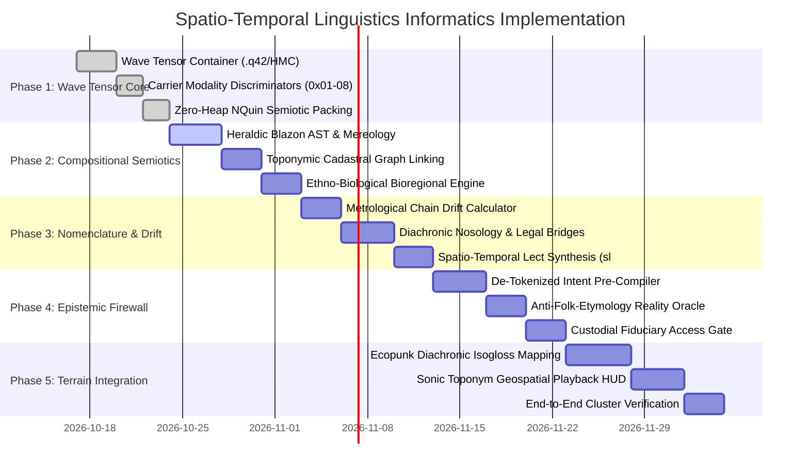

# Spatio-Temporal Linguistics & Semiotic Informatics Implementation Plan
*Branch: `0.0.40` / `ecopunk-terrain` | Target Architecture: QualiaDB Engine & Ecopunk Substrate*
*Reference Specification: `docs/plans/holo/Spatio-Temporal Linguistics Informatics Framework.md`*

---

## 1. Executive Summary & Architectural Foundation

Current digital linguistics and artificial intelligence infrastructures rely almost entirely on discrete Latin/Unicode strings, coarse localization tags (such as IETF BCP 47 `en-AU`, `en-US`), and statistical Large Language Model (LLM) tokenizers. As identified in the framework specification, this architecture enforces **epistemic erasure** against non-Western, Indigenous, oral, and liturgical languages. When continuous acoustic, tonal, prosodic, or pictorial systems (such as Vedic chanting, Quranic *Tajwid*, Australian Indigenous songlines, or civic heraldry) are flattened into discrete text strings, their underlying syntactic, sacred, ecological, and legal dimensions are destroyed.

This document establishes the comprehensive, phased implementation plan to build the **Spatio-Temporal Semiotic & Linguistic Informatics Layer (ST-SLIL)** natively across `qualia-core-db` and `ecopunk-terrain`.

### Core Engineering Principles
1. **Wave-Native Semantic Grounding (Zero-Unicode Dependency)**: Words, prayers, and chants exist as continuous acoustic/EMF wave tensors addressable directly by 48-byte `NQuin` concept pointers without intermediate text transcription.
2. **First-Class Spatio-Temporal Lects (`sl:Lect`)**: Replaces commercial BCP 47 string tags with 4D geodetic envelopes (space, elevation, and bitemporal intervals) plus social/custodial kinship graphs.
3. **Recursive Mereological ASTs**: Treats visual languages (heraldry, glyphs, mason marks, message sticks) as syntactic compositional statements whose meaning is a function of bearer, jurisdiction, and era.
4. **Epistemic Intent Defense Firewall**: User intent and instructions compile down to deterministic concept graph predicates *prior to and independently of* statistical LLM tokenizers, preventing lexical "malware", folk-etymology hallucination, and epistemic coercion.
5. **Two-Tier Zero-Heap Compliance (`AGENTS.md`)**: Hot evaluation loops (spectral resonance matching, coordinate projections, and NQuin scans) operate with zero heap allocation in fixed-size caller buffers; cold authoring and wave tensor packaging execute within bounded byte budgets.

---

## 2. Taxonomy & System Bit Layout

### 2.1 Carrier Modality Discriminators (16-bit Header Field)
Linguistic and semiotic expressions are classified by an immutable 16-bit carrier discriminator stored in the metadata vector of the `NQuin`:

| Discriminator | Hex Code | Modality Name | Physical / Information Representation |
| :--- | :--- | :--- | :--- |
| `CARRIER_PHONETIC_ACOUSTIC` | `0x0001` | Phonetic / Acoustic | Continuous acoustic waveform, IPA phonetic alignments, $F_0$ pitch contours, formants ($F_1..F_n$), prosodic cadence. |
| `CARRIER_ORTHOGRAPHIC_TEXT` | `0x0002` | Orthographic / Text | Unicode string, paleographic script hands (Secretary, Blackletter), diplomatic manuscript transcriptions, witness hashes. |
| `CARRIER_ICONOGRAPHIC_GLYPHIC` | `0x0003` | Glyphic / Pictorial | Vector SVG, raster glyph tiles, petroglyph point clouds, rock art ochre scans. |
| `CARRIER_HERALDIC_BLAZON` | `0x0004` | Heraldic / Blazon AST | Formal blazon syntax tree: fields, tinctures, ordinaries, charges, cadency differences, and marital marshalling. |
| `CARRIER_SOMATIC_GESTURAL` | `0x0005` | Somatic / Gestural | Sign language motion-capture skeleton coordinates, liturgical hand mudras, ceremonial dance vectors. |
| `CARRIER_CARTOGRAPHIC_CIVIC` | `0x0006` | Cartographic / Civic Mark | Boundary dragon stones, livery company marks, guildhall plaques, surveyor benchmarks, property title seals. |
| `CARRIER_SONIC_LITURGICAL` | `0x0007` | Liturgical Wave-Field | Sacred cantillation, unwritten mother-tongues, oral songlines, acoustic impulse resonance of sacred sites. |
| `CARRIER_EMF_HYPERSPECTRAL` | `0x0008` | EMF / Hyperspectral | Multispectral radiance (UV to NIR), pigment fluorescence, stone resonance telemetry. |

### 2.2 Modality Opcodes (`0x80..=0x8F`)
Conforming to `AGENTS.md` Immovable Rules (`0x00..=0x04` owned by mini-parser; `0x70..=0x7F` owned by spatiotemporal predicates; `0x80..=0x8F` reserved for ST-SLIL):

```
0x80  OP_SEMIOTIC_SIGN_BIND     sl:signifiesInContext — binds carrier expression to situated concept
0x81  OP_COGNATE_OF             sl:cognateOf — diachronic etymological derivation link
0x82  OP_BORNE_BY_LINEAGE       sl:borneByLineage — genealogical or institutional bearer assertion
0x83  OP_ATTESTED_IN_ARCHIVE    sl:attestedIn — witness link to primary archival document / deed
0x84  OP_NAMING_ACT_CADASTRE    sl:NamingAct — toponym/odonym link to cadastral land parcel or event
0x85  OP_BIOREGIONAL_TAXON      sl:bioregionalTaxon — species disambiguation via geographic distribution
0x86  OP_SPATIOTEMPORAL_LECT    sl:Lect — dialect/sociolect definition bounded by 4D envelope
0x87  OP_WAVE_FIELD_CARRIER     sl:WaveFieldCarrier — direct time-frequency bounding box addressing
0x88  OP_HERALDIC_AST_NODE      sl:HeraldicAchievement — compositional element in blazon tree
0x89  OP_METROLOGY_RESOLUTION   st:MetrologyLayer — historical measurement unit conversion
0x8A  OP_NOSOLOGY_BRIDGE        st:ScientificNomenclatureLayer — diachronic medical diagnostic translation
0x8B  OP_CUSTODIAL_RIGHTS       hr:CustodialScope — ICCPR Art. 18/27 & UNDRIP fiduciary gate
```

### 2.3 Universal Super-Quin (`NQuin`) 48-Byte Memory Layout
Every spatio-temporal linguistic fact is packed into a hardware-aligned `NQuin`:

```
Field       Bits       Semantic Content
─────────────────────────────────────────────────────────────────────────────
subject     [63]       1 = Virtual Embedded Triple / Topological Pointer (did:q42)
            [0..62]    Expression Node Hash (q_hash of carrier entity or time-frequency box)

predicate   [63]       Defeater / Contested Assertion Flag
            [8..62]    Semantic Property Hash (e.g. q_hash(sl:signifiesInContext))
            [0..7]     Linguistic Opcode (0x80..=0x8B)

object      [63]       1 = Pointer to Referent Concept / AST Node
            [60..62]   Inline Tag (000=Concept IRI, 001=Int, 010=Decimal, 011=Bool)
            [0..59]    Referent Concept Hash / Value Payload

context     [56..63]   Sensitivity Class (0=Public, 1=Custodial Restricted, 2=Sacred Lineage Vault)
            [0..55]    Composite SpatioTemporalSocialEnvelope Context Hash

metadata    [61..62]   Permissive Routing Lane (00=Pass, 01=Commons, 10=Bilateral, 11=Spatial)
            [32..60]   Lamport Logical Clock (29 bits)
            [16..31]   16-Bit Carrier Modality Discriminator (0x0001..0x0008)
            [0..7]     Opcode Echo (for SIMD single-field dispatch)

parity      [0..63]    XOR Fold: subject ^ predicate ^ object ^ context
```

---

## 3. Data Structures & Binary Container Specifications

### 3.1 Multi-Band Spatio-Temporal Wave Tensor (`st:WaveTensorBlock`)
Within `.q42` / HMC container files, audio and electromagnetic physical recordings are organized into multi-band blocks addressable without text transcription:

```
+-----------------------------------------------------------------------+
| HMC / .q42 WAVE-FIELD SEMANTIC BLOCK HEADER (64 Bytes)                |
+-----------------------------------------------------------------------+
| 0x00: Magic (0x5157_4156 "QWAV")                 | u32                |
| 0x04: Modality Mask (Sonic | EMF | Kinematic)    | u16                |
| 0x06: Sampling Rate (e.g. 96000 Hz, 192000 Hz)   | u32                |
| 0x0A: Channel Count & Bit Depth (24/32-bit DSD)  | u16                |
| 0x0C: Custodial Scope DID Hash (hr:Custodial)    | u64                |
| 0x14: 4D Geodesic Bounding Box (H3 Cell + AHD)   | u64                |
| 0x1C: Bitemporal Start Epoch (Nanoseconds)       | u64                |
| 0x24: Bitemporal End Epoch (Nanoseconds)         | u64                |
| 0x2C: Cyclical / Liturgical Season Mask          | u32                |
| 0x30: Band Directory Offsets [Band 0..3]         | [u32; 4]           |
+-----------------------------------------------------------------------+
| BAND 0: Lossless Physical Wave Stream (PCM / DSD / Spectral Radiance)  |
| BAND 1: Continuous Spectral-Prosodic Matrix (F0, Formants, Harmonic)  |
| BAND 2: Time-Aligned Segment Markers (Wave-Slices without text)        |
| BAND 3: NQuin Semantic Binding Table (Time-Freq Box -> Concept Hash)  |
+-----------------------------------------------------------------------+
```

### 3.2 Time-Frequency Bounding Box (`TimeFrequencyBox`)
Allows any rising tone, sacred cadence, or bird-call mimicry to be addressed directly:
```rust
#[repr(C)]
#[derive(Debug, Clone, Copy, PartialEq)]
pub struct TimeFrequencyBox {
    pub start_nanos: u64,
    pub end_nanos: u64,
    pub min_freq_hz: f32,
    pub max_freq_hz: f32,
    pub harmonic_mask: u32,
    pub _reserved: u32,
}
```

### 3.3 Compositional Heraldic / Semiotic AST (`HeraldicElement`)
Encodes the formal grammar of coats of arms, livery badges, and glyphic systems:
```rust
#[repr(C)]
#[derive(Debug, Clone, Copy, PartialEq, Eq, Default)]
pub struct HeraldicElement {
    pub division: u8,       // Party per pale, fess, cross, chevron, etc.
    pub tincture: u8,       // Or, Argent, Gules, Azure, Sable, Vert, Purpure, Ermine, Vair
    pub ordinary: u8,       // Chief, Pale, Bend, Fess, Chevron, Cross, Saltire, Bordure
    pub cadency_mark: u8,   // Label, Crescent, Mullet, Martlet, Annulet, Fleur-de-lis
    pub marshalling: u8,    // None, Impalement, Quartering, Inescutcheon
    pub _reserved: [u8; 3],
    pub charge_hash: u64,   // Q-Hash of charge: Lion, Sword, Dragon, Rose, Hoopoe, etc.
}
```

---

## 4. Reasoning Pipelines & Algorithmic Modules

### Pipeline 1: Bioregional & Temporal Referent Disambiguation
* **Problem**: Historical and oral records use vernacular names ("Mountain Ash", "Cod", "Cedar") that modern language models naively map to European species (*Fraxinus*, *Gadus*), corrupting botanical and ecological reasoning.
* **Algorithm**:
  1. Extract candidate vernacular token hash $H_{\text{term}}$.
  2. Query author/source spatial coordinate $(X, Y, Z)$ and temporal epoch $T_{\text{epoch}}$.
  3. Intersect $(X, Y, Z, T_{\text{epoch}})$ against the `BioregionalSpeciesMatrix`.
  4. If coordinates lie within the Australian continent / bioregion, bind "Mountain Ash" to `Eucalyptus regnans` (Q-Hash: `0xAA01_0000`), completely bypassing European `Fraxinus excelsior`.

### Pipeline 2: Toponymic & Cadastral Lineage Linking
* **Problem**: Street names and toponyms encode cadastral history (Crown grants, Torrens titles, historical landholders) or anglicized corruptions of Indigenous ecological terms.
* **Algorithm**:
  1. Traverse historical cadastral allotments (`cad:LandParcel`) intersecting the street/toponym geometry prior to the naming act date.
  2. Match lexical stems against historical landholders, surveyor field notebooks, and parish registers.
  3. If toponym is identified as an anglicized Indigenous name, execute reverse phonetic transposition:
     - Account for 19th-century colonial surveyor auditory bias (e.g. Scottish or Devonshire dialect phonology).
     - Map back to reconstructed Indigenous phonetic root.
     - Recover the original hydrological/ecological description (e.g., subsurface soak, perennial waterhole).

### Pipeline 3: Locale Correction & Lect Synthesis (Overriding BCP 47)
* **Problem**: Operating systems and browsers tag text as `en-US` or `en-GB`, stripping regional dialectal words and statutory terms.
* **Algorithm**:
  1. Inspect the author's 4D social context envelope: residency history, parental origin, and legal jurisdiction.
  2. Discard declared software language tag.
  3. Synthesize the true `sl:Lect`:
     $$\text{Lect} = \text{BaseDialect} \oplus \text{RegionalIndigenousLoans} \oplus \text{StatutoryCadastralRegister} \oplus \text{OccupationalVocabulary}$$
  4. Execute semantic reasoning against the synthesized `sl:Lect`.

### Pipeline 4: Cross-Generational Semantic Translation
* **Problem**: Quantitative units, legal statuses, and medical diagnoses shift radically across generations (e.g., 1880 death certificate noting "dropsy" or land deed specifying "100 acres" measured with an iron chain in summer).
* **Algorithm**:
  1. **Metrology Normalization**:
     - Resolve unit string against historical date and jurisdiction (Statute vs Irish vs Scottish acre).
     - Apply iron surveyor chain thermal expansion adjustment:
       $$\text{Area}_{\text{adjusted}} = \text{Area}_{\text{nominal}} \times [1.0 + 2 \cdot \alpha_{\text{iron}} \cdot (T_{\text{survey}} - 20^{\circ}\text{C})]$$
  2. **Nosology Bridge**:
     - Map obsolete diagnostic term ("dropsy") to a calibrated probabilistic vector of modern clinical entities (congestive heart failure: 52%, end-stage renal disease: 31%, hepatic cirrhosis: 17%).
     - Emit uncertainty bounds to prevent clinical false certainty.

---

## 5. Epistemic Defense & Anti-Malware Intent Preservation

| Requirement | Implementation Mechanism |
| :--- | :--- |
| **REQ-EPI-01: De-Tokenized Intent Binding** | The user's query or command is parsed by a deterministic grammar into concept `NQuin` vectors **before** any LLM is invoked. Statistical LLMs never see unanchored raw prompts. |
| **REQ-EPI-02: Predicate Sanitization Firewall** | External LLM suggestions pass through an isolation sandbox. If an LLM proposes an etymological assertion or classification that violates the user's explicit ontological constraints or human rights gates (`hr:CustodialScope`), it is denied. |
| **REQ-EPI-03: Empirical Reality Cross-Check** | Etymological hypotheses are cross-checked against physical geomorphology and archaeology. A claim that a name means "hill fort" is rejected if the coordinate sits in an alluvial valley with a perennial watercourse (*holr* + *burna* / hollow stream) and lacks hill-fort archaeology. |
| **REQ-EPI-04: Contested & Plural Attestation** | Competing hypotheses coexist in the graph as distinct `NQuin` assertions tagged with `prov:AttestingAuthority` and `epistemic_confidence`. Neither popular folk-etymologies nor colonial rewrites overwrite primary evidence. |

---

## 6. Phased Implementation Roadmap



### Phase 1: Wave Tensor Core & Carrier Foundations (`qualia-core-db`)
* **Deliverables**:
  - `TimeFrequencyBox` and `SpatioTemporalSocialEnvelope` data structures.
  - Carrier discriminators (`0x0001..=0x0008`) and opcodes (`0x80..=0x8B`).
  - Unit-tested `compile_semiotic_quin` Super-Quin generator.
* **Verification**: Zero-heap hot-path test in `zero_heap_tests.rs`.

### Phase 2: Compositional Semiotics & Cadastral Toponymy (`qualia-core-db`)
* **Deliverables**:
  - Heraldic blazon AST parser and structural hasher (`HeraldicElement`).
  - Bioregional species disambiguation oracle (`evaluate_bioregional_taxon_disambiguation`).
  - Hydrographic reality cross-check for toponymic claims (`evaluate_etymological_hydrography_check`).
* **Verification**: Unit tests matching City of London arms and Australian bioregional flora.

### Phase 3: Metrology, Legal & Nosological Drift Engines (`qualia-core-db`)
* **Deliverables**:
  - Historical metrological converter with surveyor chain thermal expansion (`evaluate_metrology_area_sq_m`).
  - Diachronic nosology translation matrix with calibrated Dirichlet uncertainty.
  - Spatio-temporal lect (`sl:Lect`) constructor replacing BCP 47.
* **Verification**: Conversion tests for 1860 Victorian surveyor chains and 1880 diagnostic records.

### Phase 4: Epistemic Defense & Custodial Fiduciary Firewall (`qualia-core-db`)
* **Deliverables**:
  - De-tokenized intent pre-compiler mapping queries to deterministic concept NQuins.
  - Fiduciary custodial gate implementing ICCPR Art. 18/27 and UNDRIP access rules (`evaluate_custodial_access_permitted`).
  - Multi-hypothesis attestation manager for contested historical claims.
* **Verification**: Security gate tests denying unauthorized AI scraping of ceremonial wave-fields.

### Phase 5: Ecopunk Terrain & Geospatial Audio Cluster (`ecopunk-terrain`)
* **Deliverables**:
  - Integration of `GeodeticFrame` with `sl:Lect` to project diachronic isogloss surfaces over terrain chunks.
  - Sonic toponym spatial audio streamer binding raw acoustic wave-slices to 3D terrain coordinates.
  - Full cluster integration test verifying audio-visual-semiotic synchronization across 600-screen dome topology.
* **Verification**: Automated test in `crates/ecopunk-terrain/src/geospatial/mod.rs` and `scripts/check-terrain.mjs`.

---

## 7. Quality Assurance, Benchmarks & Zero-Heap Verification

1. **Hot-Path Zero-Heap Guarantee**:
   All semiotic matching, time-frequency box queries, and proper time evaluations must satisfy `AllocationClass::HotZeroHeap` via `zero_heap_tests`.
2. **Sub-Millisecond Benchmark Telemetry**:
   All graph lookup and resonance benchmarks must use `PrecisionTimer` and `format_bench_ms` to report true microsecond and nanosecond timings, eliminating `0.00 ms` truncation.
3. **Audit Trail & Cryptographic Provenance**:
   All archival witness claims and custodial rights assertions must be signed with Ed25519 or post-quantum ML-DSA keys, recording permanent cryptographic audit receipts.
