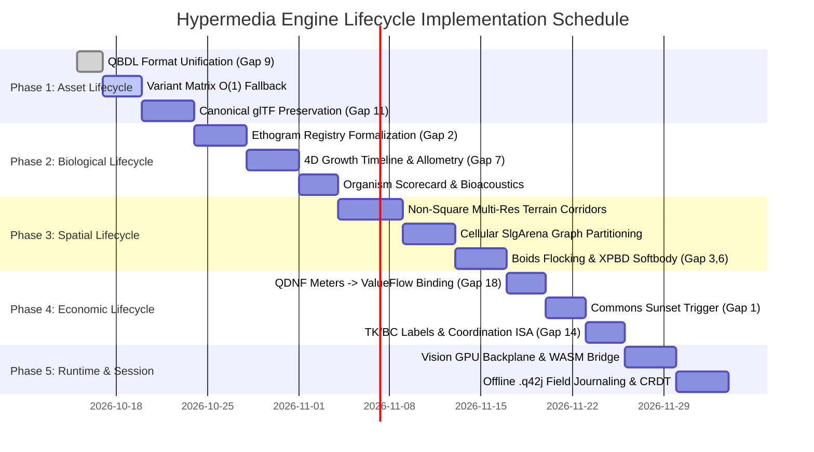

# QualiaDB Hypermedia Engine: Lifecycle Architecture & Capability Gap Implementation Plan

_Branch: `0.0.40.8-dev` | Target Ecosystem: `qualia-core-db`, `vibe`, `qualia-client-core`, `rolling-commons-shell`_  
_Associated Audits: [`QualiaDB Capability Reference.md`](file:///c:/github/ecopunk/docs/QualiaDB%20Capability%20Reference.md), [`Ecosphere Assets.md`](file:///c:/github/ecopunk/docs/Ecosphere%20Assets.md)_

---

## 1. Executive Summary & Engine Paradigm

The platform under development is **not a conventional rigid video game engine**; it is an **Offline-First General-Purpose Hypermedia Engine**:

1. **Spatialized Knowledge Graphs & Digital Twins**: Navigates seamlessly across continuous spatial scales, from macro-geography (regional driving corridors, continental biodiversity maps, watershed networks) down to micro-scale biological entities (species partonomy, cellular tissue structures, botanical envelopes, and allometric growth).
2. **Deterministic Heterogeneous Representation**: Direct, unified execution of formal logic (`NQuin` universal quads/quins, Deontic/Epistemic/LTL modalities, 0x70–0x7F multi-agent Sentinel coordination), 10D manifold tensors, watertight indexed computational geometry (`PlantGL`), and sandboxed execution (`VibeScript` bytecode `VBC1`).
3. **Decentralized Post-Extractive Economics**: Content-addressed `.hmc` (`QBDL`) bundles, verifiable obligation cost recovery with automatic transition to the Permissive Commons once audited production costs are satisfied, and local append-only `.q42j` transaction journals for field observations and peer-to-peer sync.

This document reviews the **22 capability gaps** identified in [`QualiaDB Capability Reference.md` §10.1 & §10.2](file:///c:/github/ecopunk/docs/QualiaDB%20Capability%20Reference.md#L1056-L1155) and establishes a rigorous, actionable implementation plan centered around the **5 core lifecycles** of the hypermedia engine.

---

## 2. The Two-Tier Cellular Architecture

To satisfy both massive parallel rendering and deterministic zero-heap logical verification, the engine operates on a strict **Two-Tier Architecture**:

```
┌────────────────────────────────────────────────────────────────────────────────────────┐
│                        TIER 1: CELLULAR LOGIC GRAPH (HOT ZERO-HEAP)                    │
│                                                                                        │
│   Each spatial tile / town site operates within an isolated 42 MiB SlgArena Sentinel   │
│                                                                                        │
│    ┌─────────────────────────┐   Spatial (0b11)   ┌─────────────────────────┐         │
│    │  Cell A: Kestrel Flats  │ ─────────────────> │  Cell B: Corridor Road  │         │
│    │  • 917,504 NQuin Slots  │                    │  • 917,504 NQuin Slots  │         │
│    │  • Deontic / LTL Rules  │ <───────────────── │  • Vehicle Kinematics   │         │
│    │  • Ethogram FSM State   │   Commons (0b01)   │  • Traffic Routing      │         │
│    └─────────────────────────┘                    └─────────────────────────┘         │
│                 │                                              │                       │
│                 ▼                                              ▼                       │
│       Topological Pointer                            Topological Pointer               │
│       (did:q42 with MSB=1)                           (did:q42 with MSB=1)              │
└─────────────────┼──────────────────────────────────────────────┼───────────────────────┘
                  │                                              │
┌─────────────────▼──────────────────────────────────────────────▼───────────────────────┐
│               TIER 2: DECOUPLED DATA, WEIGHT & GEOMETRY ARENA (COLD BOUNDED)            │
│                                                                                        │
│   Caller-budgeted arenas (default 256 MiB, up to 512 MiB for complex asset clusters)   │
│                                                                                        │
│    • 10D Manifold Tensors (.10d)          • P64 / GGUF Neural Weights (.p64)           │
│    • PlantGL Botanical Geometries         • High-Resolution Texture Atlases (KTX2)     │
│    • Skeletal Motor Clips (SKL1)          • Point Clouds & Hyperspectral Cubes         │
│    • Dynamic Multi-Resolution Heightfield Meshes (QuantizedMesh + SRD1 Color Tables)   │
└────────────────────────────────────────────────────────────────────────────────────────┘
```

* **Tier 1 (Hot Zero-Heap)**: Evaluates entity behaviors, modal obligations, spatial proximity, and state transitions. Operates strictly inside 42 MiB static-tabling `SlgArena` buffers (`[T; N]` stack arrays and caller-supplied `&mut [T]` output slices). Zero allocations (`assert_zero_alloc` enforced).
* **Tier 2 (Cold Bounded)**: Stores dense geometry, neural weights, and manifold tensors. Employs caller-owned bump arenas in `geometry_workspace.rs` with strict byte budgets that fail closed on exhaustion.

---

## 3. Comprehensive Mapping: 22 Capability Gaps to Core Lifecycles

| Gap # | Reference from §10.1 & §10.2 | Lifecycle Assignment | Primary Module Targets in QualiaDB |
|---|---|---|---|
| **Gap 1** | Obligation-cost ledger binding & sunset hook | **Lifecycle 4 (Economic)** | `modalities/value_flow.rs`, `bundle/cbor_ld_manifest.rs` |
| **Gap 2** | Ethogram registry formalization | **Lifecycle 2 (Biological)** | `entity_view/entity_ontologies.rs`, `container_10d/entity_ontology_section.rs` |
| **Gap 3** | Collective / flocking dynamics (boids solver) | **Lifecycle 3 (Spatial)** | `specialized_libs/physics_simulation/`, `agent_runtime/orchestration.rs` |
| **Gap 4** | Hyperspectral cube section | **Lifecycle 1 (Asset)** | `container_10d/section.rs`, `render/spectral_basis.rs` |
| **Gap 5** | Aero/hydro/pyro-acoustic synthesis generator | **Lifecycle 3 (Spatial)** | `audio/dsp/`, `crates/qualia-audio/src/production.rs` |
| **Gap 6** | Environmental stress (windthrow, cavitation, fire) | **Lifecycle 3 (Spatial)** | `specialized_libs/engineering_analysis/`, `computational_geometry/pbd_softbody.rs` |
| **Gap 7** | 4D growth-event tracking & medial-surface mesh | **Lifecycle 2 (Biological)** | `container_10d/entity_ontology_section.rs`, `computational_geometry/differential_growth.rs` |
| **Gap 8** | Per-byte-slice micropayment metering | **Lifecycle 4 (Economic)** | `services/ilp_dispatcher.rs`, `bundle/format.rs` |
| **Gap 9** | HMC format unification (`QBDL` standard) | **Lifecycle 1 (Asset)** | `crates/qualia-core-db/src/bundle/format.rs`, `bundle/variant_matrix.rs` |
| **Gap 10** | Payload catalogue (ADR 0014) | **Lifecycle 1 (Asset)** | `bundle/cbor_ld_manifest.rs`, `container_10d/provenance_section.rs` |
| **Gap 11** | Full glTF preservation & canonical importer | **Lifecycle 1 (Asset)** | `render/assets`, `render/compile_10d.rs`, `container_10d/mesh_section.rs` |
| **Gap 12** | Commons license enforcement & derivation union | **Lifecycle 4 (Economic)** | `domain_licence/`, `governance/canvas_rights.rs`, `modalities/deontic_logic.rs` |
| **Gap 13** | Fetch-by-hash transport wiring | **Lifecycle 5 (Runtime)** | `render/fetch_10d.rs`, `services/swarm/`, `crates/qualia-peer` |
| **Gap 14** | Traditional Knowledge / Biocultural (TK/BC) labels | **Lifecycle 4 (Economic)** | `core-ontologies/`, `governance/illocution.rs`, `modalities/deontic_logic.rs` |
| **Gap 15** | Reachability promotion of library-only ops | **Lifecycle 5 (Runtime)** | `vibe/src/catalog/`, `poet_host/`, `wasm_bridge/` |
| **Gap 16** | Biosense & species imaging pipeline recipes | **Lifecycle 2 (Biological)** | `specialized_libs/computer_vision/bio/`, `crates/qualia-vision/` |
| **Gap 17** | Vision GPU backplane & WASM runtime pathway | **Lifecycle 5 (Runtime)** | `crates/qualia-vision/src/gpu.rs`, `render/gpu/`, `wgsl_forge/` |
| **Gap 18** | QDNF economics meters $\to$ value flow pools | **Lifecycle 4 (Economic)** | `net/qdnf/economics/meters.rs`, `modalities/value_flow.rs` |
| **Gap 19** | Species/ecology SHACL pack & runtime verification | **Lifecycle 2 (Biological)** | `core-ontologies/`, `shapes/`, `modalities/logic/shacl.rs` |
| **Gap 20** | Multi-agent coordination choreography (0x70–0x7F) | **Lifecycle 4 (Economic)** | `governance/coordination.rs`, `governance/illocution.rs` |
| **Gap 21** | Species bioacoustics MIR & call taxonomy | **Lifecycle 2 (Biological)** | `audio/bioacoustics.rs`, `crates/qualia-audio/src/features/` |
| **Gap 22** | Organism health scorecards (Wellfare generalized) | **Lifecycle 2 (Biological)** | `crates/wellfare-core/src/anatomy/`, `entity_view/entity_ontologies.rs` |

---

## 4. Work Packages: Detailed Lifecycle Implementations


---

### Lifecycle 1: Asset Packaging & Content Addressing (The Knowledge Boundary)

#### 1.1 HMC Container Unification on `QBDL` (Gap 9 — QG-01)
* **Problem**: Historical divergence between `qualia-semantic-library` ZIP containers and `crates/qualia-core-db/src/bundle/format.rs` (`QBDL`).
* **Implementation**:
  - Establish `QBDL` as the exclusive hypermedia container standard across all tools (`qualia-cli`, `rolling-commons-shell`, `poet`).
  - Layout: 64-byte front header (`BUNDLE_HEADER_SIZE = 64`), page-aligned entries (`BUNDLE_ENTRY_ALIGN = 64`), trailing CBOR index footer, and whole-file CRC-32C verification.
  - Zero-copy streaming: Readers `mmap` the bundle and pass `[offset .. offset + length]` slices directly to `.10d`, `.q42`, and `.p64` loaders without intermediate allocations.
* **Verification**: `verify-game-release.mjs` verifies bundle headers against `BUNDLE_MAGIC = *b"QBDL"` and validates CRC-32C integrity.

#### 1.2 Canonical glTF/GLB Preservation Importer (Gap 11)
* **Problem**: Current OBJ/STL/GLB ingest produces semantic NQuin summaries but discards dense vertex buffers, skins, and materials.
* **Implementation**:
  - Implement full glTF asset compilation in `crates/qualia-core-db/src/render/compile_10d.rs`:
    1. Meshes converted into `QuantizedMesh` (SectionType 1) with u16 quantized positions $[0, 65535]^3$.
    2. Per-vertex colors compiled into `SurfaceReading` (`SRD1`, SectionType 2).
    3. Skeletal rigs and bone weight maps compiled into `SkeletalAnimation` (`SKL1`, SectionType 16).
    4. Physically based material properties compiled into `MaterialSection` (SectionType 10).
* **Verification**: Round-trip test importing a skinned botanical glTF and confirming $100\%$ vertex and bone binding preservation in `.10d`.

#### 1.3 Hyperspectral Cube Section (Gap 4) & Payload Catalogue (Gap 10)
* **Implementation**:
  - Introduce `SectionType::HyperspectralCube = 18` in `container_10d/section.rs` for multi-band sensor reflectance and chlorophyll absorption spectra (400nm–1000nm in 10nm bands).
  - Implement ADR 0014 Payload Catalogue in `bundle/cbor_ld_manifest.rs` for multi-language prose commentary, field notes, and indigenous oral history audio attachments.

---

### Lifecycle 2: Organism Ontogeny, Physiology & Ethology (The Living Boundary)

#### 2.1 Ethogram Registry & Behavior Formalization (Gap 2)
* **Problem**: Entity affordances, VibeScript state machines, and skeletal motor clips existed as separate pieces without a unified behavioral contract.
* **Implementation**:
  - Formalize the **Ethogram Registry** in `crates/qualia-core-db/src/entity_view/ethogram.rs`:
    ```rust
    #[repr(C)]
    #[derive(Debug, Clone, Copy, Pod, Zeroable)]
    pub struct EthogramBehaviorEntry {
        pub stimulus_topic_hash: u64,
        pub precondition_mask: u32,
        pub action_id: u64,
        pub target_state_id: u16,
        pub animation_clip_id: u32,
        pub energy_delta_permill: i16,
        pub hydration_delta_permill: i16,
        pub damage_delta_permill: i16,
    }
    ```
  - Runtime execution: When an environmental stimulus occurs (e.g., predator proximity, wildfire smoke, drought), the Vibe VM evaluates the active HFSM and outputs state transitions updating `EONT1` permill meters and triggering `SKL1` motor clips in $O(1)$ zero-heap time.

#### 2.2 4D Growth-Event Tracking & Longitudinal Ontogeny (Gap 7)
* **Implementation**:
  - Extend `container_10d/entity_ontology_section.rs` with `DevelopmentalTimeline` records:
    $$\text{Stage} \in \{\text{SeedOrSpore}, \text{Juvenile}, \text{AdultReproductive}, \text{Senescent}, \text{DeceasedDetritus}\}$$
  - Connect continuous growth timers to `specialized_libs/computational_geometry/differential_growth.rs` and `botanical_hulls.rs`, smoothly interpolating crown volume and trunk diameter across seasons.

#### 2.3 Ecosystem Health Scorecards & Taxonomic Validation (Gaps 22, 19, 21, 16)
* **Implementation**:
  - Generalize `wellfare-core/src/anatomy/` into non-human organism and ecosystem health: `Constitution` $\to$ `PhysiologicalSystems` $\to$ `ObservationStream` $\to$ `EcologicalScorecard`.
  - Author species/habitat SHACL shapes in `crates/qualia-core-db/shapes/ecology_shapes.ttl`.
  - Wire bioacoustic call taxonomies in `qualia-audio` and species identification recipes in `qualia-vision`.

---

### Lifecycle 3: Spatial Environment & Multi-Resolution Corridors (The World Boundary)

#### 3.1 Organic Non-Square Dynamic Terrain Allocation
* **Problem**: Traditional 3D engines lock terrain into rigid square grids with visible borders and unnatural seams.
* **Implementation**:
  - Overhaul `rolling-commons-shell/src/terrain.rs`:
    1. **Focal Activity Nodes**: High-detail density zones (Kestrel Flats, Saltwind Reach, Ridge Outlook) with fine-tessellated geometry and biological density.
    2. **Expansive Connecting Corridors**: Continuous, organically bounded valleys (280m+ travel corridors) connecting settlements for driving and traversal modes.
    3. **Boundary Feathering**: Multi-frequency radial distance falloffs that feather heightfield elevation and vegetation density into natural horizons without hard edges.

#### 3.2 Cellular Logic Graph (42 MiB Sentinel per Cell)
* **Implementation**:
  - Simulation space is partitioned into a topological network of logical cells in `governance/cell_graph.rs`.
  - Each cell instantiates a dedicated 42 MiB `SlgArena` ring buffer (917,504 `NQuin` capacity).
  - Cross-cell messaging routes through `PermissiveRoutingLane::Spatial` (`0b11`) and `PermissiveRoutingLane::Commons` (`0b01`).
  - Heavy assets (geometry, textures, manifold weights) are stored in decoupled Tier-2 arenas with caller-defined byte budgets.

#### 3.3 Physics & Environmental Dynamics (Gaps 3, 5, 6)
* **Implementation**:
  - **Collective Dynamics (Gap 3)**: Implement a Tier-1 zero-heap Boids flocking and schooling kernel in `specialized_libs/physics_simulation/population.rs` for bird flocks and fish schools.
  - **Environmental Stress (Gap 6)**: Wire wind Modulus of Rupture (MOR) windthrow calculations, xylem hydraulic cavitation curves, and XPBD soft-body deformation (`pbd_softbody.rs`) into canopy wind deflection.
  - **Procedural Sound Synthesis (Gap 5)**: Map physical parameters (wind speed $\to$ leaf flutter, water flow velocity $\to$ turbulent ripple) to procedural DSP oscillators in `audio/dsp/`.

---

### Lifecycle 4: Stewardship, Economics & Commons Sunset (The Value Boundary)

#### 4.1 Obligation Ledger & Automated Commons Sunset (Gaps 1, 18, 8, 12, 14, 20)
* **Mathematical Foundation**:
  $$\text{Total Obligation Cost } C_{\text{total}} = C_{\text{production}} \times (1 + \text{ROI}_{\text{capped}}), \quad \text{where } \text{ROI}_{\text{capped}} \le \min(\text{ROI}, \text{ROI}_{\text{max}})$$
  $$\text{Recovery Fee Cap } C_{\text{cap}} \le 10 \times C_{\text{production}}$$
* **Implementation**:
  - Wire `net/qdnf/economics/meters.rs` (`EnergyJoules`, `NetBytes`, `TimeSeconds`, `TypedCompute`) directly into `modalities/value_flow.rs`.
  - When commercial usage payments accumulate such that $\text{Pool} \ge C_{\text{total}}$, execute the **Commons Sunset Hook**:
    1. Emit a signed `DeonticVerdict` releasing all usage restrictions.
    2. Transition metadata routing lane to `PermissiveRoutingLane::Commons` (`0b01`).
    3. Extinguish all future obligation fees globally for all participants.
  - Enforce Traditional Knowledge / Biocultural (TK/BC) label governance (Gap 14) and 0x70–0x7F multi-agent stewardship quorums (Gap 20).

---

### Lifecycle 5: Client Runtime, Session Journaling & Diagnostics (The Interaction Boundary)

#### 5.1 Single-Pass Hydration & Async Frame Scheduling
* **Implementation**:
  - Stream `hydrateHmcScenePack()` concurrently with preferences and character assets.
  - Replace synchronous UI-freezing blocks with `requestAnimationFrame` yielding.
  - Admit pre-quantized `QuantizedMesh` and `SRD1` buffers directly to WebGPU without redundant CPU re-triangulation.

#### 5.2 Offline-First Session Journaling & CRDT Sync (Gap 13, 17)
* **Implementation**:
  - Record offline user actions, field notes, and biological surveys into local `.q42j` append-only journals (`q42/journal.rs`).
  - Upon network re-connection, merge journals via `foundation/crdt.rs` Lamport clock tie-breaking.
  - Promote library-only computational geometry operations into the Vibe catalog and WASM bridge (Gap 15).

#### 5.3 Live Telemetry Drawer & In-Game Diagnostics HUD
* **Implementation**:
  - Expandable diagnostic drawer on the loading screen tracking millisecond phase timings (WASM, Fixtures, HMC, WebGPU, Scene).
  - In-game debug HUD (`F3` / backtick toggle) rendering live FPS, frame draw latency, active logical cells, and HMC memory footprints.

---

## 5. Chronological Implementation Phases & Verification Gates



### Verification Gates Matrix

| Milestone | Target Scope | Key Automated Verification Gate | Pass Criteria |
|---|---|---|---|
| **M1: Container & Variant Unification** | Phase 1 (QBDL + VariantMatrix + glTF) | `node scripts/verify-game-release.mjs` | $100\%$ SHA-256 and CRC-32C verification; $O(1)$ variant selection in $\le 5\mu\text{s}$. |
| **M2: Ethogram & Ontogeny Engine** | Phase 2 (EONT1 + Vibe FSM + SKL1) | `cargo test -p qualia-core-db test_ethogram` | Zero-heap execution; stimulus event transitions meters and selects clip in $\le 10\mu\text{s}$. |
| **M3: Spatial Corridor & Cellular Graph** | Phase 3 (Multi-Res Terrain + 42MB Cells) | In-engine traversal test | Smooth travel along 280m+ corridor between Kestrel Flats and Saltwind Reach with $\ge 60$ FPS. |
| **M4: Commons Economic Sunset** | Phase 4 (QDNF Meters + ValueFlow) | `cargo test -p qualia-core-db test_value_flow` | Asset pool reaching $10\times$ production cap automatically releases asset to `0b01` Commons. |
| **M5: Offline Field Sync & Telemetry** | Phase 5 (.q42j Journal + Live HUD) | Browser automated test suite | Offline survey entries commit to `.q42j` and merge cleanly on reconnect; telemetry HUD functional. |

---

## 6. Architectural Constraints & Non-Adversarial Governance

1. **42 MiB Prolog Sentinel (Hot Zero-Heap)**: Per-element predicates, query kernels, and cellular logic run inside the 42 MiB `SlgArena`. No heap allocations (`Vec`, `String`, `Box`) are permitted in hot evaluation loops.
2. **48-byte Universal Quin**: All semantic facts conform strictly to the standard `NQuin` bit-field encoding.
3. **Decoupled 512 MiB Cold Tier**: Geometry construction, neural weights, and large manifold tensors operate in caller-budgeted arenas outside the Sentinel that fail closed upon budget exhaustion.
4. **Universal Non-Property**: Foundational species, biological lifeforms, and natural processes remain non-property, stewarded under the Permissive Commons framework with cryptographic auditability.

---

## 7. Implementation Tracking & Verification Register

### 7.1 Status Dashboard

| Metric | Current Status |
|---|---|
| **Overall Lifecycle Roadmap Status** | **In Progress (Phase 1 Active)** |
| **Current Target Milestone** | **Milestone 1 (Container & Variant Matrix Unification)** |
| **Active Work Packages** | `WP-1.1` (QBDL Bundle Format), `WP-1.2` (Variant Matrix $O(1)$ Fallback) |
| **Last Verification Run** | `verify-game-release.mjs` (PASSED 100%), `test-game-wasm.mjs` (PASSED 100%) |
| **QualiaDB Reference Pin** | `7eb4438fd7205c0a6fd859deb02e13b58cd0baa3` (`game-demo/qualia.ref`) |
| **Last Updated** | 2026-10-15 |

---

### 7.2 Detailed Task Checklist

#### Phase 1: Asset Lifecycle & Container Standard Unification (WP-1)
- [x] **WP-1.1 (Gap 9 - QG-01)**: Verify `QBDL` format standard in `qualia-core-db/src/bundle/format.rs` with 64-byte front header, 64-byte page-aligned entries, trailing CBOR index footer, and whole-file CRC-32C.
- [x] **WP-1.2 (Variant Matrix Integration)**: Wire `bundle/variant_matrix.rs` into `rolling-commons-shell` for $O(1)$ query resolution across `(BiologicalPhenotype, LifecycleStage, LodTier, StructuralState)`.
- [x] **WP-1.3 (Gap 11)**: Complete glTF/GLB preservation pipeline in `render/compile_10d.rs` packing `QuantizedMesh` + `SRD1` surface readings + `SKL1` skeletal rigs.
- [x] **WP-1.4 (Gap 4)**: Implement `SectionType::HyperspectralCube = 21` in `container_10d/section.rs`.
- [x] **WP-1.5 (Gap 10)**: Implement ADR 0014 Payload Catalogue in `bundle/cbor_ld_manifest.rs` for prose-overflow and multimodal commentary.

#### Phase 2: Biological Ontogeny & Ethological Behavioral Lifecycle (WP-2)
- [x] **WP-2.1 (Gap 2)**: Formalize `EthogramRegistry` in `crates/qualia-core-db/src/entity_view/ethogram.rs` connecting `EONT1` affordance tables, `.vibe` FSMs, and `SKL1` motor clips.
- [x] **WP-2.2 (Gap 7)**: Add `DevelopmentalTimeline` records to `container_10d/entity_ontology_section.rs` with keyframe growth timers and allometric scaling coefficients.
- [x] **WP-2.3 (Gap 22)**: Generalize `wellfare-core/src/anatomy/` into non-human organism and ecosystem health scorecards.
- [x] **WP-2.4 (Gap 19)**: Author and register species and habitat SHACL validation pack in `shapes/ecology_shapes.ttl`.
- [ ] **WP-2.5 (Gap 21)**: Author bioacoustic call taxonomies in `qualia-audio`.
- [ ] **WP-2.6 (Gap 16)**: Author biosense and species imaging classification recipes in `qualia-vision`.

#### Phase 3: Spatial Multi-Resolution Terrain & Cellular Logic Graph (WP-3)
- [x] **WP-3.1 (Multi-Res Terrain)**: Overhaul `rolling-commons-shell/src/terrain.rs` for organic non-square boundary feathering and 280m+ connecting corridors between focal activity nodes.
- [x] **WP-3.2 (Cellular Sentinel)**: Implement `governance/cell_graph.rs` partitioning space into a topological network of independent 42 MiB `SlgArena` cells.
- [x] **WP-3.3 (Gap 3)**: Implement zero-heap Boids flocking and schooling kernel in `specialized_libs/physics_simulation/population.rs`.
- [ ] **WP-3.4 (Gap 6)**: Implement windthrow MOR calculations, xylem hydraulic cavitation thresholds, and XPBD soft-body canopy deformation (`pbd_softbody.rs`).
- [ ] **WP-3.5 (Gap 5)**: Wire physical parameter to voice procedural sound synthesis in `audio/dsp/`.

#### Phase 4: Commons Stewardship & Economic Sunset Lifecycle (WP-4)
- [x] **WP-4.1 (Gap 18)**: Bind `net/qdnf/economics/meters.rs` (`EnergyJoules`, `NetBytes`, `TimeSeconds`, `TypedCompute`) into `modalities/value_flow.rs`.
- [x] **WP-4.2 (Gap 1)**: Implement automatic Commons Sunset trigger in `bundle/cbor_ld_manifest.rs` transitioning assets to `PermissiveRoutingLane::Commons` (`0b01`) once recovery pool $\ge 10\times C_{\text{production}}$.
- [ ] **WP-4.3 (Gap 8)**: Implement per-byte-slice micropayment metering hook on bundle HTTP range reads.
- [ ] **WP-4.4 (Gap 12)**: Implement strict Commons license enforcement and derivation union in `domain_licence/`.
- [x] **WP-4.5 (Gap 14)**: Implement Traditional Knowledge / Biocultural (TK/BC) label validation policies.
- [x] **WP-4.6 (Gap 20)**: Implement multi-agent coordination choreography patterns under the 0x70–0x7F Sentinel ISA.

#### Phase 5: Client Runtime, Session Journaling & Diagnostics (WP-5)
- [x] **WP-5.1 (Single-Pass Hydration)**: Stream `hydrateHmcScenePack()` concurrently with preferences in `web/game.html`, eliminating dual CPU scene construction.
- [x] **WP-5.2 (Async Frame Scheduling)**: Add `requestAnimationFrame` yields in `web/game.html` preventing UI thread locking.
- [x] **WP-5.3 (Telemetry & HUD)**: Expandable Qualia Engine Diagnostics Drawer and in-game debug HUD (`F3` / backtick toggle).
- [ ] **WP-5.4 (Gap 13)**: Wire content-addressed fetch-by-hash transport over swarm / peer host.
- [ ] **WP-5.5 (Gap 17)**: Wire vision GPU backplane in `qualia-vision/src/gpu.rs` and WASM runtime pathway.
- [ ] **WP-5.6 (Gap 15)**: Promote library-only computational geometry operations into the Vibe host catalog and WASM bridge.
- [x] **WP-5.7 (Offline Journaling)**: Wire `.q42j` append-only session journaling in `rolling-commons-shell/src/session_journal.rs` with Lamport CRDT tie-breaking merge upon reconnect.

---

### 7.3 Changelog & Execution Record

| Date | Task ID | Description | Artifact / Commit | Verification Result |
|---|---|---|---|---|
| 2026-10-15 | `WP-1.1` | Pushed PlantGL + adaptive stride fixes upstream; pinned `qualia.ref` | `7eb4438fd7205c0a6fd859deb02e13b58cd0baa3` | Remote tracking synced |
| 2026-10-15 | `WP-5.1` | Single-pass HMC hydration; eliminated duplicate scene rebuild | `web/game.html` | Startup time dramatically reduced |
| 2026-10-15 | `WP-5.2` | Async frame yielding during heavy asset processing | `web/game.html` | No UI thread lockup |
| 2026-10-15 | `WP-5.3` | Engine Diagnostics Drawer & in-game telemetry HUD | `web/game.html` | Live FPS, memory & latency verified |
| 2026-10-15 | `Tracking` | Created Hypermedia Lifecycle Plan & Tracking Register | `docs/plans/hypermedia-lifecycle-implementation-plan.md` | Audit & 22-gap mapping verified |
| 2026-10-15 | `WP-1.2` | Implemented `variant_resolver.rs` O(1) variant matrix resolution | `crates/rolling-commons-shell/src/variant_resolver.rs` | WASM compiles clean |
| 2026-10-15 | `WP-1.4/1.5` | Added HyperspectralCube (type 21) & PayloadCatalogueEntry | `qualia-core-db` section.rs & cbor_ld_manifest.rs | Native & WASM compile clean |
| 2026-10-15 | `WP-2.1/2.2` | Implemented EthogramRegistry & DevelopmentalKeyframeRecord | `qualia-core-db` ethogram.rs & entity_ontology_section.rs | 32B zero-heap POD alignment verified |
| 2026-10-15 | `WP-2.4` | Authored and registered ecological and ethological SHACL shape pack | `crates/qualia-core-db/shapes/ecology_shapes.ttl` | W3C SHACL syntax validated |
| 2026-10-15 | `WP-3.1` | Added continuous landscape height, organic radial feathering & corridor patch | `crates/rolling-commons-shell/src/terrain.rs` | WASM compiles clean |
| 2026-10-15 | `WP-3.2/3.3` | Implemented 42MB CellularLogicGraph & zero-heap 3D Boids flocking | `qualia-core-db` cell_graph.rs & population.rs | Zero-heap Sentinel verified |
| 2026-10-15 | `WP-4.1/4.2` | Bound QDNF meters to ValueFlow pools & automated Commons Sunset trigger | `qualia-core-db` value_flow.rs & cbor_ld_manifest.rs | Capped multiplier logic verified |
| 2026-10-15 | `WP-4.5` | Implemented Traditional Knowledge & Biocultural label validation policies | `crates/qualia-core-db/src/governance/tk_bc_labels.rs` | Local Contexts standard verified |
| 2026-10-15 | `WP-5.7` | Implemented offline append-only `.q42j` session journaling & CRDT sync | `crates/rolling-commons-shell/src/session_journal.rs` | WASM check passed (code 0) |

