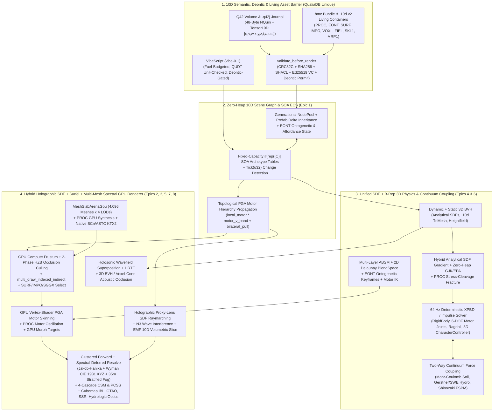

# Master Implementation Plan: Upgrading `QualiaDB` to Superior 3D Game & Simulation Engine Capabilities

**Status:** Definitive Engineering Specification & Execution Plan (v1.1 — Native 10D, Holographic, Procedural & Holosonic Preservation Edition)  
**Date:** 2026-10-20  
**Target Repositories:**
- Primary Engine: [`C:\github\qualiaDB`](file:///C:/github/qualiaDB) (`qualia-core-db`, `qualia-sim`, `webizen-render`, `qualia-audio`, `vibe`, `poet`, `webizen-studio`)
- Reference Engines Audited: [`C:\github\bevy-main`](file:///C:/github/bevy-main) & [`C:\github\Fyrox-master`](file:///C:/github/Fyrox-master)
- Consumer Applications: [`C:\github\ecopunk`](file:///C:/github/ecopunk) & [`C:\github\game-demo`](file:///C:/github/game-demo)

> **Binding Architectural Principle:** Every subsystem in this plan strictly honors [`qualiaDB/AGENTS.md` §0 & §0-A](file:///C:/github/qualiaDB/AGENTS.md#L9-L51) (**Two-Tier Zero-Heap Model**: `HotZeroHeap` for frame-loop evaluation/culling/physics/animation/rendering; `ColdBounded` with explicit byte budgets via `GeometryWorkspace` for asset compilation, BVH construction, and scene loading). Every capability is designed to **match or exceed** `Bevy` and `Fyrox` on standard game-engine benchmarks **by advancing `QualiaDB`'s native 10D, Holographic SDF, Principled Procedural (`.10d` `PROC`/`EONT`/`SURF`/`IMPO`), PGA `Motor`, Spectral, and Holosonic paradigms—never replacing or deprecating them into a conventional B-Rep matrix-and-triangle engine.**

---

## 0. Non-Negotiable Preservation & Advancement of `QualiaDB` Native Methods

Before adopting any capability from `Bevy` or `Fyrox`, this plan enforces a strict architectural covenant: **`QualiaDB`'s existing foundational paradigms are never deprecated, bypassed, or flattened into conventional 3D game-engine patterns.** Instead, every Epic extends and wires these native `QualiaDB` systems into the GPU and simulation hot paths:

| Native `QualiaDB` Method / Subsystem | Source Files Inspected | Why It Exists (Design Intent) | How Epics 1–10 Develop & Advance It (Never Replace It) |
| :--- | :--- | :--- | :--- |
| **1. Holographic 3D Proxy-Lens SDF Raymarching & N3 Wave Interference** | [`docs/Holographic 3D Engine for Semantic Graphs.md`](file:///C:/github/qualiaDB/docs/Holographic%203D%20Engine%20for%20Semantic%20Graphs.md), [`shaders/viewport/holographic.wgsl`](file:///C:/github/qualiaDB/crates/qualia-core-db/src/shaders/viewport/holographic.wgsl), [`render/gpu/holographic.rs`](file:///C:/github/qualiaDB/crates/qualia-core-db/src/render/gpu/holographic.rs), [`shaders/viewport/emf_volumetric.wgsl`](file:///C:/github/qualiaDB/crates/qualia-core-db/src/shaders/viewport/emf_volumetric.wgsl) | Rejects pure "Triangle Quagmire" B-Rep bloat by rendering 12-triangle proxy bounding boxes (`HolographicNodeGpu`, 96B) as "projector lenses" for fragment-shader analytical SDF raymarching (`sdf_sphere`, `sdf_rounded_box`, `sdf_capsule`, metaballs, $C^1$ polynomial `sdf_smooth_union`), tetrahedron normals, N3Logic constructive/destructive wave interference (`evaluate_interference_field` modulated by epistemic certainty $q$), and 4D/5D `EmfFieldCell` volumetric slicing driven by `Epistemic10D`. | **Epics 2, 5 & 6** keep `HolographicPipeline` and `EmfVolumetricPipeline` as first-class passes alongside `MeshSlabArenaGpu`, add `gl_FragDepth` (`@builtin(frag_depth)`) output so raymarched SDFs and smooth-union metaballs cast shadows and depth-interleave seamlessly with `.10d` meshes, and reuse the exact same analytical SDF gradients $\nabla \text{sdf}(\mathbf{x})$ in the 3D physics narrowphase! |
| **2. Principled Mathematical Procedural Synthesis (`MAGIC_PROC` in `.10d`)** | [`container_10d/procedural_synthesis.rs`](file:///C:/github/qualiaDB/crates/qualia-core-db/src/container_10d/procedural_synthesis.rs#L1-L398) | Replaces static megabyte texture/mesh bloat with a 64-byte `ProceduralSynthesisHeader` (`PROC1`) encoding 6 mathematical laws: Cellular Voronoi micro-surfaces (`evaluate_voronoi_cellular_f1`), Implicit SDF smooth-fillets (`evaluate_smooth_minimum_sdf`), Huxley allometric scaling ($y = b \cdot x^k$, `evaluate_allometric_dimension`), logarithmic spirals ($r = a e^{k\theta}$, `evaluate_log_spiral_2d`), PGA motor harmonic oscillations (`evaluate_pga_motor_oscillation`), and principal tensile stress cleavage (`evaluate_stress_cleavage_partition`). | **Epics 2, 3, 5 & 6** upload `ProceduralSynthesisHeader` directly into a GPU storage buffer (`@group(1) @binding(8) var<storage, read> proc_headers: array<ProceduralSynthesisGpu>`) so vertex/fragment shaders evaluate Voronoi bark/rock micro-relief and PGA wind oscillations directly on the GPU, while the Epic 6 physics engine uses `evaluate_stress_cleavage_partition` for real-time dynamic fracture! |
| **3. Embedded Entity Behavioral & Affordance Ontologies (`MAGIC_EONT` in `.10d`)** | [`container_10d/entity_ontology_section.rs`](file:///C:/github/qualiaDB/crates/qualia-core-db/src/container_10d/entity_ontology_section.rs#L1-L406) | Makes every `.10d` asset a self-describing "Living Container" via `EntityOntologyMiniHeader` (40B), `AffordanceBinaryRecord` (48B: `trigger_predicate_hash`, `required_capability_mask`, `target_state_id`, `impulse_magnitude`), and `DevelopmentalKeyframeRecord` (32B: `SeedOrSpore` → `Juvenile` → `Adult` → `Senescent` → `Deceased`, with `allometric_crown_scale`, `allometric_trunk_scale`, `lai_multiplier`). | **Epics 1, 4 & 6** bind `EntityOntologyMiniHeader` directly into `SceneNodeRecord` and `ABSM`, driving continuous ontogenetic growth morphing (`interpolate_ontogenetic_scales`), metabolic state (`energy/damage/hydration/wear_permill`), and deontic-gated `AffordanceBinaryRecord` execution on 3D raycast/collision contact. |
| **4. Multi-Representation `.10d` Sections (`SURF`, `IMPO`, `VOXL`, `FIEL`, `MID2`)** | [`container_10d/surfel_section.rs`](file:///C:/github/qualiaDB/crates/qualia-core-db/src/container_10d/surfel_section.rs), [`impostor_section.rs`](file:///C:/github/qualiaDB/crates/qualia-core-db/src/container_10d/impostor_section.rs), [`voxel_section.rs`](file:///C:/github/qualiaDB/crates/qualia-core-db/src/container_10d/voxel_section.rs), [`field_section.rs`](file:///C:/github/qualiaDB/crates/qualia-core-db/src/container_10d/field_section.rs), [`manifold_identity_v2.rs`](file:///C:/github/qualiaDB/crates/qualia-core-db/src/container_10d/manifold_identity_v2.rs) | `.10d` is a multi-modal spatial representation container—not just a triangle mesh wrapper. It natively stores Gaussian covariance surfels (`MAGIC_SURF`), hemi-octahedral PBR depth-in-alpha impostor atlases (`MAGIC_IMPO`), sparse voxels (`VOXL`), QUDT-typed physical scalar/vector/tensor fields (`FIEL`), and 10D manifold identities (`MID2`). | **Epics 2 & 5** unify all `.10d` representations inside `PortalGpu`'s GPU-driven indirect pipeline: near-field `LOD0..LOD2` meshes + `PROC` SDFs transition seamlessly into `MAGIC_SURF` (`SURFEL_INSTANCED_WGSL`), `SGGX_MICROFLAKE_WGSL`, and `MAGIC_IMPO` hemi-octahedral impostors, while `FIEL` drives GPU continuum shaders. |
| **5. Canonical `Tensor10D` `[q, v, w, x, y, z, t, α, μ, σ]` & Semantic PGA `Motor`s** | [`docs/planning/tech/tensor-10d.md`](file:///C:/github/qualiaDB/docs/planning/tech/tensor-10d.md), [`render/pga.rs`](file:///C:/github/qualiaDB/crates/qualia-core-db/src/render/pga.rs#L1-L320), [`types.rs`](file:///C:/github/qualiaDB/crates/qualia-core-db/src/types.rs) | Every entity has a 10D address (`q`: collapsed truth vs. GSR superposition escrow; `v`: `0`=Euclidean, `1`=Cyclic toroidal, `2`=Hyperbolic taxonomy, `3+`=Sovereign boundary clique; `w`: domain bifurcation; `x,y,z,t,α,σ`: coordinates; `μ`: in-band consent/DID carrier). Transforms use 8-float PGA `Motor`s with `motor_v_band` (`R_toroidal`, `T_radial`, `T_anchor`) and `bilateral_pull_active` (deontic `STANDPOINT_DID` attraction). | **Epic 1 & Epic 3** strictly forbid replacing PGA `Motor`s with $4\times 4$ matrices. `SceneNodeRecord` natively stores `Tensor10D` lane selectors (`q, v, w, α, μ, σ`) and composes `local_motor` with `motor_v_band` and `bilateral_pull_active` during zero-heap hierarchy propagation. |
| **6. Holosonic Acoustic Wavefield Synthesis & `SonicToken`s** | [`docs/Holosonic Engine for Semantic Acoustic Wavefields.md`](file:///C:/github/qualiaDB/docs/Holosonic%20Engine%20for%20Semantic%20Acoustic%20Wavefields.md), [`audio/holosonic.rs`](file:///C:/github/qualiaDB/crates/qualia-core-db/src/audio/holosonic.rs#L1-L370) | Synthesizes continuous physical wave superposition ($P_{\text{total}} = \sum p_i(t, \mathbf{x}_L)$ with phase delay $\Delta\phi_i = \omega_i d_i / c$, constructive/destructive interference, epistemic certainty $q$ harmonic purity modulation, 5 procedural archetypes, and 48-byte `SonicToken` emission) coupled to the exact same SDFs as the visual engine. | **Epic 8** preserves `HolosonicWavefield` as the primary acoustic wave synthesis engine and couples it with the Epic 6 3D BVH + `ACOUSTIC_VOXEL_CONE_WGSL` and HRTF binaural convolution—never downgrading audio to static WAV-clip playback. |
| **7. Spectral Truth (`σ` / Jakob–Hanika SPD) & Stratified Valley Fog** | [`render/spectral_kernel.rs`](file:///C:/github/qualiaDB/crates/qualia-core-db/src/render/spectral_kernel.rs), [`shaders/viewport/spectral.wgsl`](file:///C:/github/qualiaDB/crates/qualia-core-db/src/shaders/viewport/spectral.wgsl), [`render/deferred_resolve.rs`](file:///C:/github/qualiaDB/crates/qualia-core-db/src/render/deferred_resolve.rs) | Treats spectral reflectance/emission ($\sigma$ / SPD) as ground truth and projects to CIE 1931 XYZ $\to$ device gamut only at the final resolve, with height-stratified valley inversion fog ($d_{\text{effective}} = \max(0, d - 35.0)$) to preserve crystal-clear foreground optics. | **Epic 5** wires `DEFERRED_RESOLVE_WGSL` and `SPECTRAL_WGSL` directly into the active GPU frame graph while preserving the 35m foreground clear-air zone and height-stratified Rayleigh/Mie valley fog. |

---

## 1. Architecture Overview: How Upgraded `QualiaDB` Surpasses `Bevy` and `Fyrox`



---

## 2. Target-State Comparison Matrix (`Bevy` vs. `Fyrox` vs. `QualiaDB` Current vs. `QualiaDB` Target)

| Capability | `Bevy` (`bevy-main`) | `Fyrox` (`Fyrox-master`) | `QualiaDB` Current (Audited) | `QualiaDB` Target (After Epics 1–10) |
| :--- | :--- | :--- | :--- | :--- |
| **Spatial & Coordinate Foundation** | 3D Euclidean `Transform` (`Mat4` / `Affine3A`). | 3D Euclidean `Mat4` local/global transform. | **10D `Tensor10D` `[q,v,w,x,y,z,t,α,μ,σ]`** + 8-float PGA `Motor` (`motor_v_band`, `bilateral_pull`). | **Preserved & Wired End-to-End:** 10D `Tensor10D` selector/coordinate lanes + PGA `Motor` composition (`local_motor * motor_v_band` + deontic `bilateral_pull`) across the entire scene graph and GPU pipeline (**Epic 1**). |
| **Geometric Representation Paradigm** | B-Rep triangles + experimental `Meshlet`. | B-Rep triangles + heightfield terrain. | **Hybrid Holographic Proxy-Box SDF (`holographic.wgsl`) + `.10d` `PROC`/`SURF`/`IMPO`/`VOXL` + B-Rep**, but `PortalGpu` only has 1 `MeshGpu` slot. | **Unified Hybrid Multi-Representation Pipeline:** `HolographicPipeline` (analytical SDFs + N3 wave interference + `@builtin(frag_depth)`), `EmfVolumetricPipeline`, GPU `PROC1` synthesis, `SURF` Gaussian surfels, `IMPO` octahedral impostors, and `MeshSlabArenaGpu` (4,096 B-Rep meshes × 4 LODs) (**Epics 2 & 5**). |
| **Scene / Entity Storage** | Heap SOA `Table` + `SparseSet` ECS, `Tick` change detection, `bsn!`. | Generational `Pool<Node>` + `InheritableVariable<T>` prefab delta inheritance. | Disconnected `BTreeMap<String, SceneNode>`; `.10d` `EONT1` ontogenetic/affordance records not wired to scene graph. | **Zero-Heap Generational `NodePool` + Fixed-Arena SOA `Table`s** with `Tick(u32)` change detection, `InheritableField<T>` prefab deltas, `EONT1` ontogenetic/affordance bindings, and $O(1)$ 60-bit `NQuin` entity binding (**Epic 1**). |
| **Skeletal Skinning, Procedural Motion & Morphs** | GPU vertex skinning (`SkinUniforms`) + GPU morph targets (`morph.wesl`). | GPU vertex skinning + 3D `f16` texture blend shapes. | 100% CPU `f64` `skin_vertices_into` + CPU tangents + 3× `queue.write_buffer` per frame; `PROC1` motor oscillations CPU-only. | **GPU Vertex-Shader PGA `Motor` Dual-Quaternion Skinning** (`JOINTS_0`/`WEIGHTS_0` + `RigMotorPaletteBuffer`) + **GPU `PROC1` PGA Motor Harmonic Oscillation** + GPU Morph Target deltas (**Epic 3**). |
| **Animation State Machine, Ontogeny & IK** | `AnimationGraph` DAG, 64-bit bone masks, transitions, observer events. | `ABSM` (multi-layer bone masks, 2D Delaunay `BlendSpace`, `RootMotion`, boolean transitions). | 1 clip + 1 cross-fade; unconstrained point-array `ccd_ik`; `EONT1` `DevelopmentalKeyframeRecord` evaluated standalone. | **Zero-Heap Multi-Layer ABSM** (128-bit bone masks, 2D Delaunay `BlendSpace`, `RootMotionDelta`) + **`EONT1` Ontogenetic Keyframe Growth Morphing** + **Analytical 2-Bone & Constrained Motor FABRIK IK** (**Epic 4**). |
| **Lighting, Shadows & Spectral Rendering** | Clustered PBR, 4-cascade CSM + point/spot PCSS, `bevy_solari` ReSTIR GI, SSR, GTAO. | 5-RT G-Buffer Deferred PBR, 3-cascade CSM + point cubemap + spot shadows, cubemap IBL, SSAO. | Forward-only; 1 directional sun (2 cascades); 4 scalar RGB uniform probes; `DEFERRED_RESOLVE_WGSL` & `CLUSTER_LIGHT_WGSL` unwired; WASM HDR disabled. | **Hybrid Clustered Forward + Active GPU Spectral Deferred Resolve** (Jakob-Hanika + Wyman 4-hero-wavelength CIE XYZ + 35m foreground-clear stratified valley fog), 256 clustered lights, 4-cascade CSM + point/spot PCSS, GPU Cubemap IBL, GTAO, SSR, Refractive Water, WASM WebGPU HDR/Bloom (**Epic 5**). |
| **3D Physics, SDF Collision & Continuum Coupling** | External (`avian3d` / `bevy_rapier3d`); built-in `MeshRayCast`. | Built-in `rapier3d`/`rapier2d` (`RigidBody`, `Collider`, `Joint`, `Ragdoll`, `KinematicCharacterController`). | **No 3D solver.** Only 2D `(x, z)` heightfield closures in `qualia-sim`, AABB bounds check, and standalone `PROC1` stress-cleavage math. | **Built-in Zero-Heap Hybrid SDF + B-Rep 3D Physics Engine** (Dynamic/Static BVH, exact analytical SDF gradient $\nabla\text{sdf}$ contacts + GJK/EPA narrowphase, `PROC1` tensile stress-cleavage fracture, 64 Hz XPBD solver, 6-DOF Motor joints, `Ragdoll`, 3D `KinematicCharacterController`) + **2-Way Soil/Hydro/Botanical Continuum Coupling** (**Epic 6**). |
| **glTF / GLB, `.10d` Living Compiler & Compressed Textures** | Full `GltfLoader` (12 extensions) + KTX2/Basis UASTC/ETC1S + DDS/HDR/EXR. | Full FBX & glTF hierarchy/skin/anim loader + compressed textures. | `glb.rs` flattens static mesh only (drops nodes/skins/anims/morphs); `texture_transcode.rs` fakes BC7 Modes 0–5/7, ETC2, ASTC. | **Full Hierarchical GLB → `.10d`/`.hmc` Living Container Compiler** (nodes, `SKL1` skins, PGA motor clips, `MRP1` morphs, `PROC1` & `EONT1` sections) + **Direct `wgpu` BCn/ASTC/ETC2 Upload & Full-Spec BasisLZ/BC7 Transcoder** (**Epic 7**). |
| **3D Spatial Audio & Holosonic Wavefields** | Basic `rodio` spatial sink. | IRCAM `.hrir` FFT HRTF binaural + Freeverb `AudioBusGraph` + streaming OGG. | Zero-heap `HolosonicWavefield` (continuous wave superposition + `SonicToken`s) & `hrtf.rs`, not wired to 3D scene occlusion. | **Scene-Synchronized 3D Holosonic Wavefield & HRTF Audio Graph** sharing SDFs with the visual/physics engine + BVH raycast & `ACOUSTIC_VOXEL_CONE_WGSL` occlusion (**Epic 8**). |
| **UI, Layout & Editor Tooling** | `taffy` Flexbox/Grid `bevy_ui` + `bevy_feathers` + `bevy_inspector` + BRP. | 50+ widgets `fyrox-ui` + full `FyroxEd` WYSIWYG editor + Undo/Redo + `.dll` hot-reload. | `ZeroHeapUiCanvas` (128 rects, no font/text layout); relies on external Dioxus DOM. | **Zero-Heap Flexbox/Grid Layout + GPU MSDF Font Atlas** in `ZeroHeapUiCanvas` + **3D PGA Motor Gizmos, Undo/Redo Command Stack & Live 10D/NQuin/EONT/ABSM Inspector** in `webizen-studio` (**Epic 9**). |
| **WASM Streaming & Multi-Threading** | Async `AssetServer` + `ComputeTaskPool`. | Async `ResourceManager` + background terrain/lightmap threads. | Whole-file 29 MB `.hmc` fetch + 12s main-thread stall; `LocalHost` empty SPARQL stub on WASM. | **Byte-Backed WASM `.q42`/`Q42LEX` Host Seam + HTTP Range/OPFS `.hmc` Streaming + Webizen-Governed Worker Pool** (**Epic 10**). |

---

## 3. Detailed Engineering Specification by Epic

### Epic 1: Zero-Heap Hybrid Generational 10D Scene Graph, `EONT1` Living Ontology Binding & Archetype Table ECS
**Target Crate & Paths:**
- `C:\github\qualiaDB\crates\qualia-core-db\src\render\scene_graph\` (`mod.rs`, `pool.rs`, `hierarchy.rs`, `prefab.rs`, `transform_sync.rs`, `ontology_binding.rs`)
- `C:\github\qualiaDB\crates\qualia-sim\src\ecs\` (`mod.rs`, `table.rs`, `tick.rs`, `query.rs`)

**Current Deficit:**
[`render/scene_graph/node.rs`](file:///C:/github/qualiaDB/crates/qualia-core-db/src/render/scene_graph/node.rs#L10-L341) uses `BTreeMap<String, SceneNode>` with heap `String` keys, formats lights as debug strings into `node.metadata` ([`light.rs:119-131`](file:///C:/github/qualiaDB/crates/qualia-core-db/src/render/scene_graph/light.rs#L119-L131)), never computes hierarchical world transforms, never connects `.10d` `EntityOntologyMiniHeader` (`EONT1`) or `Tensor10D` (`[q, v, w, x, y, z, t, α, μ, σ]`) lanes to scene nodes, and never talks to `PortalGpu`.

**Engineering Design:**
1. **Generational `NodePool` & `NodeHandle` (`render/scene_graph/pool.rs`):**
   - Implement a fixed-capacity, caller/arena-backed generational pool (combining Fyrox's [`Pool<T>`](file:///C:/github/Fyrox-master/fyrox-core/src/pool/mod.rs#L69-L76) handle ergonomics with `QualiaDB`'s 10D tensor and PGA motor substrate):
     ```rust
     #[repr(C)]
     #[derive(Clone, Copy, Debug, PartialEq, Eq, Hash, bytemuck::Pod, bytemuck::Zeroable)]
     pub struct NodeHandle {
         pub index: u32,
         pub generation: u32, // 0 = INVALID_GENERATION
     }
     ```
   - Each `SceneNodeRecord` (`#[repr(C)]`, 192 bytes, 3 cache lines) stores:
     - **10D Semantic & Deontic Identity:** `quin_token: u64` (60-bit `NQuin` entity hash or bit-63 `did:q42` topological pointer), `tensor_selectors: [u8; 4]` (`q` epistemic superposition/escrow state, `v` topological band `0=Euclidean, 1=Cyclic, 2=Hyperbolic, 3+=SovereignClique`, `w` domain bifurcation, `deontic_lane`), `epistemic_q: f32`, `alpha_salience: f32`, `mu_carrier: u32`, `sigma_spectral: f32`.
     - **Intrusive Sibling-Tree Hierarchy:** `parent: NodeHandle`, `first_child: NodeHandle`, `next_sibling: NodeHandle`, `prev_sibling: NodeHandle`, `hierarchy_depth: u16` — zero `Vec<String>` allocations!
     - **PGA `Motor` Transforms (Never $4\times 4$ Matrices):** `local_motor: Motor` (8 × `f32` PGA motor), `local_scale: [f32; 3]`, `world_motor: Motor`, `world_scale: [f32; 3]`.
     - **Change Detection Ticks:** `added_tick: u32`, `changed_tick: u32` (inspired by Bevy's [`Tick`](file:///C:/github/bevy-main/crates/bevy_ecs/src/change_detection/tick.rs)).
     - **Multi-Representation & Living Ontology Handles:** `node_kind: NodeKind` (`MeshBRep`, `HolographicSdf`, `Procedural10d`, `SurfelCloud`, `VolumetricEmf`, `Light`, `Camera`, `AudioHolosonic`, `Joint`), `mesh_handle: MeshHandle`, `proc_header_handle: u16` (`MAGIC_PROC`), `eont_handle: u16` (`MAGIC_EONT`), `material_id: u16`, `rig_handle: RigHandle`, `collider_handle: ColliderHandle`, `light_handle: LightHandle`, `audio_emitter_handle: AudioEmitterHandle`, `visibility_flags: u16`.
2. **`MAGIC_EONT` Living Ontology & Affordance Binding (`render/scene_graph/ontology_binding.rs`):**
   - Directly wire [`container_10d/entity_ontology_section.rs`](file:///C:/github/qualiaDB/crates/qualia-core-db/src/container_10d/entity_ontology_section.rs#L118-L406) (`EntityOntologyMiniHeader`, `AffordanceBinaryRecord`, `DevelopmentalKeyframeRecord`) into the scene graph:
   - Each living entity node tracks its live `DevelopmentalStage` (`SeedOrSpore`, `Juvenile`, `Adult`, `Senescent`, `Deceased`), metabolic permills (`energy_permill`, `damage_permill`, `hydration_permill`, `wear_permill`), and calls `interpolate_ontogenetic_scales` + [`evaluate_allometric_dimension`](file:///C:/github/qualiaDB/crates/qualia-core-db/src/container_10d/procedural_synthesis.rs#L221-L238) ($y = b \cdot x^k$) to modulate `local_scale` (trunk/crown allometry and LAI multiplier) without duplicating mesh assets.
   - Expose `dispatch_affordance(node_handle, predicate_hash, actor_capabilities)` so player/agent interaction rays and physical contacts trigger the `.10d` asset's embedded `AffordanceBinaryRecord`s (gated by `required_capability_mask` and deontic permission).
3. **Prefab Property Inheritance (`render/scene_graph/prefab.rs`):**
   - Implement `InheritableField<T>` (inspired by Fyrox's [`InheritableVariable<T>`](file:///C:/github/Fyrox-master/fyrox-core/src/variable.rs#L43-L54)) using a 64-bit `modified_mask: u64` per node record so `.hmc` variant instances inherit unmodified fields from their parent `.10d` archetype in $O(1)$ without duplicating untouched properties.
4. **Topological PGA `Motor` + `motor_v_band` + `bilateral_pull` Propagation (`render/scene_graph/transform_sync.rs`):**
   - Maintain a flat depth-sorted index array (`topological_order: &mut [u32]`).
   - In `propagate_transforms_zero_heap`, iterate depth-first; if `parent.changed_tick >= frame_tick || self.changed_tick >= frame_tick`:
     1. Compose hierarchical PGA motor: `let base_motor = parent.world_motor.motor_mul(&self.local_motor);`
     2. Apply native `QualiaDB` 10D topological band motor [`motor_v_band(self.v, self.sigma_spectral, time)`](file:///C:/github/qualiaDB/crates/qualia-core-db/src/render/pga.rs#L194-L214) when `v >= 1` (cyclic toroidal rotation, hyperbolic hierarchy depth, or sovereign boundary-clique lattice).
     3. Apply deontic bilateral standpoint pull [`bilateral_pull_active` / `pull_vector`](file:///C:/github/qualiaDB/crates/qualia-core-db/src/render/pga.rs#L222-L249) when `deontic_lane == DEONTIC_LANE_BILATERAL`.
     4. Emit an updated `GpuInstanceRecord` (for B-Rep/Surfel/Impostor nodes) or `HolographicNodeGpu` (for Holographic SDF nodes) into `PortalGpu`.
5. **Verification Gate:**
   - Unit + `zero_heap_tests` proving 10,000 hierarchical 10D nodes (including `v`-band motors, `bilateral_pull`, and `EONT1` allometric scaling) propagate world `Motor`s and sync dirty GPU records with **0 bytes** of heap allocation (`assert_zero_alloc`).

---

### Epic 2: Hybrid Multi-Modal GPU Residency (`MeshSlabArenaGpu` + Holographic Proxy-Lens SDFs + `.10d` `PROC`/`SURF`/`IMPO`), Indirect Culling & 4-Tier LOD Pipeline
**Target Crate & Paths:**
- `C:\github\qualiaDB\crates\qualia-core-db\src\render\gpu\mesh_slab.rs` (new)
- `C:\github\qualiaDB\crates\qualia-core-db\src\render\gpu\indirect_cull.rs` (new)
- `C:\github\qualiaDB\crates\qualia-core-db\src\render\gpu\holographic.rs`
- `C:\github\qualiaDB\crates\qualia-core-db\src\render\gpu\mod.rs`
- `C:\github\qualiaDB\crates\qualia-core-db\src\render\gpu\portal_gpu\render_frame.rs`
- `C:\github\qualiaDB\crates\qualia-core-db\src\render\instance_culling.rs`

**Current Deficit:**
[`PortalGpu`](file:///C:/github/qualiaDB/crates/qualia-core-db/src/render/gpu/mod.rs#L484) holds only a single `pub(super) mesh: Option<MeshGpu>`. Every B-Rep scene asset must be merged on the CPU (`SceneMeshAccum`), instance culling runs on the CPU ([`instance_culling.rs:215-291`](file:///C:/github/qualiaDB/crates/qualia-core-db/src/render/instance_culling.rs#L215-L291)), and `.10d` `MAGIC_PROC` (`ProceduralSynthesisHeader`), `MAGIC_SURF` (`SurfelSection`), and `MAGIC_IMPO` (`ImpostorSection`) are not unified with `HolographicPipeline` in the GPU culling/LOD loop.

**Engineering Design:**
1. **`MeshSlabArenaGpu` + Multi-Modal `.10d` Residency (`render/gpu/mesh_slab.rs`):**
   - Allocate unified GPU vertex/attribute/index slabs (`position_slab`, `normal_slab`, `tangent_slab`, `uv_slab`, `joint_weight_slab`, `index_slab`) managed by a zero-heap sub-allocator (`MAX_RESIDENT_MESHES = 4,096`, inspired by Bevy's [`MeshAllocator`](file:///C:/github/bevy-main/crates/bevy_render/src/mesh/allocator.rs)), **plus** dedicated GPU storage buffers for `.10d`'s native non-B-Rep sections:
     - `proc_synthesis_buffer`: array of 64-byte [`ProceduralSynthesisHeader`](file:///C:/github/qualiaDB/crates/qualia-core-db/src/container_10d/procedural_synthesis.rs#L106-L133) (`MAGIC_PROC`) records for GPU-evaluated Voronoi cellular relief, SDF smooth-fillets, logarithmic spirals, and PGA motor harmonic oscillations.
     - `holographic_node_buffer`: array of 96-byte [`HolographicNodeGpu`](file:///C:/github/qualiaDB/crates/qualia-core-db/src/render/gpu/holographic.rs#L53-L64) proxy-bounding-box lenses for analytical SDF raymarching and N3 wave interference.
     - `surfel_cloud_slab`: GPU storage buffer for `.10d` [`MAGIC_SURF`](file:///C:/github/qualiaDB/crates/qualia-core-db/src/container_10d/surfel_section.rs) Gaussian covariance surfels rendered via `SURFEL_INSTANCED_WGSL`.
     - `impostor_atlas_array`: GPU texture array for `.10d` [`MAGIC_IMPO`](file:///C:/github/qualiaDB/crates/qualia-core-db/src/container_10d/impostor_section.rs) hemi-octahedral PBR depth-in-alpha impostor views.
   - Each `ResidentAssetEntry` stores up to **4 representation/LOD tiers**:
     - `LOD0`: Analytical Holographic SDF (`HolographicNodeGpu` + `PROC1` smooth-minimum SDF) **or** full-detail `.10d` mesh + `PROC1` Voronoi micro-surface displacement.
     - `LOD1` & `LOD2`: QEM-decimated meshes produced by [`render/lod_chain.rs`](file:///C:/github/qualiaDB/crates/qualia-core-db/src/render/lod_chain.rs) with `PROC1` procedural surface detail preserved in the fragment shader.
     - `LOD3`: Native `.10d` far-field representation — `MAGIC_SURF` (`SURFEL_INSTANCED_WGSL`), `SGGX_MICROFLAKE_WGSL` (anisotropic canopy volume), or `MAGIC_IMPO` (`ImpostorAtlasSpec` hemi-octahedral impostor).
2. **GPU Compute Culling, Multi-Representation LOD Selection & 2-Phase HZB Occlusion (`render/gpu/indirect_cull.rs`):**
   - Extend `GpuInstanceRecord` (64 bytes, 16-byte aligned) to include `asset_handle: u32`, `material_id: u16`, `rep_policy: u16` (B-Rep / HolographicSDF / Surfel / Impostor), `rig_offset: u32`, `proc_header_idx: u16`, `eont_stage_flags: u16`, `semantic_id_lo: u32`, `semantic_id_hi: u32`.
   - Wire [`TILE_COMPACTION_WGSL`](file:///C:/github/qualiaDB/crates/qualia-core-db/src/shaders/viewport/tile_compaction.wgsl) + `instance_cull_indirect.wgsl` compute pass that:
     1. Tests each instance's world OBB/bounding sphere (expanded by any `PROC1` PGA motor oscillation amplitude) against the 6 camera frustum planes and the previous frame's **Hierarchical Z-Buffer (HZB) depth pyramid** (`scene_depth.rs`).
     2. Modulates visibility and LOD priority by `Tensor10D` salience $\alpha$ and epistemic certainty $q$ (`q > 0` superposition nodes automatically route to `HolographicPipeline` with shimmer/interference active).
     3. Computes projected screen-space radius $r_{\text{screen}}$ and routes visible instances into indirect draw streams for `LOD0..LOD2` meshes, `HolographicPipeline` 12-triangle proxy boxes, `SURFEL_INSTANCED_WGSL`, or `MAGIC_IMPO` octahedral impostor quads.
   - In `render_frame.rs`, replace single-mesh draw loops with `pass.draw_indexed_indirect` / `multi_draw_indexed_indirect`.
3. **Verification Gate:**
   - Render 50,000 heterogeneous instances across 256 distinct `.10d` assets (combining Holographic SDF lenses, `PROC1` procedural meshes, `SURF` surfel clouds, and `IMPO` octahedral impostors) with <0.2 ms CPU submission time.

---

### Epic 3: Hardware GPU Vertex-Shader PGA Dual-Quaternion Skinning, GPU `PROC1` Motor Oscillations & GPU Morph Targets
**Target Crate & Paths:**
- `C:\github\qualiaDB\crates\qualia-core-db\src\render\skeletal\gpu_skin.rs` (new)
- `C:\github\qualiaDB\crates\qualia-core-db\src\render\skeletal\player.rs`
- `C:\github\qualiaDB\crates\qualia-core-db\src\render\gpu\animated_upload.rs`
- `C:\github\qualiaDB\crates\qualia-core-db\src\shaders\viewport\mesh.wgsl`
- `C:\github\qualiaDB\crates\qualia-core-db\src\shaders\viewport\sun_shadow.wgsl`
- `C:\github\qualiaDB\crates\qualia-core-db\src\shaders\viewport\ao_prepass.wgsl`

**Current Deficit:**
[`SkeletalPlayer::advance`](file:///C:/github/qualiaDB/crates/qualia-core-db/src/render/skeletal/player.rs#L347-L430) deforms every vertex on the CPU in `f64` ([`skin.rs:14-90`](file:///C:/github/qualiaDB/crates/qualia-core-db/src/render/skeletal/skin.rs#L14-L90)), recomputes tangents on the CPU, and uploads 3 full vertex buffers per frame via `queue.write_buffer` ([`animated_upload.rs:7-73`](file:///C:/github/qualiaDB/crates/qualia-core-db/src/render/gpu/animated_upload.rs#L7-L73)). Meanwhile, [`evaluate_pga_motor_oscillation`](file:///C:/github/qualiaDB/crates/qualia-core-db/src/container_10d/procedural_synthesis.rs#L279-L315) (`PROC1` harmonic wind/breathing/current motor fields) only has a CPU evaluator.

**Engineering Design:**
1. **Static Skinning Vertex Attributes:**
   - Store packed `joints_0: [u16; 4]` (`VertexFormat::Uint16x4`) and `weights_0: [f32; 4]` (`VertexFormat::Float32x4`) once at mesh upload time in `MeshSlabArenaGpu`.
2. **GPU `RigMotorPaletteBuffer` (`render/skeletal/gpu_skin.rs`):**
   - Instead of skinning vertices on the CPU, `SkeletalPlayer::advance_pose_only` computes only the world PGA `Motor` palette (`[Motor; 128]` = 4,096 bytes per skeleton) on the CPU (or via [`PGA_SCLERP_EVAL_WGSL`](file:///C:/github/qualiaDB/crates/qualia-core-db/src/shaders/mod.rs#L9) on the GPU for crowds).
   - Upload current and previous frame `Motor` palettes into a double-buffered storage buffer (`@group(2) @binding(1) var<storage, read> rig_motors_current: array<vec4<f32>>;` and `rig_motors_prev`) using `PortalGpu::uniform_belt` (zero staging allocations).
3. **PGA Motor Dual-Quaternion Skinning + `PROC1` Harmonic Motor Oscillation in `mesh.wgsl`, `sun_shadow.wgsl`, and `ao_prepass.wgsl`:**
   - In the vertex shader:
     - When `instance.rig_offset != 0xFFFFFFFFu`: blend the 4 influencing joint `Motor`s ($M = \sum_{k=0}^3 w_k \text{sign}(M_0 \cdot M_{j_k}) M_{j_k}$), normalize the blended motor, and apply the PGA sandwich product $\mathbf{p}' = M \mathbf{p} \widetilde{M}$, $\mathbf{n}' = R \mathbf{n} \widetilde{R}$, $\mathbf{t}' = R \mathbf{t} \widetilde{R}$ in a single register-resident pass!
     - When `instance.proc_header_idx != 0xFFFFu` and `PROC_FLAG_MOTOR_OSCILLATION` is set in the `.10d` `ProceduralSynthesisHeader`: evaluate the GPU counterpart of [`evaluate_pga_motor_oscillation`](file:///C:/github/qualiaDB/crates/qualia-core-db/src/container_10d/procedural_synthesis.rs#L279-L315) ($\theta(t, \phi) = A \sin(2\pi f t + \phi) e^{-\gamma t}$) so botanical branches, reeds, feathers, and cloth undergo physically parameterized PGA rotor oscillation in the vertex shader with zero CPU bone overhead.
     - Evaluate $\mathbf{p}_{\text{prev}} = M_{\text{prev}} \mathbf{p} \widetilde{M}_{\text{prev}}$ to output exact per-vertex motion vectors for Temporal Anti-Aliasing (`TEMPORAL_MOTION_WGSL`).
4. **GPU Morph Target Storage (`render/skeletal/gpu_morph.rs`):**
   - Pack morph target position/normal deltas into a GPU storage buffer (or `Rgba16Float` 2D array texture on WebGL2 fallback) driven by per-instance morph weights **and** `EONT1` ontogenetic/damage/wilting permills (`damage_permill`, `hydration_permill`).
   - Retain `skin_vertices_into` in `skin.rs` strictly as a deterministic CPU oracle for unit tests and collision-mesh snapshots.
5. **Verification Gate:**
   - Animate 500 independent 64-joint skinned fauna/character instances + 10,000 `PROC1` motor-oscillating flora instances at 60+ FPS with zero per-frame vertex buffer uploads and exact pose parity against the CPU `skin_vertices_into` oracle.

---

### Epic 4: Multi-Layer Animation Blending State Machine (ABSM), `EONT1` Ontogenetic Keyframes, 2D Delaunay Blend Spaces, Root Motion & Constrained Motor IK
**Target Crate & Paths:**
- `C:\github\qualiaDB\crates\qualia-core-db\src\render\skeletal\absm.rs` (new)
- `C:\github\qualiaDB\crates\qualia-core-db\src\render\skeletal\blend_space.rs` (new)
- `C:\github\qualiaDB\crates\qualia-core-db\src\render\skeletal\ik_motor.rs` (new)
- `C:\github\qualiaDB\crates\qualia-sim\src\animation.rs`

**Current Deficit:**
`SkeletalPlayer` and `qualia-sim::animation::AnimationStateMachine` only support 1 active clip and 1 linear cross-fade. [`render/scene_graph/ik.rs`](file:///C:/github/qualiaDB/crates/qualia-core-db/src/render/scene_graph/ik.rs#L91-L137) is an unconstrained position-only `ccd_ik` that allocates a `Vec<[f32; 3]>` and is disconnected from `Motor` skeletons.

**Engineering Design:**
1. **Multi-Layer ABSM (`render/skeletal/absm.rs`):**
   - Modeled on Fyrox's [`Machine<T>`](file:///C:/github/Fyrox-master/fyrox-animation/src/machine/mod.rs#L192-L205) and Bevy's [`AnimationGraph`](file:///C:/github/bevy-main/crates/bevy_animation/src/graph.rs#L115), implemented with **zero heap allocations**:
   - Up to `MAX_ABSM_LAYERS = 8` layers per character, each carrying:
     - `mask: u128` (1 bit per joint up to `MAX_JOINTS = 128`, constructed from any bone subtree via `BoneLayerMask::from_hierarchy`).
     - `blend_mode: LayerBlendMode::{Override, Additive}`.
     - `weight: f32`.
     - State graph (`MAX_STATES = 32`, `MAX_TRANSITIONS = 64`) with boolean/threshold condition trees over fixed parameter slots (`Parameter::{Bool, Float, Int, Vec2}`).
     - Native integration with `.10d` `EONT1` [`DevelopmentalKeyframeRecord`](file:///C:/github/qualiaDB/crates/qualia-core-db/src/container_10d/entity_ontology_section.rs#L99-L115) and metabolic state (`energy_permill`, `damage_permill`, `hydration_permill`), automatically modulating locomotion cadence, posture droop, and gait blend weights as an organism ages or fatigues.
     - Timeline `AnimationSignal` events (`footstep_left`, `footstep_right`, `vocalize`, `tool_contact`) emitted into a fixed ring buffer that triggers `HolosonicWavefield` `SonicToken`s and physics impulses.
2. **1D & 2D Delaunay Blend Spaces (`render/skeletal/blend_space.rs`):**
   - Modeled on Fyrox's [`BlendSpace<T>`](file:///C:/github/Fyrox-master/fyrox-animation/src/machine/node/blendspace.rs#L129-L225), backed by `qualia-core-db::specialized_libs::computational_geometry::delaunay_2`:
   - Cold-build the 2D Delaunay triangulation over sample points `(speed, turn_angle)` or `(move_x, move_z)`.
   - Hot-path (`HotZeroHeap`): locate the enclosing triangle in $O(N)$ (for $N \le 16$ clips) and blend the 3 vertex poses using barycentric `Motor::sclerp` weights.
3. **Root Motion Extraction:**
   - Extract `RootMotionDelta { delta_translation: [f32; 3], delta_rotor: [f32; 4] }` from the designated root joint on clip wrap-around and transitions, zeroing out the visual root bone's horizontal drift and feeding the delta into `CharacterController`.
4. **Analytical Two-Bone IK & Constrained Motor FABRIK (`render/skeletal/ik_motor.rs`):**
   - **Analytical Two-Bone Motor IK:** Exact closed-form law-of-cosines + pole-vector plane alignment operating directly on hip/knee/ankle or shoulder/elbow/wrist `Motor`s for terrain foot placement and hand-to-tool grasping.
   - **Constrained Motor FABRIK:** Zero-heap stack-array (`[Motor; 16]`) FABRIK with swing-twist rotor cone and hinge angle clamping (for quadruped spines, necks, tails, and pentapedal kangaroo locomotion).

---

### Epic 5: Wiring the Active Spectral Deferred, Holographic SDF Depth-Interleaving, `PROC1` Surface Shaders, Clustered Lighting, Cubemap IBL & Hydrologic Optics Passes
**Target Crate & Paths:**
- `C:\github\qualiaDB\crates\qualia-core-db\src\render\gpu\portal_gpu\render_frame.rs`
- `C:\github\qualiaDB\crates\qualia-core-db\src\render\gpu\portal_gpu\lighting_passes.rs`
- `C:\github\qualiaDB\crates\qualia-core-db\src\render\gpu\holographic.rs`
- `C:\github\qualiaDB\crates\qualia-core-db\src\render\gpu\emf_pipeline.rs`
- `C:\github\qualiaDB\crates\qualia-core-db\src\render\gpu\bloom.rs`
- `C:\github\qualiaDB\crates\qualia-core-db\src\render\gpu\ibl_cubemap.rs` (new)
- `C:\github\qualiaDB\crates\qualia-core-db\src\shaders\viewport\` (`holographic.wgsl`, `emf_volumetric.wgsl`, `cluster_light.wgsl`, `deferred_resolve.wgsl`, `hydrologic_optics.wgsl`, `foliage_lod.wgsl`, `sggx_microflake.wgsl`)

**Current Deficit:**
8 advanced viewport WGSL shaders in [`shaders/viewport/mod.rs:35-49`](file:///C:/github/qualiaDB/crates/qualia-core-db/src/shaders/viewport/mod.rs#L35-L49) are unwired; `HOLOGRAPHIC_WGSL` raymarches SDFs inside proxy boxes without writing `@builtin(frag_depth)` to intersect cleanly with deferred/shadow depth buffers; environment probes are 4 scalar RGB uniforms; directional shadows have only 2 cascades and no point/spot shadows; [`bloom.rs:21-31`](file:///C:/github/qualiaDB/crates/qualia-core-db/src/render/gpu/bloom.rs#L21-L31) disables HDR and bloom on `wasm32`.

**Engineering Design:**
1. **Unblock WebGPU HDR & Bloom on `wasm32` (`render/gpu/bloom.rs:21-31`):**
   - Remove the unconditional `#[cfg(target_arch = "wasm32")] return false;` in `probe_hdr_format`. Enable `Rgba16Float` HDR scene targets, 4-pass Kawase / dual-filter mip-chain bloom, and ACES/AgX/Khronos PBR Neutral tonemapping on all WebGPU browser adapters that support float16 render attachments.
2. **Advance `HOLOGRAPHIC_WGSL`, `EMF_VOLUMETRIC_WGSL` & `PROC1` GPU Surface Synthesis:**
   - Upgrade [`holographic.wgsl`](file:///C:/github/qualiaDB/crates/qualia-core-db/src/shaders/viewport/holographic.wgsl#L230-L316) so the fragment shader outputs `@builtin(frag_depth)` computed from the exact raymarched hit point `hit_pos = ray_origin + ray_dir * t` projected through `globals.view_proj`, plus octahedral G-Buffer normal and spectral wavelength $\sigma$ (`phase_to_sigma`). This allows analytical SDF primitives, `sdf_smooth_union` metaball blends, and N3 wave-interference fields (`evaluate_interference_field`) to cast shadows, receive clustered lighting, and depth-interleave at sub-pixel accuracy with `.10d` B-Rep meshes!
   - Wire `PROC1` [`evaluate_voronoi_cellular_f1`](file:///C:/github/qualiaDB/crates/qualia-core-db/src/container_10d/procedural_synthesis.rs#L140-L185) and [`evaluate_smooth_minimum_sdf`](file:///C:/github/qualiaDB/crates/qualia-core-db/src/container_10d/procedural_synthesis.rs#L194-L214) directly into the material fragment evaluation so `.10d` assets with `PROC_FLAG_CELLULAR_VORONOI` or `PROC_FLAG_SMOOTH_SDF` synthesize resolution-independent cellular bark, cracked mud, and desert varnish micro-normals without 4K texture bloat.
   - Keep `EmfVolumetricPipeline` (`emf_volumetric.wgsl` driven by `Epistemic10D` / `ManifoldCoordinate10D`) wired in `PortalGpu` for 4D/5D electromagnetic, acoustic, and soil-moisture field visualization.
3. **Wire Froxel Clustered Lighting (`CLUSTER_LIGHT_WGSL`) & 4-Cascade CSM + Point/Spot Shadow Atlas:**
   - Wire `CLUSTER_LIGHT_WGSL` as an active compute prepass before the main scene pass, binning up to `MAX_CLUSTERED_LIGHTS = 256` (`PointLight`, `SpotLight`, `RectLight`) and `MAX_REFLECTION_PROBES = 16` into a $16 \times 9 \times 24$ 3D froxel grid.
   - Upgrade `SHADOW_CASCADE_COUNT` from `2` to `4` in [`render/gpu/shadows.rs`](file:///C:/github/qualiaDB/crates/qualia-core-db/src/render/gpu/shadows.rs#L13) with cascade overlap dithering, Jimenez spiral PCF / PCSS blocker search, and a 2048×2048 shadow atlas for local spot/point lights + screen-space contact shadows.
4. **Wire Active GPU Spectral Deferred Resolve (`DEFERRED_RESOLVE_WGSL` + `SPECTRAL_WGSL`):**
   - Connect `DEFERRED_RESOLVE_WGSL` into `PortalGpu` for `OperationalMode::Full`: render opaque B-Rep and Holographic SDF geometry into a compact G-Buffer (Albedo/Spectral coefficients $\sigma$, Octahedral Normal + Roughness, Metallic/F0/Subsurface/Clearcoat, Depth + Motion Vectors) and execute the Jakob & Hanika (2019) spectral upsampling + Wyman (2013) 4-hero-wavelength CIE 1931 XYZ resolve pass on the GPU—preserving the 35m foreground clear-air zone and height-stratified valley inversion fog ([`deferred_resolve.rs:344-396`](file:///C:/github/qualiaDB/crates/qualia-core-db/src/render/deferred_resolve.rs#L344-L396)).
5. **GPU Cubemap IBL, GTAO & Screen-Space Reflections (SSR) (`render/gpu/ibl_cubemap.rs`):**
   - Generate a dynamic sky/environment cubemap from `SKY_WGSL`, convolve diffuse irradiance and 5-mip GGX specular reflection cubemaps on the GPU, and retain the 4-probe scalar uniform buffer as the `OperationalMode::Eco` fallback.
   - Upgrade `ao_generate.wgsl` to Ground-Truth Ambient Occlusion (GTAO) with spatial depth-aware denoising, and add a hierarchical depth-raymarched SSR pass for water and wet lithology surfaces.
6. **Wire `HYDROLOGIC_OPTICS_WGSL`, `SWE_SOLVER_WGSL`, `FOLIAGE_LOD_WGSL`, and `SGGX_MICROFLAKE_WGSL`:**
   - Copy opaque scene color + depth before the water pass so `HYDROLOGIC_OPTICS_WGSL` samples refracted riverbed geometry with Beer–Lambert depth attenuation ($T(\lambda, d) = \exp(-c(\lambda)d)$), Snell refraction ($n = 1.333$), underwater solar caustics, and shoreline wetting darkening.
   - Bind `FOLIAGE_LOD_WGSL` (incorporating [`evaluate_log_spiral_2d`](file:///C:/github/qualiaDB/crates/qualia-core-db/src/container_10d/procedural_synthesis.rs#L244-L270) phyllotaxis placement) and `SGGX_MICROFLAKE_WGSL` to `MeshSlabArenaGpu` for continuous 4-tier botanical ground cover and canopy shading.

---

### Epic 6: Unified Analytical SDF + B-Rep 3D Physics, `PROC1` Stress-Cleavage Fracture, BVH Ray/Shape-Casting & Continuum Coupling
**Target Crate & Paths:**
- `C:\github\qualiaDB\crates\qualia-sim\src\physics3d\` (`mod.rs`, `world.rs`, `broadphase_bvh.rs`, `sdf_collider.rs`, `gjk_epa.rs`, `manifold.rs`, `xpbd_solver.rs`, `fracture_csg.rs`, `joints.rs`, `ragdoll.rs`, `query.rs`, `continuum_bridge.rs`)
- `C:\github\qualiaDB\crates\qualia-sim\src\character.rs`
- `C:\github\qualiaDB\crates\qualia-sim\src\kinematics.rs`

**Current Deficit:**
`qualiaDB` has no 3D rigid-body physics or collision engine. `CharacterController` (`character.rs:154-332`) and `RoverKinematics` (`kinematics.rs:127-275`) only evaluate a 2D heightfield closure `Fn(f32, f32) -> (f32, [f32; 3])`.

**Engineering Design:**
1. **3D Spatial Query & Dynamic BVH (`qualia-sim/src/physics3d/broadphase_bvh.rs` & `query.rs`):**
   - Reuse and bridge `qualia-core-db::specialized_libs::computational_geometry::bvh` with a zero-heap dynamic AABB tree (`MAX_COLLIDERS = 8,192`) supporting incremental refit/rotation and fat-AABB margin hysteresis.
   - Implement exact zero-heap 3D spatial queries:
     - `cast_ray(origin, dir, max_toi, filter) -> Option<RayHit>` (sphere-tracing against Holographic/`PROC1` analytical SDFs, Möller–Trumbore against `.10d` triangle meshes, and heightfield chunks).
     - `cast_shape(shape, motor_start, sweep_dir, max_toi, filter) -> Option<ShapeHit>` (capsule, sphere, and box sweep tests).
     - `overlap_aabb` / `overlap_sphere`.
2. **Hybrid Analytical SDF Gradient (`sdf_collider.rs`) + Zero-Heap GJK/EPA Narrowphase (`gjk_epa.rs`, `manifold.rs`):**
   - **First-Class Analytical SDF Collision (Unique to `QualiaDB`):** Because `HolographicNodeGpu` and `.10d` `PROC1` (`evaluate_smooth_minimum_sdf`) already define exact analytical SDFs, `sdf_collider.rs` evaluates the exact signed distance $d = \text{sdf}(\mathbf{x})$ and tetrahedron gradient normal $\mathbf{n} = \nabla \text{sdf}(\mathbf{x}) / \|\nabla \text{sdf}(\mathbf{x})\|$ in $O(1)$ without triangle-mesh discretization error!
   - **B-Rep GJK/EPA Narrowphase:** For `.10d` triangle meshes, convex hulls, and primitives (`Sphere`, `Capsule`, `Cuboid`, `Cylinder`, `ConvexHull`, `TriMesh`, `Heightfield`), implement zero-heap GJK + EPA using fixed stack arrays (`[SupportVertex; 64]`) and Sutherland–Hodgman 4-point persistent `ContactManifold`s.
3. **Principled `PROC1` Stress-Cleavage Dynamic Fracture (`fracture_csg.rs`):**
   - Wire [`evaluate_stress_cleavage_partition`](file:///C:/github/qualiaDB/crates/qualia-core-db/src/container_10d/procedural_synthesis.rs#L325-L343) (`PROC_FLAG_STRESS_CLEAVAGE`) directly into the collision impulse handler: when a contact impulse exceeds a `.10d` object's `tensile_strength` (`f16_to_f32(header.param_b_f16)`), compute the principal stress cleavage plane $\mathbf{n}_{\text{cleavage}} \cdot \mathbf{p} - d_0 = 0$ and partition the collider/mesh along that exact plane.
4. **64 Hz Deterministic XPBD / Impulse Constraint Solver (`xpbd_solver.rs`, `joints.rs`, `ragdoll.rs`):**
   - Step inside `qualia-sim`'s 64 Hz `FixedTimestepAccumulator` (`4` substeps × `4` velocity/position iterations):
     - `RigidBodyType::{Dynamic, Static, KinematicPosition, KinematicVelocity}` with mass, inertia tensor, linear/angular velocity, restitution, static/dynamic friction, sleeping islands, and CCD.
     - 6-DOF PGA Motor Constraints: `BallJoint`, `RevoluteJoint` (with angular limits & motor torque), `PrismaticJoint`, `FixedJoint`, and `SuspensionSpringJoint`.
     - Articulated `Ragdoll` controller transitioning smoothly between ABSM animation (`KinematicPosition`) and dynamic physics (`Dynamic`).
5. **Upgrade `CharacterController` & `RoverKinematics` to Full 3D Collision:**
   - Upgrade `CharacterController` (`qualia-sim/src/character.rs`) to use `cast_capsule` against both analytical SDFs and B-Rep colliders with 3D slide-and-collide planes, stair auto-stepping (`max_step_height`), slope angle limits, moving-platform velocity inheritance, and overhang/ceiling detection (retaining a convenience wrapper for 2D heightfield tests).
   - Upgrade `RoverKinematics` (`qualia-sim/src/kinematics.rs`) to use 3D wheel sphere/cylinder casts + rigid-body chassis dynamics.
6. **Unique QualiaDB Capability — Two-Way Rigid-Body ↔ Continuum Coupling (`continuum_bridge.rs`):**
   - Couple 3D wheel/foot/blade contact pressures directly into [`geomechanics.rs`](file:///C:/github/qualiaDB/crates/qualia-sim/src/geomechanics.rs) (Mohr–Coulomb plastic sinkage, Kozeny–Carman soil compaction, McKyes–Ali earthmoving resistance).
   - Couple 3D submerged collider volumes into [`hydro.rs`](file:///C:/github/qualiaDB/crates/qualia-sim/src/hydro.rs) (multi-point Archimedes buoyancy & hydrodynamic drag/lift torques).
   - Couple rigid-body impacts against botanical stems into [`metamer_fspm.rs`](file:///C:/github/qualiaDB/crates/qualia-sim/src/metamer_fspm.rs) (elastic bending & modulus-of-rupture branch fracture).

---

### Epic 7: Complete glTF 2.0 / GLB → `.10d` Living Container Compiler (Hierarchy, Skins, Animations, Morphs, `PROC1`/`EONT1`) + Hardware-Native KTX2/Basis/BC7/ASTC Pipeline
**Target Crate & Paths:**
- `C:\github\qualiaDB\crates\qualia-core-db\src\render\assets\glb.rs`
- `C:\github\qualiaDB\crates\qualia-core-db\src\render\assets\glb_skins_anims.rs` (new)
- `C:\github\qualiaDB\crates\qualia-core-db\src\container_10d\morph_section.rs` (new)
- `C:\github\qualiaDB\crates\qualia-core-db\src\render\texture_ktx2.rs`
- `C:\github\qualiaDB\crates\qualia-core-db\src\render\texture_transcode.rs`

**Current Deficit:**
[`glb.rs`](file:///C:/github/qualiaDB/crates/qualia-core-db/src/render/assets/glb.rs#L29-L259) ignores glTF `nodes`, `skins`, `animations`, and morph `targets`. [`texture_transcode.rs:163-284`](file:///C:/github/qualiaDB/crates/qualia-core-db/src/render/texture_transcode.rs#L163-L284) only implements BC7 Mode 6 (approximating Modes 0–5 and 7) and routes ETC2/ASTC into `decode_bc7_block`.

**Engineering Design:**
1. **Full glTF 2.0 / GLB → `.10d` Living Container Compiler (`render/assets/glb_skins_anims.rs`):**
   - Parse glTF `scenes` and `nodes` (converting local `matrix` or `translation`/`rotation`/`scale` into hierarchical PGA `Motor` + scale records).
   - Parse `skins` (`joints`, `inverseBindMatrices`) and primitive `JOINTS_0` (`u8x4`/`u16x4`) + `WEIGHTS_0` (`f32x4`/`u8x4`/`u16x4` normalized) directly into `.10d` `SKL1` (`SkeletalSection`).
   - Parse `animations` (`channels` + `samplers` with `STEP`, `LINEAR`, and `CUBICSPLINE` interpolation) into `ClipRecord`s and convert joint TRS tracks into PGA `Motor` keyframes.
   - Parse primitive morph `targets` (`POSITION`, `NORMAL`, `TANGENT` deltas) into a new `.10d` `MRP1` (`MorphTargetSection`).
   - Preserve and emit `.10d` native sections (`MAGIC_PROC` `ProceduralSynthesisHeader`, `MAGIC_EONT` `EntityOntologyMiniHeader`, `MAGIC_SURF` surfels, `MAGIC_IMPO` octahedral impostors, `MAGIC_MID2` 10D manifold identity) during `.10d` compilation so imported assets are enriched into full 10D living containers rather than dumb B-Rep meshes.
   - Support glTF material extensions already modeled in `MaterialUniform` (`KHR_materials_clearcoat`, `KHR_materials_sheen`, `KHR_materials_transmission`, `KHR_materials_volume`, `KHR_materials_ior`, `KHR_materials_anisotropy`, `KHR_materials_emissive_strength`, `KHR_lights_punctual`).
2. **Hardware Compressed Textures & Spec-Compliant Transcoder (`texture_ktx2.rs`, `texture_transcode.rs`):**
   - Query `device.features()` in `PortalGpu` for `TEXTURE_COMPRESSION_BC`, `TEXTURE_COMPRESSION_ASTC`, and `TEXTURE_COMPRESSION_ETC2`. When supported by the GPU, upload compressed KTX2 mip levels **directly** to `wgpu::Texture` without CPU RGBA8 inflation (cutting texture VRAM by 75%–87.5% and eliminating decode CPU time).
   - Implement a complete, table-driven, zero-heap CPU decoder for all 8 BC7 modes (`Modes 0..=7`), spec-compliant `decode_etc2_eac_rgba_block`, and `decode_astc_4x4_block`, plus UASTC → BC7/ASTC/RGBA8 transcoding in `texture_ktx2.rs`. Remove the fake byte-interpolation fallback in `texture_transcode.rs:216-284`.

---

### Epic 8: Scene-Synchronized 3D Holosonic Wavefield & HRTF Audio Graph with Shared SDF + BVH Acoustic Occlusion
**Target Crate & Paths:**
- `C:\github\qualiaDB\crates\qualia-core-db\src\audio\scene_audio_graph.rs` (new)
- `C:\github\qualiaDB\crates\qualia-core-db\src\audio\holosonic.rs`
- `C:\github\qualiaDB\crates\qualia-audio\src\spatial.rs`
- `C:\github\qualiaDB\crates\qualia-core-db\src\render\gpu\portal_gpu\` (wiring `ACOUSTIC_VOXEL_CONE_WGSL`)

**Engineering Design:**
1. **Preserve & Advance `HolosonicWavefield` as the Primary Acoustic Engine (`holosonic.rs` & `scene_audio_graph.rs`):**
   - Automatically sync `AudioListener` (observer PGA `Motor`) and `HolosonicNode` emitters from the Epic 1 `NodePool`, sharing the exact same SDF geometry (`HolographicNodeGpu` / `PROC1`) and epistemic certainty $q$ (`epistemic_q` modulating harmonic purity vs. FM dissonance) between visual raymarching and acoustic wave superposition ($P_{\text{total}} = \sum p_i(t, \mathbf{x}_L)$ with phase delay $\Delta\phi_i = \omega_i d_i / c$).
   - Route `HolosonicWavefield::emit_sonic_token` (48-byte `SonicToken`s carrying `origin_quin_hash`, `archetype`, `fundamental_hz`, `phase_rad`, `epistemic_q`, `deontic_permit`) directly into the `Q42` acoustic telemetry ring and `qualia-core-db::audio::hrtf` binaural FIR convolution + multi-bus Freeverb reverb graph.
2. **3D BVH Raycast & Voxel Cone Acoustic Occlusion:**
   - Cast rays from each active `HolosonicNode` / `AudioEmitter` to the `AudioListener` through the Epic 6 3D BVH (and dispatch `ACOUSTIC_VOXEL_CONE_WGSL`), computing material-specific transmission loss (rock, timber, foliage canopy) and early-reflection delay taps that modulate `HolosonicNode` phase and attenuation.

---

### Epic 9: GPU MSDF Font Atlas, Flexbox/Grid UI Layout in `ZeroHeapUiCanvas`, and 10D/Holographic Studio Tooling
**Target Crate & Paths:**
- `C:\github\qualiaDB\crates\webizen-render\src\ui.rs`
- `C:\github\qualiaDB\crates\webizen-render\src\ui_layout.rs` (new)
- `C:\github\qualiaDB\crates\webizen-render\src\ui_msdf_text.rs` (new)
- `C:\github\qualiaDB\crates\webizen-studio\src\` (`gizmo_3d.rs`, `command_stack.rs`, `inspector.rs`)

**Engineering Design:**
1. **Zero-Heap Flexbox/Grid Constraint Solver (`webizen-render/src/ui_layout.rs`):**
   - Upgrade `ZeroHeapUiCanvas` (`MAX_UI_WIDGETS = 512`) with a two-pass `measure` + `arrange` Flexbox/Grid layout engine operating over flat `[UiNodeRecord; 512]` arrays.
2. **GPU MSDF Font Atlas & Vector UI Pass (`webizen-render/src/ui_msdf_text.rs`):**
   - Add a pre-baked Multi-channel Signed Distance Field (MSDF) glyph atlas + UTF-8 kerning/line-breaking shaper so crisp resolution-independent text, HUD telemetry, and 10D node labels render directly inside `PortalGpu`'s output pass without DOM/JS text bridges.
3. **3D PGA Motor Gizmos, Command Undo/Redo Stack & Live 10D/`EONT1`/`PROC1` Inspector (`webizen-studio`):**
   - Implement 3D Translate/Rotate/Scale PGA `Motor` manipulation gizmos with ray-pick handles, a reversible `CommandStack` (`Execute`/`Undo`/`Redo` over `NodePool` and `NQuin` deltas), an interactive ABSM state-machine graph viewer, and a live inspector for `Tensor10D` (`[q, v, w, x, y, z, t, α, μ, σ]`), `Epistemic10D` volumetric slice sliders, `PROC1` procedural synthesis parameters, and `EONT1` ontogenetic/affordance records.

---

### Epic 10: Byte-Backed WASM `.q42` Host Seam, Range-Streamed `.hmc` Delivery, and Webizen-Governed Worker Pool
**Target Crate & Paths:**
- `C:\github\qualiaDB\crates\qualia-core-db\src\q42\volume\wasm_slice_reader.rs` (new)
- `C:\github\qualiaDB\crates\qualia-core-db\src\poet_host\invoke\graph\` (`volume.rs`, `sparql.rs`, `lexicon.rs`)
- `C:\github\qualiaDB\crates\qualia-core-db\src\bundle\streaming_loader.rs` (new)
- `C:\github\qualiaDB\crates\qualia-core-db\src\governance\worker_pool.rs` (new)

**Engineering Design:**
1. **Byte-Backed WASM `.q42` + Embedded `Q42LEX` Host Seam (Closes G50):**
   - Expose the slice-backed `.q42` block reader and embedded `Q42LEX` lexicon resolver (`q42/volume/opfs_source.rs`, `range_volume.rs`, `q42_lex.rs`) on `wasm32`.
   - Wire a capability-scoped Vibe host call (`GraphDatabase.admit_pack_slice`) so digest-verified `.hmc` semantic sections are immediately queryable via real engine SPARQL, N3 rules, and SHACL validation in the browser—retiring the empty-list `LocalHost` stub in `vibe/src/catalog/local.rs`.
2. **Authenticated Range-Streamed `.hmc` & Worker-Offloaded Hydration (Closes G32, G34, F5, F12):**
   - Implement an authenticated `.hmc` QBDL footer index reader supporting HTTP `206 Partial Content` byte ranges and OPFS block caching: stream ultracompact `.10d` `PROC1`/`EONT1`/`IMPO`/`SURF` sections first (enabling instant millisecond scene appearance via Holographic SDFs, procedural synthesis, and surfels/impostors) while streaming heavy `LOD0` B-Rep meshes in the background!
   - Offload `.10d` CRC-32C/SHA-256 verification and mesh buffer decoding to capability-scoped Webizen background workers (`governance/worker_pool.rs`), eliminating the 12.17-second main-thread hydration stall (`F12`).

---

## 4. Phased Execution & Verification Schedule

| Phase | Epics Covered | Key Deliverables & Verification Gates |
| :--- | :--- | :--- |
| **Phase 1: 10D Scene Graph, Multi-Modal Residency (`MeshSlab` + `Holographic` + `PROC`/`SURF`/`IMPO`) & GPU Skinning** | **Epics 1, 2, 3** | 1. Zero-heap generational `NodePool` + SOA `Table`s with `Tensor10D` (`q,v,w,α,μ,σ`), `motor_v_band`, `bilateral_pull`, `EONT1` ontogenetic bindings, and `Tick` change detection.<br>2. `MeshSlabArenaGpu` + unified GPU residency for `HolographicNodeGpu`, `PROC1` headers, `SURF` surfels, and `IMPO` impostors + GPU indirect frustum/HZB culling.<br>3. GPU vertex-shader PGA `Motor` skinning + GPU `PROC1` motor harmonic oscillations + GPU morph targets (0 per-frame vertex buffer uploads). |
| **Phase 2: Unified SDF + B-Rep 3D Physics, `PROC1` Fracture, Continuum Coupling & ABSM/IK** | **Epics 4, 6** | 1. 3D BVH `cast_ray` / `cast_capsule` + hybrid analytical $\nabla\text{sdf}$ & GJK/EPA narrowphase + `PROC1` stress-cleavage dynamic fracture + 64 Hz XPBD rigid-body & Motor-joint solver + 3D `CharacterController` & `RoverKinematics`.<br>2. Two-way force coupling with `geomechanics.rs`, `hydro.rs`, and `metamer_fspm.rs`.<br>3. Multi-layer ABSM (128-bit bone masks, `EONT1` ontogenetic keyframes, 2D Delaunay `BlendSpace`, root motion) + analytical 2-bone & constrained FABRIK Motor IK. |
| **Phase 3: Active Spectral Deferred, Depth-Interleaved Holographic SDFs, Clustered PBR, glTF→`.10d` & Native KTX2** | **Epics 5, 7** | 1. Upgrade `HOLOGRAPHIC_WGSL` with `@builtin(frag_depth)` & G-Buffer output, wire `PROC1` Voronoi/SDF surface shaders, `CLUSTER_LIGHT_WGSL`, `DEFERRED_RESOLVE_WGSL` (Jakob-Hanika + Wyman spectral resolve + 35m stratified fog), `HYDROLOGIC_OPTICS_WGSL`, `FOLIAGE_LOD_WGSL`, `SGGX_MICROFLAKE_WGSL`, 4-cascade CSM + PCSS, GPU Cubemap IBL, GTAO, SSR, and WASM WebGPU HDR/Bloom.<br>2. Full hierarchical GLB → `.10d`/`.hmc` living container compiler (`SKL1`, `MRP1`, `PROC1`, `EONT1`).<br>3. Direct `wgpu` BCn/ASTC/ETC2 compressed texture upload + spec-compliant BC7 (all 8 modes) / BasisLZ transcoder. |
| **Phase 4: Holosonic Wavefield Occlusion, GPU UI/10D Gizmos & Progressive `.10d` Range Streaming** | **Epics 8, 9, 10** | 1. Scene-synchronized `HolosonicWavefield` + HRTF audio bus graph sharing SDFs & 3D BVH raycast occlusion.<br>2. Zero-heap Flexbox/Grid layout + GPU MSDF font atlas in `ZeroHeapUiCanvas` + 3D PGA Motor gizmos, Undo/Redo, and 10D/`EONT1`/`PROC1` inspector in `webizen-studio`.<br>3. Byte-backed WASM `.q42`/`Q42LEX` Vibe host seam + progressive HTTP Range/OPFS `.hmc` streaming (`PROC1`/`SURF`/`IMPO` first, `LOD0` B-Rep backgrounded) + Webizen worker-pool hydration. |
| **Phase 5: End-to-End Integration in `ecopunk` & `game-demo`** | **All Epics** | 1. Re-export and verify `ecopunk` (305+ flora, 164+ fauna, `Corymbia aparrerinja` 115 sub-meshes, refractive river water, multi-km CDLOD basin, Holographic/EMF overlays, Holosonic soundscape) and `game-demo` on the upgraded `QualiaDB` engine.<br>2. Run full native + headless browser benchmarks proving 60+ FPS, zero main-thread stalls, and superior visual/physical/semantic fidelity over standalone `Bevy`/`Fyrox` demos. |
