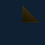

# Native DX12 texture-effect readbacks

Actual 64×64 GPU frames from the signed synthetic texture test. The imported image, editable paint layer and geometry are engineering calibration inputs. These frames verify the rendering path and recovery; they are not production assets or artistic-quality references. No image-generation provider or image enhancement was used.

| Accepted paint baseline | Grayscale | Invert |
|---|---|---|
|  |  |  |

| Sepia | Ordered final stack | Fresh-process HMC reopen |
|---|---|---|
|  |  |  |

The final stack is Sepia followed by Invert. The test checks non-commuting order, disabled/removed steps, exact undo/rebuild restoration, source/session/epoch currency, admitted native/MCP edits and retained original/derived resource bytes/metadata. Final and reopened PNG hashes must match exactly. [Machine-readable witness](attempt-2/gpu-witness.json) records actual source, input/output/package and frame digests. Asset production remains **HOLD**.
